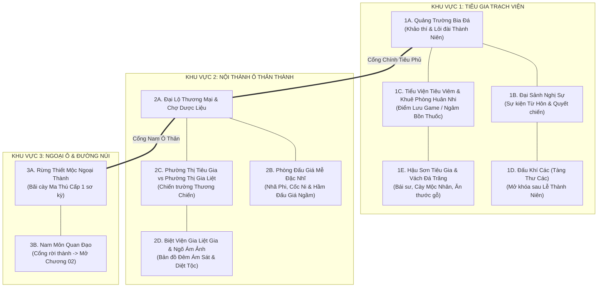

# CHƯƠNG 01: Ô THẢN THÀNH — MẠC KHI THIẾU NIÊN CÙNG!

> **Quyển 01**: Gia Mã Đế Quốc | **Cấp độ (Level)**: `1 – 14`
> **Lộ trình Cảnh giới**: `Đấu Chi Khí 3 Đoạn` → `Đấu Giả 4 Tinh` *(Mở khóa Nhất Phẩm Luyện Đan Sư)*
> **Bối cảnh trung tâm**: Ô Thản Thành — Thành trì thương mại đông nam Gia Mã Đế Quốc, nơi Tam đại gia tộc *(Tiêu Gia, Gia Liệt Gia, Áo Ba Gia)* cùng Phòng Đấu Giá Mễ Đặc Nhĩ kìm kẹp lẫn nhau.
> **Trọng tâm Mở khóa**: Nhẫn Đen *(Dược Lão)*, Công pháp tiến hóa **Phần Quyết** *(Hoàng Giai Đê Cấp)*, Đấu Kỹ **Hấp Chưởng + Xuy Hỏa Chưởng + Bát Cực Băng**, Vũ khí trấn phái **Huyền Trọng Xích**, Hệ thống **Luyện Đan Sơ Cấp** & **Cải Trang Hắc Bào**.

---

## 1. Sơ Đồ Bản Đồ Con (Zone Layout & Connectivity)

Bản đồ Chương 01 được thiết kế theo cấu trúc bán mở *(Semi-open Hub)* lấy **Đình Viện Tiêu Gia** và **Phố Trung Tâm Ô Thản Thành** làm hai trục kết nối chính. Người chơi có thể tự do di chuyển giữa các khu vực theo chu kỳ **Ngày / Đêm** *(ảnh hưởng trực tiếp tới sự kiện ẩn, lén lút và chợ đen)*.

### Chi Tiết Thiết Kế Từng Khu Vực (Top-down 2D Pixel Specs)

| Mã Zone | Tên Khu Vực | Kích Thước & Địa Hình Pixel 2D | NPC Trọng Tâm & Tương Tác | Hoạt Động / Cày Cuốc |
| :---: | :--- | :--- | :--- | :--- |
| **1A** | **Quảng Trường Bia Đá** | `64x64 tiles`, sân đá xanh cổ kính, giữa sân dựng **Trắc Nghiệm Ma Thạch Bi** cao 3 trượng phát hạt sáng vàng/đỏ. | Khảo Thí Quan, Tiêu Mị, Tiêu Ninh, Nhược Lâm Đạo Sư *(Hồi 1.5)*. | Đánh Cọc Gỗ tập combo, Lôi đài Tỷ thí Thành Niên Lễ. |
| **1B** | **Đại Sảnh Nghị Sự** | `40x32 tiles`, thảm đỏ sẫm, ghế Tộc trưởng chạm đầu sư tử và hai hàng ghế Trưởng lão. | Tiêu Chiến, Tam Đại Trưởng Lão, Đoàn sứ giả Vân Lam Tông *(Hồi 1.2)*. | Sự kiện Từ Hôn, Nhận nhiệm vụ gia tộc, Thủ thành Hồi 1.7. |
| **1C** | **Tiểu Viện Tiêu Viêm & Viện Huân Nhi** | `48x40 tiles`, nhà gỗ dưới bóng cây cổ thụ, sân sau nối sang hiên trúc đầy đom đóm đêm của Huân Nhi. | Tiêu Huân Nhi, Lăng Ảnh *(ẩn trên nóc nhà lúc Canh Ba)*. | **Điểm Lưu Game**, Ngâm **Bồn Gỗ Trúc Cơ**, Chuyển Ngày/Đêm. |
| **1D** | **Đấu Khí Các (Tàng Thư Các)** | `36x36 tiles`, lầu gỗ 2 tầng bảo vệ bởi màn chắn gợn sóng lam nhạt *(Thủy Màn Kết Giới)*. | Trưởng lão Thủ Các, Kệ ngọc giản Hoàng Giai. | Chọn công pháp gia tộc (*Lộng Viêm Quyết*), đọc sách Lore đại lục. |
| **1E** | **Hậu Sơn & Vách Đá Trăng** | `80x72 tiles`, đường dốc rừng trúc xuyên mây dẫn lên mỏm đá nhìn xuống toàn cảnh đèn lồng Ô Thản Thành. | Dược Lão *(Linh hồn)*, Tiêu Ngọc *(Hồi 1.4)*. | Thức tỉnh nhẫn đen, Đánh 6 Mộc Nhân, Mini-game Né Thước Gỗ, Luyện Đan ẩn. |
| **2A** | **Đại Lộ Thương Mại** | `96x48 tiles`, phố lát đá nhộn nhịp xe ngựa, sạp rèn vũ khí, tiệm tạp hóa Hắc Bào và quán trà tin đồn. | Thợ Rèn Trương, Chủ Tiệm Áo Choàng, Lính đánh thuê qua đường. | Mua bán trang bị sơ cấp, Nghe ngóng giá cả dược liệu trong thành. |
| **2B** | **Phòng Đấu Giá Mễ Đặc Nhĩ** | `56x56 tiles`, mái vòm pha lê dát vàng chia 3 phòng: Giám Định Thất, Phòng VIP Tử Kim và Hội Trường Bán Nguyệt. | **Nhã Phi**, **Cốc Ni Đại Sư**, Tiêu Ninh, Gia Liệt Áo. | Giám định linh dịch, Đấu Giá Hội công khai & Đấu Giá Ngầm Hắc Bào. |
| **2C** | **Khu Phường Thị Đối Đầu** | `72x52 tiles`, hai dãy phố thương mại của Tiêu Gia và Gia Liệt Gia nằm đối diện qua con kênh nhỏ. | Quản sự Phường Thị Tiêu Gia, Côn đồ Gia Liệt, Thương buôn. | Chiến trường **Thương Chiến Đan Dược**, Đánh dẹp côn đồ phá rối. |
| **2D** | **Biệt Viện Gia Liệt & Ngõ Ám Ảnh** | `68x68 tiles`, ban ngày khóa cổng; ban đêm mở lối mái ngói liên thông cùng vùng nón tầm nhìn lính canh cầm đuốc. | **Liễu Tịch**, **Gia Liệt Tất**, **Gia Liệt Áo**, Hộ viện Tinh anh. | Phó bản **Stealth Ám Sát** *(Đêm mưa)* & Chiến dịch Tổng tiến công diệt tộc. |
| **3A** | **Rừng Thiết Mộc Ngoại Thành** | `90x90 tiles`, rừng cây thân sắt rậm rạp có sương mù nhẹ và hang sói lửa ở góc tây nam. | Thợ săn bị thương, Đàn Xích Viêm Lang & Thiết Bì Dã Trư. | **Bãi cày chính Lv.2–9**: Săn Hỏa Ma Hạch Cấp 1, hái cỏ thuốc dại. |
| **3B** | **Nam Môn Quan Đạo** | `48x30 tiles`, cổng thành tường đá rêu phong hướng ra con đường đất đỏ dẫn về Ma Thú Sơn Mạch. | Lính gác cổng thành, Đoàn buôn lữ hành. | Điểm chuyển tiếp cốt truyện sang **Chương 02: Thanh Sơn Trấn**. |

---

## 2. Chuỗi Nhiệm Vụ Chính (Main Questline — 7 Phân Cảnh Nguyên Tác)

### Phân Cảnh 1.1: Bia Đá Khảo Thí & Hơi Ấm Giữa Lòng Tộc Lạnh (Level 1)
* **Diễn biến cốt truyện**:
  * Mở đầu bằng đoạn hồi tưởng tông màu Sepia: Tiêu Viêm 11 tuổi ngưng tụ Khí Toàn trở thành Đấu Giả trẻ nhất lịch sử trăm năm Tiêu Gia, rồi đột ngột rơi xuống vực thẳm suốt 3 năm mất sạch Đấu Khí.
  * Trở lại thực tại ở **Quảng Trường Bia Đá (1A)**: Người chơi điều khiển Tiêu Viêm *(Lv.1 — Đấu Chi Khí 3 Đoạn)* bước qua đám đông đệ tử đang xì xào chỉ trỏ để chạm tay vào Ma Thạch Bi. Năm chữ đỏ chói hiện lên: **`Đấu Chi Khí: Tam Đoạn — Cấp bậc: Đê Cấp!`**.
  * **Tiêu Mị** *(vừa đạt Thất Đoạn, nửa năm trước còn quấn quýt gọi "Tiêu Viêm biểu ca")* nay ngượng ngùng lùi lại, quay lưng bước về phía đám con cháu trưởng lão. **Tiêu Ninh** *(Bát Đoạn, cháu trai Đại Trưởng Lão)* khoanh tay cười khẩy chế giễu.
  * Giữa tiếng cười nhạo, thiếu nữ mặc thanh y như đóa sen trắng **Tiêu Huân Nhi** *(Cửu Đoạn Đỉnh Phong — tâm điểm ngưỡng mộ của toàn tộc)* rẽ đám đông bước tới đứng sát bên Tiêu Viêm, mỉm cười dịu dàng nắm lấy cổ tay huynh. Phụ thân **Tiêu Chiến** *(Đại Đấu Sư 5 Tinh)* bước ra quát dẹp đám đệ tử vô lễ, vỗ vai động viên con trai giữ vững khí phách.
  * **Sự kiện Đêm Khuya**: Khi Tiêu Viêm về **Tiểu Viện (1C)**, Huân Nhi gõ cửa ghé thăm. Đoạn đối thoại khắc họa kỷ niệm năm Tiêu Viêm 4–6 tuổi mỗi đêm đều vụng về dùng Đấu Chi Khí "ôn dưỡng kinh mạch" cho nàng suốt hai năm ròng không nghỉ — lý do khiến thiên kim tiểu thư thần bí một lòng gắn bó với huynh.
  * **Phục bút Cổ Tộc**: Lúc rời phòng Tiêu Viêm nhìn lên bầu trời đêm, đồng tử đen láy của Huân Nhi thoáng bùng lên hai cụm **Hỏa Diễm Màu Vàng Kim (Kim Đế Phần Thiên Viêm)** cực kỳ bá đạo kèm lời độc thoại ngầm cảnh cáo thế lực vô hình nếu dám làm tổn thương "Tiêu Viêm ca ca".
* **Mục tiêu Gameplay**:
  1. Làm quen di chuyển `WASD`, tương tác Ma Thạch Bi.
  2. Đấu tập hướng dẫn *(Tutorial Combat)* với Cọc Gỗ và né đòn khiêu khích của một đệ tử nhánh phụ bằng phím `Space` *(Dash I-frame)*.
  3. Đối thoại với Tiêu Chiến và Huân Nhi nhận túi tiền tiêu vặt `200 Kim Tệ`.

### Phân Cảnh 1.2: Đại Sảnh Từ Hôn — "Mạc Khi Thiếu Niên Cùng!" (Level 1–2)
* **Diễn biến cốt truyện**:
  * Chiều hôm sau, gia đinh hốt hoảng báo tin quý khách tới **Đại Sảnh Nghị Sự (1B)**. Ba vị Trưởng lão khúm núm tiếp đón đoàn người mặc bào trắng thêu mây kiếm ở cổ tay — biểu tượng của thế lực bá chủ Gia Mã Đế Quốc: **Vân Lam Tông**!
  * Dẫn đầu là Chấp sự **Cát Diệp** *(Đấu Linh 7 Tinh)*, đi kèm thiếu niên tuấn lãng ngạo mạn đeo kiếm bạc **Mộ Lan** và thiếu nữ tuyệt sắc khí chất lạnh lùng cao ngạo **Nạp Lan Yên Nhiên** *(cháu gái Nạp Lan Lão Gia Tử, đệ tử thân truyền của Tông chủ Vân Vận)*.
  * Cát Diệp giải phóng uy áp **Đấu Linh 7 Tinh** *(hiệu ứng rung màn hình, thanh `SPD` của toàn bộ NPC trong phòng bị khóa cứng)*, đặt bình ngọc chứa tứ phẩm đan dược **Tụ Khí Tán** *(do Đan Vương Cổ Hà luyện chế)* lên bàn để ép Tiêu Chiến **hủy bỏ hôn ước** năm xưa với Tiêu Viêm.
  * Ba vị Trưởng lão tham lam nhìn Tụ Khí Tán khuyên Tiêu Chiến nhận lời; Tiêu Chiến giận dữ bộc phát Đấu Khí *Cuồng Sư Nộ Cương* bóp nát chén ngọc định liều mạng bảo vệ tôn nghiêm cho con trai.
  * Tiêu Viêm bước thẳng lên giữa đại sảnh, đối diện ánh mắt khinh miệt của Mộ Lan và sự cao ngạo của Nạp Lan Yên Nhiên. Nén cơn giận run người, Tiêu Viêm rút đoản kiếm trên bàn **rạch đứt lòng bàn tay**, ấn dấu tay đẫm máu viết thẳng một tờ **Hưu Thư** *(Tiêu Gia chủ động hưu bỏ Nạp Lan Yên Nhiên chứ không nhận hủy hôn, càng không thèm liếc nhìn viên Tụ Khí Tán!)*.
  * Thiết lập **Ước Hẹn 3 Năm**: Ba năm sau, Tiêu Viêm sẽ tự chân bước lên đỉnh Vân Lam Sơn, rửa sạch nỗi nhục hôm nay trước mặt thiên hạ! *(Huân Nhi khẽ siết ngón tay định triệu hồi ám vệ xóa sổ Cát Diệp, nhưng thấy ngọn lửa kiêu hãnh trong mắt Tiêu Viêm đã cháy trở lại nên mỉm cười thu tay)*.
* **Mục tiêu Gameplay**:
  1. Mini-game **Kháng Uy Áp (Willpower QTE)**: Liên tục giữ nhịp phím tiến bước vượt qua trường lực Đấu Linh của Cát Diệp để đi từ cửa sảnh lên trước mặt Nạp Lan Yên Nhiên.
  2. Lựa chọn hội thoại định hình khí chất -> Mở khóa Buff vĩnh viễn đầu tiên: **Ấn Ký Tôn Nghiêm** *(+5% `ATK` và +10% Tốc độ tích nộ khi máu dưới 30%)*.

### Phân Cảnh 1.3: Đêm Hậu Sơn Thức Tỉnh Dược Lão & Bồn Gỗ Trúc Cơ (Level 2–6)
* **Diễn biến cốt truyện**:
  * Đêm khuya sau lễ từ hôn, Tiêu Viêm lên **Vách Đá Hậu Sơn (1E)** đấm vào vách đá đến bật máu tay. Máu thấm vào chiếc **Nhẫn Cổ Màu Đen (Cốt Viêm Giới)** đeo trước ngực — di vật mẫu thân để lại. Chiếc nhẫn rung bần bật, phun ra luồng khói trắng hóa thành lão giả tóc bạc khoác hắc bào hư ảo: **Dược Trần (Dược Lão)**!
  * Sự thật phơi bày: Suốt 3 năm qua, chính tàn hồn của Dược Lão trong nhẫn đã hút sạch Đấu Khí của Tiêu Viêm để tỉnh lại! Cơn thịnh nộ của Tiêu Viêm nhanh chóng chuyển thành sững sờ khi lão giả tiết lộ mình là bậc tông sư **Luyện Đan Sư** từng đứng trên đỉnh Đấu Khí Đại Lục, và 3 năm nén khí thực chất đã rèn đúc căn cơ kinh mạch của Tiêu Viêm rắn chắc gấp bội người thường.
  * **Khảo nghiệm Bái Sư**: Dược Lão kiểm tra thuộc tính của Tiêu Viêm — phát hiện linh hồn xuyên không khiến **Linh Hồn Lực (`SOUL`)** của Tiêu Viêm đạt mức *Phàm Cảnh Trung Kỳ* ngay từ đầu, lại mang thuộc tính **Hỏa kèm một tia Mộc** cực hiếm — thiên phú trời sinh của Luyện Đan Sư! Tiêu Viêm dập đầu 3 lạy chính thức bái Dược Lão làm sư phụ.
  * Sáng hôm sau, cầm khoản tiền `1.000 Kim Tệ` do Huân Nhi hào phóng cho mượn, Tiêu Viêm tới **Phòng Đấu Giá Mễ Đặc Nhĩ (2B)**. Lần đầu diện kiến yêu tinh quyến rũ **Nhã Phi** và Nhị phẩm Luyện Đan Sư **Cốc Ni Đại Sư**, thu mua đủ 3 tài liệu: **Tử Diệp Lan Thảo** *(100 năm)*, **Tẩy Cốt Hoa**, và **Hỏa Ma Hạch Cấp 1** *(thiếu 1 viên Hỏa Ma Hạch phải tự ra Rừng Thiết Mộc Ngoại Thành săn Xích Viêm Lang để kiếm đủ!)*.
  * Trở về hậu sơn, Dược Lão khống chế ngọn lửa trắng muốt lạnh thấu xương mà nóng chảy đá vàng — **Cốt Linh Lãnh Hỏa (#11 Dị Hỏa Bảng)** — dung luyện 3 dược liệu thành chất lỏng màu ngọc bích: **Trúc Cơ Linh Dịch**!
* **Mục tiêu Gameplay**:
  1. Mở khóa phím `T` *(tạm thời ở dạng Tư Vấn Linh Hồn & Quét Bảo Vật của Dược Lão)* và chỉ số `SOUL`.
  2. Ra **Rừng Thiết Mộc (3A)** tiêu diệt 5 *Xích Viêm Lang (Lv.2–3)* thu thập **Hỏa Ma Hạch Cấp 1**.
  3. Kích hoạt cơ chế **Ngâm Bồn Gỗ Đả Tọa** tại Tiểu Viện (1C) kết hợp cày quái/mộc nhân đẩy tu vi vọt từ **Đấu Chi Khí 3 Đoạn → 7 Đoạn (Lv.2 → Lv.6)** chỉ trong 2 tháng game-time!

### Phân Cảnh 1.4: Đấu Giá Hội Mễ Đặc Nhĩ & Cái Bẫy "Hấp Chưởng" (Level 6–7)
* **Diễn biến cốt truyện**:
  * Cần tiền mua thêm dược liệu và Đấu Kỹ phòng thân trước Lễ Thành Niên, Tiêu Viêm trích một lọ ngọc nhỏ Trúc Cơ Linh Dịch đã pha loãng đem tới Mễ Đặc Nhĩ nhờ Cốc Ni giám định. Dược lực tẩy tủy kinh người làm cả Cốc Ni lẫn Nhã Phi chấn động, lập tức đưa lên bàn bán đấu giá thu về **35.000 Kim Tệ** cùng tấm **Thẻ Quý Khách Tử Kim**!
  * Ngay tại phiên đấu giá, quyển trục Huyền Giai Đê Cấp Đấu Kỹ **Hấp Chưởng** và đan dược **Tăng Khí Tán** được đưa lên đài. **Tiêu Ninh** ngồi hàng ghế đầu điên cuồng hét giá hòng mua sức mạnh lấy lòng Huân Nhi.
  * Tiêu Viêm ngồi ghế khuất khéo léo nâng giá đấu trí: một mặt **đoạt gọn quyển "Hấp Chưởng"** ngay trước mũi Tiêu Ninh, mặt khác **kích giá viên "Tăng Khí Tán" vọt lên gấp ba giá trị thật** rồi buông tay đúng lúc! Hậu quả: Tiêu Ninh mất mặt cay cú phải cắn răng ký giấy **vay nặng lãi thiếu gia Gia Liệt Áo** của Gia Liệt Gia *(mở ngòi nổ cho âm mưu thôn tính phường thị Tiêu Gia sau này)*.
  * Trở về Hậu Sơn luyện Hấp Chưởng, Dược Lão chê Hấp Chưởng chỉ kéo đối thủ lại gần dễ ăn đòn hội đồng nên tiện tay truyền luôn kỳ kỹ Huyền Giai Đê Cấp **Xuy Hỏa Chưởng** *(bộc phát luồng gió nóng đẩy văng mục tiêu)* — tạo thành cặp bài trùng **Hấp – Xuy Liên Hoàn**!
  * **Sự kiện Giao chiến Hậu Sơn với Tiêu Ngọc**: Biểu tỷ chân dài **Tiêu Ngọc** *(từ **Học Viện Già Nam** về thăm nhà chuẩn bị đợt chiêu sinh)* đi ngang qua rừng trúc bắt gặp Tiêu Viêm, nhớ mối hận hồi 7 tuổi bị tên nhóc này lẻn vào động suối nhìn trộm lúc tắm nên rút roi xông vào đánh! Tiêu Viêm dùng *Hấp Chưởng* hút lệch đường roi khiến Tiêu Ngọc ngã nhào vào lòng mình đỏ mặt tía tai bỏ chạy — đồng thời lần đầu hé lộ thông tin về thánh địa tu luyện số một đại lục: **Học Viện Già Nam**.
* **Mục tiêu Gameplay**:
  1. Tham gia **Mini-game Đấu Giá Tâm Lý** *(xem Mục 4.2)*: Đọc thanh "Độ Cay Cú" của Tiêu Ninh để đẩy giá Tăng Khí Tán lên mốc `19.000 Kim Tệ` mà không bị ôm hàng, và chốt hạ Hấp Chưởng ở mốc `15.500 Kim Tệ`.
  2. Học và gán 2 kỹ năng chủ động đầu tiên vào phím `Q` (**Hấp Chưởng**) và `E` (**Xuy Hỏa Chưởng**).
  3. Đánh bại Mini-boss **Tiêu Ngọc (Lv.8 — Đấu Chi Khí 9 Đoạn)** trong 90 giây mà không làm nàng mất quá 80% máu.

### Phân Cảnh 1.5: Lễ Thành Niên Tiêu Gia — Bát Đoạn Chấn Động Toàn Trường! (Level 7–9)
* **Diễn biến cốt truyện**:
  * Ngày trọng đại tại **Quảng Trường Bia Đá (1A)**: Hàng trăm tộc nhân cùng khách mời Ô Thản Thành vây kín đài cao. Khi được gọi tên, Tiêu Viêm bước lên đặt tay vào Ma Thạch Bi — cột sáng chói lòa vọt thẳng lên đỉnh bia: **`Đấu Chi Khí: Bát Đoạn!`** *(thực tế đã chạm ngưỡng Cửu Đoạn Đỉnh Phong)*. Cả quảng trường chết lặng như tờ! Một năm tăng Ngũ Đoạn — thiên tài năm xưa đã thực sự sống lại!
  * **Tiêu Mị** sững sờ hối hận, cắn môi bước lên đài xin tỷ thí với hy vọng nối lại tình cảm cũ. Tiêu Viêm chỉ dùng một bước nghiêng người cùng kình phong nhẹ của *Xuy Hỏa Chưởng* đẩy nàng lùi khỏi vạch vôi mà không hề chạm vào vạt áo, ánh mắt bình thản xa cách khiến thiếu nữ bật khóc hối tiếc.
  * Không chấp nhận sự thật, **Tiêu Ninh** mắt vằn tia máu nhảy lên lôi đài! Trước đó gã đã nuốt viên **Tăng Khí Tán** cưỡng ép đột phá lên **Nhất Tinh Đấu Giả**, toàn thân rực ánh vàng nhạt của *Thiết Sơn Quyền* tuyên bố thách đấu sinh tử!
  * Giữa tiếng la ó lo lắng của tộc nhân, Tiêu Viêm đứng vững như tùng bách, thi triển hoàn hảo combo **Hấp Chưởng** kéo lệch cánh tay bọc Đấu Khí của Tiêu Ninh làm gã mất đà chúi đầu tới trước, rồi áp sát chưởng tâm vào ngực gã nổ tung **Xuy Hỏa Chưởng** ở cự ly không tấc! Tiêu Ninh phun máu tươi bay vọt khỏi lôi đài đập gãy cột cờ! Đại Trưởng Lão tím mặt cứng họng, còn Tiêu Chiến vỗ đùi cười vang dậy cả Tiêu Phủ!
  * Cuối buổi lễ, đạo sư xinh đẹp **Nhược Lâm** *(Đại Đấu Sư của Học Viện Già Nam)* xuất hiện cùng Tiêu Ngọc. Cảm phục thiên phú kinh người của Tiêu Viêm và Huân Nhi, Nhược Lâm đặc cách tuyển thẳng cả hai. Tuy nhiên vì **Ước Hẹn 3 Năm**, Tiêu Viêm dứt khoát xin Nhược Lâm **2 năm nghỉ phép khổ tu bên ngoài** trước khi nhập học *(mở khóa tín vật Già Nam Ngọc Bài cho Quyển 2)*.
* **Mục tiêu Gameplay**:
  1. Vượt chuỗi 2 trận lôi đài liên tiếp: **Tiêu Mị (Lv.7)** → **Boss Tiêu Ninh — Dược Lực Bạo Phát (Lv.10 — Nhất Tinh Đấu Giả)**.
  2. Nhận quyền truy cập **Đấu Khí Các (1D)** và phần thưởng danh hiệu **Thiếu Tộc Trưởng Tiềm Năng** *(+150 Max `HP`)*.

### Phân Cảnh 1.6: Tàng Thư Các Chọn "Phần Quyết" & Một Tháng Ăn Thước Gỗ (Level 9–11)
* **Diễn biến cốt truyện**:
  * Bước vào **Đấu Khí Các (1D)** được bảo vệ bởi kết giới năng lượng, Tiêu Viêm giả vờ chọn công pháp trấn tộc hệ Hỏa **Lộng Viêm Quyết** *(Hoàng Giai Cao Cấp)* để che mắt các trưởng lão. Huân Nhi lén dúi tặng huynh một quyển công pháp Huyền Giai Đê Cấp quý giá, Tiêu Viêm mỉm cười xoa đầu nàng nhưng trả lại vì đã có con đường riêng.
  * Quay về sơn động bí mật **Hậu Sơn (1E)**: Tiêu Viêm nuốt giọt tinh túy cuối cùng của Trúc Cơ Linh Dịch, điều khiển 9 luồng khí xoáy chặt trong đan điền ngưng tụ thành **Đấu Khí Toàn** -> Đột phá đại cảnh giới **Nhất Tinh Đấu Giả (Lv.10)**, chính thức mở khóa giao diện **Nội Thị Kinh Mạch**!
  * Khoảnh khắc chọn đạo: Dược Lão lấy ra quyển trục màu đỏ sẫm cổ xưa mang tên **Phần Quyết**! Cấp bậc khởi điểm chỉ là **Hoàng Giai Đê Cấp** *(rác rưởi nhất đại lục)*, nhưng sở hữu đặc tính nghịch thiên duy nhất thế gian: **Có thể thôn phệ 23 loại Dị Hỏa để tiến hóa vô hạn vượt qua cả Thiên Giai!** Biết rõ chín phần chết một phần sống, Tiêu Viêm không mảy may do dự nhỏ máu nhận chủ Phần Quyết!
  * Ngay sau đó, để bù đắp sát thương khi Phần Quyết còn yếu, Dược Lão truyền thụ cận chiến Đấu Kỹ Huyền Giai Cao Cấp **Bát Cực Băng** *(ám kình 8 trọng chồng lên nhau, luyện đại thành uy lực sánh ngang Địa Giai Đê Cấp!)*. Để ép cơ bắp Tiêu Viêm nhớ từng thớ lực, suốt **30 ngày ròng rã**, Dược Lão ngưng tụ linh hồn cầm **cây thước gỗ đen đặc** quất Tiêu Viêm bầm dập từ sáng tới khuya trên đỉnh núi, đêm về lại thả vào bồn thuốc ngâm cho liền xương!
* **Mục tiêu Gameplay**:
  1. Đột phá **Đấu Giả (Lv.10)**: Thay thanh thể lực thường bằng thanh **`QI` (Đấu Khí)** màu vàng nhạt của Phần Quyết sơ kỳ; mở khóa ô kỹ năng `R` (**Bát Cực Băng**).
  2. Vượt **Mini-game Khổ Tu: Né Thước Gỗ Dược Lão** *(3 cấp độ khó — xem Mục 4.3)* để tích điểm Thông Thạo Bát Cực Băng mở khóa 4 trọng ám kình đầu tiên *(Xuyên Giáp 25%)*. Cày cấp lên **Lv.11–12 (Đấu Giả 2–3 Tinh)**.

### Phân Cảnh 1.7: Thương Chiến Phường Thị, Hắc Bào Tiên Sinh & Huyền Trọng Xích (Level 12–14)
* **Diễn biến cốt truyện**:
  * Sóng gió ập tới Tiêu Gia: Tộc trưởng **Gia Liệt Tất** và thiếu gia **Gia Liệt Áo** của Gia Liệt Gia bỏ vốn lớn thuê được **Nhất phẩm Luyện Đan Sư Liễu Tịch** *(đệ tử của Cổ Đặc Đại Sư)*, luyện chế hàng loạt **Hồi Xuân Tán** cướp sạch dòng khách lính đánh thuê khỏi **Phường Thị Tiêu Gia (2C)**. Quá quắt hơn, tên háo sắc Liễu Tịch khi ngang qua phố còn dám buông lời dâm ô đòi Gia Liệt Áo bắt **Tiêu Huân Nhi** tới hầu hạ hắn! Trong mắt Tiêu Viêm lần đầu bùng lên sát cơ lạnh thấu xương!
  * **Phản công Thương Chiến**: Tiêu Viêm mua chiếc **Hắc Bào trùm đầu** che kín dung mạo, nhờ Dược Lão truyền âm giả giọng ông lão khàn đặc mang danh hiệu **"Hắc Bào Tiên Sinh"**, bí mật tới Mễ Đặc Nhĩ gặp **Nhã Phi**. Nhờ Dược Lão luyện ra 500 lọ **Ngưng Huyết Tán** *(tốc độ cầm máu gấp đôi Hồi Xuân Tán, giá chỉ bằng một nửa)* kết hợp Nhã Phi tung tiền thu gom sạch kho dược liệu toàn thành -> Chỉ trong 7 ngày, phường thị Gia Liệt Gia vắng tanh vỡ nợ, Liễu Tịch hết sạch cỏ thuốc không luyện nổi một viên đan!
  * **Đêm Ám Sát & Chi Tiết Ẩn Đấu Hoàng Lăng Ảnh**: Đêm mưa gió, Liễu Tịch cay cú chuẩn bị sáng mai rời thành cầu viện sư phụ. Để diệt cỏ tận gốc, Tiêu Viêm khoác Hắc Bào lẻn vào **Biệt Viện Gia Liệt Gia (2D)** lúc nửa đêm. Giữa căn phòng hoa lệ, gã Luyện Đan Sư kiêu ngạo vừa định hô hoán đã bị Tiêu Viêm lướt tới tung một quyền **Bát Cực Băng** nổ nát lồng ngực chết không kịp nhắm mắt!
    * *Hoạt cảnh Bí mật cho người tinh mắt*: Ngay sau khi Tiêu Viêm nhảy qua tường rút lui thành công, camera lia chậm lại mái ngói tối đen: Một đạo bóng đen hư vô bước ra (**Lăng Ảnh** — Đấu Hoàng Cửu Tinh hộ vệ bóng tối của Cổ Tộc theo bảo vệ Huân Nhi), nhìn thi thể Liễu Tịch khẽ gật đầu tán thưởng sự tàn nhẫn dứt khoát của thiếu gia Tiêu Gia, rồi phẩy tay phóng **Ám Đấu Khí** xóa sạch hoàn toàn dấu vân tay và tàn dư hỏa khí tại hiện trường để sư phụ Liễu Tịch vĩnh viễn không lần ra manh mối!
  * **Đại Chiến Diệt Tộc**: Gia Liệt Gia chó cùng rứt giậu! **Gia Liệt Tất & Gia Liệt Áo** dốc cạn gia sản liên thủ với tộc trưởng **Áo Ba Phách** của **Áo Ba Gia**, dẫn hàng trăm hảo thủ bao vây **Đại Sảnh & Phường Thị Tiêu Gia** ép Tiêu Chiến giao đất nộp người! Giữa lúc Tiêu Chiến bị hai Đại Đấu Sư vây đánh rách áo đổ máu, một đạo bóng đen từ mái nhà giáng xuống như thiên thần: **Hắc Bào Tiên Sinh (Tiêu Viêm được Dược Lão phụ thể `T`)**! Bàn tay bùng lên ngọn lửa trắng **Cốt Linh Lãnh Hỏa** mang theo uy áp **Đấu Linh** khủng khiếp, chỉ một chiêu bóp nghẹt cổ Gia Liệt Tất, đánh văng Áo Ba Phách hộc máu quỳ mọp cầu xin cắt đất bồi thường rút quân!
  * Sau khi tự tay dùng Hỏa Đấu Khí luyện thành công viên **Tụ Khí Tán** đầu đời *(nhận huy hiệu **Nhất Phẩm Luyện Đan Sư**, thăng lên **Đấu Giả 4 Tinh — Lv.14**)*, Tiêu Viêm cùng Tiêu Chiến dẫn thiết kỵ Tiêu Gia tổng tiến công ban đêm **xóa sổ hoàn toàn Gia Liệt Gia**, đưa Tiêu Gia độc bá Ô Thản Thành!
  * **Nhận Huyền Trọng Xích & Từ Biệt Dưới Trăng**: Trước lúc lên đường khổ tu, Dược Lão lấy từ nhẫn đen ra thanh cự xích khổng lồ không lưỡi đen kịt nặng ngàn cân đúc từ Diễm Vẫn Huyền Thiết — **Huyền Trọng Xích**! Đêm trăng tròn trên **Vách Đá Hậu Sơn (1E)**, Tiêu Viêm đeo trọng xích sau lưng, nói lời từ biệt dịu dàng với **Tiêu Huân Nhi** đang đứng dưới mưa hoa đào đêm. Thiếu niên xoay người bước qua **Nam Môn Quan Đạo (3B)** tiến về dãy núi sương mù phương xa — khép lại Chương 01!
* **Mục tiêu Gameplay**:
  1. Chế tạo 10 mẻ **Ngưng Huyết Tán** qua giao diện Lò Đan Sơ Cấp để kéo thanh Thị Phần Phường Thị Tiêu Gia lên `100%`.
  2. Vượt bản đồ Stealth ban đêm **Ngõ Ám Ảnh (2D)** và hạ sát Mini-boss **Liễu Tịch (Lv.12)**.
  3. Đánh trận Thủ Thành & Tổng Công Kích **Boss Kép Gia Liệt Tất & Gia Liệt Áo + Áo Ba Phách** *(xem Mục 7)*.
  4. Mở khóa vĩnh viễn vũ khí chính **Huyền Trọng Xích** *(cơ chế chuyển đổi Trọng Áp / Giải Phong bằng `RMB` hoặc `C`)*.

---

## 3. Nhiệm Vụ Phụ & Kỳ Ngộ Ẩn (Side Quests, Secrets & Easter Eggs)

1. **[Kỳ Ngộ Ẩn] Bóng Đêm Trên Mái Hiên Huân Nhi**:
   * **Điều kiện kích hoạt**: Sau Phân cảnh 1.2 *(Từ hôn)*, vào đúng khung giờ **Canh Ba (23:00 – 01:00 trong game)**, người chơi nhảy lên nóc cây cổ thụ phía sau khuê phòng Huân Nhi ở `Zone 1C` khi chỉ số `SOUL` đã mở khóa *(sau khi thức tỉnh Dược Lão)*.
   * **Diễn biến**: Dược Lão khẽ truyền âm kinh hãi bảo Tiêu Viêm lập tức nín thở đứng im! Trên nóc nhà đối diện thoáng hiện đôi mắt sắc lạnh ẩn trong bóng đen hòa làm một với màn đêm (**Lăng Ảnh**). Nếu người chơi không bấm bất kỳ nút tấn công nào trong 5 giây, bóng đen sẽ biến mất và để lại một chiếc **Lông Vũ Hắc Ảnh**.
   * **Phần thưởng**: Phụ kiện hiếm **Hắc Ảnh Phù** *(+8% Tốc độ di chuyển ban đêm, giảm 20% tầm phát hiện của kẻ địch khi mặc Hắc Bào)* + Mở khóa Mục Từ Điển Ẩn: *"Lai lịch thần bí của Huân Nhi"*.
2. **[Nhiệm Vụ Phụ] Nỗi Khổ Của Cốc Ni Đại Sư**:
   * **Người giao**: Cốc Ni Đại Sư tại Sảnh Giám Định Mễ Đặc Nhĩ (`Zone 2B`).
   * **Nội dung**: Cốc Ni bị kẹt ở bình cảnh Nhị phẩm suốt 10 năm do sai tỷ lệ khống hỏa khi luyện *Hồi Khí Đan*. Với sự chỉ điểm ngầm của Dược Lão, người chơi đóng vai Hắc Bào Tiên Sinh viết lại 3 dòng sửa lỗi trên mảnh giấy ném cho lão.
   * **Phần thưởng**: **Đan Phương: Hồi Khí Đan (Nhất Phẩm Đỉnh Phong)**, giảm giá `15%` vĩnh viễn mọi dược liệu mua tại hệ thống Mễ Đặc Nhĩ trên toàn đế quốc.
3. **[Nhiệm Vụ Phụ] Hổ Phụ Sinh Hổ Tử — Tâm Sự Của Tiêu Chiến**:
   * **Người giao**: Tộc trưởng Tiêu Chiến tại Thư Phòng (`Zone 1B`) trước đêm tổng tiến công Gia Liệt Gia.
   * **Nội dung**: Giúp phụ thân tìm lại **Chiếc Trâm Ngọc Vỡ** của mẫu thân Tiêu Viêm bị thất lạc dưới hồ sen sau nhà và đấu giao hữu 10 chiêu chịu đòn từ *Cuồng Sư Nộ Cương* của ông để chứng minh con trai đã đủ lông đủ cánh đi xa.
   * **Phần thưởng**: `1.500 Kim Tệ`, **Hộ Uyển Cuồng Sư** *(+25 `DEF`, +5% Sát thương Trọng Xích)* và đoạn hội thoại cảm động làm tiền đề cho nỗi đau Tiêu Chiến mất tích ở Chương 04.
4. **[Easter Egg] Kho Báu Nhỏ Tuổi Thơ Dưới Gốc Trúc**:
   * **Vị trí**: Dùng *Xuy Hỏa Chưởng (`E`)* thổi bay đống lá khô góc đông bắc **Hậu Sơn (1E)** sẽ lộ ra hộp sắt rỉ sét do Tiêu Viêm và Huân Nhi chôn từ năm 8 tuổi, chứa bức tranh vẽ nguệch ngoạc của Huân Nhi cùng 1 viên **Tẩy Tủy Quả Khô** *(+5 điểm `QI` vĩnh viễn)*.

---

## 4. Cơ Chế Gameplay Đặc Sắc Của Chương 01

### 4.1. Cơ Chế Ngâm Bồn Gỗ Trúc Cơ Linh Dịch (Meditation Bath Minigame)
* **Tương tác**: Đặt dược dịch vào **Bồn Gỗ (Zone 1C)** để bắt đầu chu kỳ tu luyện 60 giây.
* **Cách chơi**: Trên màn hình hiện sơ đồ Pixel **Đan Điền & Bát Mạch**. Các hạt năng lượng xanh bích lục trôi theo dòng xoáy hướng vào tâm; người chơi dùng `A / D` hoặc con lăn chuột điều chỉnh nhịp thở để dẫn luồng linh dịch đi đúng qua các huyệt đạo đang phát sáng vàng.
* **Thưởng**: Đạt hạng `Hoàn Mỹ (Perfect Sync > 90%)` sẽ nhân đôi lượng EXP Đấu Khí nhận được từ bồn thuốc và cộng thêm **+2 `DEF` gốc** nhờ hiệu ứng Tẩy Cốt!

### 4.2. Cơ Chế Đấu Giá Hội & Đấu Giá Ngầm (Auction Mind-Game)
* **Giao diện**: Màn hình chia đôi — bên trái là Nhã Phi gõ búa trên đài với đồng hồ đếm ngược `5s` mỗi nhịp hô giá; bên phải là chân dung Pixel của các đối thủ cạnh tranh *(Tiêu Ninh, Gia Liệt Áo, Thương nhân ẩn danh)* kèm biểu cảm đổ mồ hôi / gân xanh nổi trên trán.
* **Chiến thuật**:
  * `Tăng Nhỏ (+500 Vàng)`: Thăm dò túi tiền đối phương.
  * `Đè Giá Áp Đảo (+3.000 Vàng)`: Gây hiệu ứng *Hoảng Sợ*, ép các NPC nhát gan bỏ cuộc sớm.
  * `Kích Giá Gài Bẫy (Bluff)`: Đẩy thanh *Phẫn Nộ* của kẻ thù (như Tiêu Ninh) lên trên `85%` nhưng dưới `100%` rồi bấm `Nhường Lượt` — kẻ thù sẽ ôm món hàng với giá cắt cổ và rơi vào trạng thái *Nợ Nần / Tâm Ma* *(giảm 15% `DEF` khi gặp lại trên lôi đài!)*.

### 4.3. Khổ Tu Né Thước Gỗ Dược Lão (30-Day Sparring Survival)
* **Thiết kế**: Sân tròn đường kính 16 tiles trên đỉnh **Hậu Sơn (1E)**. Trong lúc học *Bát Cực Băng*, người chơi bị khóa thanh `QI` về `0` *(chỉ được dùng nhục thân thuần túy)*.
* **Luật chơi**: Dược Lão lướt cực nhanh tung liên hoàn các đòn quất thước gỗ tạo vệt đỏ trên mặt đất *(Quét ngang 180°, Đập dọc chẻ đôi, Xoáy tròn 8 hướng)*.
  * Lướt né `Space` sát sạt lưỡi thước trong khung `0.15s` *(Perfect Dodge)* sẽ kích hoạt làm chậm thời gian `0.5s`, cho phép người chơi áp sát đấm trả 1 quyền **Bát Cực Băng** vào hư ảnh thước gỗ để tích `1 tầng Ám Kình`.
  * Bị thước quất trúng sẽ mất máu nhưng tăng chỉ số **Độ Dẻo Dai Thể Phách**; trụ đủ 60 giây hoặc tích đủ 8 lần phản đòn chuẩn xác sẽ hoàn thành khóa huấn luyện với phần thưởng mở khóa hiệu ứng **Nội Chấn Xuyên Giáp** cho kỹ năng `R`!

### 4.4. Cơ Chế Cải Trang "Hắc Bào Tiên Sinh" & Thương Chiến Phường Thị
* **Trạng thái Hắc Bào (Disguise Mode)**:
  * Khi trang bị **Áo Choàng Hắc Bào** trong hành trang, chân dung nhân vật đổi sang bóng đen trùm mũ kín mặt, giọng thoại có hiệu ứng trầm khàn của Dược Lão truyền âm.
  * *Hiệu quả*: Các NPC phe địch hoặc người quen *(như Nhã Phi, Cốc Ni, tuần tra Gia Liệt Gia)* không nhận ra thân phận thiếu gia Tiêu Gia, mở khóa bảng giá giao dịch **Khách Quý Luyện Đan Sư** tại Mễ Đặc Nhĩ. Lưu ý: Nếu cởi hoặc mặc Hắc Bào trong vùng tầm nhìn của bất kỳ NPC nào, thanh **Lộ Thân Phận** sẽ đầy ngay lập tức!
* **Bảng Điều Khiển Thương Chiến Phường Thị (Market Warfare UI)**:
  * Xuất hiện ở Phân cảnh 1.7 với thanh kéo co thị phần `0% ◄───[50%]───► 100%` giữa **Hồi Xuân Tán (Gia Liệt Gia)** và **Ngưng Huyết Tán (Tiêu Gia + Mễ Đặc Nhĩ)**.
  * *Vòng lặp Gameplay*:
    1. Dùng **Lò Đan Sơ Cấp** canh thanh nhiệt độ ở vùng xanh lá để luyện hàng loạt **Ngưng Huyết Tán** *(tỉ lệ 1 Chỉ Huyết Thảo + 1 Hoạt Huyết Quả = 3 lọ)*.
    2. Giao hàng cho **Nhã Phi** tại Phòng VIP Mễ Đặc Nhĩ để nhận hoa hồng Kim Tệ và kích hoạt sự kiện **"Đầu Cơ Dược Thảo"** *(cắt nguồn cung nguyên liệu của Liễu Tịch)*.
    3. Bảo vệ xe hàng Ngưng Huyết Tán đi từ `Zone 2B` sang `Zone 2C` trước 2 đợt tập kích của *Ác Bá Phường Thị Gia Liệt*. Khi thị phần chạm mốc `100%`, kinh tế Gia Liệt Gia chính thức sụp đổ, mở khóa nhiệm vụ Đêm Ám Sát!

---

## 5. Trích Dẫn Thoại Kinh Điển (Iconic Cutscene Scripts)

> **[Phân Cảnh 1.1 — Tiểu Viện Đêm Khuya | BGM: *Thanh Liên Dạ Vũ* (Êm dịu, phảng phất huyền bí)]**
>
> **Tiêu Huân Nhi** *(Portrait: Mỉm cười tinh nghịch bên hiên cửa gỗ)*: "Tiêu Viêm biểu ca còn nhớ năm bốn tuổi tới sáu tuổi, đêm nào huynh cũng lén chui vào phòng Huân Nhi nói là giúp muội ôn dưỡng kinh mạch không? Lúc đó Đấu Chi Khí của huynh yếu xíu, trán đẫm mồ hôi mà suốt hai năm trời mưa gió chưa từng bỏ lỡ một đêm..."
>
> **Tiêu Huân Nhi** *(Quay lưng bước ra sân trăng, đôi mắt thoáng lóe tia lửa vàng kim uy nghiêm tuyệt đối — Độc thoại nội tâm)*: *"Tiêu Viêm ca ca, năm xưa huynh thật lòng đối đãi với Huân Nhi khi huynh rực rỡ nhất. Hôm nay dù cả thế gian quay lưng cười nhạo huynh là phế vật, Huân Nhi vẫn tin huynh sẽ một lần nữa chạm tới đỉnh cao..."*

> **[Phân Cảnh 1.2 — Đại Sảnh Tiêu Gia | BGM: *Thiếu Niên Huyết Lệ* (Căng thẳng, tiếng đàn tranh dồn dập)]**
>
> **Nạp Lan Yên Nhiên** *(Portrait: Lạnh lùng, ánh mắt nhìn xuống từ trên cao)*: "Tiêu Viêm, ta biết hôm nay làm vậy khiến ngươi khó xử. Nhưng giữa chúng ta vốn đã là người của hai thế giới khác biệt — ta là thiếu tông chủ tương lai của Vân Lam Tông, còn ngươi... Cầm lấy viên Tụ Khí Tán này đi, coi như lời tạ lỗi của Yên Nhiên."
>
> **Tiêu Viêm** *(Portrait: Máu nhỏ giọt từ bàn tay nắm chặt đoản kiếm, khóe môi nhếch nụ cười gằn rực lửa)*: "Nạp Lan tiểu thư, ngươi nhầm rồi! Tờ giấy này không phải giấy hủy hôn do ngươi ban bố... mà là **Hưu Thư** của Tiêu Gia ta đuổi ngươi ra khỏi cửa! Từ giây phút này, ngươi và Tiêu Viêm ta ân đoạn nghĩa tuyệt!"
>
> **Tiêu Viêm** *(Quay lưng ấn bàn tay đẫm máu lên mặt bàn gỗ, gằn từng chữ vang dội đại sảnh)*: **"Tam thập niên hà đông, tam thập niên hà tây, mạc khi thiếu niên cùng! Ba năm sau, Tiêu Viêm ta nhất định tự mình bước lên Vân Lam Sơn, đòi lại gấp bội nỗi nhục ngày hôm nay!"**

> **[Phân Cảnh 1.3 — Vách Đá Hậu Sơn Đêm Trăng | BGM: *Tàn Hồn Hắc Giới* (Huyền bí, sâu lắng)]**
>
> **Dược Lão** *(Portrait: Linh hồn lơ lửng cười tà mị, vuốt chòm râu bạc)*: "Hắc hắc, tiểu oa nhi tính khí cũng cứng đầu gớm! Ba năm Đấu Khí của ngươi đúng là đều chui vào bụng lão già này cả đấy... Nhưng ngươi thử nghĩ xem, trên mảnh Đấu Khí Đại Lục cá lớn nuốt cá bé này, thứ nghề nghiệp nào cao quý nhất, khiến cả Đấu Hoàng cũng phải cúi đầu cầu cạnh?"
>
> **Dược Lão** *(Ánh mắt bỗng sắc bén như sao băng, ngọn lửa trắng Cốt Linh Lãnh Hỏa bùng lên trên đầu ngón tay)*: **"Tiểu gia hỏa... ngươi có muốn trở thành một Luyện Đan Sư không?"**

> **[Phân Cảnh 1.5 — Lễ Thành Niên Tiêu Gia | BGM: *Long Đằng Thiếu Niên* (Hào hùng, trống trận dồn dập)]**
>
> **Tiêu Mị** *(Portrait: Cắn môi run rẩy trên lôi đài sau khi bại trong 1 chiêu)*: "Tiêu Viêm biểu ca... muội biết nửa năm qua muội đã sai rồi. Chúng ta... có thể quay lại như trước kia được không?"
>
> **Tiêu Viêm** *(Portrait: Ánh mắt tĩnh lặng không chút gợn sóng, lướt ngang qua vai nàng)*: "Tiêu Mị biểu muội, trận đấu kết thúc rồi. Tránh đường đi, trên đài vẫn còn kẻ đang đợi ta."

> **[Phân Cảnh 1.6 — Sơn Động Hậu Sơn | BGM: *Phần Thiên Chi Thủy* (Trầm hùng, bi tráng)]**
>
> **Dược Lão** *(Portrait: Nghiêm nghị hiếm thấy, nâng quyển trục đỏ sẫm lơ lửng trước mặt)*: "Quyển công pháp này tên là **Phần Quyết**. Đừng thấy nó hiện tại chỉ là Hoàng Giai Đê Cấp mà khinh thường — nó có thể nuốt chửng Dị Hỏa hủy thiên diệt địa để tiến hóa không có điểm dừng! Nhưng chỉ một bước sảy chân, ngươi sẽ bị vạn hỏa đốt thành tro bụi. Nghĩ cho kỹ... có dám luyện hay không?!"
>
> **Tiêu Viêm** *(Không chớp mắt vươn tay chộp lấy quyển trục)*: "Luyện! Muốn ba năm sau đạp lên Vân Lam Tông, con đường bình thường vốn dĩ chẳng bao giờ đủ!"

> **[Phân Cảnh 1.7 — Hiện Trường Ám Sát Liễu Tịch (Cutscene Ẩn) | BGM: *Ám Ảnh Tùy Hành* (Tĩnh mịch)]**
>
> **Lăng Ảnh** *(Portrait: Bóng đen Đấu Hoàng bước ra từ góc tối sau khi Tiêu Viêm vừa nhảy qua tường, cúi nhìn vết chưởng nát tim trên ngực Liễu Tịch)*: "Ra tay gọn gàng, sát phạt dứt khoát không để lại hậu họa... Ánh mắt chọn người của tiểu thư quả nhiên không tệ chút nào. Thôi được, lão nô giúp tiểu tử nhà ngươi quét sạch cái đuôi này vậy." *(Vung tay phóng Ám Đấu Khí xóa sạch mọi tàn dư hỏa kình tại hiện trường).*

> **[Phân Cảnh 1.7 — Tiêu Biệt Dưới Trăng | BGM: *Nguyệt Hạ Giai Nhân* (Tiếng tiêu trúc dịu êm)]**
>
> **Tiêu Huân Nhi** *(Portrait: Dịu dàng đượm buồn dưới ánh trăng, ngón tay khẽ chỉnh lại cổ áo cho Tiêu Viêm đang vác Huyền Trọng Xích)*: "Tiêu Viêm ca ca, thế giới bên ngoài rộng lớn hiểm ác lắm... Huân Nhi sẽ tới Học Viện Già Nam đợi huynh. Dù ba năm sau trên đỉnh Vân Lam Sơn đối diện với huynh là cả thiên hạ, phía sau lưng huynh mãi mãi vẫn có Huân Nhi đứng đợi."

---

## 6. Bảng Quái Vật, Tinh Anh & Vật Phẩm Rớt (Bestiary & Loot Table)

| Tên Kẻ Địch / Ma Thú | Cảnh Giới & Level | Khu Vực Xuất Hiện | Hành Vi AI (Top-down 2D Pattern) | Vật Phẩm Rớt & Tỷ Lệ (Drop Rate) |
| :--- | :---: | :--- | :--- | :--- |
| **Đệ Tử Nhánh Phụ Tiêu Gia** | Đấu Chi Khí 3–5 Đoạn *(Lv.1–4)* | Quảng Trường `1A` | Lao thẳng đấm 2 nhịp cơ bản, khựng `1.0s` sau khi hụt đòn. | Băng Gạc Thô *(40%)*, Đồng Xu *(100%)* |
| **Xích Viêm Lang (Ma Thú Cấp 1)** | Tương đương 4–6 Đoạn *(Lv.3–6)* | Rừng Thiết Mộc `3A` | Đi theo bầy 3 con; gầm đỏ người `0.6s` rồi vồ thẳng 5 tiles gây bỏng nhẹ. | Da Sói Đỏ *(65%)*, **Hỏa Ma Hạch Cấp 1** *(18%)* |
| **Thiết Bì Dã Trư** | Tương đương 6–8 Đoạn *(Lv.5–8)* | Rừng Thiết Mộc Sâu `3A` | Giáp trước mặt giảm 50% sát thương; húc thẳng vào tường sẽ bị *Choáng 2s*. | Nanh Heo Rừng *(50%)*, Thịt Tươi *(80%)*, Tẩy Cốt Thảo *(12%)* |
| **Thanh Ảnh Miêu (Tinh Anh Rừng)** | Tương đương 9 Đoạn *(Lv.9)* | Tán Cây Cổ Thụ `3A` | Ẩn nấp trong bụi cây, nhảy xổ cào 3 vệt gây *Chảy Máu*; tốc độ chạy rất cao. | Vuốt Mèo Xanh *(50%)*, **Mộc Ma Hạch Cấp 1** *(25%)*, Giày Da Nhẹ *(10%)* |
| **Ác Bá Phường Thị Gia Liệt** | Đấu Chi Khí 8–9 Đoạn *(Lv.7–9)* | Phường Thị `2C`, Ngõ `2D` | Cầm đao chém vòng cung 120°; ném phi tiêu tẩm tê liệt tầm trung. | Kim Tệ `30–60` *(100%)*, Hồi Xuân Tán Kém Phẩm *(25%)* |
| **Hộ Viện Tinh Anh Gia Liệt Gia** | Đấu Giả 1–2 Tinh *(Lv.10–11)* | Biệt Viện Gia Liệt `2D` | Bọc Phong Đấu Khí ở đao chém lướt 2 nhát chữ X; biết giơ đao đỡ đòn chính diện. | Tinh Thiết Đoản Đao *(15%)*, Tụ Khí Thảo *(20%)* |
| **Thiết Vệ Áo Ba Gia** | Đấu Giả 2–3 Tinh *(Lv.11–13)* | Đại Sảnh `1B` *(Hồi 1.7)* | Cầm khiên sắt lớn chặn đạn/chưởng phía trước; cần dùng *Bát Cực Băng* phá khiên. | Mảnh Giáp Sắt *(45%)*, Ngưng Huyết Tán *(30%)* |
| **[Mini-Boss] Tiêu Ngọc** | Đấu Chi Khí 9 Đoạn *(Lv.8)* | Rừng Trúc Hậu Sơn `1E` | Quất trường tiên tầm xa 6 tiles cuốn chân làm bất động `1s`; nhảy lùi giữ khoảng cách. | Hồi Khí Tán Học Viện *(100%)*, Sổ Tay Già Nam *(100%)* |
| **[Mini-Boss] Liễu Tịch (Nhất Phẩm LĐS)** | Đấu Giả 3 Tinh *(Lv.12)* | Nội Thất Biệt Viện `2D` | Ném bình *Bạo Viêm Tán* nổ vùng tròn trên sàn và gọi 2 Hộ Viện che chắn; máu giấy nhưng sát thương Hỏa cao. | **Đan Lô Đồng Thau Cũ** *(100%)*, **Đan Phương: Hồi Xuân Tán** *(100%)*, Nhẫn Trữ Vật Sơ Cấp *(100%)* |

---

## 7. Kịch Bản Chiến Đấu Boss Nhiều Phase (Multi-Phase Boss Encounters)

### 7.1. BOSS LÔI ĐÀI: TIÊU NINH — KẺ CUỒNG DƯỢC (Level 10 — Nhất Tinh Đấu Giả)
* **Đấu trường**: Lôi đài đá hình vuông `20x20 tiles` tại **Quảng Trường Bia Đá (1A)**. Rơi khỏi mép đài sẽ xử thua ngay lập tức *(cơ chế Ring-Out áp dụng cho cả người chơi lẫn Boss!)*.
* **Phase 1 (100% – 50% HP) — Thiết Sơn Quyền Pháp**:
  * *Chiêu 1 (Toái Thạch Quyền)*: Đấm thẳng tạo sóng chấn động đất dài 4 tiles, báo hiệu bằng vệt nứt vàng `0.5s`.
  * *Chiêu 2 (Thiết Sơn Kháo)*: Gồng vàng người `0.8s` *(Miễn nhiễm khống chế nhẹ)* rồi lao húc vai cực mạnh đẩy lùi người chơi 6 tiles về sát mép đài.
* **Phase 2 (Dưới 50% HP) — Dược Lực Tăng Khí Tán Phản Phệ**:
  * *Chuyển Phase*: Tiêu Ninh gầm thét đập ngực, mạch máu đỏ ngầu nổi khắp người -> Tăng **+35% `ATK` & `SPD`**, tung chiêu *Cuồng Quyền Loạn Vũ* đấm liên hoàn 4 phát, nhưng ngay sau đòn thứ 4 gã sẽ bị khựng thở dốc `1.5s` *(vỡ thế phòng ngự, nhận +50% sát thương!)*.
  * *Cơ chế Khắc chế Chuẩn Nguyên Tác*: Ngay khi Tiêu Ninh húc trượt *Thiết Sơn Kháo* sát mép đài, người chơi tung **Hấp Chưởng (`Q`)** kéo gã mất thăng bằng lao tới, lập tức nối **Xuy Hỏa Chưởng (`E`)** nổ sát mặt hất văng gã bay thẳng ra ngoài lôi đài -> Kích hoạt **Cutscene Kết Liễu Đẹp Mắt (Instant Ring-Out Bonus EXP +50%)**!

### 7.2. PHÓ BẢN ÁM SÁT: ĐÊM MƯA TRẢM LIỄU TỊCH (Level 12 — Stealth Boss Encounter)
* **Đấu trường**: Phòng ngủ biệt viện `18x16 tiles` có bình phong gỗ, lò hương và cửa sổ trổ ra mái ngói mưa đêm. Đồng hồ đếm ngược **Báo Động Gia Liệt Gia (`45 giây`)** bắt đầu chạy ngay khi phá cửa sổ lao vào!
* **Cơ chế Đặc thù**:
  * Nếu để Liễu Tịch chạy tới giật **Chuông Đồng Báo Động** ở góc bắc phòng, 6 *Hộ Viện Tinh Anh* sẽ ập vào biến trận đấu thành tử chiến khó nhằn.
  * Người chơi khởi đầu từ điểm mù sau bình phong: Bấm `Q` (**Hấp Chưởng**) giật đứt dây chuông hoặc kéo Liễu Tịch ngã ngược khỏi giường, né vùng lửa *Liệt Hỏa Phấn* gã ném mù quáng ra sàn bằng `Space`, rồi áp sát dồn combo **Đánh thường x3 + Bát Cực Băng (`R`)** kết liễu gọn trong dưới 45 giây để kích hoạt thành tựu ẩn **"Thập Bộ Sát Nhất Nhân"** và mở khóa trọn vẹn đoạn Cutscene **Đấu Hoàng Lăng Ảnh xóa dấu vết**!

### 7.3. BOSS KẾT CHƯƠNG: GIA LIỆT TẤT & GIA LIỆT ÁO LIÊN THỦ ÁO BA PHÁCH (Level 14 — Đại Đấu Sư Chiến Cuộc)
* **Đấu trường**: Quảng trường rực lửa trước **Đại Sảnh Tiêu Gia (1B)** và nối tiếp sang **Phủ Đệ Gia Liệt Gia (2D)** trong đêm mưa tầm tã.
* **Phase 1 (100% – 65% HP) — Hắc Bào Tiên Sinh Giáng Lâm (Trạng Thái Dược Lão Phụ Thể `T`)**:
  * Người chơi vào vai **Hắc Bào Tiên Sinh** được buff tạm thời trạng thái **Đấu Linh Hư Ảnh + Cốt Linh Lãnh Hỏa** *(mọi đòn đánh phủ lửa trắng gây Đóng Băng làm chậm 40%, thanh `QI` tự hồi đầy liên tục)*.
  * Đối đầu đồng thời **Gia Liệt Tất (Đại Đấu Sư 4 Tinh — Hệ Phong)** và **Áo Ba Phách (Đại Đấu Sư 4 Tinh — Hệ Thổ)**. Khi kéo máu Áo Ba Phách xuống dưới 50%, lão sẽ khiếp đảm quỳ rạp xin bồi thường `5.000 Kim Tệ` và rút toàn quân Áo Ba Gia khỏi chiến trường!
* **Phase 2 (65% – 25% HP) — Đêm Huyết Tẩy Gia Liệt Gia (Thực Lực Bản Thân Tiêu Viêm Lv.14)**:
  * Chuyển cảnh sang đêm tổng tiến công diệt tộc tại sảnh chính Gia Liệt Gia: Dược Lão nhường quyền chiến đấu thực chiến cho Tiêu Viêm *(Đấu Giả 4 Tinh)* phối hợp cùng NPC trợ chiến **Tiêu Chiến** *(cầm chân Gia Liệt Tất đang trọng thương)* để người chơi trực tiếp xử tử thiếu tộc trưởng **Gia Liệt Áo (Đấu Giả 8 Tinh)**.
  * *Hành vi Gia Liệt Áo*: Bắn tên nỏ 3 tia hình rẻ quạt và gọi chó săn Ma Thú cắn trộm; khi máu dưới 20% hắn định quỳ lạy nhắc chuyện nợ tiền của Tiêu Ninh hòng xin tha mạng, người chơi dứt khoát vung chưởng tiễn hắn lên đường!
* **Phase 3 (25% – 0% HP) — Gia Liệt Tất Tuyệt Vọng Tự Bạo Phong Toàn**:
  * Thấy con trai độc nhất chết thảm, **Gia Liệt Tất** hóa điên đốt cháy Khí Toàn thi triển tuyệt chiêu Huyền Giai **Cuồng Phong Quyển Nhận**: biến bản thân thành cơn lốc đao xanh khổng lồ di chuyển bật nảy quanh phòng đồng thời hút mọi vật thể vào tâm bão!
  * *Chiến thuật Phá giải*: Canh lúc Tiêu Chiến gầm vang tung *Cuồng Sư Ngâm Quyền* làm khựng lốc xoáy `1.2s`, người chơi lập tức dùng `E` (**Xuy Hỏa Chưởng**) đẩy bản thân lướt vọt rồi bật ngược `Space` đâm thẳng vào mắt bão, tung cú đấm chí mạng **Bát Cực Băng (`R` — Đủ 4 tầng Ám Kình)** đánh tan Khí Toàn của Gia Liệt Tất!
* **Phần thưởng Chiến thắng**:
  * Mở khóa vũ khí **Huyền Trọng Xích** *(Trang bị trấn phái xuyên suốt toàn bộ game — mở cơ chế Trọng Áp +30% EXP ở Chương 02)*.
  * **Áo Choàng Hắc Bào Cấp Thực Chiến** *(Che giấu danh tính tại các chợ đen & Đấu Giá Hội)*.
  * `10.000 Kim Tệ` chiến lợi phẩm diệt tộc, **Ngọc Giản Gia Liệt Phong Quyển** & Danh hiệu **Sát Phạt Quyết Đoán** *(+10% Sát thương lên kẻ địch dạng Người)*.

---

## 8. Tổng Kết Lộ Trình Thăng Tiến & Mở Khóa Hệ Thống Chương 01

| Giai Đoạn Cốt Truyện | Cấp Độ & Cảnh Giới Chuẩn | Công Pháp / Đấu Kỹ / Hệ Thống Mới | Trang Bị & Vật Phẩm Cốt Lõi |
| :--- | :---: | :--- | :--- |
| **Hồi 1.1 – 1.2 (Khảo Thí & Từ Hôn)** | `Lv.1 – 2` *(Đấu Chi Khí 3 Đoạn)* | Lướt né `Space` *(I-frame)*, Nội tại **Ấn Ký Tôn Nghiêm** | Tờ Hưu Thư Máu *(Quest Item cốt lõi tới Chương 04)* |
| **Hồi 1.3 (Bái Sư & Ngâm Bồn Thuốc)** | `Lv.2 – 6` *(Đấu Chi Khí 4–7 Đoạn)* | Mở chỉ số `SOUL`, Tư vấn Dược Lão `T`, **Bồn Gỗ Trúc Cơ** | Nhẫn Đen *(Cốt Viêm Giới)*, Trúc Cơ Linh Dịch |
| **Hồi 1.4 (Đấu Giá Hội & Tiêu Ngọc)** | `Lv.6 – 7` *(Đấu Chi Khí 7–8 Đoạn)* | **Hấp Chưởng (`Q`)**, **Xuy Hỏa Chưởng (`E`)**, Hệ thống Đấu Giá | Thẻ Quý Khách Tử Kim Mễ Đặc Nhĩ, Vốn `~20.000 Kim Tệ` |
| **Hồi 1.5 (Lễ Thành Niên Tiêu Gia)** | `Lv.7 – 9` *(Đấu Chi Khí 8–9 Đoạn)* | Combo *Hấp – Xuy Liên Hoàn*, Mở cửa Đấu Khí Các | **Già Nam Học Viện Ngọc Bài** *(Mở khóa Quyển 02)* |
| **Hồi 1.6 (Tàng Thư Các & Khổ Tu)** | `Lv.10 – 12` *(Đấu Giả 1–3 Tinh)* | Công pháp **Phần Quyết** *(Hoàng Giai Đê Cấp)*, **Bát Cực Băng (`R`)**, Nội Thị | Sách giả Lộng Viêm Quyết, Bát Cực Ám Kình *(4 Trọng)* |
| **Hồi 1.7 (Thương Chiến & Diệt Gia Liệt)** | `Lv.12 – 14` *(Đấu Giả 3–4 Tinh)* | **Luyện Đan Nhất Phẩm**, Cải trang **Hắc Bào**, Phụ thể `T` | **Huyền Trọng Xích**, Đan Lô Đồng Thau, Áo Choàng Hắc Bào |

> **Điều kiện Chuyển Chương 01 → Chương 02**: Hoàn thành chuỗi nhiệm vụ chính Hồi 1.7, đạt tối thiểu **Level 13 (Đấu Giả 4 Tinh)**, trang bị **Huyền Trọng Xích** và bước qua cổng **Nam Môn Quan Đạo (`Zone 3B`)** hướng tới Thanh Sơn Trấn — Ma Thú Sơn Mạch.

---

## 9. Bảng Mã Nhiệm Vụ Kỹ Thuật (`Quest_ID`) & Chỉ Dẫn Triển Khai Pixel VFX / Audio

### 9.1. Danh Sách Quest ID Chính & Phụ Chương 01 (Dành Cho Hệ Thống Quest Scripting)

| Quest_ID | Tên Nhiệm Vụ Hiển Thị | Phân Loại | Zone Kích Hoạt | Điều Kiện Hoàn Thành (Trigger Flag) | EXP & Vàng Thưởng |
| :--- | :--- | :---: | :---: | :--- | :--- |
| `Q01_M01_BIA_DA` | Khảo Thí Bia Đá Tiêu Gia | Chính Tuyến | `Zone 1A` | Tương tác `Obj_MaThachBi` + Xem Cutscene Huân Nhi đêm khuya | `150 EXP`, `200 Vàng` |
| `Q01_M02_TU_HON` | Tam Niên Chi Ước | Chính Tuyến | `Zone 1B` | Vượt QTE Uy Áp Cát Diệp + Ký `Item_HuuThuMau` | `300 EXP`, Buff *Tôn Nghiêm* |
| `Q01_M03_DUOC_LAO` | Nhẫn Đen Thức Tỉnh | Chính Tuyến | `Zone 1E` | Bái sư Dược Lão + Thu thập 3 nguyên liệu + Ngâm Bồn Thuốc đạt 7 Đoạn | `1.800 EXP`, Mở `SOUL` |
| `Q01_M04_DAU_GIA` | Phong Vân Đấu Giá Trường | Chính Tuyến | `Zone 2B` | Bán linh dịch + Thắng đấu giá *Hấp Chưởng* + Gài nợ Tiêu Ninh + Tỷ thí Tiêu Ngọc | `1.200 EXP`, `35.000 Vàng` |
| `Q01_M05_THANH_NIEN` | Nhất Minh Kinh Nhân | Chính Tuyến | `Zone 1A` | Đạt 8 Đoạn tại Bia Đá + Hạ Tiêu Mị & Đánh văng Tiêu Ninh khỏi lôi đài | `2.500 EXP`, Ngọc Bài Già Nam |
| `Q01_M06_PHAN_QUYET` | Phần Quyết & Thước Gỗ | Chính Tuyến | `Zone 1D/1E` | Đột phá Đấu Giả + Nhận *Phần Quyết* + Vượt Mini-game Né Thước Gỗ 30 ngày | `3.500 EXP`, Kỹ năng `R` |
| `Q01_M07_HAC_BAO` | Hắc Bào Diệt Gia Liệt | Chính Tuyến | `Zone 2C/2D` | Chiếm 100% thị phần *Ngưng Huyết Tán* + Ám sát Liễu Tịch + Xóa sổ Gia Liệt Gia | `6.000 EXP`, **Huyền Trọng Xích** |
| `Q01_S01_LANG_ANH` | Bóng Đêm Trên Mái Hiên | Kỳ Ngộ Ẩn | `Zone 1C` | Đứng im 5s trên nóc cây lúc `23:00–01:00` khi có chỉ số `SOUL` | `800 EXP`, *Hắc Ảnh Phù* |
| `Q01_S02_COC_NI` | Bình Cảnh Của Cốc Ni | Nhiệm Vụ Phụ | `Zone 2B` | Mặc Hắc Bào giao mảnh giấy sửa lỗi khống hỏa cho Cốc Ni | `1.000 EXP`, Đan phương *Hồi Khí* |
| `Q01_S03_TIEU_CHIEN` | Hổ Phụ Sinh Hổ Tử | Nhiệm Vụ Phụ | `Zone 1B` | Vớt Trâm Ngọc dưới hồ sen + Đỡ 10 chiêu *Cuồng Sư Nộ Cương* | `1.200 EXP`, *Hộ Uyển Cuồng Sư* |

### 9.2. Đặc Tả Hiệu Ứng Hình Ảnh Pixel (2D Shaders / Particles) & Âm Thanh Điểm Nhấn
* **Hiệu ứng Bia Đá Khảo Thí (`Obj_MaThachBi`)**:
  * Khi Tiêu Viêm chạm tay ở Hồi 1.1: Hạt sáng vàng yếu ớt nhấp nháy 3 nhịp kèm âm thanh *SFX_Stone_Dull.wav*.
  * Khi chạm tay ở Hồi 1.5 (Bát Đoạn): Cột sáng vàng kim bùng phát cao `48px`, rung camera nhẹ `0.2s` kèm tiếng chuông ngân *SFX_Breakthrough_Chime.wav*.
* **Hiệu ứng Cốt Linh Lãnh Hỏa (Dược Lão)**:
  * Sử dụng hệ hạt kép (*Dual Particle Emitter*): Lõi trong màu trắng sáng chói (`#FFFFFF`), viền ngoài tỏa bông tuyết băng lam nhạt (`#B2EBF2`) nhưng làm bốc hơi sương mù xung quanh.
* **Hiệu ứng Combo Hấp Chưởng (`Q`) → Xuy Hỏa Chưởng (`E`)**:
  * `Q`: Tạo vòng xoáy gió ngược hút bụi đất từ mục tiêu về lòng bàn tay Tiêu Viêm trong `0.25s`.
  * `E`: Nổ luồng sóng xung kích hình nón màu cam đỏ đẩy lùi kẻ địch `6 tiles`, để lại vệt cháy đen mờ trên mặt sàn đá lôi đài.
* **Âm nhạc Chủ đạo Chương 01 (OST Direction)**:
  * *Quảng trường & Phố Ô Thản*: Nhạc cụ dân tộc nhẹ nhàng (Sáo trúc, Đàn tỳ bà nhịp vừa).
  * *Đại sảnh Từ Hôn*: Tiếng trống trầm dồn dập kết hợp tiếng đàn cổ tranh rít gắt khi Tiêu Viêm cắt tay ấn máu viết Hưu Thư.
  * *Đêm Ám Sát Gia Liệt Gia*: Tiếng mưa rơi rả rích trên mái ngói trộn lẫn tiếng sấm xa và nhịp tim đập trầm đục khi tiếp cận phòng Liễu Tịch.

### 9.3. Thông Số Khung Hình & Hitbox Đòn Đánh Của Boss Chương 01 (Frame Data Chuẩn)
* **Tiêu Ninh — Thiết Sơn Kháo**:
  * *Khởi chiêu (Startup)*: `48 frames (0.8s)` — Phát sáng viền vàng quanh vai.
  * *Hoạt động (Active)*: `18 frames (0.3s)` — Hitbox chữ nhật `2x5 tiles` lao thẳng.
  * *Thu chiêu khi hụt (Recovery)*: `90 frames (1.5s)` — Khung vàng để người chơi dùng `Q + E` hất văng khỏi đài!
* **Gia Liệt Tất — Cuồng Phong Quyển Nhận**:
  * *Khởi chiêu*: `60 frames (1.0s)` — Hai thanh đao chập chéo xoay trên đầu.
  * *Hoạt động*: `240 frames (4.0s)` — Vùng lốc xoáy bán kính `3.5 tiles` gây sát thương mỗi `0.25s`, kèm lực kéo hướng tâm tốc độ `1.5 tiles/s`.
  * *Điểm yếu*: Mắt bão rộng `1.0 tile` ngay sát người Gia Liệt Tất sau khi bị Tiêu Chiến làm khựng!

---

## 10. Bảng Vật Phẩm Cửa Hàng & Đấu Giá Đặc Trưng Tại Ô Thản Thành

| Khu Vực Giao Dịch | Tên Vật Phẩm Bán | Giá Mua (Kim Tệ) | Giới Hạn Mua | Công Dụng & Ghi Chú Cốt Truyện |
| :--- | :--- | :---: | :---: | :--- |
| **Chợ Dược Liệu (`Zone 2A`)** | Chỉ Huyết Thảo / Hoạt Huyết Quả | `25 Vàng` | Không giới hạn | Nguyên liệu luyện *Ngưng Huyết Tán* phục vụ Thương Chiến Phường Thị. |
| **Tiệm Rèn Trương (`Zone 2A`)** | Hộ Tâm Thiết Phiến Sơ Cấp | `450 Vàng` | `1 cái` | `+30 DEF` cho giai đoạn đầu trước khi có *Hải Tâm Giáp* ở Chương 02. |
| **Tiệm Tạp Hóa Đêm (`Zone 2A`)** | Áo Choàng Hắc Bào Phổ Thông | `300 Vàng` | `1 cái` | Mở khóa trạng thái **Hắc Bào Tiên Sinh** che giấu thân phận Tiêu Gia. |
| **Mễ Đặc Nhĩ (`Zone 2B` - Cốc Ni)** | Tử Diệp Lan Thảo *(100 năm)* | `350 Vàng` | `1 nhánh` | Thành phần #1 luyện **Trúc Cơ Linh Dịch** *(Dùng tiền mượn của Huân Nhi)*. |
| **Mễ Đặc Nhĩ (`Zone 2B` - Cốc Ni)** | Tẩy Cốt Hoa Tinh Khiết | `450 Vàng` | `1 đóa` | Thành phần #2 luyện **Trúc Cơ Linh Dịch** *(Tẩy tủy kinh mạch 3→7 Đoạn)*. |
| **Hội Trường Đấu Giá (`Zone 2B`)** | Quyển Trục: **Hấp Chưởng** | `~15.500 Vàng` | Đấu giá 1 lần | Huyền Giai Đê Cấp Đấu Kỹ (`Q`) — mảnh ghép bắt buộc cho combo Lôi Đài. |
| **Phòng VIP Nhã Phi (`Zone 2B`)** | Đỉnh Luyện Đan Xích Đồng | `4.000 Vàng` | `1 đỉnh` | Tăng `+8%` độ ổn định lửa khi tự luyện viên *Tụ Khí Tán* đầu tay lên Nhất Phẩm. |
| **Quà Tặng Cốt Truyện (`Zone 1E`)** | **Huyền Trọng Xích** | *Miễn phí (Dược Lão)* | Duy nhất | Trọng khí Diễm Vẫn Huyền Thiết — biểu tượng bất diệt của Viêm Đế tương lai! |
