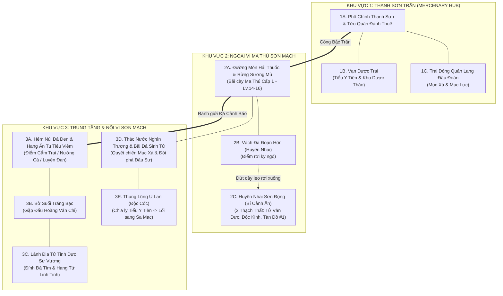

# CHƯƠNG 02: MA THÚ SƠN MẠCH — TRỌNG XÍCH TỬ DỰC, KỲ DUYÊN RỪNG THẲM

> **Quyển 01**: Gia Mã Đế Quốc | **Cấp độ (Level)**: `14 – 22`
> **Lộ trình Cảnh giới**: `Đấu Giả 4 Tinh` → `Đấu Sư 2 Tinh` *(Thăng phẩm Nhị Phẩm Luyện Đan Sư)*
> **Bối cảnh trung tâm**: Thanh Sơn Trấn và rìa Đông Ma Thú Sơn Mạch — dãy rừng nguyên sinh hiểm ác kéo dài vạn dặm nơi Ma Thú thống trị, mồ chôn kiêm thiên đường đổi đời của giới Lính Đánh Thuê.
> **Trọng tâm Mở khóa**: Cơ chế **Huyền Trọng Xích Trọng Áp (+30% EXP)**, Phi Hành Đấu Kỹ **Tử Vân Dực** *(Nâng cấp `Space`)*, Âm Ba Đấu Kỹ **Cuồng Sư Ngâm**, **Mảnh Tàn Đồ Tịnh Liên Yêu Hỏa #1**, Thú Hỏa Cấp 6 **Tử Hỏa** *(Phần Quyết tiến hóa **Hoàng Giai Đỉnh Phong**)*, Bảo giáp **Hải Tâm Giáp**, và **Đấu Khí Sa Y** *(Đấu Sư)*.

---

## 1. Sơ Đồ Bản Đồ Con (Zone Layout & Connectivity)

Bản đồ Chương 02 chuyển từ không gian đô thị sang **hệ sinh thái rừng núi phân tầng nguy hiểm tăng dần từ Ngoài vào Trong** *(Risk-Zone Tiering)*. Càng tiến sâu về Nội Vi, sương mù càng dày, Ma Thú cấp cao càng hung hãn nhưng tỷ lệ rơi Ma Hạch và dược thảo quý tăng gấp bội.

### Chi Tiết Thiết Kế Từng Khu Vực (Top-down 2D Pixel Specs)

| Mã Zone | Tên Khu Vực | Kích Thước & Địa Hình Pixel 2D | NPC Trọng Tâm & Tương Tác | Hoạt Động / Cày Cuốc |
| :---: | :--- | :--- | :--- | :--- |
| **1A** | **Phố Chính Thanh Sơn Trấn** | `72x56 tiles`, nhà gỗ thô mộc, cờ hiệu các đoàn đánh thuê bay phần phật, bảng ủy thác săn Ma Thú giữa chợ. | Thương nhân Vũ Khí, Chủ Tửu Quán, Lính đánh thuê tự do. | Mua lương khô/bình rỗng, Nhận nhiệm vụ săn Ma Hạch hàng ngày. |
| **1B** | **Vạn Dược Trai** | `40x36 tiles`, hiệu thuốc lớn nhất trấn ngập mùi thảo mộc, sân sau phơi đầy nong dược thảo nhiều màu. | **Tiểu Y Tiên**, Quản sự Vạn Dược Trai, Hộ vệ hái thuốc. | Mua dược liệu hiếm, Giao tiếp tăng hảo cảm Tiểu Y Tiên. |
| **1C** | **Trại Lang Đầu Đoàn** | `64x64 tiles`, doanh trại rào gỗ cắm đầu sói trắng dữ tợn, chòi canh cung thủ 4 góc. | **Mục Xà**, **Mục Lực**, Tinh anh Lang Đầu Đoàn. | Cấm địa đầu chương; Chiến trường giải cứu & Diệt đoàn ở Hồi 2.5–2.6. |
| **2A** | **Rừng Sương Mù Ngoại Vi** | `110x96 tiles`, tán cây cổ thụ che khuất ánh nắng, bụi gai làm chậm và hang ổ Ma Thú Cấp 1 rải rác. | Đội hái thuốc Vạn Dược Trai, Toán tuần tra Lang Đầu. | **Bãi cày Lv.14–17**: Thử nghiệm đeo Huyền Trọng Xích cày EXP. |
| **2B** | **Vách Đá Đoạn Hồn** | `52x40 tiles`, mép vực sâu hun hút mây mù cuộn bên dưới, vách đá mọc đầy *Hoàng Liên Tinh*. | Tiểu Y Tiên, Mục Lực *(theo dõi ngầm)*. | Sự kiện đứt dây thừng lao xuống vực cứu mỹ nhân. |
| **2C** | **Huyền Nhai Sơn Động** | `60x60 tiles`, động đá rêu xanh phát sáng huỳnh quang, vườn linh dược hoang hóa, hài cốt tiền bối và **3 Thạch Thất**. | Khôi Lỗi Cơ Quan Mộc/Thạch Nhân, Tiểu Y Tiên. | **Bí cảnh Giải đố & Kỳ ngộ**: Lấy *Tử Vân Dực*, *Cuồng Sư Ngâm*, *Tàn Đồ #1*. |
| **3A** | **Hang Ẩn Tu & Rừng Trung Tầng** | `120x100 tiles`, rừng rậm tối tăm sát rìa Nội Vi; hang đá nhỏ bên sườn núi có đống lửa trại và lò đan dã chiến. | **Dược Lão**, **Vân Chi** *(tạm trú ở Hồi 2.4)*. | **Điểm Lưu Game Dã Ngoại**, Luyện đan từ Ma Hạch, Nướng cá suối, Nuốt Tử Hỏa. |
| **3B** | **Bờ Suối Trăng Bạc** | `68x52 tiles`, dòng suối trong vắt phản chiếu ánh trăng tím và cánh rừng bị cày nát bởi dư chấn Đấu Hoàng. | **Vân Chi (Vân Vận)**. | Hoạt cảnh cứu Vân Chi ngất xỉu, sự kiện hài hước ngâm suối lạnh, Nhận *Hải Tâm Giáp*. |
| **3C** | **Lãnh Địa Tử Tinh Dực Sư Vương** | `88x88 tiles`, ngọn núi đá kết tinh thạch anh tím rực rỡ; hang động sâu chia 2 tầng chứa hồ Tử Linh Tinh. | **Tử Tinh Dực Sư Vương (Cấp 6)**, **Tiểu Sư Vương (Cấp 3)**. | Phó bản **Đột Nhập Tốc Độ Cao**: Đánh bại Tiểu Sư Vương, đoạt *Tử Tinh Nguyên*. |
| **3D** | **Thác Nước Nghìn Trượng** | `76x64 tiles`, dòng thác đổ ầm ầm xuống hồ sâu đầy tảng đá trơn trượt, hơi nước tăng tốc hồi `QI`. | **Đoàn trưởng Mục Xà** *(Boss kết chương)*. | Trận quyết tử 1v1 giết Mục Xà & Bế quan đột phá **Đấu Sư**. |
| **3E** | **Thung Lũng U Lan (Độc Cốc)** | `56x48 tiles`, thung lũng hoa lan tím tuyệt đẹp bị vòng độc khí đen từ cơ thể Tiểu Y Tiên làm héo rũ dần. | **Tiểu Y Tiên** *(Ách Nan Độc Thể thức tỉnh)*. | Phân cảnh từ biệt cảm động & Cổng viễn chinh sang **Chương 03: Đại Mạc**. |

---

## 2. Chuỗi Nhiệm Vụ Chính (Main Questline — 6 Phân Cảnh Nguyên Tác)

### Phân Cảnh 2.1: Thanh Sơn Trấn & Nụ Cười Của Tiểu Y Tiên (Level 14–15)
* **Diễn biến cốt truyện**:
  * Sau hành trình băng rừng, Tiêu Viêm vác thanh **Huyền Trọng Xích** quấn vải đen bước vào **Thanh Sơn Trấn (1A)**. Khác hẳn sự yên bình của Ô Thản Thành, nơi đây sặc mùi rượu mạnh, mồ hôi và máu tanh của hàng trăm gã lính đánh thuê liều mạng.
  * Tìm tới **Vạn Dược Trai (1B)** bổ sung dược liệu dự trữ, Tiêu Viêm tình cờ gặp **Mục Lực** *(Thiếu đoàn trưởng **Lang Đầu Đoàn**, Đấu Giả Đỉnh Phong sắp lên Đấu Sư)* đang dùng lời ngon ngọt giả tạo hòng lôi kéo vị y sư danh tiếng của trấn.
  * Giữa hiệu thuốc, một thiếu nữ mặc váy trắng giản dị có vòng eo thon nhỏ không đầy một nắm tay cùng nụ cười trong trẻo như sương sớm bước ra: **Tiểu Y Tiên**! Dù bản thân không hề có Đấu Khí *(mơ ước lớn nhất là trở thành Luyện Đan Sư nhưng thiếu Hỏa-Mộc thuộc tính)*, nàng vẫn khiến toàn bộ lính đánh thuê Thanh Sơn Trấn kính trọng bảo vệ.
  * Để kiếm lối vào sâu trong núi an toàn và tiếp cận nguồn thảo dược tươi, Tiêu Viêm đăng ký gia nhập đội hộ tống hái thuốc của Tiểu Y Tiên. Hành động lạnh nhạt phớt lờ lời mời kết giao của Mục Lực khiến tên thiếu đoàn trưởng nham hiểm nảy sinh sát ý ngầm!
* **Mục tiêu Gameplay**:
  1. Dạo quanh Thanh Sơn Trấn sắm sửa **Túi Da Đựng Ma Hạch** và làm quen cơ chế **Đeo Huyền Trọng Xích Trọng Áp**.
  2. Hộ tống đoàn xe thuốc của Tiểu Y Tiên qua `Zone 2A`, đánh tan 3 đợt tập kích của bầy *Cuồng Phong Lang (Lv.14–15)* trong khi giữ máu xe thuốc trên `70%`.

### Phân Cảnh 2.2: Kỳ Ngộ Huyền Nhai Sơn Động — Tử Vân Dực & Tàn Đồ #1 (Level 15–16)
* **Diễn biến cốt truyện**:
  * Tại **Vách Đá Đoạn Hồn (2B)**, khi Tiểu Y Tiên buộc dây thừng trèo xuống hái cây *Hoàng Liên Tinh* mọc chênh vênh bên bờ vực, sợi dây bất ngờ bị đá sắc cứa đứt *(có dấu hiệu bị người của Mục Lực phá hoại ngầm)*! Tiếng hét thất thanh vang lên — Tiêu Viêm không kịp suy nghĩ lao vọt người ra khỏi mép vực ôm chặt lấy Tiểu Y Tiên, vung **Huyền Trọng Xích** cắm ngập vào vách đá tóe lửa kìm hãm đà rơi, lăn thẳng vào một mỏm hang đá khuất trong biển mây: **Huyền Nhai Sơn Động (2C)**!
  * Bên trong sơn động hóa ra là nơi tọa hóa của một vị cường giả tiền bối ẩn danh từ nhiều năm trước! Xung quanh bộ hài cốt ngồi xếp bằng trên bệ đá là cả một **vườn linh dược quý hiếm** tỏa hương ngào ngạt *(Băng Linh Diệp, Tử Lam Thảo ngàn năm...)*. Tiêu Viêm hào sảng chia đôi vườn thuốc với Tiểu Y Tiên, đồng thời nhặt được **Chiếc Chìa Khóa Đen Nhỏ** bên dưới di thư của tiền bối.
  * Tiến vào sâu hơn, hai người đối mặt **3 Thạch Thất khóa cơ quan Khôi Lỗi**:
    1. **Thạch Thất Trái**: Vượt trận pháp Mộc Nhân thu được Âm Ba Đấu Kỹ Huyền Giai Trung Cấp **Cuồng Sư Ngâm**!
    2. **Thạch Thất Giữa**: Mở rương đá chứa cuốn sách lụa bảy màu kỳ quái **Thất Thải Độc Kinh**! Tiểu Y Tiên mê mẩn ôm lấy cuốn sách vì bên trong ghi chép phương pháp "Dùng Độc Tu Đấu Khí" — cả hai đều không ngờ chính cuốn kỳ thư này sẽ đánh thức thể chất kinh khủng nhất đại lục ngủ say trong người nàng: **Ách Nan Độc Thể**!
    3. **Thạch Thất Phải (Hộp Ngọc Bí Mật)**: Dùng chiếc chìa khóa đen mở chiếc hộp ngọc giấu trong vách đá giả! Bên trong là quyển trục màu đen cực kỳ quý giá: **Phi Hành Đấu Kỹ Huyền Giai Thượng Phẩm — Tử Vân Dực** *(chế tác từ đôi cánh Thượng Cổ Hắc Vân Điêu, giúp tu giả bay lượn trên bầu trời mà không cần đạt tới Đấu Vương!)* VÀ một mảnh da dê cổ vàng ố vẽ hình đóa sen kỳ dị không rõ đầu đuôi: **Mảnh Tàn Đồ Tịnh Liên Yêu Hỏa #1** *(Dược Lão chấn động căn dặn phải cất kỹ bằng mọi giá!)*.
  * Không có đường trèo lên vách đá trơn tuột, Tiêu Viêm bế quan vài ngày trong động sơ bộ luyện hóa **Tử Vân Dực** mọc ra đôi cánh chim ưng đen ánh tím dài nửa trượng từ sau lưng, ôm ngang eo Tiểu Y Tiên đập cánh bay vút lên khỏi vực sâu giữa ánh mắt ngưỡng mộ lấp lánh của thiếu nữ!
* **Mục tiêu Gameplay**:
  1. Giải đố cơ quan 3 Thạch Thất và hạ gục **Hộ Động Thạch Khôi (Lv.16)** *(xem Mục 4.2 & Mục 7.1)*.
  2. Học Đấu Kỹ mới **Cuồng Sư Ngâm** *(có thể thay thế linh hoạt vào ô `Q/E/R` — gây Choáng diện rộng hình nón)* và nâng cấp phím `Space` thành **Lướt Tử Vân Dực** *(tăng 40% cự ly lướt, vượt qua khe vực/bẫy đất và cho phép kích hoạt trạng thái Lơ Lửng trên không ngắn hạn)*.
  3. Nhận vật phẩm cốt truyện tối thượng: **Mảnh Tàn Đồ Tịnh Liên Yêu Hỏa (1/4)**.

### Phân Cảnh 2.3: Khổ Tu Rừng Sâu Ma Thú — Sức Nặng Ngàn Cân (Level 16–18)
* **Diễn biến cốt truyện**:
  * Đưa Tiểu Y Tiên về Vạn Dược Trai an toàn, Tiêu Viêm tránh mặt tai mắt của Mục Lực, một mình vác Huyền Trọng Xích tiến sâu qua ranh giới đá cảnh báo để vào **Trung Tầng & Rìa Nội Vi Ma Thú Sơn Mạch (3A)**.
  * Tại đây, Dược Lão bắt đầu giáo trình rèn luyện khắc nghiệt nhất: **Không được tháo Huyền Trọng Xích kể cả khi ăn ngủ hay chém giết với Ma Thú!** Ban ngày Tiêu Viêm vác trọng xích nặng ngàn cân quần thảo đẫm máu với đàn Ma Thú Cấp 1 Đỉnh Phong và Cấp 2 *(Thiết Giáp Tê, Băng Linh Điểu, Hỏa Tinh Viên)*; đêm về chui vào **Hang Ẩn Tu (3A)** lấp đá che cửa, lấy Ma Hạch và linh dược từ Huyền Nhai Động tự tay khống lửa luyện chế hàng trăm viên **Hồi Khí Đan & Liệu Thương Đan** *(chính thức đạt trình độ **Nhị Phẩm Luyện Đan Sư**!)*.
  * Qua hàng chục trận sinh tử cận kề cái chết, Đấu Khí trong cơ thể Tiêu Viêm cô đọng thuần khiết đến đáng sợ, cảnh giới tăng vọt từ **Đấu Giả 5 Tinh → Đấu Giả 7–8 Tinh (Lv.18)**, đồng thời ngộ tới trọng thứ 6 của *Bát Cực Băng*!
* **Mục tiêu Gameplay**:
  1. Cày cuốc mở tại `Zone 3A`: Tích lũy `15 Ma Hạch Cấp 1` & `5 Ma Hạch Cấp 2` trong trạng thái bật **Trọng Áp Huyền Trọng Xích (+30% EXP)**.
  2. Luyện thành công 3 mẻ **Hộ Mạch Đan (Nhị Phẩm)** tại Lò Đan Hang Đá để nâng bậc nghề nghiệp lên **Nhị Phẩm Luyện Đan Sư**.

### Phân Cảnh 2.4: Mỹ Nhân Thần Bí Vân Chi & Tử Tinh Dực Sư Vương (Level 18–19)
* **Diễn biến cốt truyện**:
  * Một đêm trăng sáng vằng vặc tại `Zone 3B`, cả cánh rừng Ma Thú bỗng run rẩy quỳ rạp bởi hai luồng uy áp hủy thiên diệt địa trên bầu trời! Tiêu Viêm núp sau tảng đá ngước nhìn mà nghẹt thở: Giữa tầng mây là một nữ tử áo trắng tuyệt mỹ cầm thanh cổ kiếm xanh biếc mọc đôi cánh Đấu Khí lộng lẫy (**Đấu Hoàng Cường Giả!**) đang giao chiến kinh thiên động địa với bá chủ vùng Đông Sơn Mạch — **Ma Thú Cấp 6: Tử Tinh Dực Sư Vương**!
  * Sư Vương gầm vang phóng tia sáng tím **Tử Tinh Phong Ấn** bắn trúng ngực nữ tử áo trắng! Dù nàng đánh gãy một chiếc sừng xoắn ốc của Sư Vương, toàn bộ Đấu Khí và đôi cánh của nàng lập tức bị phong ấn biến mất, rơi thẳng từ chín tầng mây xuống **Bờ Suối Trăng Bạc (3B)**!
  * Chờ Sư Vương rút về hang dưỡng thương, Tiêu Viêm thận trọng ra suối cứu nữ tử hôn mê mang về **Hang Ẩn Tu (3A)**. Nhìn vết thương sâu hoắm trước ngực mỹ nhân cao quý lạnh lùng, thiếu niên 17 tuổi mặt đỏ tới mang tai, run tay cởi lớp áo ngoài để rắc thuốc cầm máu — đúng lúc nàng tỉnh dậy mở đôi mắt phượng sắc lạnh kề kiếm vào cổ huynh! Biết thiếu niên thật lòng cứu mạng và bản thân đang mất sạch tu vi như người phàm, nàng đành thu kiếm, tự xưng tên giả là **"Vân Chi"** *(chính là Tông chủ Vân Lam Tông **Vân Vận** — sư phụ của Nạp Lan Yên Nhiên!)*, còn Tiêu Viêm cũng cẩn thận lấy tên giả là **"Dược Nham"**.
  * **Chuỗi ngày Lãng mạn & Dở khóc dở cười trong Hang Đá**: Hai con người vốn ở hai đầu chiến tuyến lại trải qua những ngày bình yên ấm áp nhất bên đống lửa. Kinh điển nhất là cảnh Tiêu Viêm bắt cá dưới suối đem nướng, vô tình lấy nhầm lọ **Kích Tình Hợp Hoan Phấn** của Dược Lão tưởng là muối tiêu rắc lên cá! Vân Chi ăn xong gương mặt băng sương đỏ ửng như ráng chiều, hơi thở nóng rực phải lao ra nhảy ùm xuống dòng suối lạnh ngâm mình cả đêm, nghiến răng mắng "tiểu tặc vô sỉ"!
  * **Kế hoạch Điệu Hổ Ly Sơn Đoạt Tử Hỏa**: Sau vài ngày phong ấn nới lỏng một chút, Vân Chi quyết định liều bay lên trời dụ **Tử Tinh Dực Sư Vương** rời ổ để Tiêu Viêm *(nhờ Dược Lão bọc linh hồn tàng hình)* lướt **Tử Vân Dực** lẻn vào **Hang Sư Vương (3C)** tìm *Tử Linh Tinh* giải phong ấn cho nàng!
  * Trong hang động tím rực, Tiêu Viêm đụng độ con trai của Thú Vương là **Tiểu Tử Tinh Dực Sư Vương (Ma Thú Cấp 3 — tương đương Đại Đấu Sư)**! Sau màn kịch chiến nảy lửa kết hợp Cốt Linh Lãnh Hỏa hỗ trợ đục thủng lớp vỏ đá thạch nhũ, Tiêu Viêm không chỉ thu được **Bầu Tử Linh Tinh Lỏng**, mà dưới đáy hố sâu còn vớ được báu vật vô giá: **Tử Tinh Nguyên** — tinh thể kết tinh chứa ngọn **Tử Hỏa (Thú Hỏa Cấp 6)** cực kỳ bá đạo!
  * Khi hai người rút chạy bị Sư Vương phát hiện điên cuồng đuổi giết, Dược Lão mượn xác Tiêu Viêm vung một đạo kiếm quang lửa trắng đánh lùi Thú Vương, còn bản thân Tiêu Viêm cạn kiệt sức lực ngất đi bên bờ suối. Lúc tỉnh dậy, phong ấn của Vân Chi đã giải trừ hoàn toàn; trước khi bay về Vân Lam Tông, vị nữ Đấu Hoàng đứng lặng nhìn gương mặt thiếu niên đang ngủ, lưu luyến cởi chiếc nội giáp trân quý nhất đời mình đặt bên gối huynh: **Nội Giáp Hải Tâm Giáp** kèm lời nhắn hẹn ngày tái ngộ!
* **Mục tiêu Gameplay**:
  1. Mini-game **Nướng Cá & Chế Dược Trị Thương** tại lửa trại `Zone 3A`.
  2. Vượt phó bản hành động lén lút tốc độ cao **Lãnh Địa Tử Tinh (3C)**: Né các cột lửa tím từ trên trời giáng xuống của cuộc chiến Đấu Hoàng và đánh bại Boss **Tiểu Tử Tinh Dực Sư Vương (Lv.20)** trong thời gian giới hạn trước khi Sư Vương mẹ quay về!
  3. Nhận trang bị Phòng ngự Huyền Thoại đầu tiên: **Hải Tâm Giáp** *(+180 `DEF`, Nội tại: Tự động tạo khiên nước hấp thụ `50%` sát thương từ một đòn chí mạng mỗi 60 giây!)* cùng **Tử Tinh Nguyên** & **Tử Linh Tinh**.

### Phân Cảnh 2.5: Luyện Hóa Tử Hỏa & Cứu Nguy Thanh Sơn Trấn (Level 19–20)
* **Diễn biến cốt truyện**:
  * Trở lại sơn động, Tiêu Viêm uống Tử Linh Tinh hộ thể rồi vận chuyển **Phần Quyết** nuốt chửng ngọn **Tử Hỏa** bên trong Tử Tinh Nguyên! Sau cơn đau nung chảy kinh mạch, luồng Đấu Khí màu vàng nhạt của Tiêu Viêm chính thức lột xác thành sắc **Tím Thẫm Rực Lửa (Tử Tinh Hỏa)**! Công pháp **Phần Quyết tiến hóa lần đầu tiên từ Hoàng Giai Đê Cấp vọt thẳng lên Hoàng Giai Đỉnh Phong**, tu vi chạm đỉnh **Đấu Giả Cửu Tinh Đỉnh Phong (Lv.20)**!
  * Hoàn tất khổ tu, Tiêu Viêm quay về **Thanh Sơn Trấn (1A)** chuẩn bị hành trang đi Sa Mạc thì thấy Vạn Dược Trai đóng cửa tan hoang! Thì ra **Mục Lực** (nay đã lên **Nhất Tinh Đấu Sư**) phát hiện dấu vết vườn dược thảo ở Huyền Nhai Động nên dẫn tinh nhuệ Lang Đầu Đoàn vây chặt đội hái thuốc trong **Rừng Ngoại Vi (2A)**, ép **Tiểu Y Tiên** giao nộp kho báu và làm thiếp cho hắn!
  * Giữa lúc các hộ vệ Vạn Dược Trai ngã gục trong vũng máu còn Tiểu Y Tiên rút dao găm kề cổ định tự vẫn bảo toàn trong sạch, một tiếng xé gió dữ dội vang lên! Thanh cự xích đen nhánh từ trên trời giáng thẳng xuống cắm nát mặt đất giữa vòng vây!
  * Mục Lực cười gằn cậy thế Đấu Sư xông lên đâm thương — Tiêu Viêm mặt lạnh như băng bấm tháo phong ấn **Huyền Trọng Xích**, tốc độ tăng vọt như quỷ mị lách qua mũi thương, bàn tay bùng lên **Tử Hỏa** tung một quyền **Bát Cực Băng (6 Trọng Ám Kình)** đấm xuyên thủng lồng ngực Mục Lực chết tươi ngay trước mắt hàng chục tên cướp! Tin con trai độc nhất bị giết truyền về doanh trại khiến Đoàn trưởng **Mục Xà (Nhị Tinh Đấu Sư)** gầm thét phát lệnh huyết tẩy truy sát Tiêu Viêm!
* **Mục tiêu Gameplay**:
  1. Hoàn thành nghi thức **Thôn Phệ Tử Hỏa**: Mở khóa **Pixel Palette Shader Tím (Tử Hỏa)** cho toàn bộ đòn đánh thường & kỹ năng *(tăng +15% `ATK` gốc và gắn hiệu ứng **Thiêu Đốt Tử Viêm** trừ máu theo giây)*.
  2. Giải vây **Rừng Ngoại Vi (2A)**: Hạ sát chớp nhoáng Mini-boss **Mục Lực — Nhất Tinh Đấu Sư (Lv.19)** và quét sạch 15 tinh nhuệ Lang Đầu Đoàn bảo vệ Tiểu Y Tiên.

### Phân Cảnh 2.6: Quyết Tử Đấu Sư Mục Xà, Đột Phá Đấu Sư & Chia Ly Độc Cốc (Level 20–22)
* **Diễn biến cốt truyện**:
  * Đưa Tiểu Y Tiên trốn đi an toàn, Tiêu Viêm không hề bỏ trốn mà một mình quay lại rừng đêm hóa thân thành thợ săn bóng tối! Suốt ba ngày đêm, hễ toán lính nào của **Lang Đầu Đoàn** tách lẻ đều bị thanh trọng xích bọc lửa tím đập nát sọ trong chớp mắt, đẩy tâm lý đám cướp vào khủng hoảng tột độ.
  * Cuối cùng tại **Bãi Đá Thác Nước Nghìn Trượng (3D)**, Tiêu Viêm mặt đối mặt quyết chiến sinh tử 1v1 với Đoàn trưởng **Mục Xà (Đấu Sư 2 Tinh)**! Mục Xà khoác lớp **Đấu Khí Sa Y** màu lục sẫm múa trường thương cuồng bạo ép Tiêu Viêm lùi sát bờ vực. Nhờ **Hải Tâm Giáp** cản đòn hiểm, Tiêu Viêm tung **Tử Vân Dực** bay vọt lên không trung vô hiệu hóa địa lợi của Mục Xà, hét vang **Cuồng Sư Ngâm** chấn nát màng nhĩ lão rồi bổ nhào từ trên cao giáng nhát **Huyền Trọng Xích Ngàn Cân quyện Tử Hỏa** đập vỡ vụn Đấu Khí Sa Y, thiêu Mục Xà thành tro tàn! Lang Đầu Đoàn chính thức bị xóa sổ!
  * Nhân lúc chiến ý sôi trào sau trận đại chiến vượt cấp, Tiêu Viêm chui vào hang đá dưới chân **Thác Nước (3D)** nuốt phần Tử Linh Tinh còn lại, ép xoáy khí trong đan điền hóa lỏng ngưng tụ thành **Khí Tuyền** -> Chính thức đột phá đại cảnh giới **Đấu Sư (1 Tinh → 2 Tinh — Lv.22)**, khoác lên mình tấm áo choàng năng lượng tím mờ ảo tuyệt đẹp: **Đấu Khí Sa Y**!
  * **Bi kịch & Lời Hẹn Tại Thung Lũng U Lan (3E)**: Khi Tiêu Viêm đi tìm Tiểu Y Tiên để báo tin vui, huynh lần theo manh mối tới một sơn cốc hẻo lánh. Cảnh tượng trước mắt khiến trái tim thắt lại: Cả thung lũng hoa lan rực rỡ đang héo đen thối rữa tạo thành một vòng tròn chết chóc quanh bóng lưng nhỏ bé của **Tiểu Y Tiên**! Vì lén ăn quá nhiều độc thảo theo *Thất Thải Độc Kinh* để mong có sức mạnh không làm gánh nặng cho Tiêu Viêm, **Ách Nan Độc Thể** của nàng đã thức tỉnh — từ nay mỗi hơi thở và cái chạm tay của nàng đều mang kịch độc giết người!
  * Tiểu Y Tiên khóc nấc lùi lại cầu xin Tiêu Viêm đừng bước qua vạch cỏ héo kẻo trúng độc chết. Không nói một lời, Tiêu Viêm bọc Tử Hỏa quanh bàn tay, dứt khoát bước thẳng qua vòng cỏ đen ôm lấy bờ vai run rẩy của thiếu nữ, lau nước mắt và hứa chắc như đinh đóng cột: Đợi ngày huynh trở thành bậc tông sư Luyện Đan, nhất định sẽ luyện ra viên **Độc Đan hoàn mỹ** giúp nàng khống chế Ách Nan Độc Thể! Sáng hôm sau khi Tiêu Viêm thức dậy, Tiểu Y Tiên đã lặng lẽ rời đi về hướng Xuất Vân Đế Quốc, chỉ để lại bức thư tay đẫm nước mắt và một túi độc phấn phòng thân. Tiêu Viêm nắm chặt bức thư nhìn về chân trời cát vàng phía Đông — hướng thẳng tới **Sa Mạc Tháp Qua Nhĩ**!
* **Mục tiêu Gameplay**:
  1. Chiến dịch **Ám Sát Rừng Đêm**: Hạ 3 đội trưởng tuần tra Lang Đầu Đoàn để làm suy yếu tinh thần Mục Xà trước trận quyết chiến.
  2. Đánh bại **Boss Kết Chương: Đoàn Trưởng Mục Xà (Lv.22 — Đấu Sư 2 Tinh)** *(xem Mục 7.3)*.
  3. Đột phá **Đấu Sư**: Mở khóa kỹ năng nội tại / bật tắt tự động **Đấu Khí Sa Y** *(giảm `20%` sát thương nhận vào và phản lại sát thương Tử Hỏa cận chiến khi thanh `QI > 30%`)*.

---

## 3. Nhiệm Vụ Phụ & Kỳ Ngộ Ẩn (Side Quests, Secrets & Easter Eggs)

1. **[Kỳ Ngộ Ẩn] Sừng Gãy Của Tử Tinh Dực Sư Vương**:
   * **Điều kiện kích hoạt**: Ngay sau đêm đại chiến trên bầu trời giữa Vân Chi và Sư Vương ở Phân cảnh 2.4, trước khi đi vào Hang Sư Vương, người chơi dùng chỉ số `SOUL` quét dọc sườn đồi cháy xém phía đông `Zone 3B`.
   * **Diễn biến**: Tìm thấy một mảnh nhỏ **Đoạn Giác Tử Tinh** bị kiếm của Vân Chi chém bay cắm sâu vào thân cây cổ thụ vạn năm.
   * **Phần thưởng**: Nguyên liệu rèn cực phẩm dùng để khảm vào chuôi **Huyền Trọng Xích** *(+12% Sát thương Hỏa thuộc tính & tỷ lệ 5% phóng tia lửa tím khi vung xích)*.
2. **[Nhiệm Vụ Phụ] Bác Sĩ Rừng Xanh — Cứu Chữa Huyết Chiến Dong Binh**:
   * **Người giao**: Tiểu Y Tiên tại **Vạn Dược Trai (1B)** *(trước Phân cảnh 2.5)*.
   * **Nội dung**: Ba lính đánh thuê của *Thiết Thuẫn Đoàn* bị *Thiết Vĩ Hạt* chích trúng độc lạ nằm hấp hối. Người chơi vận dụng kiến thức của Dược Lão phân biệt đúng 3 triệu chứng độc tố và dùng *Tử Hỏa / Phàm Hỏa* sắc thuốc giải độc kịp thời.
   * **Phần thưởng**: Điểm Hảo Cảm Tiểu Y Tiên `+50`, `2.500 Kim Tệ`, và tín vật **Huy Hiệu Đồng Thiết Thuẫn** *(giúp qua trạm gác biên giới Sa Mạc ở đầu Chương 03 không mất phí thông hành)*.
3. **[Nhiệm Vụ Phụ] Thợ Săn Huyền Thưởng: Bạo Hùng Mắt Đỏ**:
   * **Người giao**: Bảng Ủy Thác Giữa Chợ Thanh Sơn Trấn (`Zone 1A`).
   * **Nội dung**: Săn con Ma Thú Tinh Anh Cấp 2 **Xích Mục Bạo Hùng (Lv.19)** đang tàn phá đường buôn thuốc phía tây `Zone 3A`.
   * **Phần thưởng**: **Thổ Ma Hạch Cấp 2**, `3.000 Kim Tệ` và **Đai Lưng Da Gấu Tinh Anh** *(Mở rộng ô đeo Đan Dược phím tắt `1-2-3` tăng giới hạn mang từ 5 lên 8 bình/ô!)*.
4. **[Easter Egg] Bữa Cá Nướng "Bỏng Môi" Bên Suối**:
   * **Vị trí**: Trong Phân cảnh 2.4 khi chọn gia vị nướng cá cho Vân Chi tại `Zone 3A`, nếu người chơi cố tình chọn kiểm tra túi đồ của Dược Lão 2 lần sẽ kích hoạt đoạn đối thoại ẩn Dược Lão cười gian xúi bẩy đổ lọ bột màu hồng vào cá, mở khóa bức tranh minh họa Pixel Art đặc biệt **CG: Vân Chi Dưới Suối Trăng** trong Bộ Sưu Tập Kỷ Niệm!
5. **[Hệ Thống Nhánh Hảo Cảm Hồng Nhan — Gieo Nhân Gặt Quả Về Sau]**:
   * Mọi lựa chọn đối thoại và hành động chăm sóc hai vị hồng nhan trong Chương 02 được lưu trữ thành biến số ẩn xuyên suốt game:

| Nhân Vật Hồng Nhan | Hành Động Tích Điểm Trong Chương 02 | Tác Động Hệ Quả Ở Các Chương Sau |
| :--- | :--- | :--- |
| **Tiểu Y Tiên** | Chia sẻ trọn vẹn linh dược Huyền Nhai Động (`+30`), Giải cứu không để hộ vệ nào tử trận ở Hồi 2.5 (`+30`), Nắm tay bước qua vòng cỏ độc (`+40`). | Khi tái ngộ ở **Quyển 02 (Xuất Vân Đế Quốc — Tông Chủ Độc Tông)**, mở khóa ngay kỹ năng Hợp Kích *Thiên Độc Hỏa Liên* và nhận thêm `1 Túi Kháng Độc Tuyệt Đối`. |
| **Vân Chi (Vân Vận)** | Cầm máu khéo léo không mạo phạm quá đà (`+25`), Nướng cá thảo mộc thêm lần 2 chuộc lỗi (`+25`), Chia đủ một nửa Bầu Tử Linh Tinh (`+50`). | Tại **Chương 03 (Thánh Thành Xà Nhân)** và **Chương 04 (Đào Vong Biên Giới)**, Vân Vận sẽ chủ động nương kiếm chặn đường Cổ Hà/Phong Lê giúp người chơi có thêm `3 giây` bất tử thoát vây! |

---

## 4. Cơ Chế Gameplay Đặc Sắc Của Chương 02

### 4.1. Cơ Chế "Trọng Áp / Giải Phong" Huyền Trọng Xích (`RMB` hoặc `C`)
Đây là cơ chế cốt lõi định hình bản sắc chiến đấu của Tiêu Viêm đúng theo Trụ Cột #1 của Master GDD:
* **Trạng thái Phong Ấn (Trọng Áp — Mặc định khi khổ tu)**:
  * Thanh Huyền Trọng Xích tỏa ánh đen nặng trịch, mỗi bước chân giẫm nứt nhẹ mặt đất Pixel.
  * *Hệ quả*: Giảm `-25% SPD` *(tốc độ chạy & tốc độ vung đòn)*, giảm cự ly lướt `Space` đi 1 tile, **NHƯNG nhận thêm `+30% EXP Đấu Khí` từ mọi nguồn sát thương/hạ quái**, đồng thời lực va chạm vật lý gây *Đẩy Lùi (Knockback)* mạnh gấp đôi!
* **Trạng thái Giải Phong (Bùng Nổ Thực Lực — Bấm `RMB` / `C`)**:
  * Tiêu Viêm chấn tung xiềng áp chế của xích *(hiệu ứng bùng nổ sóng khí tím quanh người)*: Khôi phục tức thì `100% SPD` gốc và nhận thêm buff **Thân Nhẹ Như Yến (`+20% Tốc độ đánh & +15% Tỷ lệ Chí Mạng trong 12 giây`)**!
  * *Ứng dụng thực chiến*: Cày quái thường luôn bật *Trọng Áp* để tối đa hóa EXP; ngay khi gặp Ma Thú Tinh Anh hoặc Boss như Mục Lực/Mục Xà lao vào, bấm `C` tháo phong ấn lật kèo tốc độ chớp nhoáng khiến đối thủ không kịp trở tay!

### 4.2. Cơ Quan Mộc Nhân & Bẫy Thạch Thất Huyền Nhai Động
* Để mở 3 Thạch Thất ở `Zone 2C`, người chơi phải giải bài toán phối hợp kỹ năng thay vì chỉ chém chay:
  * **Cửa 1 (Thử thách Lực Kình)**: Dùng đòn đập nặng của *Huyền Trọng Xích* hoặc *Bát Cực Băng (`R`)* đánh lún 3 trụ đá theo đúng thứ tự số vạch khắc trên tường trong 8 giây.
  * **Cửa 2 (Thử thách Khống Vị)**: Dùng **Hấp Chưởng (`Q`)** kéo viên bi sắt cơ quan lăn qua mê cung rãnh đá và dùng **Xuy Hỏa Chưởng (`E`)** đẩy nó rơi đúng vào ổ khóa trung tâm.

### 4.3. Cắm Trại Hang Đá: Mổ Ma Hạch & Lò Đan Dã Chiến
* Trong rừng sâu không có tiệm thuốc, người chơi tương tác với **Đống Lửa Hang Ẩn Tu (`Zone 3A`)** để chế tác sinh tồn:

| Tên Vật Phẩm / Đan Dược | Phẩm Cấp | Công Thức Nguyên Liệu (Hang Đá) | Hiệu Ứng Sử Dụng Thực Chiến |
| :--- | :---: | :--- | :--- |
| **Cá Suối Nướng Thảo Mộc** | Lương thực | `2 Cá Bạc Suối Trăng` + `1 Tử Lan Diệp` | Hồi `30% HP` ngoài giao tranh + Tăng `10%` tốc độ hồi `QI` trong 15 phút. |
| **Hồi Khí Đan (Nhị Phẩm)** | Nhị Phẩm | `1 Ma Hạch Cấp 1 (Bất kỳ)` + `2 Hồi Khí Thảo` | Lập tức hồi `45% QI` và cộng thêm `2% QI/giây` trong 8 giây *(CD: 12s)*. |
| **Cuồng Bạo Huyết Đan** | Nhị Phẩm | `1 Hỏa Ma Hạch Cấp 2` + `1 Mật Gấu Đỏ` | Tăng `+25% ATK` trong 15 giây nhưng giảm `-10% DEF` *(chuyên dùng dồn sát thương Boss)*. |
| **Tử Linh Hộ Mạch Dịch** | Đặc Chế | `1 Giọt Tử Linh Tinh` + `2 Băng Linh Diệp` | Tạo màng chắn chống phản phệ Hỏa Độc, dùng cho nghi thức nuốt *Tử Hỏa* và đột phá *Đấu Sư*. |

### 4.4. Nghi Thức Thôn Phệ Tử Hỏa & Hệ Thống Đấu Khí Sa Y (Đấu Sư)
* **Thôn Phệ Tử Tinh Thú Hỏa (Evolution Ritual)**:
  * Diễn ra trong giao diện Nội Thị: Người chơi điều khiển vòng xoáy *Phần Quyết* nuốt từng cụm lửa tím từ **Tử Tinh Nguyên** trong khi nhấp uống *Tử Linh Tinh* giữ nhiệt độ kinh mạch không vượt ngưỡng nổ.
  * *Đột biến hình ảnh & lối chơi*: Toàn bộ vệt chém Pixel của Huyền Trọng Xích, *Xuy Hỏa Chưởng* và *Bát Cực Băng* đổi sang **Shader Tím Tử Viêm**; đòn đánh thứ 3 trong chuỗi `LMB` để lại vệt lửa tím cháy trên đất `2.0s`!
* **Cơ chế Đấu Khí Sa Y (Mở khóa ở Level 20 — Đấu Sư)**:
  * Khác biệt hoàn toàn thời còn là Đấu Giả trần trụi: Ngay khi vào trạng thái chiến đấu, cơ thể Tiêu Viêm tự động phủ một lớp lụa khí tím mờ ảo (**Sa Y**).
  * *Thông số*: Hấp thụ `20%` mọi sát thương nhận vào *(trừ thẳng một lượng nhỏ vào thanh `QI` thay vì mất `HP`)*, miễn nhiễm trạng thái *Khựng Nhẹ (Micro-stagger)* từ quái cấp thấp hơn, giúp chuỗi vung Huyền Trọng Xích không bị ngắt nhịp giữa bầy quái đông!

---

## 5. Trích Dẫn Thoại Kinh Điển (Iconic Cutscene Scripts)

> **[Phân Cảnh 2.2 — Huyền Nhai Sơn Động | BGM: *Tuyệt Bích Kỳ Duyên* (Tươi sáng, kỳ bí)]**
>
> **Tiểu Y Tiên** *(Portrait: Ôm cuốn Thất Thải Độc Kinh lấp lánh mắt cười trong veo)*: "Tiêu Viêm, huynh có Hỏa Đấu Khí để trở thành Luyện Đan Sư cao quý, còn muội trời sinh không có thiên phú... Nhưng cuốn Độc Kinh này nói rằng dùng độc cũng có thể bước lên con đường cường giả bảo vệ người mình trân quý! Sau này huynh luyện Đan cứu người, muội luyện Độc hộ thân cho huynh, được không?"

> **[Phân Cảnh 2.4 — Đêm Trong Hang Đá Cùng Đấu Hoàng | BGM: *U Động Hàn Phương* (Nhẹ nhàng pha chút dở khóc dở cười)]**
>
> **Vân Chi (Vân Vận)** *(Portrait: Tóc đen xõa dài, gương mặt trắng ngần ửng hồng lườm nguýt trong khi tay che vạt áo)*: "Dược Nham! Ta đường đường là... khụ, dù ta bị phong ấn Đấu Khí thì ngươi lúc băng bó vết thương cũng phải biết giữ lễ nghĩa nam nữ chứ! Còn con cá nướng tối qua ngươi rắc cái thứ bột quái quỷ gì vào mà làm người ta nóng như lửa đốt hả?!"
>
> **Tiêu Viêm** *(Portrait: Đổ mồ hôi hột gãi đầu nhìn lọ thuốc trống không, gào thầm trong tâm trí)*: *"Sư phụ già chết tiệt! Lão để lọ Hợp Hoan Phấn cạnh lọ muối tiêu của đệ tử làm cái quái gì vậy hả?!"*

> **[Phân Cảnh 2.4 — Bờ Suối Trăng Bạc Lúc Chia Tay | BGM: *Vân Mộng Tinh Hà* (Sâu lắng, vương vấn đầy tiếc nuối)]**
>
> **Vân Chi (Vân Vận)** *(Portrait: Khoác lại bộ váy trắng Đấu Hoàng thanh cao, cúi nhìn thiếu niên đang ngủ say bên đống lửa tàn, đặt chiếc Hải Tâm Giáp ánh lam lên ngực Tiêu Viêm)*: "Dược Nham... những ngày làm một người con gái bình thường không mang gánh nặng tông môn trong sơn động nhỏ này, có lẽ là ký ức nhẹ nhõm nhất cuộc đời ta. Chiếc Hải Tâm Giáp này tặng lại ngươi giữ mạng. Giữa biển người mênh mông... hy vọng chúng ta sẽ không bao giờ phải gặp lại nhau ở thế đối đầu."

> **[Phân Cảnh 2.5 — Rừng Ngoại Vi Giải Cứu Tiểu Y Tiên | BGM: *Trọng Xích Phá Quân* (Dữ dội, máu lửa)]**
>
> **Mục Lực** *(Portrait: Cười nham hiểm chống thương sắt tỏa Đấu Khí Đấu Sư)*: "Hahahaha! Một thằng nhóc Đấu Giả vác cục sắt vụn mà dám anh hùng cứu mỹ nhân trước mặt Nhất Tinh Đấu Sư như bản thiếu gia sao?!"
>
> **Tiêu Viêm** *(Portrait: Lạnh băng rút Huyền Trọng Xích khỏi mặt đất, Tử Hỏa tím thẫm bùng cháy dữ dội quanh nắm đấm)*: "Đụng vào bằng hữu của Tiêu Viêm ta... hôm nay dù cha ngươi là Mục Xà có đứng đây, mạng chó của ngươi ta cũng lấy!"

> **[Phân Cảnh 2.6 — Thung Lũng U Lan Chia Ly | BGM: *Độc Cốc Lệ Hoa* (Bi thương, da diết)]**
>
> **Tiểu Y Tiên** *(Portrait: Nước mắt rơi xuống đám cỏ hóa đen dưới chân, hoảng loạn lùi lại)*: "Đừng lại gần muội, Tiêu Viêm! Muội biến thành quái vật Ách Nan Độc Thể rồi... ai chạm vào muội cũng sẽ chết! Huynh mau đi đi!"
>
> **Tiêu Viêm** *(Bước thẳng qua ranh giới cỏ độc chết chóc, bàn tay bọc lửa tím giữ chặt đôi vai gầy của nàng)*: "Ngốc ạ, trong mắt ta muội vĩnh viễn là Tiểu Y Tiên của Vạn Dược Trai, không phải quái vật! Nghe lời ta, đợi ngày ta đứng trên đỉnh cao Đan Đạo, ta nhất định sẽ quay lại chế cho muội viên Độc Đan khống chế hoàn toàn thể chất này!"

---

## 6. Bảng Quái Vật, Tinh Anh & Vật Phẩm Rớt (Bestiary & Loot Table)

| Tên Kẻ Địch / Ma Thú | Cảnh Giới & Level | Khu Vực Xuất Hiện | Hành Vi AI (Top-down 2D Pattern) | Vật Phẩm Rớt & Tỷ Lệ (Drop Rate) |
| :--- | :---: | :--- | :--- | :--- |
| **Cuồng Phong Lang (Cấp 1)** | Tương đương Đấu Giả 4–5 Tinh *(Lv.14–15)* | Rừng Sương Mù `2A` | Chạy vòng quanh người chơi rồi phun lưỡi gió xanh tầm trung; tru gọi bầy. | Nanh Phong Lang *(60%)*, **Phong Ma Hạch Cấp 1** *(22%)* |
| **Thiết Vĩ Độc Hạt (Cấp 1)** | Tương đương Đấu Giả 6 Tinh *(Lv.16)* | Vách Đá `2B`, Độc Cốc `3E` | Chui dưới đất trồi lên đâm đuôi sắt gây *Trúng Độc (-2% HP/s)*. | Túi Độc Bọ Cạp *(55%)*, Hắc Tiết Thảo *(25%)* |
| **Hộ Động Thạch Khôi** | Tương đương Đấu Giả 7 Tinh *(Lv.16)* | Huyền Nhai Động `2C` | Kháng 70% sát thương chém nhẹ; chỉ chịu sát thương chuẩn từ Trọng Xích & *Bát Cực Băng*. | Đá Cơ Quan Cổ *(100%)*, Tinh Thạch Bụi *(50%)* |
| **Hỏa Tinh Viên (Ma Thú Cấp 2)** | Tương đương Đấu Giả 7–8 Tinh *(Lv.17)* | Rừng Trung Tầng `3A` | Ném đá lửa nổ diện rộng và đấm đất 3 nhịp liên hồi; rất hung hãn khi mất nửa máu. | Lông Khỉ Đỏ *(55%)*, **Hỏa Ma Hạch Cấp 2** *(18%)* |
| **Thiết Giáp Tê (Ma Thú Cấp 2)** | Tương đương Đấu Giả 8 Tinh *(Lv.17–18)* | Rừng Trung Tầng `3A` | Húc thẳng tốc độ cao cày nát cây cối trên đường chạy; quay đầu chậm. | Da Tê Giác Sắt *(50%)*, **Thổ Ma Hạch Cấp 2** *(15%)* |
| **Băng Linh Điểu (Ma Thú Cấp 2)** | Tương đương Đấu Giả 9 Tinh *(Lv.18–19)* | Bờ Suối `3B`, Thác `3D` | Bay lơ lửng bắn 3 lông vũ băng làm chậm 30%; cần dùng *Hấp Chưởng* hoặc *Tử Vân Dực* kéo xuống. | Lông Vũ Hàn Băng *(60%)*, **Băng Ma Hạch Cấp 2** *(18%)* |
| **Xích Mục Bạo Hùng (Tinh Anh Cấp 2)** | Tương đương Đấu Sư 1 Tinh *(Lv.19)* | Sâu Trong `Zone 3A` | Vồ tát quạt 180° gây chảy máu, gầm hồi máu nhẹ nếu người chơi đứng quá xa. | Mật Gấu Đỏ *(100%)*, **Thổ Ma Hạch Cấp 2** *(100%)* |
| **Lính Đánh Thuê Tinh Nhuệ Lang Đầu** | Đấu Giả 7–9 Tinh *(Lv.17–19)* | Trại `1C`, Rừng `2A/3D` | Đi theo tổ đội 3 người (1 Khiên + 1 Đao + 1 Nỏ bắn lưới trói chân `1.5s`). | Kim Tệ `80–150` *(100%)*, Hồi Khí Tán *(30%)*, Đao Sói *(12%)* |
| **[Mini-Boss] Mục Lực** | Nhất Tinh Đấu Sư *(Lv.19)* | Rừng Giải Vây `2A` | Có lớp *Đấu Khí Sa Y mỏng*; đâm *Lang Nha Đột Kích* 3 nhát liên tiếp. | **Trường Thương Lang Nha** *(100%)*, Chìa Khóa Kho Lang Đầu *(100%)* |

---

## 7. Kịch Bản Chiến Đấu Boss Nhiều Phase (Multi-Phase Boss Encounters)

### 7.0. MINI-BOSS CƠ QUAN: HỘ ĐỘNG SONG THẠCH TƯỚNG (Level 16 — Khôi Lỗi Tiền Bối)
* **Đấu trường**: Sảnh tròn trước 3 Thạch Thất của **Huyền Nhai Sơn Động (`Zone 2C`)** kích thước `24x24 tiles` với 4 cột đá dẫn truyền năng lượng bốn góc.
* **Cơ chế Liên Kết Cộng Hưởng**:
  * Hai pho tượng đá (**Thạch Tướng Cầm Khiên** & **Thạch Tướng Cầm Chùy**) chia sẻ chung dây xích linh lực: Nếu một con chết trước con kia quá `8 giây`, pho tượng còn sống sẽ truyền năng lượng hồi sinh đồng bọn với `30% HP`!
  * *Phase 1 (100% – 50% HP)*: Thạch Tướng Khiên dựng tường đá chặn đường đạn và phản chấn đòn đánh nhanh; Thạch Tướng Chùy nhảy đập sóng tròn gây *Làm Chậm*.
  * *Phase 2 (50% – 0% HP)*: Hai tượng nối tia laser vàng ở giữa rồi xoay tròn quét khắp phòng!
  * *Chiến thuật Phá giải*: Giữ chế độ **Trọng Áp Huyền Trọng Xích** để đập vỡ khiên đá, dùng **Hấp Chưởng (`Q`)** gom hai Thạch Tướng chụm sát vào nhau rồi xả **Bát Cực Băng (`R`)** kết liễu đồng thời cả hai trong khung 8 giây -> Rớt **Chìa Khóa Đá Mở Thạch Thất #3 (Tử Vân Dực & Tàn Đồ Tịnh Liên #1)**!

### 7.1. BOSS BÍ CẢNH & ĐÀO THOÁT: TIỂU TỬ TINH DỰC SƯ VƯƠNG & SƯ VƯƠNG CẤP 6 (Level 20)
* **Đấu trường**: Tầng đáy **Hang Tử Tinh (`Zone 3C`)** rộng `32x32 tiles` với các cụm thạch nhũ tím phát sáng và đồng hồ báo động **Sư Vương Mẹ Quay Về (`180 giây`)** treo trên đỉnh màn hình!
* **Phase 1 (100% – 50% HP) — Vương Giả Thú Uy**:
  * Lớp da kết tinh thạch anh tím của Tiểu Sư Vương giảm `40%` sát thương vật lý thường.
  * *Chiêu thức*: **Tử Dực Phác Sát** *(vỗ cánh bay là là mặt đất tạt móng vuốt chữ X)* và **Sư Vương Hống** *(gầm sóng âm đẩy lùi toàn sân)*.
* **Phase 2 (50% – 0% HP) — Tử Hỏa Trụ Phun Trào**:
  * Sừng trên trán Tiểu Sư Vương rực sáng, triệu hồi 5 vòng tròn cảnh báo tím dưới đất nổ thành **Cột Lửa Tử Hỏa** sau `1.0s`, đồng thời há miệng tích tụ quả cầu năng lượng lớn *Tử Tinh Quang Trụ* quét ngang 90°!
  * *Chiến thuật Phá giải*: Bấm `T` gọi tia **Cốt Linh Lãnh Hỏa của Dược Lão** bắn thẳng vào sừng của Tiểu Sư Vương khi nó đang gồng *Quang Trụ* -> Gây phản ứng **Nhiệt Lạnh Xung Đột** làm nứt vỡ lớp giáp thạch anh tím *(Choáng `3.0s`, nhận `200%` sát thương!)*, lập tức tháo phong ấn Huyền Trọng Xích (`C`) lao vào nện chuỗi combo hạ gục nó để đoạt **Tử Tinh Nguyên**!
* **Phase 3 (Sự Kiện Đào Thoát Điện Ảnh — Escape Sequence)**:
  * Ngay khi nhặt được Tử Tinh Nguyên, hang động rung chuyển dữ dội — **Tử Tinh Dực Sư Vương Cấp 6 (Lv.65 — Bất Khả Chiến Bại ở thời điểm hiện tại!)** gầm thét lao vào cửa hang!
  * Người chơi bật **Tử Vân Dực (`Space` liên hoàn)** bay dọc đường hầm sụp đổ dài `120 tiles`, lách qua mưa thiên thạch lửa tím và luồng sóng *Tử Hỏa Liễu Nguyên* quét từ phía sau cho tới khi lao vọt ra bầu trời gặp Vân Chi và kích hoạt **Dược Lão Phụ Thể (`T`)** tung một kiếm *Cốt Linh Lãnh Hỏa* chém nát biển lửa mở đường thoát thân!

### 7.2. BOSS KẾT CHƯƠNG: ĐOÀN TRƯỞNG MỤC XÀ — ÁC LANG ĐẤU SƯ (Level 22 — Đấu Sư 2 Tinh)
* **Đấu trường**: **Bãi Đá Thác Nước Nghìn Trượng (`Zone 3D`)** kích thước `40x36 tiles`, địa hình chia cắt bởi dòng suối chảy xiết ở giữa và các mỏm đá cao thấp.
* **Phase 1 (100% – 65% HP) — Phong Lang Đấu Khí Sa Y**:
  * Mục Xà duy trì lớp **Thanh Phong Sa Y** hấp thụ sát thương cho tới khi thanh Giáp Trắng dưới cây máu bị đánh vỡ.
  * *Chiêu thức*: **Phong Xà Thương Ảnh** *(đâm lướt 8 tiles để lại dư ảnh gió cắt máu)* và **Toàn Phong Trảm** *(xoay thương phản đòn đánh xa)*.
  * *Khắc chế*: Giữ Huyền Trọng Xích ở chế độ đòn đập nặng kết hợp **Bát Cực Băng (`R`)** có nội tại xuyên giáp để phá vỡ *Đấu Khí Sa Y* làm Mục Xà khựng người!
* **Phase 2 (65% – 30% HP) — Không Chiến Tử Vân Dực**:
  * Mục Xà nhảy lên mỏm đá giữa thác nước phóng liên tục hàng chục lưỡi thương khí *Vạn Lang Nha* phủ kín mặt đất thấp!
  * *Cơ chế Đặc sắc*: Người chơi kích hoạt **Tử Vân Dực (`Space` giữ 0.5s để bay lượn vượt qua dòng suối xiết)** tiếp cận thẳng mỏm đá cao, hét vang **Cuồng Sư Ngâm (`Q`)** giữa không trung làm Mục Xà choáng váng ngã nhào từ mỏm đá xuống bãi cạn!
* **Phase 3 (30% – 0% HP) — Huyết Tế Cuồng Lang & Đòn Kết Liễu Trọng Xích**:
  * Biết khó sống sót, Mục Xà đốt máu huyết hóa thành hình thái *Huyết Lang Cuồng Bạo* *(tốc độ di chuyển cực nhanh, lao cắn xé liên hoàn không ngừng nghỉ, đòn đánh gây Chảy Máu nặng)*.
  * *Chiến thuật Kết liễu*: Nhờ **Hải Tâm Giáp** tự kích hoạt khiên nước đỡ trọn cú đâm liều mạng của Mục Xà, người chơi uống nhanh **Hồi Khí Đan (`1`)**, bấm `C` giải phong Huyền Trọng Xích phủ đầy **Tử Hỏa** bổ sập từ đỉnh đầu xuống — thiêu rụi hoàn toàn Đoàn trưởng Lang Đầu Đoàn!
* **Phần thưởng Chiến thắng**:
  * **Nạp Giới Của Mục Xà** *(Tăng gấp đôi sức chứa túi đồ hành trang + `18.000 Kim Tệ` gia sản cả đời Lang Đầu Đoàn)*.
  * **Ngọc Giản Huyền Giai Đê Cấp: Phong Lang Đột** & Nguyên liệu đột phá **Đấu Sư**.

---

## 8. Tổng Kết Lộ Trình Thăng Tiến & Mở Khóa Hệ Thống Chương 02

| Giai Đoạn Cốt Truyện | Cấp Độ & Cảnh Giới Chuẩn | Công Pháp / Đấu Kỹ / Hệ Thống Mới | Trang Bị & Vật Phẩm Cốt Lõi |
| :--- | :---: | :--- | :--- |
| **Hồi 2.1 (Thanh Sơn Trấn & Vạn Dược)** | `Lv.14 – 15` *(Đấu Giả 4–5 Tinh)* | Cơ chế **Huyền Trọng Xích Trọng Áp (+30% EXP)** | Túi Thu Thập Ma Hạch, Bản đồ Ngoại Vi |
| **Hồi 2.2 (Kỳ Ngộ Huyền Nhai Động)** | `Lv.15 – 16` *(Đấu Giả 5–6 Tinh)* | **Tử Vân Dực** *(Nâng cấp `Space`)*, **Cuồng Sư Ngâm** | **Mảnh Tàn Đồ Tịnh Liên Yêu Hỏa #1**, Kho Linh Dược |
| **Hồi 2.3 (Khổ Tu Rừng Sâu)** | `Lv.16 – 18` *(Đấu Giả 6–8 Tinh)* | **Luyện Đan Nhị Phẩm**, Lửa trại dã ngoại, *Bát Cực Băng 6 Trọng* | Hồi Khí Đan Nhị Phẩm, Đoạn Giác Tử Tinh *(Ẩn)* |
| **Hồi 2.4 (Vân Chi & Hang Sư Vương)** | `Lv.18 – 19` *(Đấu Giả 8–9 Tinh)* | Kỹ năng phối hợp *Điệu Hổ Ly Sơn* | **Nội Giáp Hải Tâm Giáp**, **Tử Tinh Nguyên**, Bầu Tử Linh Tinh |
| **Hồi 2.5 (Nuốt Tử Hỏa & Giết Mục Lực)** | `Lv.19 – 20` *(Đấu Giả 9 Tinh Đỉnh)* | **Thú Hỏa: Tử Hỏa** *(Shader Tím)*, **Phần Quyết → Hoàng Giai Đỉnh Phong** | Chìa Khóa Kho Báu Lang Đầu Đoàn |
| **Hồi 2.6 (Trảm Mục Xà & Lên Đấu Sư)** | `Lv.20 – 22` *(Đấu Sư 1–2 Tinh)* | Cảnh giới **Đấu Sư**: Mở **Khí Tuyền** & **Đấu Khí Sa Y** | **Nạp Giới Mục Xà**, Túi Độc Phấn Kỷ Vật Tiểu Y Tiên |

> **Điều kiện Chuyển Chương 02 → Chương 03**: Đột phá thành công **Đấu Sư (tối thiểu Level 21–22)**, hoàn thành hoạt cảnh từ biệt Tiểu Y Tiên tại **Thung Lũng U Lan (`Zone 3E`)** và tiến ra đường mòn cát vàng phía Đông dẫn tới **Sa Mạc Tháp Qua Nhĩ**.

### Gợi Ý Phối Bộ Kỹ Năng (Recommended Loadout) Cuối Chương 02
* **Vũ khí**: `Huyền Trọng Xích` *(Gắn Đoạn Giác Tử Tinh — Bật Trọng Áp khi farm rừng, tháo phong ấn `C` khi solo Boss)*.
* **Nội giáp & Phụ kiện**: `Hải Tâm Giáp` + `Đai Lưng Da Gấu Tinh Anh` *(Mang 8 Hồi Khí Đan + 8 Liệu Thương Đan + 5 Cuồng Bạo Huyết Đan)*.
* **Bộ 3 Đấu Kỹ Chủ Động (`Q - E - R`)**:
  * `Q` (**Hấp Chưởng**): Kéo Ma Thú bay (*Băng Linh Điểu*) hoặc ngắt nhịp gồng thương của kẻ địch.
  * `E` (**Cuồng Sư Ngâm**): Phá thế vây của bầy sói / lính đánh thuê bằng hiệu ứng *Choáng diện rộng 1.5s*.
  * `R` (**Bát Cực Băng — Tử Hỏa Ám Kình**): Sát thương kết liễu xuyên thẳng *Đấu Khí Sa Y* của các đối thủ cấp Đấu Sư!
* **Thân pháp (`Space`)**: `Tử Vân Dực` *(Giữ phím để bay vượt địa hình suối/bẫy gai và né đòn quét đất 360° của Boss)*.

---

## 9. Bảng Mã Nhiệm Vụ Kỹ Thuật (`Quest_ID`) & Chỉ Dẫn Triển Khai Pixel VFX / Audio

### 9.1. Danh Sách Quest ID Chính & Phụ Chương 02 (Dành Cho Hệ Thống Quest Scripting)

| Quest_ID | Tên Nhiệm Vụ Hiển Thị | Phân Loại | Zone Kích Hoạt | Điều Kiện Hoàn Thành (Trigger Flag) | EXP & Vàng Thưởng |
| :--- | :--- | :---: | :---: | :--- | :--- |
| `Q02_M01_VAN_DUOC` | Y Tiên Nơi Biên Trấn | Chính Tuyến | `Zone 1A/1B` | Gia nhập đội hái thuốc + Bảo vệ xe thuốc qua `Zone 2A` (>70% HP) | `3.200 EXP`, `1.500 Vàng` |
| `Q02_M02_HUYEN_NHAI` | Kỳ Ngộ Dưới Đáy Vực | Chính Tuyến | `Zone 2B/2C` | Lao xuống cứu Tiểu Y Tiên + Giải 3 Thạch Thất lấy *Tử Vân Dực* & *Tàn Đồ #1* | `5.000 EXP`, Mở bay `Space` |
| `Q02_M03_TRONG_XICH` | Khổ Tu Rừng Sâu | Chính Tuyến | `Zone 3A` | Đeo Trọng Áp săn đủ 20 Ma Hạch + Thăng cấp **Nhị Phẩm Luyện Đan Sư** | `7.500 EXP`, Mở Lò Dã Chiến |
| `Q02_M04_VAN_CHI` | Bờ Suối Gặp Đấu Hoàng | Chính Tuyến | `Zone 3B/3C` | Cứu Vân Chi + Nướng cá + Đột nhập Hang Sư Vương đoạt *Tử Tinh Nguyên* | `9.000 EXP`, **Hải Tâm Giáp** |
| `Q02_M05_TU_HOA` | Tử Hỏa Phần Lang Đầu | Chính Tuyến | `Zone 3A/2A` | Thôn phệ *Tử Hỏa* (Phần Quyết Hoàng Giai Đỉnh) + Giải cứu Tiểu Y Tiên, giết Mục Lực | `8.500 EXP`, Shader *Tử Hỏa* |
| `Q02_M06_MUC_XA` | Độc Cốc Biệt Ly | Chính Tuyến | `Zone 3D/3E` | Quyết sát Mục Xà + Đột phá **Đấu Sư** + Từ biệt Tiểu Y Tiên ở Thung Lũng U Lan | `12.000 EXP`, **Đấu Khí Sa Y** |
| `Q02_S01_DOAN_GIAC` | Sừng Gãy Thú Vương | Kỳ Ngộ Ẩn | `Zone 3B` | Dùng `SOUL` quét gốc cổ thụ cháy sau đêm đại chiến Đấu Hoàng | `2.000 EXP`, *Đoạn Giác Tử Tinh* |
| `Q02_S02_GIAI_DOC` | Bác Sĩ Rừng Xanh | Nhiệm Vụ Phụ | `Zone 1B` | Bắt mạch phân biệt đúng 3 chứng độc bò cạp cứu lính đánh thuê Thiết Thuẫn | `2.500 EXP`, `2.500 Vàng` |
| `Q02_S03_BAO_HUNG` | Truy Sát Xích Mục Hùng | Nhiệm Vụ Phụ | `Zone 1A/3A` | Hạ Tinh Anh *Xích Mục Bạo Hùng* nộp Ma Hạch về bảng ủy thác | `3.000 EXP`, *Đai Lưng 8 Ô* |

### 9.2. Đặc Tả Hiệu Ứng Hình Ảnh Pixel (2D Shaders / Particles) & Âm Thanh Điểm Nhấn
* **Hiệu ứng Chuyển Đổi Huyền Trọng Xích (`RMB` / `C`)**:
  * *Trọng Áp*: Mỗi bước chạy tạo bụi đá nhỏ dưới chân kèm tiếng kim loại trầm nặng *SFX_HeavyRuler_Step.wav*; vệt vung xích màu đen đặc viền cam/tím.
  * *Giải Phong*: Vòng sóng xung kích trắng tím bung tỏa từ lưng nhân vật kèm tiếng xiềng sắt đứt tung *SFX_Seal_Break.wav*; nhân vật để lại 2 bóng mờ dư ảnh (*Afterimage Sprite*) khi lướt!
* **Hiệu ứng Tử Vân Dực (`Space`) & Tử Hỏa**:
  * Khi giữ `Space`, đôi cánh đen ánh vân mây tím trải rộng `40px` sau lưng Tiêu Viêm, nhân vật nâng độ cao trục Z ảo lên `12px` *(vô hiệu hóa va chạm bẫy gai/mặt nước dưới đất)*.
  * *Tử Hỏa Palette Swap*: Đổi toàn bộ bảng màu lửa gốc từ `[#FF9800, #FF5722]` sang dải tím vương giả `[#E040FB, #7B1FA2, #4A148C]`.
* **Hiệu ứng Ách Nan Độc Thể (Thung Lũng U Lan `Zone 3E`)**:
  * Sử dụng *Radial Desaturation Shader* lấy Tiểu Y Tiên làm tâm: cỏ hoa trong bán kính `6 tiles` quanh nàng chuyển màu xám đen và tan thành khói tím, trừ duy nhất bàn tay bọc Tử Hỏa của Tiêu Viêm khi chạm vào nàng tạo vầng sáng ấm áp đẩy lùi khói độc!

### 9.3. Thông Số Khung Hình & Hitbox Đòn Đánh Của Boss Chương 02 (Frame Data Chuẩn)
* **Tiểu Tử Tinh Dực Sư Vương — Tử Tinh Quang Trụ**:
  * *Khởi chiêu*: `72 frames (1.2s)` — Sừng trên trán tụ sáng tím chói lòa *(Khung thời gian vàng để bấm `T` bắn Cốt Linh Lãnh Hỏa gây Choáng!)*.
  * *Hoạt động*: `120 frames (2.0s)` — Tia laser rộng `2.5 tiles` dài `18 tiles` quét góc 90° từ trái qua phải.
* **Đoàn Trưởng Mục Xà — Phong Xà Thương Ảnh**:
  * *Khởi chiêu*: `30 frames (0.5s)` — Hạ thấp mũi thương lóe sáng xanh lá.
  * *Hoạt động*: Đâm lướt liên hoàn 3 nhịp (`6 tiles` mỗi nhịp), để lại đường gió cắt tồn tại `1.0s` trên mặt đất.
  * *Phá giải*: Bay lơ lửng bằng *Tử Vân Dực* trên không rồi hét **Cuồng Sư Ngâm** ép Mục Xà rơi vào trạng thái *Ôm Đầu Choáng `90 frames (1.5s)`*!

---

## 10. Bảng Vật Phẩm Giao Dịch Tại Thanh Sơn Trấn & Vạn Dược Trai

| Điểm Giao Dịch | Tên Vật Phẩm Bán | Giá Mua (Kim Tệ) | Giới Hạn Mua | Công Dụng & Ghi Chú Cày Cuốc |
| :--- | :--- | :---: | :---: | :--- |
| **Vạn Dược Trai (`Zone 1B`)** | Hồi Khí Thảo Thượng Hạng | `60 Vàng` | Không giới hạn | Nguyên liệu chính kết hợp Ma Hạch Cấp 1 luyện *Hồi Khí Đan Nhị Phẩm*. |
| **Vạn Dược Trai (`Zone 1B`)** | Bột Giải Độc Tiểu Y Tiên | `120 Vàng` | `10 gói/ngày` | Xóa tức thì trạng thái *Trúng Độc* từ *Thiết Vĩ Độc Hạt* trong Ma Thú Sơn Mạch. |
| **Vạn Dược Trai (`Zone 1B`)** | Băng Linh Diệp | `350 Vàng` | `5 lá` | Pha chế *Tử Linh Hộ Mạch Dịch* chống phản phệ khi nuốt Tử Hỏa. |
| **Tửu Quán Đánh Thuê (`Zone 1A`)** | Rượu Liệt Hỏa Dong Binh | `80 Vàng` | `5 vò` | Tăng `+10% ATK` và miễn nhiễm sương lạnh rừng đêm trong `10 phút`. |
| **Tiệm Vũ Khí Trấn (`Zone 1A`)** | Dây Quấn Chuôi Da Ma Thú | `1.200 Vàng` | `1 cuộn` | Giảm `-5%` mức phạt tốc độ vung của **Huyền Trọng Xích** ở chế độ Trọng Áp. |
| **Thương Nhân Chợ Đen (`Zone 1A`)** | Ngọc Giản Rỗng Lưu Đan Phương | `500 Vàng` | `3 mảnh` | Sao chép công thức đan dược dã chiến để mở khóa chế tạo nhanh bên lửa trại. |
| **Kỳ Ngộ Hang Đá (`Zone 2C`)** | Quyển Trục: **Tử Vân Dực** | *Kỳ ngộ Hộp Ngọc* | Duy nhất | Huyền Giai Thượng Phẩm Phi Hành Đấu Kỹ — lột xác hoàn toàn cơ động 2D! |
| **Kỷ Vật Chia Tay (`Zone 3B`)** | **Nội Giáp Hải Tâm Giáp** | *Vân Chi trao tặng* | Duy nhất | Phòng cụ cấp Đấu Hoàng bảo hộ mạng sống Tiêu Viêm suốt Quyển 01! |
