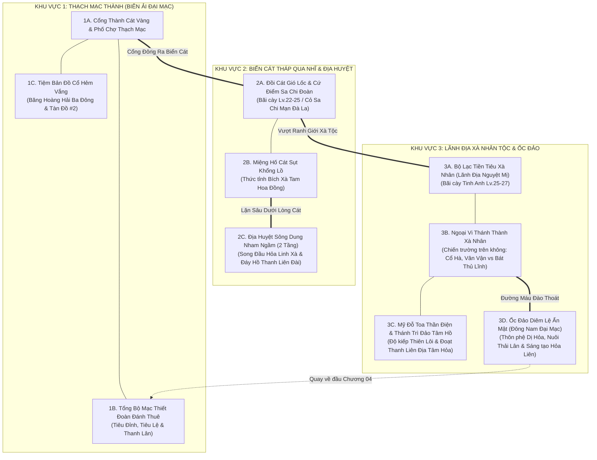

# CHƯƠNG 03: SA MẠC THÁP QUA NHĨ — ĐOẠT DỊ HỎA TRONG TUYỆT CẢNH!

> **Quyển 01**: Gia Mã Đế Quốc | **Cấp độ (Level)**: `22 – 29`
> **Lộ trình Cảnh giới**: `Đấu Sư 2 Tinh` → `Đấu Sư 9 Tinh Đỉnh Phong` *(Thăng phẩm Tam Phẩm Luyện Đan Sư)*
> **Bối cảnh trung tâm**: Đại Mạc Tháp Qua Nhĩ — Biển cát tử thần trải dài biên cương phía Đông Gia Mã Đế Quốc, chiến trường đẫm máu giữa Nhân loại và vương quốc **Xà Nhân Tộc** của Nữ Vương Mỹ Đỗ Toa.
> **Trọng tâm Mở khóa**: **Mảnh Tàn Đồ Tịnh Liên Yêu Hỏa #2** *(Giao ước Băng Hoàng Hải Ba Đông)*, Nhãn thuật đồng hành **Bích Xà Tam Hoa Đồng (Thanh Lân)**, Tọa đài tu luyện **Thanh Liên Đài**, **Dị Hỏa Đầu Tiên: Thanh Liên Địa Tâm Hỏa (#19)** *(Phần Quyết tiến hóa **Huyền Giai Trung Cấp**)*, Thần thú đồng hành **Thải Lân (Thất Thải Thôn Thiên Mãng)**, và Mở khóa phím `F`: **Sơ Hình Phật Nộ Hỏa Liên**!

---

## 1. Sơ Đồ Bản Đồ Con (Zone Layout & Connectivity)

Bản đồ Chương 03 áp dụng cơ chế **Môi trường Khắc nghiệt Đa tầng (Vertical & Desert Biomes)**: Phía trên là mặt cát bỏng rát cùng bão cát che khuất tầm nhìn; phía dưới lòng đất là hệ thống Địa Huyệt Dung Nham ngầm nóng chảy; và sâu trong lãnh địa Xà Nhân là Thánh Thành cổ kính huyền hoặc.

### Chi Tiết Thiết Kế Từng Khu Vực (Top-down 2D Pixel Specs)

| Mã Zone | Tên Khu Vực | Kích Thước & Địa Hình Pixel 2D | NPC Trọng Tâm & Tương Tác | Hoạt Động / Cày Cuốc |
| :---: | :--- | :--- | :--- | :--- |
| **1A** | **Phố Chợ Thạch Mạc Thành** | `80x60 tiles`, kiến trúc đá sa thạch vàng sẫm, hiệu ứng sóng nhiệt *(Heat Distortion Shader)* rung rinh mặt đất. | Thương nhân Nước Ngọt, Thợ rèn Sa Mạc, Lính biên phòng. | Mua Bình Nước Lạnh, Thuốc chống nắng, Nghe tin tức Xà Nhân Tộc. |
| **1B** | **Tổng Bộ Mạc Thiết Đoàn** | `56x48 tiles`, pháo đài đá kiên cố treo cờ sắt đen, sân tập võ đầy nắng và phòng nghị sự của hai anh ruột. | **Đại ca Tiêu Đỉnh**, **Nhị ca Tiêu Lệ**, **Thanh Lân**, Tuyết Lam. | **Điểm Lưu Game Chính**, Nhận tiếp tế gia tộc, Nhận chuỗi nhiệm vụ Mạc Thiết. |
| **1C** | **Tiệm Bản Đồ Cổ Hẻm Vắng** | `28x24 tiles`, căn nhà tối tăm mát lạnh kỳ lạ giữa sa mạc, kệ gỗ chất đầy bản đồ da dê; biến thành đấu trường băng khi đánh Boss. | **Hải Ba Đông (Chế Đồ Lão Nhân)**. | Cảm ứng `SOUL` tìm **Mảnh Tàn Đồ #2**, Boss chiến Hải Ba Đông. |
| **2A** | **Đồi Cát Gió Lốc** | `130x110 tiles`, cát lún làm giảm tốc chạy, cơn lốc cát di động che mờ bản đồ con *(Minimap)* mỗi 3 phút. | Toán tuần tra Sa Chi Đoàn, Đoàn trưởng **La Bố**. | **Bãi cày Lv.22–25**: Săn Ma Thú sa mạc, hái **Sa Chi Mạn Đà La**. |
| **2B** | **Miệng Hố Cát Sụt** | `64x64 tiles`, phễu cát xoáy khổng lồ sâu hun hút tỏa hơi nóng hầm hập từ lòng đất lên. | **Thanh Lân**, **Tiêu Đỉnh & Tiêu Lệ**, Tinh nhuệ Sa Chi Đoàn. | Dằn mặt La Bố, Sự kiện Thanh Lân mở *Bích Xà Tam Hoa Đồng*. |
| **2C** | **Địa Huyệt Dung Nham Ngầm** | `96x80 tiles`, thế giới ngầm rực đỏ ánh nham thạch Pixel sôi sục, cầu đá gãy và vùng lặn sâu dưới đáy hồ lửa. | **Song Đầu Hỏa Linh Xà (Cấp 4 Đỉnh)**, **Dược Lão**. | Hạ Hỏa Linh Xà, Lặn đáy dung nham đào **Thanh Liên Đài** & *Địa Tâm Tinh*. |
| **3A** | **Bộ Lạc Tiền Tiêu Xà Nhân** | `100x84 tiles`, lều đá chạm khắc hình rắn độc, tháp canh cung thủ Xà Nhân có tầm bắn rất xa. | Nữ thống lĩnh **Nguyệt Mị** *(Đấu Vương — Tuần tra vòng ngoài)*. | **Bãi cày Tinh Anh Lv.25–27**: Cày vảy Xà Nhân, tránh tầm quét của Nguyệt Mị. |
| **3B** | **Ngoại Vi Thánh Thành** | `88x72 tiles`, hẻm núi đá đỏ nhìn lên bầu trời rực sáng hiệu ứng chưởng pháp va chạm của hàng loạt Đấu Vương, Đấu Hoàng. | **Đan Vương Cổ Hà**, **Vân Vận**, Phong Lê, Nghiêm Sư, **Mặc Ba Tư**. | Bản đồ **Ẩn Nấp Hắc Bào & Tung Hỏa Mù** đánh lạc hướng phe Cổ Hà. |
| **3C** | **Thánh Trì Đảo Tâm Hồ** | `72x72 tiles`, cung điện cổ Hy Lạp – Ai Cập pha Á Đông giữa hồ nước thánh, bầu trời cuồn cuộn mây tím Thiên Lôi. | **Mỹ Đỗ Toa Nữ Vương** *(Đấu Hoàng Đỉnh Phong -> Thất Thải Thôn Thiên Mãng)*. | Hoạt cảnh Độ Kiếp kinh điển, Đột kích **Đoạt Thanh Liên Địa Tâm Hỏa** & Đào thoát! |
| **3D** | **Ốc Đảo Diêm Lệ Ẩn Mật** | `60x56 tiles`, hồ nước xanh ngọc phẳng lặng giữa rặng cọ khuất sau vách đá muối trắng, có kết giới linh hồn Dược Lão. | **Thải Lân (Pet)**, **Dược Lão**. | Mini-game sinh tồn **Thôn Phệ Dị Hỏa**, Nuôi Thải Lân, Thử nghiệm **Phật Nộ Hỏa Liên**. |

---

## 2. Chuỗi Nhiệm Vụ Chính (Main Questline — 6 Phân Cảnh Nguyên Tác)

### Phân Cảnh 3.1: Thạch Mạc Thành & Tình Huynh Đệ Mạc Thiết Đoàn (Level 22–23)
* **Diễn biến cốt truyện**:
  * Vượt qua ranh giới nắng cháy da thịt của **Sa Mạc Tháp Qua Nhĩ**, ngay trước cổng **Thạch Mạc Thành (1A)**, Tiêu Viêm bắt gặp tiểu đội trinh sát của **Mạc Thiết Đoàn Đánh Thuê** *(do nữ đội viên lanh lợi **Tuyết Lam** dẫn đầu)* đang bị gần hai mươi tên côn đồ của đoàn đối thủ **Sa Chi Đoàn** vây chém cướp nước giữa bão cát!
  * Nhận ra huy hiệu thiết kiếm của hai vị huynh trưởng nhà mình, Tiêu Viêm chẳng nói hai lời vung **Huyền Trọng Xích** xông vào đánh bay toàn bộ đám Sa Chi Đoàn chỉ trong vài nhịp thở, được Tuyết Lam phấn khích dẫn thẳng về **Tổng Bộ Mạc Thiết Đoàn (1B)**.
  * **Khoảnh khắc Đoàn Tụ Xúc Động**: Giữa đại sảnh đá, Đại ca **Tiêu Đỉnh** *(Đấu Sư Đỉnh Phong, gương mặt trầm ổn điềm tĩnh luôn nở nụ cười ấm áp)* và Nhị ca **Tiêu Lệ** *(Đấu Sư Hậu Kỳ, khí chất lạnh lùng sát phạt với ngọn Huyết Thương)* sững người rồi bật dậy ôm chầm lấy tam đệ! Hơn một năm trước khi rời Ô Thản Thành, họ vẫn luôn lo lắng đứa em trai "phế vật Tam Đoạn" ở nhà chịu uất ức; nay tận mắt thấy Tiêu Viêm mười bảy tuổi đã sừng sững ở cảnh giới **Đấu Sư** lại còn có bản lĩnh Luyện Đan Sư, cả hai người anh đều rưng rưng tự hào!
* **Mục tiêu Gameplay**:
  1. Giải cứu tiểu đội Tuyết Lam ở ngoại vi `Zone 1A` *(tiêu diệt 12 tên Đao Phủ Sa Chi Đoàn trong điều kiện bão cát giảm 30% tầm nhìn)*.
  2. Mở khóa hệ thống **Tiếp Tế Huynh Đệ Mạc Thiết** tại `Zone 1B`: Nhận miễn phí *Bình Nước Lạnh Đại Mạc* mỗi lần ghé về và mở bảng Nhiệm vụ Dẹp Loạn Sa Chi Đoàn.

### Phân Cảnh 3.2: Tiệm Bản Đồ Cổ & Giao Ước Với Băng Hoàng Hải Ba Đông (Level 23–24)
* **Diễn biến cốt truyện**:
  * Để thám thính lộ trình tìm kiếm Dị Hỏa sâu trong sa mạc, Tiêu Viêm một mình dạo phố Thạch Mạc Thành và rẽ vào **Tiệm Bản Đồ Cổ Hẻm Vắng (1C)**. Căn tiệm nhỏ hẹp lạnh lẽo khác thường, sau quầy gỗ là một lão già mặt nhăn nheo quái gở đang cặm cụi vẽ bản đồ bằng bút lông cực kỳ tỉ mỉ.
  * Khi Tiêu Viêm cầm tấm bản đồ vùng lõi Xà Nhân lên xem, chiếc nhẫn đen và **Mảnh Tàn Đồ #1** trong Nạp Giới bỗng rung lên nóng rực! Vận dụng **Linh Hồn Lực (`SOUL`)** quét qua đống giấy cũ trong góc nhà, Tiêu Viêm phát hiện một mảnh da dê rách nát vẽ nửa đóa sen cổ — chính là **Mảnh Tàn Đồ Tịnh Liên Yêu Hỏa #2**!
  * Ngay khoảnh khắc Tiêu Viêm ngỏ ý mua mảnh giấy vụn đó, cánh cửa gỗ sau lưng đóng sầm lại! Hàn khí băng tuyết khủng khiếp đóng băng toàn bộ căn tiệm! Lão già lộ nguyên hình là một trong Thập Đại Cường Giả lừng lẫy hai mươi năm trước của Gia Mã Đế Quốc — **Băng Hoàng Hải Ba Đông**! *(Năm xưa lão giao chiến với Nữ Vương Mỹ Đỗ Toa bị trúng "Xà Chi Phong Ấn Chú", thực lực từ Đấu Hoàng Ngũ Tinh bị khóa rớt xuống còn **Đấu Linh**, phải ẩn danh chốn sa mạc tìm cỏ giải nguyền)*.
  * Hải Ba Đông ra đòn tàn độc định giết người diệt khẩu! Giữa lúc Tiêu Viêm chật vật dùng Tử Hỏa chống đỡ băng thương, **Dược Lão** bất ngờ bộc phát uy áp linh hồn kinh thiên kèm luồng **Cốt Linh Lãnh Hỏa** nuốt chửng cả hàn băng của Hải Ba Đông, dọa lão Băng Hoàng sợ xanh mặt suýt quỳ xuống đất!
  * **Cuộc Đàm Phán Cáo Già**: Hải Ba Đông xé đôi mảnh tàn đồ giữ một nửa làm tin, giao trước một nửa **Mảnh Tàn Đồ #2** cùng bản đồ mật đạo tới nơi có **Thanh Liên Địa Tâm Hỏa** cho Tiêu Viêm. Đổi lại, Tiêu Viêm hứa tìm **Sa Chi Mạn Đà La** để luyện chế Lục phẩm **Phá Ách Đan** phá giải phong ấn của Mỹ Đỗ Toa cho lão; sau khi khôi phục Đấu Hoàng, Hải Ba Đông phải đưa nốt nửa tàn đồ còn lại VÀ làm **Bảo tiêu Đấu Hoàng miễn phí suốt 1 năm** cho Tiêu Viêm! *(Thương vụ lời nhất lịch sử của Tiêu Viêm!)*.
* **Mục tiêu Gameplay**:
  1. Dùng kỹ năng quét `SOUL` tìm đúng điểm giấu tàn đồ trong 5 kệ sách cổ tại `Zone 1C`.
  2. Cầm cự sống sót và phản công qua 2 Phase đầu của **Boss Băng Hoàng Hải Ba Đông — Trạng Thái Phong Ấn (Lv.26)** cho tới khi kích hoạt sự kiện Dược Lão ra mặt *(xem Mục 7.1)*.
  3. Nhận **Nửa Đầu Mảnh Tàn Đồ Tịnh Liên Yêu Hỏa #2** & **Bản Đồ Lõi Đại Mạc Chi Tiết** *(xóa sạch sương mù trên toàn bộ World Map Chương 03)*.

### Phân Cảnh 3.3: Thiếu Nữ Mắt Xanh Thanh Lân & Địa Huyệt Dung Nham (Level 24–26)
* **Diễn biến cốt truyện**:
  * Trở về Mạc Thiết Đoàn chuẩn bị xuất phát, Tiêu Viêm gặp cô tỳ nữ nhỏ nhắn rụt rè **Thanh Lân** — đứa trẻ mang hai dòng máu Nhân loại và Xà Nhân, bị cả hai chủng tộc ghẻ lạnh khinh miệt, trên cánh tay quấn băng vải che đi lớp vảy rắn nhỏ. Khi thấy mấy gã lính đánh thuê ngoài thành mắng chửi Thanh Lân là "nghiệt chủng máu lạnh", Tiêu Viêm lạnh lùng ra tay trừng trị rồi dịu dàng xoa đầu cô bé, gọi nàng một tiếng *"Thanh Lân muội muội"*, khiến thiếu nữ mồ côi bật khóc khắc ghi ân tình suốt kiếp!
  * Nhờ khả năng cảm ứng nhiệt lưu kỳ lạ của Thanh Lân, Tiêu Viêm cùng **Tiêu Đỉnh, Tiêu Lệ** dẫn tinh nhuệ tới **Miệng Hố Cát Sụt (2B)** — nơi Đoàn trưởng Sa Chi Đoàn là **La Bố (Đấu Sư 4 Tinh)** đang đem quân phong tỏa. Tiêu Viêm chỉ dùng một ngón tay bắn tia Tử Hỏa làm trọng thương La Bố bắt hắn cút xéo!
  * Đúng lúc một con Ma Thú hệ Xà lao lên từ hố cát dọa Thanh Lân hoảng sợ, đôi mắt xanh biếc của cô bé bỗng xoay tít hiện lên ba chấm hoa ngọc bích yêu dị: Đồng thuật đệ nhất thiên hạ khắc tinh vạn xà — **Bích Xà Tam Hoa Đồng** lần đầu tiên thức tỉnh!
  * Để hai ca ca bảo vệ Thanh Lân ở miệng hố, Tiêu Viêm bật Tử Vân Dực lặn thẳng xuống **Địa Huyệt Sông Dung Nham Ngầm (2C)** sâu ngàn trượng dưới lòng đất! Giữa dòng sông lửa đỏ rực, hung thú canh giữ **Song Đầu Hỏa Linh Xà (Ma Thú Cấp 4 Đỉnh Phong)** trồi lên gầm thét! Nhờ **Dược Lão phụ thể (`T`)** phóng Cốt Linh Lãnh Hỏa đóng băng lớp vảy lửa đánh bại con mãng xà, khi nó trốn chạy lên miệng hố liền bị **Thanh Lân dùng Bích Xà Tam Hoa Đồng thu phục ngoan ngoãn làm thú cưỡi hộ vệ**!
  * Tiến vào đảo đá trung tâm hồ dung nham: Ngọn Dị Hỏa đã bị **Mỹ Đỗ Toa Nữ Vương** mang đi từ vài tháng trước! Không nản lòng, nhờ Hải Tâm Giáp + Cốt Linh Lãnh Hỏa bọc kín toàn thân, Tiêu Viêm mạo hiểm **lặn sâu xuống đáy hồ nham thạch nóng chảy**, dùng kiếm ngọc đào trọn vẹn gốc bảo vật thiên địa ngàn năm mới kết thành: **Thanh Liên Đài** *(Tọa đài sen ngọc xanh đính **11 hạt Liên Tử Thanh Liên**, ngồi tu luyện tốc độ hồi `QI` và nhận EXP tăng vọt gấp 3 lần + tự động phát cảnh báo nếu có sát khí tới gần!)* cùng khối tinh thạch rực cháy **Địa Tâm Hỏa Chi Tinh**!
* **Mục tiêu Gameplay**:
  1. Đánh gục nhanh Mini-boss **La Bố (Lv.24)** dưới 30 giây để thị uy trước toàn quân Sa Chi Đoàn.
  2. Vượt hầm ngầm `Zone 2C`, chiến đấu với **Boss Song Đầu Hỏa Linh Xà (Lv.27)** và thực hiện thử thách **Lặn Đáy Dung Nham** *(xem Mục 4.2)* thu hoạch **Thanh Liên Đài**.

### Phân Cảnh 3.4: Xâm Nhập Thánh Thành Xà Nhân & Bóng Hồng Cố Nhân (Level 26–27)
* **Diễn biến cốt truyện**:
  * Biết Dị Hỏa đang nằm trong tay Mỹ Đỗ Toa Nữ Vương, Tiêu Viêm khoác kín **Hắc Bào**, một mình băng qua **Lãnh Địa Bộ Lạc Nguyệt Mị (3A)** áp sát **Ngoại Vi Thánh Thành Xà Nhân (3B)**.
  * Vừa ẩn nấp vào khe núi đá nhờ Dược Lão thu liễm hơi thở, Tiêu Viêm kinh ngạc phát hiện bầu trời Thánh Thành đang đứng sừng sững một đội hình nhân loại cực kỳ khủng bố lén đột nhập cùng mục đích cướp Dị Hỏa: Dẫn đầu là Đệ nhất Luyện Đan Sư Gia Mã **Đan Vương Cổ Hà** *(Lục Phẩm)*, theo sau là hai Đấu Vương lừng danh **Phong Hành Giả Phong Lê**, **Sư Vương Nghiêm Sư**, và người thứ tư đứng tách biệt trong tà váy trắng che mạng mỏng, tay nắm thanh cổ kiếm xanh quen thuộc...
  * **Phút Giây Chết Lặng Trong Hắc Bào**: Trái tim Tiêu Viêm hẫng đi một nhịp! Ánh mắt phượng trong trẻo mà u buồn ấy chính là **Vân Chi**! Nghe Cổ Hà cung kính trò chuyện với nàng và thấy biểu tượng mây kiếm trên cổ tay áo, Tiêu Viêm lần đầu bàng hoàng xâu chuỗi ra sự thật tàn khốc: Người con gái huynh từng ôm ấp trị thương, từng cười đùa bên suối trong sơn động... rất có thể chính là vị **Tông Chủ Vân Lam Tông cao cao tại thượng — Vân Vận**!
  * Không kịp chìm trong cảm xúc rối bời, **Bát Đại Thủ Lĩnh Xà Nhân** *(Mặc Ba Tư, Nguyệt Mị, Viêm Thích, Âm Thế...)* đã kéo vạn quân vây kín bầu trời! Khi thương lượng đổi đan dược giữa Cổ Hà và Mỹ Đỗ Toa thất bại, **Vân Vận** một mình rút kiếm ngăn cản toàn bộ Bát Đại Thủ Lĩnh cùng phân thân năng lượng để Cổ Hà dẫn đội lẻn vào thành tìm lửa!
  * Chớp thời cơ vàng giữa cảnh hỗn chiến long trời lở đất, Tiêu Viêm lén phóng một tia **Tử Hỏa** vào sườn núi phía tây giả làm dao động Dị Hỏa đánh lừa nhóm Phong Lê & Nghiêm Sư chạy nhầm hướng, còn bản thân vỗ **Tử Vân Dực** lách qua khe hở phòng tuyến lao thẳng vào cấm địa hậu cung: **Thánh Trì Đảo Tâm Hồ (3C)**!
* **Mục tiêu Gameplay**:
  1. Vượt bản đồ Stealth chiến trường `Zone 3A` & `Zone 3B`: Tránh các luồng kiếm khí Đấu Hoàng giáng ngẫu nhiên từ trên trời và quăng **Mồi Lửa Tử Hỏa** đánh lạc hướng lính gác Xà Nhân cùng tai mắt của Cổ Hà.

### Phân Cảnh 3.5: Mỹ Đỗ Toa Độ Kiếp & Đoạt Lửa Trong Tuyệt Cảnh! (Level 27–28)
* **Diễn biến cốt truyện**:
  * Nấp sau rặng san hô đá bên bờ **Thánh Trì (3C)**, Tiêu Viêm chứng kiến cảnh tượng tráng lệ và điên rồ nhất từ đầu cuộc hành trình: Trên hòn đảo nhỏ giữa hồ, tuyệt đại giai nhân hung danh chấn động đại lục **Mỹ Đỗ Toa Nữ Vương** *(Đấu Hoàng Đỉnh Phong, đuôi rắn tím kiêu sa uyển chuyển, dung nhan yêu mị khuynh quốc khuynh thành)* đang triệu hồi ngọn lửa màu xanh ngọc bích hình đài sen tám cánh lơ lửng giữa không trung — **#19 Dị Hỏa Bảng: Thanh Liên Địa Tâm Hỏa**!
  * Để phá vỡ gông cùm Đấu Hoàng bước vào cảnh giới **Đấu Tông** dẫn dắt Xà Nhân Tộc thoát khỏi sa mạc khô cằn, Mỹ Đỗ Toa quyết tử thi triển cổ pháp *Niết Bàn Phần Thân*: Nàng trút bỏ chiến giáp, hóa thành bản thể Cự Xà Tím lao thẳng vào lòng **Thanh Liên Địa Tâm Hỏa**!
  * Bầu trời tối sầm vạn dặm — chín đạo **Tử Sắc Thiên Lôi** xé toạc thương khung giáng thẳng xuống đảo hồ! Trong biển lửa xanh và sấm sét hủy diệt, thân xác khổng lồ của Nữ Vương cháy đen rơi rụng từng mảng vảy máu đầy bi tráng! Đúng khoảnh khắc tiếng gầm tắt lịm, từ lớp vỏ cháy thành than chui ra một sinh vật nhỏ bé chỉ dài một thước nhưng phủ vảy trắng ngọc lấp lánh 7 màu cầu vồng tuyệt đẹp: Thượng Cổ Thần Thú trong truyền thuyết — **Thất Thải Thôn Thiên Mãng**! Do linh hồn Mỹ Đỗ Toa và bản năng Thôn Thiên Mãng kiệt sức đồng loạt rơi vào hôn mê, cả con rắn nhỏ 7 màu lẫn **Bản Nguyên Hỏa Chủng Thanh Liên Địa Tâm Hỏa** đang suy yếu cực độ đều trôi lơ lửng không ai phòng bị!
  * **"Cướp Ngay Trước Mũi Đấu Hoàng!"**: Thấy bóng Cổ Hà vừa xuất hiện ở đầu bên kia hồ, Tiêu Viêm nghiến răng dốc 200% tốc độ **Tử Vân Dực + Đấu Khí Bạo Phát** hóa thành tia chớp đen lao vọt ra đảo! Một tay vung bình Hàn Ngọc thu gọn **Hỏa Chủng Thanh Liên Địa Tâm Hỏa**, tay kia chộp luôn con **Thất Thải Thôn Thiên Mãng** nhét vào ngực áo *(bị nó ngoạm cắn một nhát chảy máu tay nhưng may mắn không có độc!)* rồi quay đầu phóng vút lên trời!
  * **Cuộc Đại Đào Vong Nghẹt Thở Trên Không**: Cổ Hà tức hộc máu gầm lên *"Dừng lại tên tiểu tặc Hắc Bào!"*, cùng Phong Lê, Nghiêm Sư và phía sau là đại thống lĩnh **Mặc Ba Tư** hóa điên truy sát ráo riết! Giữa vòng vây tứ phía trên bầu trời sa mạc, **Vân Vận** lướt tới chặn đứng ngay trước mặt Tiêu Viêm! Kiếm phong xanh biếc của nàng xé rách vạt trước Hắc Bào — để lộ ánh sáng lam quen thuộc của **Nội Giáp Hải Tâm Giáp** và đôi mắt đen rực sáng của thiếu niên!
  * Thời gian như ngừng đọng trong nửa giây! Đôi bàn tay cầm kiếm của Vân Vận khẽ run bần bật; thay vì đâm xuống nhát kiếm tất sát, nàng đau khổ nhắm mắt nghiêng mũi kiếm lệch đi ba tấc thả bóng đen vọt qua, thậm chí ngay sau đó còn quay người vung dải lụa kiếm khí *"vô tình"* cản đường Phong Lê và Cổ Hà chậm lại hai nhịp vàng ngọc — giúp Tiêu Viêm lao thẳng vào cơn bão cát mịt mù thoát chết trong gang tấc!
* **Mục tiêu Gameplay**:
  1. Thưởng thức Cutscene Pixel Art hoành tráng **Mỹ Đỗ Toa Độ Kiếp Thiên Lôi**.
  2. Chơi màn **Đột Kích Đoạt Lửa & Rượt Đuổi Trên Không (Bullet-Hell Aerial Escape)** *(xem Mục 7.3)*: Né mưa Phong Nhận của Phong Lê, Hỏa Chưởng của Cổ Hà và Xà Thương của Mặc Ba Tư trên bầu trời bão cát cho tới phân cảnh gặp Vân Vận mở đường sống!

### Phân Cảnh 3.6: Cửu Tử Nhất Sinh Thôn Phệ Dị Hỏa — Phật Nộ Hỏa Liên Khai Sinh! (Level 28–29)
* **Diễn biến cốt truyện**:
  * Bay liên tục ba ngày ba đêm tới kiệt quệ, Tiêu Viêm đáp xuống **Ốc Đảo Diêm Lệ Ẩn Mật (3D)** ở rìa Đông Nam sa mạc. Không còn đường lùi vì Hỏa Chủng trong bình ngọc sắp phá phong ấn nổ tung, Tiêu Viêm đặt **Thanh Liên Đài** giữa hồ nước mặn lạnh buốt, nhờ Dược Lão giăng kết giới hộ pháp, bắt đầu cuộc đánh cược sinh tử lớn nhất đời mình: **Thôn Phệ Dị Hỏa!**
  * Chuẩn bị vạn toàn: Luyện ngay tại chỗ viên tứ phẩm **Băng Tâm Đan** *(từ nhánh **Sa Chi Mạn Đà La** hái được trên đường chạy trốn)* uống vào giữ linh đài tỉnh táo; nuốt **Huyết Liên Tinh** kết màng máu bọc lục phủ ngũ tạng; đổ đầy **Trúc Cơ Linh Dịch** quanh người rồi há miệng **nuốt chửng Thanh Liên Địa Tâm Hỏa vào bụng**!
  * Cơn đau địa ngục ập tới! Ngọn lửa sinh ra từ tâm trái đất suốt vạn năm bùng nổ thiêu đốt từng thớ thịt, làm da Tiêu Viêm nứt toác chảy máu tươi, xương cốt kêu răng rắc như sắp hóa thành tro! Giữa ranh giới hồn phi phách tán, hình ảnh giọt nước mắt của phụ thân ở đại sảnh, lời hứa với Huân Nhi và nỗi nhục **Ước Hẹn 3 Năm** gầm vang trong đầu giúp Tiêu Viêm giữ chặt tia ý thức cuối cùng, điên cuồng xoay chuyển **Phần Quyết** nghiền nát và dung hợp bản nguyên Dị Hỏa!
  * **Niết Bàn Trùng Sinh — Tứ Đại Thành Tựu Chấn Động**:
    1. Thu phục hoàn toàn **Thanh Liên Địa Tâm Hỏa (#19)**: Toàn bộ Đấu Khí của Tiêu Viêm lột xác sang màu **Xanh Ngọc Bích (Thanh Liên Hỏa)** mang nhiệt độ hủy diệt vạn vật, tim đập một nhịp là sóng lửa xanh lan tỏa dưới chân!
    2. Công pháp **Phần Quyết tiến hóa thần tốc xuyên qua hai bậc từ Hoàng Giai Đỉnh Phong vọt thẳng lên Huyền Giai Trung Cấp**! Cảnh giới nhảy vọt liên hồi từ Đấu Sư 5 Tinh lên thẳng **Đấu Sư 9 Tinh Đỉnh Phong (Lv.29)** *(chạm sát bình cảnh Đại Đấu Sư!)*, Linh Hồn Lực tinh tiến đạt chuẩn **Tam Phẩm Luyện Đan Sư**!
    3. Con rắn nhỏ **Thất Thải Thôn Thiên Mãng** chui ra khỏi tay áo ngửi thấy mùi *Địa Tâm Hỏa Chi Tinh* liền quấn quýt đòi ăn như trẻ con! Tiêu Viêm mỉm cười đút tinh hỏa nuôi nó, đặt cho nó cái tên đáng yêu là **"Thải Lân"** *(mà chưa hề biết bên trong cơ thể bé xíu này đang ngủ say linh hồn vị Nữ Vương kiêu ngạo nhất đại lục!)* — chính thức mở khóa **Thần Thú Đồng Hành Thải Lân**!
    4. **Giây Phút Lịch Sử Sáng Tạo Tuyệt Kỹ Riêng**: Ngồi trên Thanh Liên Đài nhìn hai ngọn lửa đang có trong người *(Tử Hỏa ở tay trái, Thanh Liên Địa Tâm Hỏa ở tay phải)*, Tiêu Viêm nảy ra ý tưởng điên rồ chưa từng có cổ nhân nào dám nghĩ: **Ép hai loại Hỏa Diễm bài xích nhau dung hợp làm một!** Sau hàng chục lần nổ tung làm Tiêu Viêm rách tơi tả quần áo mặt mũi đen nhẻm như cục than, một đóa hoa sen lửa nhỏ nhắn đan xen hai sắc **Xanh Ngọc – Tím Thẫm** xoay tròn tĩnh lặng nhưng ẩn chứa sức mạnh xé rách không gian đã nở rộ trên lòng bàn tay thiếu niên! Tiêu Viêm mỉm cười đặt tên cho nó: **Phật Nộ Hỏa Liên**!
* **Mục tiêu Gameplay**:
  1. Vượt **Mini-game Sinh Tồn 4 Giai Đoạn: Thôn Phệ Thanh Liên Địa Tâm Hỏa** *(xem Mục 4.3)*.
  2. Mở khóa **Pixel Palette Shader Xanh Ngọc Bích (Thanh Liên Hỏa)**, hệ thống **Pet Đồng Hành Thải Lân**, và đặc biệt mở khóa phím Tuyệt Kỹ Tối Thượng **`F` — Phật Nộ Hỏa Liên (2 Khe Lắp Hỏa)**!

---

## 3. Nhiệm Vụ Phụ & Kỳ Ngộ Ẩn (Side Quests, Secrets & Easter Eggs)

1. **[Nhiệm Vụ Phụ Quan Trọng] Săn Tìm Sa Chi Mạn Đà La Giữa Tâm Bão Cát**:
   * **Điều kiện**: Cần thu thập trước Phân cảnh 3.6 để vừa luyện *Băng Tâm Đan* nuốt Dị Hỏa, vừa giữ lại gốc rễ chuẩn bị luyện *Phá Ách Đan* cho Hải Ba Đông ở đầu Chương 04.
   * **Diễn biến**: Chỉ xuất hiện tại trung tâm cơn lốc cát lớn ở góc bắc `Zone 2A` dưới sự canh giữ của bầy *Sa Độc Hạt Vương*.
   * **Phần thưởng**: `2 Đóa Sa Chi Mạn Đà La Tinh Khiết`, **Đan Phương: Băng Tâm Đan** & `4.000 Kim Tệ`.
2. **[Kỳ Ngộ Ẩn] Mười Một Hạt Liên Tử Thanh Liên Dưới Đáy Sông Lửa**:
   * **Vị trí**: Ở Phân cảnh 3.3 khi lặn xuống đáy hồ dung nham `Zone 2C` đào *Thanh Liên Đài*, nếu thanh chịu nhiệt của người chơi còn trên `40%` và nán lại quét `SOUL` vào khe đá nham thạch sát rễ sen thêm 5 giây sẽ nhặt được trọn vẹn **11 Hạt Thanh Liên Tử** chưa rơi rụng!
   * **Phần thưởng**: Vật phẩm tiêu hao siêu cấp **Thanh Liên Tử (x11)** — Uống 1 hạt hồi tức thì `100% QI` và miễn nhiễm mọi hiệu ứng khống chế/độc tố trong `10 giây` *(Cứu mạng cực đỉnh khi đánh Boss Chương 04!)*.
3. **[Nhiệm Vụ Phụ] Nỗi Đau Hai Dòng Máu — Bảo Vệ Thanh Lân**:
   * **Người giao**: Đại ca Tiêu Đỉnh tại Tổng Bộ Mạc Thiết (`Zone 1B`).
   * **Nội dung**: Điều tra vụ mất tích của mấy tỳ nữ lai Xà Nhân trong thành và đập tan đường dây buôn nô lệ ngầm của phó đoàn trưởng Sa Chi Đoàn *(phục bút trực tiếp dẫn tới việc tai mắt của **Mặc Gia** phát hiện ra đôi mắt của Thanh Lân ở Chương 04!)*.
   * **Phần thưởng**: Điểm Hảo Cảm Thanh Lân `+80`, **Vảy Hộ Tâm Xà Linh** *(+15% Kháng Hỏa & Kháng Độc)*, mở khóa kỹ năng Trợ Chiến Tạm Thời của Thanh Lân tại `Zone 2B`.
4. **[Easter Egg] Bức Tượng Đá Cổ Của Nữ Vương & Bóng Ma Quá Khứ Hải Ba Đông**:
   * **Vị trí**: Phá bức tường cát nứt phía tây `Zone 3A` sẽ thấy một chiến trường đóng băng hóa thạch từ 20 năm trước còn sót lại mũi thương băng của Hải Ba Đông cắm đối diện tượng Xà Thần; tương tác thu được **Hàn Băng Toái Phiến** *(tăng sát thương khi sau này kết hợp Cốt Linh Lãnh Hỏa)*.

---

## 4. Cơ Chế Gameplay Đặc Sắc Của Chương 03

### 4.1. Cơ Chế Khắc Nghiệt Đại Mạc: Thanh Khát Nước & Bão Cát Mù
* Khi di chuyển ngoài trời ở `Zone 2A, 2B, 3A`, một thanh **Nhiệt Độ / Khát Nước** tích tụ dần dưới thanh `QI`:
  * Nếu đầy 100%, nhân vật bị trạng thái *Khô Hạn* *(giảm 30% tốc độ hồi `QI` và mất 1% `HP` mỗi 3 giây)*.
  * *Cách hóa giải*: Uống *Bình Nước Lạnh Đại Mạc*, đứng dưới bóng râm di tích đá, hoặc sau khi thu phục *Thanh Liên Địa Tâm Hỏa* nhân vật sẽ **vĩnh viễn miễn nhiễm hiệu ứng Nhiệt Nóng Sa Mạc** *(cảm giác thành tựu làm chủ hỏa diễm rõ rệt!)*.

### 4.2. Lặn Sông Dung Nham Ngầm (Magma Dive Mechanic)
* Tại tầng đáy `Zone 2C`, người chơi kích hoạt lớp màng bảo vệ kép (**Hải Tâm Giáp + Cốt Linh Lãnh Hỏa của Dược Lão**) tạo thành bong bóng băng trắng bao quanh nhân vật để bơi dưới lòng dung nham Top-down 2D.
* Mạch ngầm dung nham phun trào từng đợt bong bóng lửa làm hao hụt độ bền màng băng (`100 -> 0`). Người chơi phải khéo léo lướt qua các xoáy lửa để tiếp cận bệ đá đào **Thanh Liên Đài** và trồi lên mặt đá trước khi bong bóng băng vỡ tung!

### 4.3. Mini-Game Cửu Tử Nhất Sinh: Thôn Phệ Dị Hỏa & Lắp Ghép Phật Nộ Hỏa Liên (`F`)
* **Nghi thức Thôn Phệ Thanh Liên Địa Tâm Hỏa (`Zone 3D`)**:
  * Diễn ra qua 4 đợt sóng lửa bạo phát trong kinh mạch: Người chơi phải kết hợp bấm phím `1` *(Uống Băng Tâm Đan hạ nhiệt)*, `2` *(Kích hoạt Huyết Liên Tinh vá mạch máu bị đứt)* và giữ chuẩn nhịp chuột xoay vòng xoáy **Phần Quyết** nuốt gọn lõi sen xanh!
* **Mở Khóa Hệ Thống Lắp Ghép Tuyệt Kỹ `F` — Phật Nộ Hỏa Liên (Custom Fire Fusion)**:
  * Đúng theo Trụ Cột #4 của Master GDD, bảng kỹ năng mở ra giao diện **Đài Sen Dung Hỏa** với 2 khe lắp Hỏa ban đầu:
    * **Khe 1**: `Tử Hỏa (Thú Hỏa Cấp 6)` + **Khe 2**: `Thanh Liên Địa Tâm Hỏa (Dị Hỏa #19)`.
  * **Cách thi triển trong chiến đấu**: Giữ phím `F` trong `1.5 giây` *(nhân vật chắp hai tay ngưng tụ đóa sen hai màu Xanh – Tím xoay tít, tiêu hao `60%` thanh `QI`)* rồi thả phím ném về hướng con trỏ chuột!
  * **Uy lực**: Tạo vụ nổ Hỏa Liên khổng lồ bán kính `8 tiles` gây **Sát Thương Chuẩn Xuyên Mọi Loại Giáp (`800% ATK + 250% SOUL`)**, hút nhẹ kẻ địch vào tâm nổ rồi hất tung toàn bộ kèm hiệu ứng *Phần Tâm Bạo Viêm*! *(Lưu ý: Đứng quá gần tâm nổ dưới 3 tiles mà không có Hải Tâm Giáp cũng sẽ bị dư chấn nổ làm bay mất 20% máu bản thân — đúng chất chiêu thức liều mạng của Tiêu Viêm!)*.

### 4.4. Hệ Thống Pet Thần Thú "Thải Lân" & Tọa Đài Tu Luyện Thanh Liên Đài
* **Pet Đồng Hành Trong Tay Áo — Thải Lân (Thất Thải Thôn Thiên Mãng)**:
  * Sau Phân cảnh 3.6, biểu tượng rắn nhỏ 7 màu xuất hiện góc trái màn hình với thanh **Độ No / Thân Mật (`0 – 100%`)**.
  * **Cho ăn (Feeding)**: Đút *Địa Tâm Hỏa Chi Tinh* hoặc các viên *Bán Thành Phẩm Đan Dược Tam Phẩm* (Tiêu Viêm gọi đùa là "kẹo đậu") để giữ Độ Thân Mật trên `80%`.
  * **Cơ chế Hộ Chủ Ngẫu Nhiên & Chủ Động**:
    * *Bình thường*: Thải Lân ngủ lười trong tay áo, cộng nội tại **Thượng Cổ Hung Thú Uy Áp** *(khiến mọi Ma Thú Cấp 1–3 xung quanh hoảng sợ giảm `-15% ATK`)*.
    * *Kích hoạt Cứu Nguy*: Khi máu Tiêu Viêm tụt xuống dưới `25%` hoặc bị Boss khống chế cứng, Thải Lân lập tức lao vọt từ tay áo ra hóa bóng ảnh bảy màu phun **Thất Thải Năng Lượng Trụ** đẩy lùi mọi kẻ địch và gây sát thương ngang ngửa một đòn Đấu Linh Đỉnh Phong *(Hồi chiêu: 90s)*!
* **Tọa Đài Thanh Liên Đài (Portable Cultivation Altar)**:
  * Có thể đặt ra tại bất kỳ Điểm Nghỉ Ngơi / Hang Đá nào bằng phím đạo cụ đặc biệt:
    1. Tốc độ hồi đầy thanh `HP` & `QI` chỉ mất `3 giây` ngồi thiền.
    2. Nhận buff **Thanh Liên Tĩnh Tâm** trong 20 phút tiếp theo *(+25% Tốc độ tích lũy thông thạo Đấu Kỹ & +15% Tỷ lệ thành công Luyện Đan)*.
    3. **Radar Cảnh Giới Sát Khí**: Đài sen tự động lóe sáng trên HUD trước `2.0 giây` nếu có sát thủ ẩn thân hoặc Ma Thú độn thổ chuẩn bị đánh lén!

| Trạng Thái Tâm Tình Thải Lân | Điều Kiện Duy Trì | Biểu Hiện Pixel Trên Nhân Vật | Hiệu Ứng Chiến Đấu |
| :--- | :--- | :--- | :--- |
| **Quấn Quýt (80% – 100%)** | Cho ăn Hỏa Tinh / Đan hoàn mỗi ngày | Ngóc đầu nhỏ 7 màu trên vai Tiêu Viêm | Tự động cắn gãy đòn chí mạng của Boss + Phun sáng 7 màu *(CD: 90s)*. |
| **Kiêu Kỳ (40% – 79%)** | Lâu chưa đút đan dược | Quấn quanh cổ tay ngủ say | Chỉ giữ nội tại giảm `-15% ATK` Ma Thú, tỷ lệ 50% chịu ra tay trợ chiến. |
| **Thức Tỉnh Ý Thức Nữ Vương (< 40% / Chương 04)** | Đói ăn hoặc cảm nhận khí tức Thất Huyễn Thanh Linh Tiên | Ánh mắt rắn lóe tia tím lạnh băng của Mỹ Đỗ Toa | Từ chối nghe lệnh tạm thời nhưng mở khóa sự kiện cốt truyện **Tranh Quyền Thân Xác**! |

---

## 5. Trích Dẫn Thoại Kinh Điển (Iconic Cutscene Scripts)

> **[Phân Cảnh 3.1 — Đại Sảnh Mạc Thiết Đoàn | BGM: *Huynh Đệ Đồng Tâm* (Hào sảng, ấm tình máu mủ)]**
>
> **Tiêu Đỉnh** *(Portrait: Đôi mắt trầm ổn ánh lên niềm vui khôn xiết, vỗ mạnh lên bờ vai rắn rỏi của em trai)*: "Hảo tiểu tử! Năm xưa rời Ô Thản Thành, đại ca và nhị ca ngươi đêm nào cũng lo ngươi ở nhà bị đám trưởng lão ức hiếp. Không ngờ mới hơn một năm gặp lại, tam đệ nhà họ Tiêu chúng ta đã là một vị Đấu Sư đường đường chính chính!"
>
> **Tiêu Lệ** *(Portrait: Cười gằn sát khí bên ngọn Huyết Thương nhưng ánh mắt nhìn em trai cực kỳ dịu dàng)*: "Hắc, ở cái Thạch Mạc Thành này, đứa nào dám động tới một cọng tóc của tam đệ, nhị ca đem cả đoàn đánh thuê nhà nó chôn sống dưới cát vàng!"

> **[Phân Cảnh 3.2 — Tiệm Bản Đồ Băng Giá | BGM: *Hàn Băng Cựu Hoàng* (Lạnh lẽo, kịch tính)]**
>
> **Hải Ba Đông** *(Portrait: Mắt lóe hàn quang xanh buốt, băng thương lơ lửng sau lưng)*: "Tiểu tử, ánh mắt quá độc đôi khi lại là bùa đòi mạng đấy! Biết bí mật mảnh tàn đồ của lão phu rồi thì vĩnh viễn làm tượng băng ở lại Thạch Mạc Thành này đi!"
>
> **Dược Lão** *(Hư ảnh bước ra chắn trước Tiêu Viêm, ngọn lửa trắng Cốt Linh Lãnh Hỏa búng nhẹ làm tan chảy toàn bộ băng thương trong tiệm)*: "Hắc hắc, một tên tiểu bối Đấu Hoàng bị con rắn cái phong ấn thành bộ dạng thảm hại thế này mà cũng dám múa rìu trước mặt lão phu sao? Muốn giải *Xà Chi Phong Ấn Chú* bằng Phá Ách Đan... thì ngoan ngoãn ngồi xuống nói chuyện làm ăn với đồ đệ ta đi!"

> **[Phân Cảnh 3.3 — Cổng Hậu Viện Mạc Thiết Đoàn | BGM: *Bích Nhãn Nhu Tình* (Ấm áp, xúc động)]**
>
> **Thanh Lân** *(Portrait: Cúi gằm mặt che cánh tay có vảy rắn, nước mắt lưng tròng)*: "Tam thiếu gia đừng chạm vào nô tỳ... Người trong thành đều nói Thanh Lân là quái vật máu bẩn giữa người và Xà Nhân, chạm vào sẽ mang xui xẻo..."
>
> **Tiêu Viêm** *(Ngồi xổm xuống gỡ dải băng rách, nhẹ nhàng xoa mái tóc xanh của cô bé)*: "Ai dám nói câu đó nữa bảo họ tới tìm Tiêu Viêm ta. Nhớ kỹ, từ hôm nay ở Mạc Thiết Đoàn này không có nô tỳ nào cả, ngươi là muội muội của ba huynh đệ Tiêu Gia bọn ta!"

> **[Phân Cảnh 3.5 — Thánh Trì Đảo Tâm Hồ | BGM: *Nữ Vương Niết Bàn* (Dàn hợp xướng bi tráng xen tiếng sấm rền)]**
>
> **Mỹ Đỗ Toa Nữ Vương** *(Portrait: Ngẩng cao gương mặt kiêu diễm tuyệt thế đối diện chín tầng Thiên Lôi Tím, giọng nói uy nghiêm vang vọng toàn Thánh Thành)*: **"Xà Nhân Tộc ta đã chịu khát máu nơi đại mạc cằn cỗi suốt ngàn năm! Hôm nay bổn vương lấy thân mình lao vào Dị Hỏa — hoặc là hóa thành tro bụi, hoặc là bước vào Đấu Tông mở ra vùng đất trù phú cho muôn dân Xà Tộc!"**

> **[Phân Cảnh 3.5 — Bầu Trời Bão Cát Ngoại Vi Thánh Thành | BGM: *Kiếm Đoạn Tình Tơ* (Cao trào nghẹt thở rồi lắng đọng xót xa)]**
>
> **Cổ Hà** *(Gầm vang từ phía sau)*: "Vân Tông Chủ! Mau xuất kiếm chém chết tên tiểu tặc Hắc Bào đó, Thanh Liên Địa Tâm Hỏa đang ở trong tay hắn!"
>
> **Vân Vận** *(Mũi kiếm chém toạc lớp áo choàng đen lộ ra chiếc Hải Tâm Giáp ánh lam trên ngực thiếu niên — đồng tử nàng co rút kịch liệt, bàn tay cầm kiếm run lên bần bật, khẽ thì thầm chỉ đủ hai người nghe thấy giữa tiếng gió gào)*: "Hải Tâm Giáp... Dược Nham?! Sao... sao lại là ngươi..." *(Nàng đau đớn nhắm mắt nghiêng lệch lưỡi kiếm ba tấc, để bóng đen vỗ Tử Vân Dực lướt vụt qua vai mình biến mất vào bão cát!)*

> **[Phân Cảnh 3.6 — Ốc Đảo Diêm Lệ | BGM: *Phật Nộ Khai Liên* (Uy nghiêm, bùng nổ hào khí)]**
>
> **Tiêu Viêm** *(Portrait: Trần trụi nửa thân trên rực sáng hoa văn lửa xanh ngọc bích, con rắn nhỏ bảy màu Thải Lân quấn quanh cổ tay, đầu ngón tay nâng đóa sen lửa Xanh - Tím xoay tròn tuyệt mỹ)*: "Hai luồng hỏa diễm cuồng bạo khi ép đến cực hạn lại tĩnh lặng như đóa sen nhà Phật, nhưng một khi nở rộ chính là phẫn nộ thiêu rụi thế gian... Từ nay về sau, gọi ngươi là **Phật Nộ Hỏa Liên**!"

---

## 6. Bảng Quái Vật, Tinh Anh & Vật Phẩm Rớt (Bestiary & Loot Table)

| Tên Kẻ Địch / Ma Thú | Cảnh Giới & Level | Khu Vực Xuất Hiện | Hành Vi AI (Top-down 2D Pattern) | Vật Phẩm Rớt & Tỷ Lệ (Drop Rate) |
| :--- | :---: | :--- | :--- | :--- |
| **Đao Phủ Sa Chi Đoàn** | Đấu Sư 1–2 Tinh *(Lv.22–23)* | Đồi Cát `2A`, Hố Cát `2B` | Ném cát mù làm hẹp tầm nhìn rồi chém bổ mạnh bằng mã tấu bản rộng. | Kim Tệ `120–200` *(100%)*, Bình Nước Cũ *(35%)* |
| **Sa Độc Hạt Vương (Cấp 2 Đỉnh)** | Tương đương Đấu Sư 3–4 Tinh *(Lv.23–24)* | Đồi Cát Gió Lốc `2A` | Độn thổ dưới cát tạo vệt gợn sóng, bất ngờ kẹp càng giữ chân và phun nọc độc tím. | Đuôi Hạt Vương *(50%)*, **Độc/Thổ Ma Hạch Cấp 2** *(25%)* |
| **Xích Viêm Thằn Lằn Dung Nham** | Tương đương Đấu Sư 5 Tinh *(Lv.25)* | Địa Huyệt Dung Nham `2C` | Kháng 80% sát thương Hỏa thường; phun đạn nham thạch để lại vũng lửa trên đá. | Da Thằn Lằn Lửa *(60%)*, **Hỏa Ma Hạch Cấp 2** *(30%)* |
| **Dung Nham Hỏa Cự Linh** | Tương đương Đấu Sư 6–7 Tinh *(Lv.26)* | Tầng Sâu Địa Huyệt `2C` | Tự nổ thành vũng nham thạch sau `2s` khi chết; cần dùng *Xuy Hỏa Chưởng* đẩy xa trước khi hạ. | Lõi Đá Nóng Chảy *(50%)*, **Hỏa Ma Hạch Cấp 3** *(12%)* |
| **Chiến Binh Xà Nhân Tuần Tiêu** | Đấu Sư 5–6 Tinh *(Lv.25–26)* | Lãnh Địa Xà Nhân `3A` | Trườn chữ S cực nhanh né đòn bắn thẳng, đâm xà mâu liên hoàn 3 nhịp tốc độ cao. | Vảy Xà Tộc *(65%)*, Xà Mâu Cốt Thiết *(15%)* |
| **Xà Nữ Mị Ảnh (Tinh Anh Xà Tộc)** | Đấu Sư 7–8 Tinh *(Lv.27)* | Ngoại Vi Thánh Thành `3B` | Bắn tên năng lượng *Mê Hồn Tiễn* làm đảo ngược phím di chuyển `WASD` trong `2s`! | Cung Xương Rắn *(12%)*, Huyết Liên Thảo *(22%)* |
| **Cận Vệ Hoàng Tộc Thần Điện** | Đấu Sư 8–9 Tinh *(Lv.28)* | Thánh Trì `3C` | Kết trận Xà Thuẫn 2 người bọc lót nhau, quét lưỡi hái độc tầm rộng 6 tiles. | Giáp Vảy Hoàng Kim *(15%)*, **Độc Ma Hạch Cấp 3** *(18%)* |
| **[Mini-Boss] Đoàn Trưởng La Bố** | Đấu Sư 4 Tinh *(Lv.24)* | Miệng Hố Cát `2B` | Khoác *Hoàng Sa Sa Y*, triệu hồi bức tường cát chặn đường và quét chùy sắt. | **Lệnh Bài Sa Chi Đoàn** *(100%)*, `3.500 Kim Tệ` *(100%)* |
| **[Kẻ Địch Tuần Tra Cấm Đụng] Nguyệt Mị** | Đấu Vương Tam Tinh *(Lv.52)* | Bay tuần tra `Zone 3A` | Tỏa vòng sáng hồng rộng 14 tiles; bị phát hiện phải lập tức bật *Tử Vân Dực* chạy trốn khỏi khu vực! | *(Boss Vượt Cấp — Chỉ có thể đánh gục ở Quyển 2)* |

---

## 7. Kịch Bản Chiến Đấu Boss Nhiều Phase (Multi-Phase Boss Encounters)

### 7.1. BOSS KỲ NGỘ: BĂNG HOÀNG HẢI BA ĐÔNG — TRẠNG THÁI PHONG ẤN (Level 26 — Tương Đương Đấu Linh Suy Yếu)
* **Đấu trường**: **Tiệm Bản Đồ Cổ (`Zone 1C`)** bị đóng băng hoàn toàn thành lồng băng `22x20 tiles` *(mặt sàn trơn trượt làm nhân vật có quán tính trượt nhẹ khi dừng bước)*.
* **Phase 1 (100% – 60% HP) — Huyền Băng Kính Thuẫn**:
  * Hải Ba Đông dựng 4 tấm **Gương Băng** bay quanh người phản lại đòn chưởng tầm xa và liên tục phóng *Hàn Băng Thứ* mọc nhọn từ dưới sàn.
  * *Khắc chế*: Bật **Tử Hỏa** đập bằng Huyền Trọng Xích làm nứt vỡ Gương Băng, tránh đứng trên các ô sàn đóng sương trắng quá `0.7s`.
* **Phase 2 (60% – 30% HP) — Ngưng Băng Cự Long (Kích Hoạt Cốt Truyện)**:
  * Lão Băng Hoàng nổi giận kết ấn triệu hồi một đầu **Rồng Băng Nhỏ** càn quét toàn bộ căn phòng! Phong ấn hình con rắn tím trên ngực lão cũng đồng thời phát sáng làm lão đau nhói khựng lại `1.0s` mỗi lần ra chiêu lớn.
  * Khi kéo máu Hải Ba Đông xuống mốc `30%` *(hoặc trụ vững qua chiêu Cự Long)*, hệ thống tự động kích hoạt phím **`T` — Dược Lão Hiện Hồn**: Ngọn lửa trắng **Cốt Linh Lãnh Hỏa** nuốt gọn Rồng Băng trong 1 giây, khép lại trận đấu và mở ra cuộc thương lượng lịch sử lấy **Mảnh Tàn Đồ #2**!

### 7.2. BOSS ĐỊA HUYỆT: SONG ĐẦU HỎA LINH XÀ (Level 27 — Ma Thú Cấp 4 Đỉnh Phong)
* **Đấu trường**: Đảo đá tròn giữa **Sông Dung Nham Ngầm (`Zone 2C`)** rộng `36x30 tiles`, xung quanh 4 phía đều là nham thạch sôi sục!
* **Cơ chế Hai Đầu Độc Lập (Dual-Head Synergy)**:
  * **Đầu Trái (Bạo Viêm)**: Chuyên phun luồng lửa hình quạt 120° và đập đầu xuống đảo làm sụt lở mép đá!
  * **Đầu Phải (Dung Giáp)**: Liên tục ngậm nham thạch hồi giáp lửa cho toàn thân con rắn; nếu không đánh gục Đầu Phải hoặc ngắt chiêu bằng *Cuồng Sư Ngâm*, sát thương nhận vào của Boss giảm 60%!
* **Phase Quyết Định (Dưới 35% HP — Dược Lão Phụ Thể & Đồng Thuật Thanh Lân)**:
  * Con mãng xà lặn xuống dung nham quẫy sóng thần lửa ập qua đảo! Người chơi bật **Tử Vân Dực (`Space`)** bay vọt lên không trung né sóng lửa, đồng thời bấm **`T` (Dược Lão Phụ Thể)** chém một kiếm *Băng Diễm Phong Giang* đóng băng cứng mặt hồ dung nham giữ chặt cổ nó! Khi nó hoảng sợ phóng lên miệng hố bỏ chạy sẽ kích hoạt Cutscene **Thanh Lân mở Bích Xà Tam Hoa Đồng thu phục**!

### 7.3. PHÓ BẢN ĐỈNH CAO KẾT CHƯƠNG: ĐẠI ĐÀO VONG KHỎI THÁNH THÀNH XÀ NHÂN (Level 28 — Aerial Survival Boss Event)
* **Bối cảnh**: Sau khi cuỗm mất **Thanh Liên Địa Tâm Hỏa** và **Thất Thải Thôn Thiên Mãng**, người chơi bay bằng **Tử Vân Dực** xuyên qua không phận bão cát dài `300 tiles` dưới sự truy sát điên cuồng của **Mặc Ba Tư + Đan Vương Cổ Hà + Phong Lê + Nghiêm Sư**!
* **3 Chặng Kịch Tính**:
  * *Chặng 1 (Vượt Lưới Trời Xà Tộc)*: Hàng trăm mũi Xà Mâu và bóng rắn khổng lồ của **Mặc Ba Tư** phóng từ dưới đất lên -> Lướt trái/phải liên tục và dùng **Xuy Hỏa Chưởng (`E`)** tạo phản lực tăng tốc vọt qua khe hẻm núi!
  * *Chặng 2 (Đòn Chặn Của Phong Lê & Cổ Hà)*: Phong Lê hóa lốc xoáy xanh khóa hướng bay, Cổ Hà tung *Liệt Viêm Chưởng* chặn đầu -> Bấm uống **Thanh Liên Tử** *(nếu đã nhặt ở kỳ ngộ)* hoặc bật khiên **Hải Tâm Giáp** + quăng mồi lửa giả đánh lừa cảm ứng!
  * *Chặng 3 (Mũi Kiếm Của Vân Vận)*: Cảnh quay Slow-motion điện ảnh khi **Vân Vận** xuất hiện ngay trước mặt chém rách Hắc Bào -> Không cần chiến thắng bằng vũ lực, chỉ cần sống sót qua 15 giây né kiếm khí nhẹ nhàng đầy mâu thuẫn của nàng để chứng kiến khoảnh khắc **Vân Vận mềm lòng thu kiếm cản đường Cổ Hà**, đưa Tiêu Viêm thoát thẳng tới **Ốc Đảo Diêm Lệ**!

---

## 8. Tổng Kết Lộ Trình Thăng Tiến & Mở Khóa Hệ Thống Chương 03

| Giai Đoạn Cốt Truyện | Cấp Độ & Cảnh Giới Chuẩn | Công Pháp / Đấu Kỹ / Hệ Thống Mới | Trang Bị & Vật Phẩm Cốt Lõi |
| :--- | :---: | :--- | :--- |
| **Hồi 3.1 (Thạch Mạc & Mạc Thiết)** | `Lv.22 – 23` *(Đấu Sư 2–3 Tinh)* | Cơ chế Sinh tồn Đại Mạc *(Khát nước / Bão cát)* | Huy Hiệu Mạc Thiết Đoàn, Bình Nước Lạnh |
| **Hồi 3.2 (Tiệm Bản Đồ Hải Ba Đông)** | `Lv.23 – 24` *(Đấu Sư 3–4 Tinh)* | Dò cổ vật bằng `SOUL`, Giao ước Bảo tiêu Đấu Hoàng | **Mảnh Tàn Đồ Tịnh Liên Yêu Hỏa #2 (Nửa đầu)**, Bản Đồ Lõi |
| **Hồi 3.3 (Thanh Lân & Sông Dung Nham)** | `Lv.24 – 26` *(Đấu Sư 4–6 Tinh)* | Trợ chiến *Bích Xà Tam Hoa Đồng*, Lặn Dung Nham | **Thanh Liên Đài** *(x3 Tốc độ tu luyện)*, *11 Hạt Thanh Liên Tử*, *Địa Tâm Tinh* |
| **Hồi 3.4 – 3.5 (Thánh Thành & Đoạt Lửa)** | `Lv.26 – 28` *(Đấu Sư 6–8 Tinh)* | Không chiến *Tử Vân Dực* tốc độ cao | **Bản Nguyên Thanh Liên Địa Tâm Hỏa (#19)**, Rắn nhỏ 7 màu |
| **Hồi 3.6 (Thôn Phệ Dị Hỏa & Hỏa Liên)** | `Lv.28 – 29` *(Đấu Sư 9 Tinh Đỉnh)* | **Thanh Liên Địa Tâm Hỏa** *(Shader Xanh Ngọc)*, **Phần Quyết → Huyền Giai Trung Cấp**, **Tam Phẩm LĐS**, Pet **Thải Lân**, Tuyệt kỹ **`F`: Phật Nộ Hỏa Liên** | Đan Phương Băng Tâm Đan, Sa Chi Mạn Đà La *(Cho Chương 04)* |

> **Điều kiện Chuyển Chương 03 → Chương 04**: Luyện hóa hoàn tất **Thanh Liên Địa Tâm Hỏa**, đạt **Level 29 (Đấu Sư 9 Tinh Đỉnh Phong)**, thử nghiệm thành công một lần chiêu **`F` (Phật Nộ Hỏa Liên)** làm nổ tung cồn cát tại **Ốc Đảo Diêm Lệ (`Zone 3D`)**, rồi quay về Thạch Mạc Thành chuẩn bị đột phá **Đại Đấu Sư**!

### Bảng Tương Tác & Hệ Số Sức Mạnh Các Loại Hỏa Đã Mở Khóa (Tính Đến Cuối Chương 03)

| Tên Ngọn Lửa | Phân Loại & Xếp Hạng | Màu Sắc Pixel Shader | Chỉ Số Cộng Thêm Khi Kích Hoạt | Hiệu Ứng Khi Lắp Vào Khe `F` (Phật Nộ Hỏa Liên) |
| :--- | :---: | :--- | :--- | :--- |
| **Phàm Đấu Khí Hỏa** | Đấu Khí Gốc | Vàng Cam Nhạt | `+5% ATK` cơ bản | Không thể dung hợp tạo Hỏa Liên. |
| **Tử Tinh Dực Sư Thú Hỏa (Tử Hỏa)** | Thú Hỏa Cấp 6 | Tím Thẫm Lấp Lánh | `+15% ATK`, Đốt máu `1.5% HP/s` | Tăng `+25%` bán kính nổ và sức đẩy lùi vật lý. |
| **Thanh Liên Địa Tâm Hỏa** | **Dị Hỏa Bảng #19** | **Xanh Ngọc Bích Rực Sáng** | **`+35% ATK`**, **`+20% Tỷ lệ Thành đan`**, Miễn nhiễm Nóng Sa Mạc | Xuyên `100% DEF` mục tiêu, để lại vùng *Địa Tâm Nham Viêm* cháy trên mặt đất `5 giây`. |
| **Cốt Linh Lãnh Hỏa *(Mượn Dược Lão `T`)* ** | **Dị Hỏa Bảng #11** | **Trắng Băng Sương** | Đóng băng cứng mặt nước/dung nham, Làm chậm `50%` | *(Mở khóa dung hợp 2 Dị Hỏa cực đại tại Chương 04 — tiêu hao toàn bộ Hồn Lực Dược Lão!)* |

### Danh Mục Chuẩn Bị Hành Trang Bước Sang Chương 04 (Đế Đô & Vân Lam Sơn)
* **Nguyên liệu bắt buộc giữ trong Nạp Giới**:
  * `1 Đóa Sa Chi Mạn Đà La Tinh Khiết` *(dùng luyện **Phá Ách Đan** mở khóa đồng minh Đấu Hoàng Hải Ba Đông ngay đầu Chương 04)*.
  * `Ít nhất 3–5 Hạt Thanh Liên Tử` *(dùng chống khống chế trong trận vây sát Mặc Gia Trang và Vân Yên Phúc Nhật Trận)*.
  * `5–10 Hỏa Tinh / Bán Thành Phẩm Đan Hoàn` *(giữ thanh Thân Mật của Pet **Thải Lân** trên 80% trước khi tiến vào Đế Đô)*.
* **Mốc Kỹ Năng Khuyến Nghị**:
  * Nâng cấp **Bát Cực Băng (`R`)** đạt tối thiểu **Trọng Thứ 7–8 (Đại Thành)** để chuẩn bị đối đầu các cường giả Đấu Linh có thể phách Ma Thú cấy ghép.
  * Luyện thuần thục thao tác canh thời gian gồng `1.5s` của **Phật Nộ Hỏa Liên (`F`)** kết hợp bay lùi bằng **Tử Vân Dực (`Space`)** để tránh tự sát thương bởi tâm vụ nổ.

---

## 9. Bảng Mã Nhiệm Vụ Kỹ Thuật (`Quest_ID`) & Chỉ Dẫn Triển Khai Pixel VFX / Audio

### 9.1. Danh Sách Quest ID Chính & Phụ Chương 03 (Dành Cho Hệ Thống Quest Scripting)

| Quest_ID | Tên Nhiệm Vụ Hiển Thị | Phân Loại | Zone Kích Hoạt | Điều Kiện Hoàn Thành (Trigger Flag) | EXP & Vàng Thưởng |
| :--- | :--- | :---: | :---: | :--- | :--- |
| `Q03_M01_MAC_THIET` | Gió Cát Gặp Huynh Trưởng | Chính Tuyến | `Zone 1A/1B` | Giải cứu đội Tuyết Lam + Đoàn tụ Tiêu Đỉnh & Tiêu Lệ tại Mạc Thiết Đoàn | `8.000 EXP`, `3.000 Vàng` |
| `Q03_M02_BANG_HOANG` | Tiệm Bản Đồ Băng Giá | Chính Tuyến | `Zone 1C` | Quét `SOUL` tìm Tàn Đồ + Đấu Hải Ba Đông kích hoạt giao ước Bảo tiêu 1 năm | `11.000 EXP`, **Tàn Đồ #2 (1/2)** |
| `Q03_M03_DIA_HUYET` | Bích Nhãn & Sông Ngầm Lửa | Chính Tuyến | `Zone 2B/2C` | Bảo vệ Thanh Lân + Hạ Song Đầu Hỏa Linh Xà + Lặn dung nham đào **Thanh Liên Đài** | `15.000 EXP`, **Thanh Liên Đài** |
| `Q03_M04_THANH_THANH` | Bóng Hồng Giữa Trời Cát | Chính Tuyến | `Zone 3A/3B` | Lẻn qua bộ lạc Nguyệt Mị + Ném mồi lửa giả lừa phe Cổ Hà tiến vào Thánh Trì | `14.000 EXP`, Mở `Zone 3C` |
| `Q03_M05_DOAT_LUA` | Đoạt Hỏa Trước Mũi Vương | Chính Tuyến | `Zone 3C/3B` | Xem Mỹ Đỗ Toa độ kiếp + Chộp Dị Hỏa & Rắn 7 màu + Vượt màn truy sát trên không | `20.000 EXP`, **Thanh Liên Hỏa** |
| `Q03_M06_HOA_LIEN` | Cửu Tử Nhất Sinh Khai Liên | Chính Tuyến | `Zone 3D` | Vượt Mini-game nuốt Dị Hỏa (Phần Quyết Huyền Giai Trung) + Mở Pet **Thải Lân** & **`F`** | `28.000 EXP`, **Phật Nộ Hỏa Liên** |
| `Q03_S01_MAN_DA_LA` | Hoa Nở Giữa Tâm Bão | Nhiệm Vụ Phụ | `Zone 2A` | Đột nhập mắt bão cát bắc sa mạc hái 2 đóa *Sa Chi Mạn Đà La* | `6.000 EXP`, Đan phương *Băng Tâm* |
| `Q03_S02_LIEN_TU` | Mười Một Hạt Sen Ngọc | Kỳ Ngộ Ẩn | `Zone 2C` | Quét `SOUL` dưới đáy dung nham khi màng băng còn `>40%` độ bền | `5.000 EXP`, *11 Thanh Liên Tử* |
| `Q03_S03_THANH_LAN` | Giọt Máu Lai Không Tội | Nhiệm Vụ Phụ | `Zone 1B/2A` | Đập tan trại buôn nô lệ Xà Nhân ngầm của phó đoàn Sa Chi Đoàn | `7.000 EXP`, *Vảy Hộ Tâm Xà Linh* |

### 9.2. Đặc Tả Hiệu Ứng Hình Ảnh Pixel (2D Shaders / Particles) & Âm Thanh Điểm Nhấn
* **Shader Môi Trường Đại Mạc & Địa Huyệt**:
  * *Biển Cát (`Zone 1A, 2A`)*: Áp dụng *Screen-space Heat Haze Shader* uốn lượn nhẹ phần nền xa cùng lớp sương cát vàng bay chéo góc 30°.
  * *Sông Dung Nham (`Zone 2C`)*: Ánh sáng động (*2D Point Light*) hắt ngược màu cam đỏ từ dòng dung nham lên viền dưới Sprite của nhân vật và vách đá.
* **Hiệu ứng Mỹ Đỗ Toa Độ Kiếp & Thanh Liên Địa Tâm Hỏa (`#19`)**:
  * *Thiên Lôi Tím*: 9 cột sét Pixel răng cưa sắc nét đánh flash trắng màn hình `3 frames` kèm tiếng nổ rền *SFX_HeavenlyThunder_Crack.wav*.
  * *Thanh Liên Hỏa Shader*: Lửa mang sắc xanh ngọc lục bảo pha lam ngọc (`[#00E676, #1DE9B6, #00BFA5]`), dưới chân Tiêu Viêm mỗi khi vận khí hiện rõ **hư ảnh đài sen 8 cánh xoay chậm** cực kỳ thần thánh!
* **Hiệu ứng Tuyệt Kỹ `F` — Phật Nộ Hỏa Liên**:
  * Trong `1.5s` tụ chiêu: Mọi âm thanh nhạc nền tự động hạ âm lượng xuống `-12dB` (*Audio Ducking*) chỉ còn tiếng gió rít hút không khí vào lòng bàn tay Tiêu Viêm!
  * Khi chạm mục tiêu: Khựng hình `4 frames` (*Hitstop*), bùng nổ quả cầu hai vòng xoáy Xanh – Tím lồng vào nhau làm nứt đen mặt đất bán kính `8 tiles` trong `8 giây`!

### 9.3. Thông Số Khung Hình & Hitbox Đòn Đánh Của Boss Chương 03 (Frame Data Chuẩn)
* **Băng Hoàng Hải Ba Đông — Hàn Băng Thứ Trận**:
  * *Báo hiệu (Telegraph)*: Ô gạch sàn đóng băng xanh nhạt trong `42 frames (0.7s)`.
  * *Hoạt động*: Nhọn băng đâm vọt lên tồn tại `60 frames (1.0s)`, gây sát thương Băng + *Đóng Băng Cứng `1.2s`* nếu trúng liên tiếp 2 nhát.
* **Song Đầu Hỏa Linh Xà — Song Xà Phệ Viêm & Sóng Thần Dung Nham**:
  * *Đầu Phải Hồi Giáp*: Mỗi `20s` cúi đầu hút dung nham trong `180 frames (3.0s)` — đánh trúng Đầu Phải đủ `15% Max HP` hoặc dùng *Cuồng Sư Ngâm* trong cửa sổ này sẽ ngắt chiêu và làm cả hai đầu tự đập vào nhau *Choáng `2.5s`*!
  * *Sóng Thần Dung Nham*: Quét ngang toàn bộ `36 tiles` mặt đảo; duy nhất trạng thái lơ lửng trên không của **Tử Vân Dực (`Space` giữ)** mới né hoàn toàn không mất máu!

---

## 10. Bảng Vật Phẩm Đặc Sản Thạch Mạc Thành & Quân Nhu Mạc Thiết Đoàn

| Điểm Giao Dịch / Tiếp Tế | Tên Vật Phẩm | Giá Mua / Đổi | Giới Hạn | Công Dụng & Ghi Chú Sinh Tồn Đại Mạc |
| :--- | :--- | :---: | :---: | :--- |
| **Kho Quân Nhu Mạc Thiết (`Zone 1B`)** | Bình Nước Lạnh Đại Mạc | *Miễn phí (Tiêu Đỉnh)* | `5 bình/lần về` | Xóa sạch thanh *Khát Nước / Nhiệt Nóng* và hồi `15% QI` tức thì. |
| **Kho Quân Nhu Mạc Thiết (`Zone 1B`)** | Áo Choàng Cát Ngụy Trang | `1.500 Vàng` | `1 cái` | Giảm `25%` tầm phát hiện của Tháp canh cung thủ Xà Nhân ở `Zone 3A`. |
| **Chợ Thạch Mạc (`Zone 1A`)** | Hàn Thủy Thạch Phấn | `400 Vàng` | `10 túi` | Tăng `+15%` độ bền màng bong bóng băng khi lặn xuống **Địa Huyệt Dung Nham**. |
| **Chợ Thạch Mạc (`Zone 1A`)** | Huyết Liên Tinh *(Trăm năm)* | `6.500 Vàng` | `2 viên` | Vật phẩm **bắt buộc** kết màng máu bảo vệ tạng phủ khi thôn phệ *Thanh Liên Hỏa*! |
| **Tiệm Bản Đồ Hải Ba Đông (`Zone 1C`)** | Bản Đồ Da Dê Đông Đại Mạc | `500 Vàng` | `1 tấm` | Vật mồi kích hoạt cảm ứng `SOUL` phát hiện **Mảnh Tàn Đồ Tịnh Liên Yêu Hỏa #2**. |
| **Chiến Lợi Phẩm Đáy Hồ (`Zone 2C`)** | **Thanh Liên Đài** | *Đào dưới dung nham* | Duy nhất | Tọa đài thiên địa tăng `300%` tốc độ tu luyện & cảnh báo sát thủ đánh lén! |
| **Chiến Lợi Phẩm Thánh Trì (`Zone 3C`)** | **Thanh Liên Địa Tâm Hỏa (#19)** | *Đoạt lúc Độ Kiếp* | Duy nhất | **Dị Hỏa đầu tiên** giúp *Phần Quyết* nhảy vọt lên **Huyền Giai Trung Cấp**! |
| **Kỳ Duyên Ốc Đảo (`Zone 3D`)** | Bán Thành Phẩm Đan Hoàn ("Kẹo Đậu") | *Tự luyện từ cỏ thường* | Không giới hạn | Thức ăn yêu thích giữ thanh Thân Mật của Pet **Thải Lân** luôn ở mức `100%`! |

---

## 11. Danh Sách Thành Tựu Mở Khóa (Chapter 03 Achievements)

* 🏆 **[Huynh Đệ Tương Phùng]**: Đoàn tụ cùng Đại ca Tiêu Đỉnh và Nhị ca Tiêu Lệ tại Mạc Thiết Đoàn.
* 🏆 **[Kẻ Buôn Lời Nhất Đại Mạc]**: Thu phục Băng Hoàng Hải Ba Đông làm bảo tiêu Đấu Hoàng miễn phí 1 năm và lấy Mảnh Tàn Đồ #2.
* 🏆 **[Thợ Lặn Hỏa Ngục]**: Đào nguyên vẹn **Thanh Liên Đài** kèm đủ **11 Hạt Thanh Liên Tử** dưới đáy sông dung nham ngầm.
* 🏆 **[Hổ Khẩu Đoạt Thực]**: Cướp **Thanh Liên Địa Tâm Hỏa (#19)** và **Thất Thải Thôn Thiên Mãng** ngay trước mũi Mỹ Đỗ Toa và Đan Vương Cổ Hà!
* 🏆 **[Sơ Khai Hỏa Liên]**: Sống sót qua nghi thức Thôn Phệ Dị Hỏa và lần đầu tiên dung hợp thành công **Phật Nộ Hỏa Liên (`F`)**!
