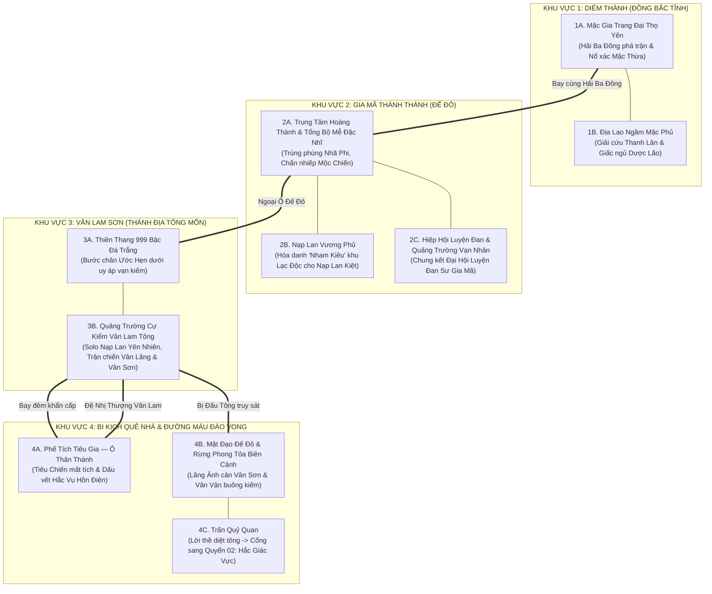

# CHƯƠNG 04: ĐẾ ĐÔ PHONG VÂN & ƯỚC HẸN BA NĂM — HUYẾT NHIỄM VÂN LAM!

> **Quyển 01**: Gia Mã Đế Quốc *(Hồi Kết Quyển 1)* | **Cấp độ (Level)**: `30 – 39`
> **Lộ trình Cảnh giới**: `Đại Đấu Sư 1 Tinh` → `Đại Đấu Sư 9 Tinh Đỉnh Phong` *(Đăng quang Quán Quân Đan Hội — Tứ Phẩm Luyện Đan Sư)*
> **Bối cảnh trung tâm**: Diêm Thành *(Mặc Gia Trang)*, Gia Mã Thánh Thành *(Đế Đô)*, Đỉnh **Vân Lam Sơn**, Ô Thản Thành đổ nát và Biên ải Trấn Quỷ Quan.
> **Trọng tâm Mở khóa**: **Đấu Khí Khải Giáp** & **Đấu Khí Ngoại Phóng** *(Đại Đấu Sư)*, Trọn vẹn **Mảnh Tàn Đồ Tịnh Liên Yêu Hỏa #2**, Tuyệt sát **Song Sắc Phật Nộ Hỏa Liên (2 Dị Hỏa)**, Kỹ năng Độc Ấn **Lạc Độc Chưởng**, Đan dược bạo cấp **Tam Văn Thanh Linh Đan**, Triệu hồi cứu nguy **Bản Thể Đấu Tông Mỹ Đỗ Toa**, và mở đường sang **Quyển 02: Hắc Giác Vực**!

---

## 1. Sơ Đồ Bản Đồ Con (Zone Layout & Connectivity)

Chương 04 là đại kiệt tác quy tụ quy mô bản đồ hoành tráng nhất Quyển 1: từ tòa trang viện đẫm máu ở Diêm Thành, kinh thành phồn hoa rực rỡ vạn người, cho tới quảng trường mây trắng 999 bậc thang trên đỉnh Vân Lam Sơn và hành trình đào vong rực lửa xuyên quốc gia.

### Chi Tiết Thiết Kế Từng Khu Vực (Top-down 2D Pixel Specs)

| Mã Zone | Tên Khu Vực | Kích Thước & Địa Hình Pixel 2D | NPC Trọng Tâm & Tương Tác | Hoạt Động / Cày Cuốc |
| :---: | :--- | :--- | :--- | :--- |
| **1A** | **Mặc Gia Trang Đại Sảnh** | `80x72 tiles`, dinh thự treo đèn lồng đỏ mừng thọ bị phủ băng trắng xóa bởi Hải Ba Đông; nửa sau bị san phẳng thành hố thiên thạch! | **Hải Ba Đông**, **Mặc Thừa**, Cát Diệp, **Lục Man & Bạch Nha**. | Đại náo thọ yến, Ném **Song Sắc Hỏa Liên** đầu tiên trong thực chiến! |
| **1B** | **Địa Lao Ngầm Mặc Phủ** | `48x44 tiles`, ngục tối ẩm ướt đầy lồng sắt giam Ma Thú thí nghiệm cấy ghép nội tạng của Mặc Thừa. | **Thanh Lân**, Quái nhân thí nghiệm Mặc Gia. | Phá ngục cứu Thanh Lân, Thu lượm sổ đen tội ác của Mặc Thừa. |
| **2A** | **Đế Đô & Tổng Bộ Mễ Đặc Nhĩ** | `120x96 tiles`, kinh thành lát ngọc cẩm thạch phồn hoa nhất Gia Mã; lầu đấu giá 5 tầng nguy nga. | **Nhã Phi**, **Hải Ba Đông**, Đằng Sơn, **Mộc Chiến**. | **Điểm Lưu Game Trung Tâm**, Mua đan phương cao cấp, Dằn mặt Mộc Chiến. |
| **2B** | **Nạp Lan Vương Phủ** | `64x56 tiles`, phủ đệ tướng quân uy nghiêm, nội viện tĩnh mịch nồng mùi hắc độc của Nạp Lan Kiệt. | **Nạp Lan Kiệt**, **Nạp Lan Yên Nhiên**, Nạp Lan Túc, Liễu Linh. | Mini-game **Khống Hỏa Khu Lạc Độc**, Nhận *Thất Huyễn Thanh Linh Tiên*. |
| **2C** | **Quảng Trường Đan Hội Đế Đô** | `100x100 tiles`, đài đá trăm bệ lò đan giữa vòng vây hàng vạn khán giả Pixel reo hò dậy đất. | **Hội trưởng Pháp Mã**, **Gia Hình Thiên**, Tiểu Công Chúa, **Viêm Lợi**. | Khảo hạch Tam Phẩm & Chung kết **Đại Hội Luyện Đan Sư Gia Mã**. |
| **3A** | **Thiên Thang 999 Bậc Đá** | `40x160 tiles` *(Bản đồ dốc thẳng đứng xuyên biển mây)*, hai bên xếp hàng ngàn đệ tử áo trắng cầm kiếm tỏa sát khí. | Đệ tử hộ sơn Vân Lam Tông, Khách mời toàn đế quốc. | Sự kiện đi bộ kháng kiếm ý lên đỉnh núi — không lùi nửa bước! |
| **3B** | **Quảng Trường Cự Kiếm Vân Lam** | `96x96 tiles`, sân đá cẩm thạch khổng lồ trên đỉnh núi mây với thanh cự kiếm đá cổ cắm giữa trời. | **Nạp Lan Yên Nhiên**, **Vân Vận**, Cổ Hà, **Vân Lăng**, **Vân Sơn**, **Mỹ Đỗ Toa**. | **Đấu trường Boss Đỉnh Cao**: Ước Hẹn 3 Năm, Phá trận Vân Yên & Nổ xác Vân Lăng! |
| **4A** | **Phế Tích Tiêu Gia (Ô Thản)** | `64x64 tiles`, bản đồ `Zone 1A-1C` của Chương 01 nhưng nay cháy rụi hoang tàn dưới mưa tro xám xịt. | **Tiêu Đỉnh** *(bị phế chân)*, **Tiêu Lệ**, Dấu vết **Hồn Điện**. | Điều tra hiện trường **Tiêu Chiến mất tích**, Uống đan bạo cấp lên Đỉnh Phong! |
| **4B** | **Rừng Phong Tỏa Biên Cảnh** | `140x80 tiles`, rừng thu lá đỏ đẫm máu với trạm gác dày đặc của chấp sự Vân Lam Tông và khe không gian nứt vỡ. | **Đấu Tông Vân Sơn**, **Lăng Ảnh**, **Vân Vận**. | Chuỗi phó bản **Sinh Tồn Đào Vong**, Trảm truy binh & Đoạn tình Vân Vận. |
| **4C** | **Trấn Quỷ Quan (Biên Ải)** | `52x40 tiles`, quan ải đá đen hiểm trở nối liền Gia Mã Đế Quốc với vùng đất tội ác Hắc Giác Vực. | Thương buôn lậu Hắc Giác Vực. | Hoạt cảnh **Lời Thề Huyết Hận** khép lại trọn vẹn Quyển 01! |

---

## 2. Chuỗi Nhiệm Vụ Chính (Main Questline — 7 Phân Cảnh Nguyên Tác)

### Phân Cảnh 4.1: Huyết Tẩy Mặc Gia Trang & Giấc Ngủ Say Của Dược Lão (Level 30–31)
* **Diễn biến cốt truyện**:
  * Quay về Thạch Mạc Thành sau khi luyện hóa Dị Hỏa, năng lượng tích tụ trong đan điền Tiêu Viêm chính thức kết tinh thành khối Đấu Tinh hình thoi -> Đột phá đại cảnh giới **Nhất Tinh Đại Đấu Sư (Lv.30)**! Mở khóa khả năng **Đấu Khí Ngoại Phóng** và triệu hồi bộ **Đấu Khí Khải Giáp** xanh ngọc bích rắn chắc phủ kín toàn thân!
  * Giữ đúng lời hứa, Dược Lão mượn cơ thể Tiêu Viêm dùng *Sa Chi Mạn Đà La* luyện thành công viên Lục phẩm **Phá Ách Đan**! Ngay khi **Hải Ba Đông** nuốt đan, đôi cánh băng khổng lồ chọc thủng mái nhà vươn rộng trên bầu trời sa mạc — vị **Băng Hoàng Đấu Hoàng** lừng lẫy năm xưa chính thức tái xuất giang hồ, hào sảng giao nốt nửa sau **Mảnh Tàn Đồ Tịnh Liên Yêu Hỏa #2** và nhận lời làm hộ vệ 1 năm cho Tiêu Viêm!
  * **Tin Dữ Sét Đánh**: Tiêu Đỉnh báo tin khẩn — **Thanh Lân** đã bị cường giả của **Mặc Gia** *(gia tộc bá chủ Đông Bắc Tỉnh tại Diêm Thành, thế lực ngoại thích lệ thuộc Vân Lam Tông)* bắt cóc ngay trong đêm! Đại trưởng lão **Mặc Thừa** *(Ngũ Tinh Đấu Linh, kẻ biến thái chuyên mổ Ma Thú cấy ghép vào cơ thể người)* đã phát hiện **Bích Xà Tam Hoa Đồng** của Thanh Lân và định mổ cướp đôi mắt cô bé ngay trong đêm Đại Thọ lần thứ 60 của lão!
  * **Đại Náo Thọ Yến Mặc Gia (`Zone 1A`)**: Giữa tiệc rượu tưng bừng có mặt cả Chấp sự **Cát Diệp** và ba vị Đấu Linh Vân Lam Tông tới chúc thọ, hai bóng người trùm Hắc Bào từ trên trời đạp nát cổng chính Mặc Gia Trang! Hải Ba Đông phất tay đóng băng toàn bộ khách mời Vân Lam Tông trên không trung, còn Tiêu Viêm xuống **Địa Lao (1B)** cứu Thanh Lân rồi quay lên quyết chiến **Mặc Thừa**!
  * Bị dồn tới đường cùng, Mặc Thừa xé toạc y phục lộ ra cơ thể quái vật gớm ghiếc khâu vá từ cánh chim ưng và vảy Ma Thú Cấp 5, thực lực bạo tăng lên **Bán Bộ Đấu Hoàng**, điên cuồng bóp nát không trung áp chế cả Hải Ba Đông! Trong khoảnh khắc sinh tử, Tiêu Viêm nghiến răng mượn một luồng **Cốt Linh Lãnh Hỏa (#11)** cuối cùng của Dược Lão ép thẳng vào **Thanh Liên Địa Tâm Hỏa (#19)** trên tay mình!
  * **Đóa Sen Hủy Diệt Đầu Tiên Của Hai Dị Hỏa**: **Song Sắc Phật Nộ Hỏa Liên (Xanh Ngọc – Trắng Băng)** xoay tròn lặng lẽ bay tới chạm vào Mặc Thừa — *ẦM!* Một đám mây nấm hai màu khổng lồ nuốt chửng nửa tòa Mặc Gia Trang, nổ tan xác Mặc Thừa thành bụi phấn không còn một mảnh xương thừa!
  * Đúng lúc Tiêu Viêm kiệt sức rơi xuống, bầu trời xé rách hiện ra hai cường giả Đấu Hoàng đỉnh phong cực kỳ đáng sợ của **Thiên Xà Phủ (Hắc Giác Vực)**: Bà lão **Lục Man** và Ma Thú Cấp 6 Đỉnh Phong **Bát Dực Hắc Xà Hoàng (Bạch Nha)** muốn đưa Thanh Lân về tông môn bồi dưỡng! Sau màn đụng độ nảy lửa giữa Bạch Nha và Dược Lão + Hải Ba Đông, biết Thiên Xà Phủ thật lòng truyền thừa thánh nữ cho Thanh Lân, Tiêu Viêm nén lòng để muội muội rời đi bái sư.
  * **Cái Giá Đau Đớn**: Vì vừa xuất Cốt Linh Lãnh Hỏa tạo Hỏa Liên vừa ngạnh kháng dư chấn nổ và đòn của Bát Dực Hắc Xà Hoàng để che mạng cho đồ đệ, tàn hồn **Dược Lão mờ đi tới mức trong suốt, mỉm cười căn dặn Tiêu Viêm tìm *"Thất Huyễn Thanh Linh Tiên"* rồi chìm vào giấc ngủ say bất tỉnh trong chiếc nhẫn đen!** Lần đầu tiên trên đời, Tiêu Viêm mất đi người thầy che chở, phải tự đôi chân mình bước vào sào huyệt Đế Đô!
* **Mục tiêu Gameplay**:
  1. Đột phá **Đại Đấu Sư (Lv.30)**: Mở khóa **Đấu Khí Khải Giáp** *(tăng gấp đôi khả năng giảm sát thương so với Sa Y và cho phép chém kiếm khí **Đấu Khí Ngoại Phóng** tầm trung bằng đòn đánh thường Huyền Trọng Xích!)*.
  2. Đánh bại **Boss Quái Nhân Mặc Thừa (Lv.32 — Bán Bộ Đấu Hoàng)** *(xem Mục 7.1)*.
  3. **Biến đổi Hệ thống**: Phím `T` *(Dược Lão Phụ Thể)* bị **Khóa Tạm Thời** do Dược Lão ngủ say — buộc người chơi tự lực cánh sinh bằng thực lực bản thân và đồng minh!

### Phân Cảnh 4.2: Tiến Vào Đế Đô Gia Mã & Danh Chấn "Nham Kiêu" (Level 31–33)
* **Diễn biến cốt truyện**:
  * Cùng Hải Ba Đông đặt chân tới **Gia Mã Thánh Thành (`Zone 2A`)** cách Vân Lam Sơn chỉ vài chục dặm. Để tránh tai mắt Vân Lam Tông trước ngày Ước Hẹn, Tiêu Viêm đeo mặt nạ dịch dung tơ tằm đổi khuôn mặt thành thanh niên gầy gò lạnh lùng, lấy hóa danh **"Nham Kiêu"**.
  * Tới **Tổng Bộ Mễ Đặc Nhĩ**, Tiêu Viêm mừng rỡ gặp lại **Nhã Phi** — nay nàng đã trưởng thành quyến rũ sắc sảo gấp bội nhưng đang bị trưởng lão nội tộc ép gả cho thiếu gia Mộc Gia là **Mộc Chiến** *(Đại Đấu Sư 2 Tinh hung hăng từ biên cương về)*. Thấy Mộc Chiến xông vào phòng đấu giá đập phá và hỗn xược với Nhã Phi, "Nham Kiêu" lạnh mặt tung cước đá gãy xương sườn Mộc Chiến bay thẳng ra đường lớn giữa tiếng vỗ tay của đám đông, còn Hải Ba Đông ra mặt dẹp yên nội bộ gia tộc trả lại thực quyền cho Nhã Phi!
  * Nghe Nhã Phi báo tin **Nạp Lan Vương Phủ (`Zone 2B`)** đang nắm giữ cây bảo dược hồi hồn **Thất Huyễn Thanh Linh Tiên** để treo thưởng cho ai cứu được lão nguyên soái **Nạp Lan Kiệt** *(Đấu Vương — ông nội ruột của Nạp Lan Yên Nhiên, đang hấp hối vì trúng **Lạc Độc** của Lạc Độc Hạt Vương mà ngay cả Đan Vương Cổ Hà cũng bó tay do không có Dị Hỏa!)*, "Nham Kiêu" đường hoàng bước vào cửa nhà kẻ thù!
  * **Màn Trêu Ngươi Định Mệnh**: Tại phòng bệnh, **Nạp Lan Yên Nhiên** *(nay đã xinh đẹp thoát tục ở cảnh giới Đại Đấu Sư)* ban đầu nhìn gã thanh niên "Nham Kiêu" bằng ánh mắt nghi ngờ. Nhưng ngay khi Nham Kiêu búng ngón tay triệu hồi **Thanh Liên Địa Tâm Hỏa** xanh rực hút từng sợi độc khí đen kịt ra khỏi tim phổi Nạp Lan Kiệt, cả Nạp Lan gia tộc đều chấn động cúi rạp! Nạp Lan Yên Nhiên dịu dàng rót trà, cúi đầu cảm kích "Nham Kiêu tiên sinh", thậm chí ánh mắt nhìn vị thiên tài bí ẩn ngang tuổi mình còn thoáng nét bối rối ngưỡng mộ — **mà không mảy may biết rằng người nàng đang kính trọng lấy lòng chính là gã vị hôn phu Tiêu Gia bị nàng sỉ nhục từ hôn 3 năm trước!** *(Trong 7 ngày khu độc, Tiêu Viêm tinh quái dùng Thanh Liên Hỏa gom toàn bộ Lạc Độc nén thành một ấn ký đầu lâu đen trong lòng bàn tay làm sát chiêu phòng thân: **Lạc Độc Ấn**!)*.
  * Nhận được **Thất Huyễn Thanh Linh Tiên**, Tiêu Viêm đem một phần nuôi dưỡng tàn hồn giúp Dược Lão ổn định khí tức trong nhẫn; bất ngờ thay, mùi hương linh dược cũng đánh thức **linh hồn bản thể Mỹ Đỗ Toa Nữ Vương** đang ngủ trong cơ thể rắn nhỏ **Thải Lân**! Đêm khuya trong khách điếm, Nữ Vương hiện nguyên hình mỹ nhân kiêu ngạo dẫm bàn chân ngọc lên ngực định giết Tiêu Viêm vì dám coi nàng làm thú cưng, nhưng do bị linh hồn Thải Lân quấn quýt ngăn cản nên đành lập thỏa thuận: Nếu Tiêu Viêm đoạt *Dung Linh Đan Phương* luyện cho nàng **Phục Linh Tử Đan** hoàn chỉnh dung hợp linh-thể, nàng sẽ bảo vệ mạng hắn!
* **Mục tiêu Gameplay**:
  1. Đánh gục Mini-boss **Mộc Chiến (Lv.31)** tại sảnh Mễ Đặc Nhĩ trong dưới 3 chiêu để kích hoạt danh hiệu **Cuồng Khách Đế Đô**.
  2. Chơi **Mini-game Khống Hỏa Rút Lạc Độc** suốt 3 đợt trị liệu tại `Zone 2B` -> Mở khóa kỹ năng phụ **Lạc Độc Ám Chưởng** *(bắn luồng độc đen ăn mòn `30% DEF` của Boss trong 10 giây)*.

### Phân Cảnh 4.3: Đại Hội Luyện Đan Sư Gia Mã — Tam Văn Thanh Linh Đan Đoạt Quán Quân! (Level 33–34)
* **Diễn biến cốt truyện**:
  * Ngày hội lớn nhất 8 năm một lần khai màn tại **Quảng Trường Trung Tâm Đế Đô (`Zone 2C`)** dưới sự chứng kiến của hàng chục vạn người dân! Dưới danh nghĩa **"Nham Kiêu"**, Tiêu Viêm vượt qua vòng loại Nội Thị Mê Cung với tốc độ kỷ lục, tiến thẳng vào Chung Kết đọ sức cùng thiên tài hoàng thất **Tiểu Công Chúa Nguyệt Nhi**, tình địch hào hoa **Liễu Linh** *(đệ tử chân truyền của Cổ Hà)* và một lão già áo xám âm hiểm tên **Viêm Lợi**!
  * **Biến Cố Quốc Thể**: Giữa vòng chung kết, Hội trưởng **Pháp Mã** *(Ngũ phẩm đỉnh phong)* kinh hoàng phát hiện **Viêm Lợi** chính là Phó hội trưởng Hiệp Hội Luyện Đan của quốc gia thù địch **Xuất Vân Đế Quốc** cải trang sang Gia Mã hòng cướp chức Quán Quân bôi nhọ danh dự toàn bộ giới Luyện Đan Gia Mã! Viêm Lợi dùng tà hỏa luyện thành viên tứ phẩm đỉnh phong *Tử Tâm Phá Chướng Đan*, sóng âm chấn nổ tung cả lò đan của Liễu Linh và hàng chục thí sinh khác!
  * Trong lúc cả khán đài vạn người tuyệt vọng nhìn Viêm Lợi ngạo nghễ cười nhạo Gia Mã không một ai có tài, Pháp Mã cắn răng bí mật truyền âm đưa cho "Nham Kiêu" cuốn đan phương cổ cực kỳ hung hiểm: **Tam Văn Thanh Linh Đan** *(cần đổi **3 loại hỏa diễm mạnh yếu khác nhau** để khắc 3 đường vân đan, người thường chạm vào 9 phần nổ lò!)*
  * **Khoảnh Khắc Nghẹt Thở Lịch Sử**: Lần luyện thứ nhất vì chưa quen nhịp chuyển lửa, lò đan của Tiêu Viêm **nổ tung** khiến khóe miệng trào máu, Viêm Lợi cười sặc sụa còn Nạp Lan Yên Nhiên trên khán đài lo lắng đứng bật dậy! Không bỏ cuộc, Tiêu Viêm lau vết máu, đặt phần nguyên liệu dự phòng cuối cùng vào đỉnh, lạnh lùng tung liền **3 Tầng Chuyển Hỏa Đỉnh Cao**: **Phàm Đấu Khí Hỏa → Tử Tinh Thú Hỏa → Thanh Liên Địa Tâm Hỏa**!
  * Cột sáng xanh tím bắn thẳng lên chín tầng mây, hương đan thơm ngát mười dặm kinh thành — viên **Tam Văn Thanh Linh Đan** hoàn mỹ bay vọt khỏi lò đè bẹp hoàn toàn đan dược của Viêm Lợi! **"Nham Kiêu" 18 tuổi chính thức đăng quang Quán Quân Đại Hội Luyện Đan Sư Gia Mã** giữa biển tiếng hò reo vang dội rung chuyển đất trời, đập nát âm mưu của Xuất Vân Đế Quốc *(Viêm Lợi định trốn chạy liền bị Gia Hình Thiên & Hải Ba Đông bắt giữ)*!
  * Nhận phần thưởng tối cao: **Lục phẩm Dung Linh Đan Phương**, Huy hiệu Trưởng Lão Danh Dự Hiệp Hội, cùng sự cam kết bảo hộ của cả hai vị Đấu Hoàng **Pháp Mã** và lão tổ Hoàng thất **Gia Hình Thiên**! Đêm cuối cùng trước ngày hẹn, Tiêu Viêm mài sắc tâm cảnh trên nóc lầu Đế Đô, tu vi vững vàng ở **Đại Đấu Sư Tứ Tinh (Lv.34)**!
* **Mục tiêu Gameplay**:
  1. Vượt 3 vòng thi **Đại Hội Luyện Đan Sư** *(xem Mục 4.2)*: Đặc biệt là màn **Tam Tầng Chuyển Hỏa QTE & Rhythm Control** để đúc thành công viên bảo đan **Tam Văn Thanh Linh Đan**!

### Phân Cảnh 4.4: Đệ Nhất Thượng Vân Lam Sơn — Ước Hẹn Ba Năm! (Level 34–35)
* **Diễn biến cốt truyện**:
  * Bình minh ngày Ước Hẹn! Chuông đồng ngân vang trên đỉnh **Vân Lam Sơn**. Toàn bộ nhân vật máu mặt nhất đế quốc *(Hải Ba Đông, Pháp Mã, Gia Hình Thiên, Nhã Phi, Cổ Hà, Nạp Lan Kiệt...)* đều ngồi kín hàng ghế khách quý trên **Quảng Trường Cự Kiếm (`Zone 3B`)**. Trên bảo tọa cao nhất là Tông chủ **Vân Vận** che mạng lụa mờ uy nghi; giữa sân là **Nạp Lan Yên Nhiên** *(Đại Đấu Sư Tam Tinh)* áo trắng phần phật cầm kiếm đứng đợi kết thúc ân oán năm xưa.
  * Từ dưới chân núi, người chơi điều khiển Tiêu Viêm khoác hắc sam, lưng vác **Huyền Trọng Xích** lặng lẽ bước từng bước lên **999 Bậc Thang Đá Trắng (`Zone 3A`)** xuyên qua kiếm khí áp bách của ngàn đệ tử Vân Lam Tông!
  * **Giây Phút Xé Mặt Nạ Chấn Động Toàn Đế Quốc**: Bước lên trung tâm quảng trường, Tiêu Viêm cắm phập thanh Huyền Trọng Xích làm nứt toác mặt sân đá cẩm thạch, rồi thản nhiên đưa tay **xé bỏ lớp da mặt dịch dung**, lộ ra gương mặt góc cạnh kiên nghị thật sự của thiếu niên nhà họ Tiêu!
    * Toàn trường nổ tung như sấm rền! Pháp Mã, Gia Hình Thiên, Liễu Linh bật dậy thất thanh: ***"Cái gì?! Tiêu Viêm phế vật năm xưa của Tiêu Gia... lại chính là Quán Quân Đan Hội Nham Kiêu hôm qua sao?!"***
    * **Nạp Lan Yên Nhiên** lùi lại nửa bước như bị sét đánh ngang tai, sắc mặt trắng bệch: Chàng trai bí ẩn từng cứu mạng ông nội nàng, vị thiên tài kiệt xuất khiến trái tim kiêu hãnh của nàng đêm qua thức trắng ngưỡng mộ... lại chính là vị hôn phu bị nàng mang Tụ Khí Tán tới đạp dưới chân ở Ô Thản Thành 3 năm trước!
    * Và trên ghế Tông chủ, **Vân Vận** bóp nát tay vịn ngọc thạch, đôi mắt phượng chấn động tột cùng: Khuôn mặt ấy, thanh trọng xích ấy, chiếc Hải Tâm Giáp ấy — thiếu niên **Dược Nham** dịu dàng trong sơn động Ma Thú Sơn Mạch, kẻ đoạt Dị Hỏa sa mạc, Nham Kiêu và kẻ thù 3 năm của đồ đệ nàng... **hóa ra từ đầu tới cuối đều là một người!**
  * **Trận Quyết Đấu Đỉnh Cao 1v1**: Không một lời thừa thãi, giao tranh bùng nổ! Nạp Lan Yên Nhiên dốc cạn kiêu hãnh thi triển *Phong Linh Phân Hình Kiếm*, cuối cùng bay vút lên trời tụ hội linh khí vạn trượng vào mũi kiếm tung tuyệt kỹ mạnh nhất: **Phong Chi Cực: Lạc Nhật Diệu**!
  * Dưới mặt đất, Tiêu Viêm tháo bỏ Huyền Trọng Xích, khoác **Thanh Liên Đấu Khí Khải Giáp**, hai bàn tay chắp lại dung hợp **Thanh Liên Địa Tâm Hỏa + Tử Hỏa** đẩy đóa **Phật Nộ Hỏa Liên** bay thẳng lên nghênh đón vầng mặt trời kiếm quang!
  * Vụ nổ lộng lẫy xé nát bầu trời Vân Lam Sơn! Nạp Lan Yên Nhiên bại trận rơi xuống đất! Tuyệt vọng vì làm nhục thanh danh sư môn, nàng nhắm mắt kề kiếm ngang cổ định **tự sát tạ tội**, nhưng Tiêu Viêm lướt **Tử Vân Dực** tay không chụp chặt lưỡi kiếm sắc bén mặc máu tươi nhỏ giọt, lạnh lùng rút từ ngực áo ra **Tờ Hưu Thư Máu 3 Năm Trước** ném trả trước mặt nàng, ngẩng cao đầu tuyên bố kết thúc Ước Hẹn rồi xoay người bước xuống núi trong sự kính nể tuyệt đối của thiên hạ!
* **Mục tiêu Gameplay**:
  1. Sự kiện đi bộ vượt **Thiên Thang 999 Bậc (`Zone 3A`)** phá tan Kiếm Trận Uy Áp.
  2. Đánh bại **Boss Nạp Lan Yên Nhiên — Thiếu Tông Chủ Vân Lam Tông (Lv.35 — Đại Đấu Sư 3 Tinh)** trong trận chiến 3 Phase nghẹt thở *(xem Mục 7.2)*.

### Phân Cảnh 4.5: Đại Trưởng Lão Vân Lăng Trở Mặt & Nữ Vương Đấu Tông Giáng Thế! (Level 35–36)
* **Diễn biến cốt truyện**:
  * Vinh quang vừa khép lại thì sát cơ bùng nổ! Nhìn thấy *Tử Vân Dực* và *Phật Nộ Hỏa Liên*, Chấp sự **Cát Diệp** bỗng run rẩy chỉ tay hét toáng lên: *"Đại trưởng lão! Hắn chính là Hắc Bào Nhân đã nổ chết Mặc Thừa ở Mặc Gia Trang!"*
  * Đại Trưởng Lão **Vân Lăng** *(Đấu Vương Đỉnh Phong — lão già hẹp hòi cổ hủ không chịu nổi cảnh một thiếu niên 18 tuổi giẫm lên mặt mũi tông môn rồi bình yên bước đi)* lập tức trở mặt ra lệnh bắt giữ Tiêu Viêm! Ba vị Trưởng lão Đấu Vương đồng loạt bay lên kết ấn triệu hồi đại trận hộ sơn **Vân Yên Phúc Nhật Trận** phủ kín mây trắng khóa chặt toàn bộ Vân Lam Sơn!
  * **Đồng Minh Đấu Hoàng Sát Cánh**: **Hải Ba Đông** cười gằn bật cánh băng Đấu Hoàng lao thẳng xuống đứng chắn trước mặt Tiêu Viêm! Trên khán đài, **Gia Hình Thiên** và **Pháp Mã** cũng đồng loạt bộc phát khí thế Đấu Hoàng cảnh cáo Vân Lăng không được đụng vào Quán Quân Đan Hội; ngay cả ám vệ **Lăng Ảnh** trong đám mây đen và **Vân Vận** vừa bay trở lại cũng lên tiếng ngăn cản, nhưng Vân Lăng điên cuồng rút lệnh bài Thái Thượng Trưởng Lão ép hàng trăm đệ tử rót Đấu Khí vào đại trận ngưng tụ cự kiếm mây đâm thẳng xuống đầu Tiêu Viêm!
  * **Giây Phút Đấu Tông Hiện Thế Chấn Nhiếp Quần Hùng**: Đúng lúc Hải Ba Đông bị đại trận cầm chân, từ trong tay áo Tiêu Viêm phóng ra cột sáng bảy sắc xé toạc cả tầng mây hộ tông! **Thất Thải Thôn Thiên Mãng** hóa thành bản thể tuyệt mỹ đầy uy quyền của **Mỹ Đỗ Toa Nữ Vương — CƯỜNG GIẢ ĐẤU TÔNG ĐẦU TIÊN XUẤT HIỆN!**
  * Đôi chân ngọc thản nhiên **đạp bước trên hư không** *(dấu hiệu tối thượng của Đấu Tông!)*, Mỹ Đỗ Toa chỉ khẽ liếc mắt phẩy nhẹ cổ tay một cái: Đại trận ngàn người Vân Yên Phúc Nhật Trận vỡ vụn như bọt nước, Vân Lăng cùng ba vị Đấu Vương phun máu tươi bắn ngược đập nát tượng đá! Trước sự run rẩy câm lặng của cả Gia Hình Thiên, Cổ Hà lẫn Hải Ba Đông, Nữ Vương lạnh lùng nắm cổ áo Tiêu Viêm *(kẻ duy nhất giữ đan phương luyện thuốc cho nàng)* xé gió bay vút khỏi Vân Lam Sơn!
* **Mục tiêu Gameplay**:
  1. Chiến đấu trụ vững `90 giây` giữa vòng vây **Vân Yên Phúc Nhật Trận** cùng NPC trợ chiến Đấu Hoàng **Hải Ba Đông** *(phá hủy 4 Nhãn Trận Kiếm Đệ Tử)* cho tới khi kích hoạt Cutscene **Mỹ Đỗ Toa Đấu Tông Phá Trận**.

### Phân Cảnh 4.6: Bi Kịch Tiêu Gia (Bóng Ma Hồn Điện) & Đệ Nhị Thượng Vân Lam Sơn! (Level 36–38)
* **Diễn biến cốt truyện**:
  * Vừa đáp xuống ngoại ô Đế Đô chưa kịp thở phào, tình báo Mễ Đặc Nhĩ hộc máu chạy tới báo tin dữ làm bầu trời trước mắt Tiêu Viêm sụp đổ: Lão cẩu **Vân Lăng** vì nhục nhã bị Mỹ Đỗ Toa đánh bại đã lén giấu Vân Vận phái hai chấp sự Đấu Linh tập kích **Ô Thản Thành** nhằm bắt Tiêu Chiến làm con tin!
  * Điên cuồng vỗ rách cả đôi cánh bay xuyên đêm về tới **Phế Tích Tiêu Gia (`Zone 4A`)**: Dinh thự tuổi thơ nay chìm trong biển máu và tro tàn! Đại ca **Tiêu Đỉnh** bị đánh gãy nát gân hai chân ngồi trên xe lăn, Nhị ca **Tiêu Lệ** máu me đầm đìa gào khóc báo tin: Phụ thân **Tiêu Chiến** lúc liều mạng đoạn hậu cho tộc nhân rút vào hầm ngầm đã **MẤT TÍCH KHÔNG ĐỂ LẠI MỘT VẾT MÁU** ngay trước mắt cả đám chấp sự Vân Lam Tông!
  * **Điều Tra Hiện Trường — Phục Bút Lớn Nhất Toàn Truyện (Hồn Điện)**: Quỳ sụp giữa sân sau đẫm nước mưa nơi phụ thân biến mất, Tiêu Viêm bật cảm ứng `SOUL` tột độ và phát hiện trong khe gạch vỡ còn vương lại **một sợi Hắc Vụ lạnh lẽo vặn vẹo phát ra tiếng xiềng xích sắt rợn người**! Trong nhẫn đen, ý thức mơ màng của Dược Lão khẽ chấn động truyền ra hai chữ đầy căm hận tột cùng: ***"Hồn Điện...!"*** *(Chính tổ chức hắc ám khủng bố bậc nhất Trung Châu này đã thừa nước đục thả câu bắt cóc Tiêu Chiến để đoạt mảnh **Đà Xá Cổ Đế Ngọc** của Tiêu Tộc!)*. Thế nhưng kẻ châm ngòi dẫn sói vào nhà hủy nát gia đình huynh hôm nay, không ai khác chính là **Vân Lăng và Vân Lam Tông**!
  * Giao phó gia tộc cho Hải Ba Đông và Mễ Đặc Nhĩ che chở, Tiêu Viêm hai mắt đỏ ngầu như tu la địa ngục, ngửa cổ **nuốt chửng viên bảo đan Tam Văn Thanh Linh Đan**! Mặc kệ dược lực cuồng bạo xé rách kinh mạch rỉ máu khắp lỗ chân lông, cảnh giới của Tiêu Viêm bạo tăng điên cuồng xuyên liền bốn cấp lên thẳng **Đại Đấu Sư Bát – Cửu Tinh Đỉnh Phong (Lv.38)**!
  * **Đệ Nhị Thượng Vân Lam Sơn — Máu Nợ Máu Trả!**: Một mình vác Huyền Trọng Xích nhuốm máu, Tiêu Viêm đạp tan cổng sơn môn lần thứ hai! Giữa lúc **Vân Vận** rơi lệ cầu xin huynh bình tĩnh điều tra vì nàng không thể tự tay xử tử Đại trưởng lão trước mặt vạn đệ tử, tên súc sinh **Vân Lăng** còn ngạo mạn cười khẩy xúc phạm Tiêu Chiến!
  * Đúng khắc ấy, cấm địa hậu sơn nổ tung — Tông chủ tiền nhiệm bế quan 30 năm **Vân Sơn** bước ra giữa hư không với uy áp **ĐẤU TÔNG CƯỜNG GIẢ** *(kẻ đã ngầm bán linh hồn cấu kết với Hộ Pháp Hồn Điện để đột phá Đấu Tông!)*, thản nhiên tuyên bố che chở cho Vân Lăng!
  * Ngước nhìn Đấu Tông Vân Sơn đứng trên trời cao, Tiêu Viêm nở nụ cười điên dại bi tráng nhất cuộc đời! Đánh thức tia hồn lực bảo mệnh cuối cùng của **Dược Lão**, thiếu niên dốc sạch giọt máu và Đấu Khí cuối cùng ép **Thanh Liên Địa Tâm Hỏa + Cốt Linh Lãnh Hỏa + Tử Hỏa** tạo thành một đóa **Phật Nộ Hỏa Liên Cực Đại** rực sáng như vầng thái dương hủy diệt, khóa cứng không gian quanh Vân Lăng rồi ném thẳng xuống! Vân Sơn kinh hãi lao tới cứu nhưng chậm nửa bước — trong tiếng gào thét tuyệt vọng, **Đại Trưởng Lão Vân Lăng bị nổ tan xác thành tro bụi vĩnh viễn trước mặt toàn thể Vân Lam Tông!**
* **Mục tiêu Gameplay**:
  1. Khám phá hiện trường `Zone 4A` bằng `SOUL` thu thập vật phẩm cốt truyện **Tàn Dư Hắc Vụ Xiềng Xích (Manh Mối Hồn Điện)** & Uống *Tam Văn Thanh Linh Đan* bạo cấp lên **Lv.38**.
  2. Trận quyết tử báo thù **Boss Đại Trưởng Lão Vân Lăng (Lv.38 — Đấu Vương Đỉnh Phong)** dưới áp lực can thiệp từ xa của Đấu Tông Vân Sơn *(xem Mục 7.3)*!

### Phân Cảnh 4.7: Cuộc Đào Vong Đẫm Máu Khỏi Gia Mã — Thề Hủy Vân Lam! (Level 38–39)
* **Diễn biến cốt truyện**:
  * Vân Lăng chết thảm ngay dưới mắt mình, **Đấu Tông Vân Sơn** nổi giận lôi đình phát lệnh phong tỏa toàn bộ biên giới Gia Mã Đế Quốc truy sát Tiêu Viêm! Tia hồn lực cuối cùng của Dược Lão sau khi đỡ trọn một đòn *Không Gian Phong Tỏa* của Vân Sơn giúp Tiêu Viêm vọt khỏi đỉnh núi đã hoàn toàn tắt lịm, **chìm vào hôn mê sâu không thể gọi dậy**; còn Hải Tâm Giáp trên ngực Tiêu Viêm cũng nứt vỡ tan tành!
  * **Đường Máu Vượt Đế Đô & Rừng Biên Cảnh (`Zone 4B`)**:
    * Vừa chạy tới ngoại thành Đế Đô, Vân Sơn đã xé không gian đuổi sát sau lưng! Ngay khi bàn tay khổng lồ của Đấu Tông chụp xuống đỉnh đầu Tiêu Viêm, từ bóng tối hư vô lao ra **Đấu Hoàng Đỉnh Phong Lăng Ảnh**! Lăng Ảnh tung *Ám Ảnh Quyết* cứng rắn cản chân Vân Sơn đúng 3 nhịp thở quý giá, ném lời nhắn của Huân Nhi bảo Tiêu Viêm hãy sống sót tìm tới **Học Viện Già Nam**, trong khi **Hải Ba Đông** kéo Tiêu Viêm chui vào mật đạo ngầm trốn khỏi kinh thành!
    * Suốt nửa tháng đẫm máu luồn lách qua **Rừng Phong Tỏa Biên Cảnh**, Tiêu Viêm như con sói độc trọng thương vừa chạy vừa quay đầu dùng *Huyền Trọng Xích + Lạc Độc Ấn* giết ngược từng toán chấp sự Đấu Linh, Đấu Vương Vân Lam Tông đuổi lẻ!
    * **Đoạn Tình Nơi Hẻm Núi Cuối Cùng**: Ngay trước cửa ải biên giới, bóng trắng cầm kiếm đứng chặn giữa đường mòn lá đỏ chính là **Vân Vận**! Đôi mắt vị nữ Tông chủ đỏ hoe ngấn lệ: Phía sau lưng nàng là tông môn ngàn năm tan hoang và thi thể Đại trưởng lão, phía trước mũi kiếm nàng là chàng thiếu niên Dược Nham đã khắc cốt ghi tâm. Tiêu Viêm máu thấm đẫm hắc bào, ánh mắt lạnh lẽo bi thương nhìn mảnh vỡ *Hải Tâm Giáp* trong tay nói lời ân đoạn nghĩa tuyệt giữa Tiêu Gia và Vân Lam Tông! Khi khí tức khủng khiếp của Vân Sơn áp sát chân trời, **Vân Vận nhắm chặt hai hàng lệ, đau đớn kháng mệnh sư phụ thu kiếm nghiêng người nhường đường máu cho Tiêu Viêm lao qua!**
  * Bước chân đẫm máu vượt qua **Trấn Quỷ Quan (`Zone 4C`)** — biên giới cuối cùng của quê hương! Ngoái đầu nhìn lại bầu trời Gia Mã Đế Quốc mù mịt mây đen, thiếu niên 18 tuổi chống thanh Huyền Trọng Xích gầm vang lời thề xé rách tầng mây trước khi bước vào vùng đất tàn khốc **Hắc Giác Vực** — khép lại thiên sử thi bi tráng của **Quyển 01**!
* **Mục tiêu Gameplay**:
  1. Vượt phó bản sinh tồn liên hoàn **Đào Vong Khỏi Đấu Tông (`Zone 4B`)**: Chạy thoát khỏi các khe nứt không gian của Vân Sơn, hạ gục 2 Truy Binh Trưởng Lão Vân Lam và chạm mốc **Level 39 (Đại Đấu Sư 9 Tinh Đỉnh Phong)** tại **Trấn Quỷ Quan (`Zone 4C`)**!

---

## 3. Nhiệm Vụ Phụ & Kỳ Ngộ Ẩn (Side Quests, Secrets & Easter Eggs)

1. **[Kỳ Ngộ Ẩn Cực Đắt Giá] Bức Mật Thư Của Huân Nhi Qua Tay Lăng Ảnh**:
   * **Điều kiện**: Nếu ở Chương 01 người chơi đã mở khóa thành tựu gặp **Lăng Ảnh** trên mái nhà, thì trong Phân cảnh 4.7 khi Lăng Ảnh cản Vân Sơn ở Đế Đô, ông sẽ lén ném thêm vào túi Tiêu Viêm một **Lá Ngọc Vàng Cổ Tộc**.
   * **Phần thưởng**: Vật phẩm hộ mệnh **Kim Viêm Hộ Hồn Ngọc** *(Giúp hồi sinh tại chỗ 1 lần duy nhất với `50% HP` khi sang Quyển 02 Hắc Giác Vực!)* + Mở khóa đoạn thư tay đầy thương nhớ của Tiêu Huân Nhi từ Nội Viện Già Nam.
2. **[Nhiệm Vụ Phụ] Chỉnh Đốn Nội Tộc Mễ Đặc Nhĩ Cùng Hải Ba Đông**:
   * **Người giao**: Nhã Phi & Hải Ba Đông tại `Zone 2A` *(trước Đan Hội)*.
   * **Nội dung**: Đánh bại phe cánh trưởng lão thân Vân Lam Tông trong nội bộ Mễ Đặc Nhĩ để củng cố quyền lực tuyệt đối cho Nhã Phi — biến Mễ Đặc Nhĩ thành mạng lưới tình báo cứu mạng toàn bộ tộc nhân Tiêu Gia ở Hồi 4.6!
   * **Phần thưởng**: `25.000 Kim Tệ`, **Thẻ Chí Tôn Kim Cương Mễ Đặc Nhĩ** & **Đan Đỉnh Tứ Phẩm: Xích Dương Đỉnh** *(+15% Tốc độ tụ đan tại Đại Hội Luyện Đan Sư!)*.
3. **[Nhiệm Vụ Phụ] Tâm Nguyện Của Nhị Ca — Vết Sẹo Huyết Thương**:
   * **Người giao**: Tiêu Lệ tại **Phế Tích Tiêu Gia (`Zone 4A`)** sau thảm kịch gia tộc.
   * **Nội dung**: Luyện gấp một viên *Hộ Mạch Sinh Cốt Đan* giữ mạng cho Đại ca Tiêu Đỉnh và cùng Tiêu Lệ thề ước trả thù *(mở phục bút sau này Tiêu Lệ vì quá hận thù mà nuốt Phệ Sinh Đan ở Hắc Giác Vực!)*.
   * **Phần thưởng**: Nội tại huyết thống **Tiêu Tộc Nộ Huyết** *(Tăng vĩnh viễn `+15% ATK` khi đối đầu mọi kẻ địch mang danh hiệu Vân Lam Tông & Hồn Điện xuyên suốt cả game!)*.
4. **[Easter Egg] Cuộc Chiến Linh Hồn Của Nữ Vương & Rắn Nhỏ Trong Khách Điếm**:
   * **Vị trí**: Nghỉ đêm tại Khách điếm Đế Đô sau khi có *Thất Huyễn Thanh Linh Tiên* sẽ kích hoạt hoạt cảnh hài hước xen lẫn nguy hiểm: Bản thể Mỹ Đỗ Toa vừa giơ tay định bóp cổ Tiêu Viêm thì ý thức bé bỏng của Thải Lân giành lại quyền điều khiển làm Nữ Vương lảo đảo ngã nhào vào lòng Tiêu Viêm rồi biến lại thành rắn nhỏ chui tọt vào chăn trốn xấu hổ!

---

## 4. Cơ Chế Gameplay Đặc Sắc Của Chương 04

### 4.1. Đặc Quyền Đại Đấu Sư: Đấu Khí Khải Giáp & Đấu Khí Ngoại Phóng
* **Thanh Liên Đấu Khí Khải Giáp**: Nâng cấp trực tiếp từ *Sa Y* khi đạt `Level 30`: Tạo bộ giáp lửa xanh ngọc bích bao phủ vai, ngực và tay chân Pixel của nhân vật — giảm `35%` sát thương nhận vào và đốt cháy mọi kẻ địch chạm vào người chơi!
* **Đấu Khí Ngoại Phóng**: Khi thanh `QI > 50%`, mỗi cú vung thường (`LMB`) của Huyền Trọng Xích sẽ phóng kèm một lưỡi trăng khuyết lửa xanh bay xa `5 tiles` xuyên thấu hàng quái — biến Tiêu Viêm thành cỗ máy càn quét tầm trung thực thụ!

### 4.2. Đại Hội Luyện Đan Sư Gia Mã: Cơ Chế Tam Tầng Chuyển Hỏa
* Trận chung kết luyện **Tam Văn Thanh Linh Đan** là đỉnh cao của hệ thống Mini-game Lò Đan trong Quyển 1:
  * **Giai đoạn 1 (Dung Thảo — Phàm Hỏa Vàng)**: Giữ con trỏ nhiệt độ ổn định ở dải nhiệt thấp `30–40%` trong 15 giây mặc cho sóng âm phá hoại từ lò của Viêm Lợi đẩy lệch thanh trượt!
  * **Giai đoạn 2 (Ngưng Đan — Đổi Sang Tử Hỏa Tím)**: Bấm phím chuyển lửa đúng khung vàng `0.3s` đẩy vọt nhiệt độ lên `65–75%` khắc đường vân thứ hai!
  * **Giai đoạn 3 (Khắc Văn Đỉnh Phong — Bùng Nổ Thanh Liên Địa Tâm Hỏa)**: Xả toàn lực Dị Hỏa xanh ngọc ép nhiệt độ chạm vạch cực hạn `95%` mà không chạm mốc nổ `100%` trong 10 giây nghẹt thở để xuất lò bảo đan!

### 4.3. Bước Chân 999 Bậc Thang Vân Lam & Cơ Chế Đào Vong Khỏi Đấu Tông
* **Thiên Thang 999 Bậc (`Zone 3A`)**: Camera zoom cận cảnh góc nghiêng bi tráng; mỗi 100 bậc thang uy áp kiếm trận của vạn đệ tử tăng gấp đôi làm bước chân nặng như đeo chì — người chơi bấm nhịp bước chân đồng bộ với nhịp đập trái tim và hồi ức lời thề ở Đại sảnh Tiêu Gia để bộc phát khí thế Đại Đấu Sư chấn văng kiếm đệ tử hai bên!
* **Truy Sát Không Gian Của Đấu Tông Vân Sơn (`Zone 4B`)**: Trên đường chạy trốn, bầu trời liên tục tối sầm xuất hiện bàn tay khổng lồ **Không Gian Đại Thủ Ấn** bóp nát địa hình thành vùng *Khóa Chết Di Chuyển*; người chơi phải dùng *Xuy Hỏa Chưởng* + *Tử Vân Dực* lướt thoát khỏi bóng bàn tay trước `1.2s` khi nó khép lại!

---

## 5. Trích Dẫn Thoại Kinh Điển (Iconic Cutscene Scripts)

> **[Phân Cảnh 4.1 — Phế Tích Mặc Gia Trang | BGM: *Sư Đồ Tình Thâm* (Tiếng đàn cầm nghẹn ngào tắt dần)]**
>
> **Dược Lão** *(Portrait: Linh hồn mờ nhạt như sương khói sau vụ nổ Song Sắc Hỏa Liên, mỉm cười hiền từ xoa đầu Tiêu Viêm đang hoảng loạn gọi tên mình)*: "Đừng gào nữa tiểu gia hỏa... Lão già ta chỉ hơi mệt cần ngủ một giấc thôi. Chặng đường lên Đế Đô và Vân Lam Sơn sắp tới, vi sư không thể đứng chắn gió mưa cho con được nữa rồi... Tự chăm sóc mình cho tốt, đừng làm mất mặt đồ đệ của Dược Trần ta..." *(Hóa thành đốm sáng trắng chui vào nhẫn đen im lìm).*

> **[Phân Cảnh 4.4 — Đỉnh Vân Lam Sơn Ước Hẹn Ba Năm | BGM: *Tam Niên Chi Ước* (Trống trận sấm rền & Nhạc giao hưởng bùng nổ đỉnh cao!)]**
>
> **Tiêu Viêm** *(Xé toạc lớp mặt nạ dịch dung Nham Kiêu, vung Huyền Trọng Xích cắm nứt toác quảng trường đá trước vạn ánh mắt kinh hoàng, giọng nói sang sảng vang dội chín tầng mây)*: **"Ô Thản Thành — Tiêu Gia — Tiêu Viêm! Hôm nay bước lên Vân Lam Sơn, ứng ước ba năm trước!"**
>
> **Nạp Lan Yên Nhiên** *(Portrait: Mặt trắng bệch chết lặng, đôi môi run rẩy nhìn khuôn mặt của Nham Kiêu)*: "Ngươi... ngươi là Nham Kiêu?! Không thể nào... Sao ngươi có thể là hắn được?!"
>
> *(Sau trận quyết chiến — Tiêu Viêm tay không nắm lưỡi kiếm đẫm máu ngăn nàng tự sát, rút tờ Hưu Thư cũ ném bay lả tả trước mặt nàng)*:
> **Tiêu Viêm**: **"Nạp Lan Yên Nhiên, ba năm trước ngươi vì thực lực của ta mà tới Tiêu Gia từ hôn; ba năm sau ta đứng tại tông môn của ngươi đường hoàng đánh bại ngươi! Tờ giấy này không phải hủy hôn, mà là Tiêu Viêm ta chính thức HƯU ngươi! Từ giây phút này, ngươi và Tiêu Gia ta hai bên không ai nợ ai nữa!"**

> **[Phân Cảnh 4.6 — Đệ Nhị Thượng Vân Lam Sơn | BGM: *Phật Nộ Phần Thiên* (Cuồng nộ, bi phẫn tột cùng)]**
>
> **Vân Sơn (Đấu Tông)** *(Đứng chắp tay trên hư không nhìn xuống lạnh nhạt)*: "Chỉ là một con kiến hôi Đại Đấu Sư mà dám đòi giết Đại trưởng lão ngay trước mặt bổn tọa sao?"
>
> **Tiêu Viêm** *(Portrait: Máu tươi chảy dài từ khóe mắt đỏ rực, hai tay nâng đóa Phật Nộ Hỏa Liên khổng lồ chói lòa cả bầu trời, gầm lên như dã thú bị thương)*: **"Vân Lăng lão cẩu! Đụng vào phụ thân ta, hủy nát Tiêu Gia ta... Hôm nay dù có Thiên Vương Lão Tử hay Đấu Tông đứng đây, mạng chó của ngươi ta cũng bắt phải đền!"**

> **[Phân Cảnh 4.7 — Biên Ải Trấn Quỷ Quan | BGM: *Thệ Diệt Vân Lam* (Bi tráng khép lại Quyển 1)]**
>
> **Tiêu Viêm** *(Ngoái đầu nhìn quê hương Gia Mã chìm trong mây đen truy sát, nắm chặt Huyền Trọng Xích tới bật máu móng tay)*: **"Vân Sơn! Vân Lam Tông! Cứ rửa sạch cổ mà đợi đó... Đợi ngày Tiêu Viêm ta từ Hắc Giác Vực bước chân trở lại Gia Mã Đế Quốc, chính là ngày Vân Lam Tông các ngươi máu chảy thành sông, gà chó không còn!"**

---

## 6. Bảng Quái Vật, Tinh Anh & Vật Phẩm Rớt (Bestiary & Loot Table)

| Tên Kẻ Địch / Ma Thú | Cảnh Giới & Level | Khu Vực Xuất Hiện | Hành Vi AI (Top-down 2D Pattern) | Vật Phẩm Rớt & Tỷ Lệ (Drop Rate) |
| :--- | :---: | :--- | :--- | :--- |
| **Hộ Vệ Thú Hóa Mặc Gia** | Đại Đấu Sư 1–2 Tinh *(Lv.30–31)* | Mặc Gia Trang `1A/1B` | Tay cấy vuốt sói vồ chém điên cuồng, khi máu dưới 20% phát nổ độc khí. | Mảnh Giáp Hắc Thiết *(50%)*, Huyết Tinh Thạch *(25%)* |
| **Chấp Sự Bạch Y Vân Lam Tông** | Đại Đấu Sư 4–6 Tinh *(Lv.33–35)* | Vân Lam Sơn `3B`, Rừng `4B` | Khoác *Phong Khải Giáp*, lướt đâm kiếm chữ Z cực nhanh và bắn 3 tia Phong Kiếm Khí. | Bạch Vân Kiếm Phổ Mảnh *(30%)*, Hồi Khí Đan Tam Phẩm *(35%)* |
| **Kiếm Vệ Vân Yên Đại Trận** | Đại Đấu Sư 7 Tinh *(Lv.36)* | Quảng Trường Vân Lam `3B` | Đứng theo cụm 4 người truyền dây sáng tạo khiên bất tử cho nhau; phải phá cọc cờ trận trước. | Ngọc Phù Tụ Phong *(40%)*, Kim Tệ `300–500` *(100%)* |
| **Truy Binh Ám Sát Vân Lam (Đấu Linh)** | Đấu Linh 2–4 Tinh *(Lv.37–39)* | Rừng Biên Cảnh `4B` | Bay lượn trên không khóa mục tiêu phóng mưa kiếm *Lạc Phong Vũ* diện rộng. | **Phong Ma Hạch Cấp 4** *(20%)*, Trường Kiếm Thanh Vân *(15%)* |
| **[Mini-Boss] Mộc Chiến** | Đại Đấu Sư 2 Tinh *(Lv.31)* | Sảnh Mễ Đặc Nhĩ `2A` | Dùng cự phủ hệ Mộc bổ thẳng chẻ đôi đất; rất chậm chạp trước tốc độ Tử Vân Dực. | **Chiến Phủ Thanh Mộc** *(100%)*, Túi Tiền Gia Tộc `5.000 Vàng` |
| **[Đối Thủ Đan Đạo] Viêm Lợi** | Tứ Phẩm Đỉnh LĐS *(Lv.34)* | Quảng Trường Đan Hội `2C` | Phóng sóng âm *Tà Hỏa Chấn Đỉnh* sang bệ luyện đan của người chơi mỗi 12 giây! | **Đan Phương: Tử Tâm Phá Chướng Đan** *(100%)*, Lò Đan Hắc Viêm |

---

## 7. Kịch Bản Chiến Đấu Boss Nhiều Phase (Multi-Phase Boss Encounters)

### 7.1. BOSS ĐẠI NÁO THỌ YẾN: QUÁI NHÂN MẶC THỪA (Level 32 — Bán Bộ Đấu Hoàng Dị Biến)
* **Đấu trường**: Sân tiệc thọ đẫm băng máu **Mặc Gia Trang (`Zone 1A`)** rộng `48x48 tiles`. Trên bầu trời có Hải Ba Đông thỉnh thoảng ném mưa thương băng hỗ trợ làm chậm Boss.
* **Phase 1 (100% – 55% HP) — Ngũ Tinh Đấu Linh Chấp Pháp**: Mặc Thừa dùng trảo pháp xé rách không khí lao chụp liên hoàn; có thể dùng *Đấu Khí Khải Giáp* đỡ đòn rồi phản kích bằng *Bát Cực Băng*.
* **Phase 2 (55% – 0% HP) — Thú Hóa Bán Bộ Đấu Hoàng & Đòn Kết Liễu Song Sắc Hỏa Liên**:
  * Mặc Thừa biến hình thành quái nhân cánh đen vảy xanh khổng lồ *(Tăng gấp đôi kích thước Sprite, miễn nhiễm 80% sát thương thông thường!)*, mở hố đen **Không Gian Vặn Vẹo** hút chặt người chơi vào giữa sân!
  * *Kịch bản Tất Sát Cốt Truyện*: Khi máu Mặc Thừa còn `20%`, phím **`F` + `T` phát sáng cộng hưởng**! Người chơi giữ chặt phím `F` trong 3 giây chống chọi lực hút để dung hợp **Thanh Liên Địa Tâm Hỏa + Cốt Linh Lãnh Hỏa** tạo thành **Song Sắc Phật Nộ Hỏa Liên**, ném thẳng vào hố đen xóa sổ hoàn toàn Mặc Thừa khỏi thế gian!

### 7.2. BOSS ĐỈNH CAO QUYỂN 1: NẠP LAN YÊN NHIÊN — ƯỚC HẸN BA NĂM (Level 35 — Đại Đấu Sư 3 Tinh)
* **Đấu trường**: **Quảng Trường Cự Kiếm Vân Lam Sơn (`Zone 3B`)** rộng `56x56 tiles` tràn ngập nắng sớm và cánh hoa trắng bay trong gió. Solo 1v1 công bằng tuyệt đối *(không có Pet hay Đồng minh can thiệp)*.
* **Phase 1 (100% – 70% HP) — Thanh Phong Kiếm Ảnh (Thăm Dò Thực Lực)**:
  * Tiêu Viêm vẫn đeo *Huyền Trọng Xích Trọng Áp*; Yên Nhiên lướt như gió chém *Nhất Kiếm Hóa Tam Thanh* và bắn lốc xoáy nhỏ đẩy lùi.
* **Phase 2 (70% – 30% HP) — Phong Linh Phân Hình Kiếm**:
  * Yên Nhiên tách ra **3 Phân Thân Kiếm Khí** giống hệt bản thể cùng lúc lao đâm từ 3 góc chéo tạo ngôi sao kiếm quang giữa sân!
  * *Chiến thuật Phá giải*: Bật quét `SOUL` nhận diện phân thân có nhịp thở thật *(ánh sáng xanh đậm hơn ở chuôi kiếm)*, bấm `C` **tháo phong ấn Huyền Trọng Xích** lướt vọt tới đập một xích *Diễm Phân Phệ Lãng / Trọng Kích* phá tan toàn bộ ảo ảnh!
* **Phase 3 (30% – 0% HP) — Quyết Đấu Tuyệt Kỹ: Phong Chi Cực: Lạc Nhật Diệu vs Phật Nộ Hỏa Liên!**:
  * Bầu trời Vân Lam Sơn chuyển sang màu hoàng hôn rực đỏ! Nạp Lan Yên Nhiên bay treo lơ lửng phía bắc sân, ngưng tụ toàn bộ ánh mặt trời thành một tia kiếm quang khổng lồ chuẩn bị đâm xuyên mặt đất sau `5.0 giây`!
  * *Khoảnh khắc Điện ảnh Tương tác*: Người chơi cởi bỏ trọng xích, giữ phím **`F` (Phật Nộ Hỏa Liên: Tử Hỏa + Thanh Liên Hỏa)** canh thanh lực đạt đúng đỉnh `100%` phóng thẳng lên va chạm trực diện với *Lạc Nhật Diệu* giữa không trung *(Đọ lực QTE bấm nhấp `Space` đẩy đóa sen lửa nuốt chửng kiếm quang!)* -> Đánh bại hoàn toàn Thiếu tông chủ Vân Lam Tông và kích hoạt hoạt cảnh trả **Hưu Thư** huyền thoại!

### 7.3. BOSS BÁO THÙ BI TRÁNG: ĐẠI TRƯỞNG LÃO VÂN LĂNG & ÁP LỰC ĐẤU TÔNG VÂN SƠN (Level 38)
* **Đấu trường**: Quảng trường Vân Lam Sơn đổ nát trong cơn giông bão sấm sét (`Zone 3B`).
* **Cơ chế Chiến Đấu Bất Đối Xứng**:
  * Đối thủ chính dưới sân là **Vân Lăng (Lv.38 — Đấu Vương Đỉnh Phong)** có *Đấu Khí Hóa Dực* bay lượn phóng *Vân Sơn Vạn Kiếm*; đồng thời mỗi `15 giây`, **Đấu Tông Vân Sơn** đứng ngoài hư không sẽ búng ngón tay giáng một vùng **Không Gian Áp Chế** vuông `12x12 tiles` làm người chơi mất máu cực nặng nếu không kịp lướt ra!
  * *Giai đoạn Huyết Chiến*: Dùng **Lạc Độc Ám Chưởng** ăn mòn lớp giáp Đấu Vương của Vân Lăng, kết hợp Pet **Thải Lân** lao ra cắn nát cánh Đấu Khí kéo lão rớt xuống đất!
  * *Đòn Kết Liễu Lịch Sử (Dưới 15% HP)*: Kích hoạt tia hồn lực cuối cùng của Dược Lão mở trạng thái **Tam Hỏa Cuồng Nộ**, ép nên đóa **Siêu Cấp Phật Nộ Hỏa Liên** to gấp ba bình thường ném thẳng vào Vân Lăng bất chấp đòn cản của Vân Sơn — nổ tan xác kẻ thù của Tiêu Gia và bắt đầu màn chạy trốn khỏi Gia Mã Đế Quốc!

---

## 8. Tổng Kết Khép Lại Quyển 01 & Hành Trang Sang Quyển 02 (Hắc Giác Vực)

| Thành Tựu Đạt Được Cuối Quyển 01 | Trạng Thái Chi Tiết Khi Bước Qua Trấn Quỷ Quan (`Level 39`) |
| :--- | :--- |
| **Cảnh Giới & Đan Đạo** | **Đại Đấu Sư 9 Tinh Đỉnh Phong (`Lv.39`)** — **Quán Quân Đan Hội Gia Mã (Tứ Phẩm Luyện Đan Sư)**. |
| **Công Pháp & Hỏa Chủng** | **Phần Quyết (Huyền Giai Trung Cấp)** — Sở hữu **Thanh Liên Địa Tâm Hỏa (#19)** + **Tử Hỏa (Thú Hỏa Cấp 6)**. |
| **Kho Đấu Kỹ & Tuyệt Sát** | *Hấp Chưởng*, *Xuy Hỏa Chưởng*, *Cuồng Sư Ngâm*, *Bát Cực Băng (Đại Thành)*, *Tử Vân Dực*, *Lạc Độc Ấn*, và **Phật Nộ Hỏa Liên (`F`)**. |
| **Bảo Vật & Manh Mối Lớn** | **Huyền Trọng Xích**, **Thanh Liên Đài**, **2/4 Mảnh Tàn Đồ Tịnh Liên Yêu Hỏa**, *Dung Linh Đan Phương*, *Tàn Dư Hắc Vụ Hồn Điện*. |
| **Trạng Thái Đồng Hành** | **Dược Lão**: *Ngủ say sâu trong nhẫn (Cần tìm dược liệu linh hồn cấp cao ở Hắc Giác Vực / Già Nam)*; **Thải Lân / Mỹ Đỗ Toa**: *Đi cùng trong tay áo chờ Phục Linh Tử Đan*. |

> **Chuyển Tiếp Sang Quyển 02 (`Chuong_05_Hac_Giac_Vuc_Va_Ngoai_Vien.md`)**: Mang theo mối huyết hải thâm thù mất cha và lệnh truy nã toàn quốc của Đấu Tông Vân Sơn, thiếu niên 18 tuổi Tiêu Viêm chính thức đặt chân vào vùng đất đẫm máu không luật pháp **Hắc Giác Vực** — mở màn chặng đường quật khởi tại **Học Viện Già Nam**, thu phục **Vẫn Lạc Tâm Viêm (#14)** để ba năm sau dẫn đại quân trở về **Tam Thượng Vân Lam Sơn**!

---

## 9. Bảng Mã Nhiệm Vụ Kỹ Thuật (`Quest_ID`) & Chỉ Dẫn Triển Khai Pixel VFX / Audio

### 9.1. Danh Sách Quest ID Chính & Phụ Chương 04 (Dành Cho Hệ Thống Quest Scripting)

| Quest_ID | Tên Nhiệm Vụ Hiển Thị | Phân Loại | Zone Kích Hoạt | Điều Kiện Hoàn Thành (Trigger Flag) | EXP & Vàng Thưởng |
| :--- | :--- | :---: | :---: | :--- | :--- |
| `Q04_M01_MAC_GIA` | Huyết Tẩy Mặc Gia Trang | Chính Tuyến | `Zone 1A/1B` | Đột phá Đại Đấu Sư + Giải ấn Hải Ba Đông + Nổ xác Mặc Thừa bằng *Song Sắc Hỏa Liên* | `25.000 EXP`, **Tàn Đồ #2 (Đủ)** |
| `Q04_M02_NHAM_KIEU` | Thánh Thành Nham Kiêu | Chính Tuyến | `Zone 2A/2B` | Đánh bại Mộc Chiến cứu Nhã Phi + Khu Lạc Độc cho Nạp Lan Kiệt lấy *Thất Huyễn Tiên* | `22.000 EXP`, *Lạc Độc Ấn* |
| `Q04_M03_DAN_HOI` | Đỉnh Cao Đan Hội Gia Mã | Chính Tuyến | `Zone 2C` | Lật tẩy Viêm Lợi + Luyện thành **Tam Văn Thanh Linh Đan** đăng quang Quán Quân | `35.000 EXP`, *Dung Linh Đan Phương* |
| `Q04_M04_TAM_NIEN` | Đệ Nhất Thượng Vân Lam | Chính Tuyến | `Zone 3A/3B` | Vượt 999 bậc thang + Xé mặt nạ lộ thân phận + Solo hạ Nạp Lan Yên Nhiên trả Hưu Thư | `45.000 EXP`, Danh hiệu *Ứng Ước* |
| `Q04_M05_NU_VUONG` | Vân Yên Đại Trận Phá Toái | Chính Tuyến | `Zone 3B` | Trụ vững 90s cùng Hải Ba Đông trong trận pháp + Triệu hồi **Mỹ Đỗ Toa Đấu Tông** | `30.000 EXP`, Mở thoát Đế Đô |
| `Q04_M06_HUYET_THU` | Bi Kịch Tiêu Gia & Sát Vân Lăng | Chính Tuyến | `Zone 4A/3B` | Điều tra Hắc Vụ **Hồn Điện** + Nuốt đan lên Đỉnh Phong + Nổ tan xác **Vân Lăng** | `60.000 EXP`, Lên thẳng `Lv.38` |
| `Q04_M07_DAO_VONG` | Đường Máu Qua Trấn Quỷ Quan | Chính Tuyến | `Zone 4B/4C` | Thoát khỏi Đấu Tông Vân Sơn (Lăng Ảnh & Vân Vận mở đường) + Lập lời thề biên ải | `50.000 EXP`, **Mở Quyển 02** |
| `Q04_S01_CO_TOC_THU` | Lá Ngọc Từ Già Nam | Kỳ Ngộ Ẩn | `Zone 4B` | Đã gặp Lăng Ảnh ở Chương 01 -> Nhận tín vật bảo mệnh khi Lăng Ảnh cản Vân Sơn | `10.000 EXP`, *Kim Viêm Hộ Hồn Ngọc* |
| `Q04_S02_ME_DAC_NHI` | Quyền Trượng Của Nhã Phi | Nhiệm Vụ Phụ | `Zone 2A` | Trấn áp phe trưởng lão Đằng Sơn/thân Vân Lam trong nội tộc Mễ Đặc Nhĩ | `15.000 EXP`, *Xích Dương Đỉnh* |
| `Q04_S03_NO_HUYET` | Thề Máu Trước Từ Đường | Nhiệm Vụ Phụ | `Zone 4A` | Luyện đan giữ mạng cho Tiêu Đỉnh + Thề ước cùng Tiêu Lệ giữa đống tro tàn | `12.000 EXP`, Buff *Tiêu Tộc Nộ Huyết* |

### 9.2. Đặc Tả Hiệu Ứng Hình Ảnh Pixel (2D Shaders / Particles) & Đạo Diễn Điện Ảnh
* **Hoạt cảnh Xé Mặt Nạ Trên Đỉnh Vân Lam Sơn (`Q04_M04`)**:
  * Khi Tiêu Viêm đưa tay gỡ mặt nạ dịch dung: Hiệu ứng hạt khói trắng bay tan theo gió núi, camera thực hiện cú **Whip-Pan nối tiếp 4 khung cắt ngang mắt (Anime/Pixel Cut-in)** của *Pháp Mã → Cổ Hà → Nạp Lan Yên Nhiên → Vân Vận* cùng tiếng tim đập thình thịch dồn vào khoảng lặng tuyệt đối `2.0s` trước khi nhạc nền *Tam Niên Chi Ước* nổ bùng!
* **Hiệu ứng Đấu Tông Xuất Thế (Mỹ Đỗ Toa vs Vân Sơn)**:
  * Kẻ địch từ Đấu Hoàng trở xuống luôn có đôi cánh Đấu Khí vỗ sau lưng khi bay; riêng **Mỹ Đỗ Toa** và **Vân Sơn** không hề mọc cánh mà dưới gót chân tỏa ra **Vòng Gợn Sóng Không Gian Đen Tím (Spatial Ripple Shader)** mỗi khi bước đi trên không trung — thể hiện trực quan sự chênh lệch đẳng cấp tuyệt đối của cảnh giới **Đấu Tông**!
* **Hiệu ứng Dấu Vết Hồn Điện (`Zone 4A`)**:
  * Giữa khung cảnh mưa xám ở Tiêu Gia, luồng Hắc Vụ sử dụng hạt khói đen viền đỏ thẫm vặn vẹo ngược chiều trọng lực, kèm tiếng xiềng xích sắt kéo lê lạnh gáy *SFX_SoulHall_Chains_Whisper.wav* — gieo ấn tượng rùng rợn đầu tiên về kẻ thù lớn nhất nửa sau cuộc đời Tiêu Viêm.

### 9.3. Thông Số Khung Hình & Hitbox Đòn Đánh Của Boss Chương 04 (Frame Data Chuẩn)
* **Quái Nhân Mặc Thừa — Không Gian Vặn Vẹo**:
  * *Khởi chiêu*: `60 frames (1.0s)` — Mở xoáy đen trước ngực bán kính `10 tiles` kéo người chơi tốc độ `2.2 tiles/s`.
  * *Tương tác Tuyệt sát*: Ném **Song Sắc Phật Nộ Hỏa Liên** vào đúng tâm xoáy đen sẽ kích hoạt hiệu ứng *Nuốt Ngược Nổ Tung* gây sát thương kịch bản `99.999` kết thúc trận đấu!
* **Nạp Lan Yên Nhiên — Phong Chi Cực: Lạc Nhật Diệu**:
  * *Tụ chiêu trên không*: `300 frames (5.0s)` — Mặt trời thu nhỏ ở mũi kiếm chiếu vệt sáng dẫn đường thẳng xuống vị trí Tiêu Viêm.
  * *Cửa sổ Đấu Chiêu (Beam/Lotus Clash)*: Thả phím `F` trong khoảng giây thứ `3.5 – 4.8` để đóa sen lửa chạm mũi kiếm giữa không trung, mở thanh kéo co năng lượng 5 giây vô cùng mãn nhãn!
* **Đại Trưởng Lão Vân Lăng & Đấu Tông Vân Sơn — Không Gian Đại Thủ Ấn**:
  * *Tần suất can thiệp của Vân Sơn*: Mỗi `15 giây`, bóng bàn tay khổng lồ `12x12 tiles` phủ đen mặt đất trong `72 frames (1.2s)` rồi sập xuống khóa cứng không gian (`Giảm 90% SPD + Mất 45% Max HP`).
  * *Chiến thuật Tối thượng*: Lợi dụng chính đòn *Không Gian Đại Thủ Ấn* của Vân Sơn bằng cách dụ **Vân Lăng** lao vào vùng bóng đen rồi bấm `Space` (*Tử Vân Dực*) vọt ra ở giây thứ `1.0` — khiến Vân Lăng bị chính đòn của sư thúc mình làm khựng chân, tạo thời cơ vàng khóa mục tiêu ném **Siêu Cấp Phật Nộ Hỏa Liên**!

### 9.4. Bảng Chuyển Giao Lưu Trữ Dữ Liệu Nhân Vật Sang Quyển 02 (Save State Flags)
Khi người chơi bước qua cổng **Trấn Quỷ Quan (`Zone 4C`)**, hệ thống tự động đóng gói các cờ biến cốt truyện (*Story Flags*) để kế thừa sang Quyển 02:
1. `Flag_LangAnh_Met` *(Boolean)*: Quyết định việc sở hữu ngọc hồi sinh của Huân Nhi tại Hắc Giác Vực.
2. `Var_Affection_TieuYTien` & `Var_Affection_VanVan` *(Integer 0–100)*: Ảnh hưởng hội thoại và kỹ năng hợp kích khi tái ngộ ở Quyển 02 & Quyển 03.
3. `State_DuocLao = DORMANT_SLEEP`: Vô hiệu hóa phím `T` cho tới khi thu phục *Vẫn Lạc Tâm Viêm* / luyện chế đan dược phục hồn ở Học Viện Già Nam, đổi lại mở khóa tính năng **Triệu Hồi Khẩn Cấp Nữ Vương Mỹ Đỗ Toa** thay thế vào phím `T` ở những trận sinh tử Quyển 02!

---

## 10. Bảng Bảo Vật Tổng Bộ Mễ Đặc Nhĩ, Hiệp Hội Luyện Đan & Chiến Lợi Phẩm Đế Đô

| Nguồn Sở Hữu Tại Đế Đô | Tên Vật Phẩm / Đan Phương | Giá Trị / Điều Kiện Nhận | Phân Cấp | Công Dụng Chiến Lược Trong Giai Đoạn Cao Trào |
| :--- | :--- | :---: | :---: | :--- |
| **Tổng Bộ Mễ Đặc Nhĩ (`Zone 2A`)** | Mặt Nạ Dịch Dung Tơ Tằm | *Nhã Phi cung cấp* | Đạo cụ Cốt truyện | Biến đổi diện mạo thành **"Nham Kiêu"**, tự do ra vào Nạp Lan Phủ & Đan Hội. |
| **Tổng Bộ Mễ Đặc Nhĩ (`Zone 2A`)** | Bộ Nguyên Liệu Phá Ách Đan | `12.000 Vàng` *(Giảm giá VIP)* | Lục Phẩm Tài Liệu | Kết hợp *Sa Chi Mạn Đà La* giải phong ấn khôi phục **Đấu Hoàng Hải Ba Đông**. |
| **Tổng Bộ Mễ Đặc Nhĩ (`Zone 2A`)** | Xích Dương Dược Đỉnh | *Thưởng Quest Phụ Mễ Đặc Nhĩ* | Đỉnh Tứ Phẩm | Chống nổ lò 1 lần và tăng `+15%` tốc độ khắc vân khi thi Chung Kết Đan Hội! |
| **Nạp Lan Vương Phủ (`Zone 2B`)** | **Thất Huyễn Thanh Linh Tiên** | *Thưởng cứu sống Nạp Lan Kiệt* | Chí Bảo Linh Hồn | Bảo toàn tàn hồn **Dược Lão** & đánh thức ý thức **Mỹ Đỗ Toa Nữ Vương**. |
| **Hiệp Hội Luyện Đan (`Zone 2C`)** | **Đan Phương: Tam Văn Thanh Linh Đan** | *Hội trưởng Pháp Mã mật trao* | Tứ Phẩm Đỉnh Phong | Đan dược nghịch thiên giúp Tiêu Viêm bạo tăng thẳng lên **Đại Đấu Sư Đỉnh Phong**! |
| **Quán Quân Đan Hội (`Zone 2C`)** | **Đan Phương: Phục Linh Tử Đan** *(Dung Linh)* | *Giải Nhất Đại Hội Luyện Đan* | Lục Phẩm Cao Cấp | Thỏa thuận cốt tử buộc **Đấu Tông Mỹ Đỗ Toa** ra tay cứu mạng trên Vân Lam Sơn! |
| **Hiệp Hội Luyện Đan (`Zone 2C`)** | Pháp Bào Trưởng Lão Danh Dự Tứ Phẩm | *Giải Nhất Đại Hội Luyện Đan* | Trang Bị Áo Ngoài | `+220 DEF`, `+25% SOUL`, khiến Pháp Mã & Gia Hình Thiên đứng ra bảo vệ người chơi. |
| **Phế Tích Tiêu Gia (`Zone 4A`)** | **Tàn Dư Hắc Vụ Xiềng Xích** | *Điều tra nơi Tiêu Chiến mất tích* | Vật Chứng Tối Mật | Mở khóa tuyến cốt truyện truy lùng **Hồn Điện** xuyên suốt Quyển 02, 03 và 04! |
| **Mật Đạo Đế Đô (`Zone 4B`)** | **Kim Viêm Hộ Hồn Ngọc** | *Lăng Ảnh chuyển lời Huân Nhi* | Bảo Ngọc Cổ Tộc | Hồi sinh tức thì 1 lần với `50% HP` kèm vòng lửa vàng bảo vệ tại Hắc Giác Vực. |

---

## 11. Ma Trận Quan Hệ Nhân Vật & Biến Động Thế Lực Cuối Quyển 01

| Nhân Vật / Thế Lực | Mối Quan Hệ Với Tiêu Viêm Cuối Chương 04 | Vai Trò Tiếp Nối Ở Các Quyển Sau |
| :--- | :--- | :--- |
| **Tiêu Chiến (Phụ thân)** | **Mất tích bí ẩn** *(Bị Hồn Điện bắt giữ vì Cổ Đế Ngọc)* | Động lực tối thượng thúc đẩy Tiêu Viêm hủy diệt Vân Lam Tông và quyết chiến Hồn Điện. |
| **Dược Trần (Dược Lão)** | **Sư phụ — Hôn mê sâu trong nhẫn** | Cần *Thanh Minh Thọ Chi* và hỏa chủng mới ở Học Viện Già Nam để thức tỉnh trở lại. |
| **Tiêu Huân Nhi** | **Thanh mai trúc mã / Chí ái** *(Đang đợi tại Nội Viện Già Nam)* | Sẵn sàng đón Tiêu Viêm tại Học Viện Già Nam (Quyển 02), luôn cử Lăng Ảnh ngầm bảo hộ. |
| **Mỹ Đỗ Toa / Thải Lân** | **Cộng sinh bất đắc dĩ (Bảo tiêu Đấu Tông / Pet tay áo)** | Đi theo giám sát Tiêu Viêm luyện *Phục Linh Tử Đan*, trở thành chiến lực hộ thân mạnh nhất Quyển 02. |
| **Vân Vận (Vân Chi)** | **Nghiệt duyên bi kịch (Ân tình sơn động vs Huyết thù tông môn)** | Vì thả Tiêu Viêm đi ở biên giới nên bị Vân Sơn phế truất chức Tông chủ; tái ngộ đẫm nước mắt ở Quyển 02. |
| **Nạp Lan Yên Nhiên** | **Đã thanh toán Ước Hẹn 3 Năm (Cởi bỏ khúc mắc)** | Cú sốc bại trận khiến nàng đóng cửa Sinh Tử Môn khổ tu, rũ bỏ kiêu ngạo năm xưa. |
| **Hải Ba Đông & Nhã Phi** | **Đồng minh sinh tử tại Gia Mã Đế Quốc** | Đứng đầu Mễ Đặc Nhĩ che chở tàn quân Tiêu Gia, chờ ngày Tiêu Viêm lập **Viêm Minh** trở về! |
| **Vân Sơn & Vân Lam Tông** | **Kẻ thù không đội trời chung (Truy nã toàn quốc)** | Trùm cuối của nửa cuối Quyển 02 (*Tam Thượng Vân Lam Sơn — Huyết Tẩy Tông Môn*). |
| **Hồn Điện (Bàn tay ngầm)** | **Thế lực hắc ám bí ẩn đứng sau mọi bi kịch** | Kẻ thù truyền kiếp của Dược Lão và Tiêu Tộc xuyên suốt Trung Châu Phong Vân (Quyển 03–04). |

---

## 12. Danh Sách Thành Tựu Mở Khóa (Chapter 04 & Book 1 Finale Achievements)

* 🏆 **[Song Sắc Diệt Quái]**: Lần đầu tiên dung hợp hai Dị Hỏa (*Thanh Liên Địa Tâm Hỏa + Cốt Linh Lãnh Hỏa*) nổ tan xác Mặc Thừa!
* 🏆 **[Độc Bộ Đan Hội]**: Vượt mặt Viêm Lợi, luyện thành công **Tam Văn Thanh Linh Đan** đoạt ngôi Quán Quân Đan Hội Gia Mã ở tuổi 18!
* 🏆 **[Mạc Khi Thiếu Niên Cùng!]**: Đánh bại *Phong Chi Cực: Lạc Nhật Diệu* của Nạp Lan Yên Nhiên trên đỉnh Vân Lam Sơn, trả lại tờ Hưu Thư danh chính ngôn thuận!
* 🏆 **[Huyết Trả Huyết]**: Một mình bước lên Vân Lam Sơn lần thứ hai, nổ chết Đại Trưởng Lão Vân Lăng ngay trước mặt Đấu Tông Vân Sơn!
* 🏆 **[Thệ Diệt Vân Lam — Hoàn Thành Quyển 01]**: Sống sót vượt qua Trấn Quỷ Quan với toàn bộ bí mật và kỳ ngộ Quyển 01 được khai mở!
