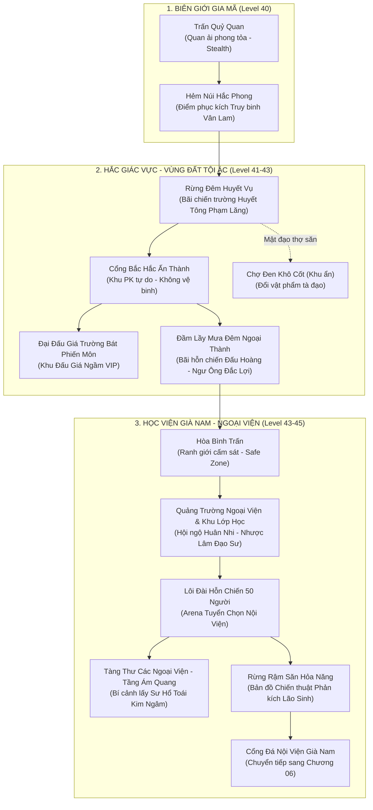

# CHƯƠNG 05: HẮC GIÁC VỰC & NGOẠI VIỆN GIÀ NAM — TỪ VÙNG ĐẤT TỘI ÁC ĐẾN ĐỈNH PHONG TÂN SINH

> **Quyển**: Quyển 02 — Hắc Giác Vực & Học Viện Già Nam
> **Cảnh Giới Yêu Cầu & Đột Phá**: Đấu Linh 1 Tinh → Đấu Linh 6 Tinh (`Level 40 – 45`)
> **Vùng Bản Đồ Chính**: Trấn Quỷ Quan → Rừng Đêm Hắc Giác Vực → Hắc Ấn Thành → Hòa Bình Trấn → Ngoại Viện Già Nam → Rừng Săn Hỏa Năng
> **Thu Hoạch Cốt Lõi**: Thân pháp *Tam Thiên Lôi Động*, Đấu kỹ âm ba *Sư Hổ Toái Kim Ngâm*, *Âm Dương Huyền Long Đan*, *Hắc Diễm Tử Vân Dực*, *Mảnh Tàn Đồ Tịnh Liên Yêu Hỏa #3*
> **Bước Nhảy Lối Chơi (Progression Milestone)**: Nâng cấp lướt né (`Space`) thành *Tam Thiên Lôi Động* để lại tàn ảnh sấm sét; mở khóa hệ thống **Hắc Bào Ẩn Danh Đấu Giá** và chiến dịch chiến thuật **Đảo Ngược Thợ Săn Hỏa Năng**.
> **Tài Liệu Tham Chiếu**: [00_Master_Index_Va_Quy_Chuan.md](file:///e:/Project/DauPhaThuongKhung/docs/00_Tong_Quan_Kien_Truc/00_Master_Index_Va_Quy_Chuan.md) | [Kho_Cong_Phap_Va_Dau_Ky.md](file:///e:/Project/DauPhaThuongKhung/docs/04_Dau_Ky_Cong_Phap_Va_Trang_Bi/Kho_Cong_Phap_Va_Dau_Ky.md)

---

## 1. Sơ Đồ Khu Vực Bản Đồ (Top-Down 2D World Layout)

Hành trình Chương 05 đưa người chơi rời khỏi vùng biên giới bị phong tỏa của Gia Mã Đế Quốc, băng qua miền đất đẫm máu không luật pháp **Hắc Giác Vực** ở phương Bắc trước khi tiến xuống thánh địa tu luyện **Học Viện Già Nam** ở phương Nam.

### Đặc Tính Môi Trường & Quy Luật Vùng Đất
* **Trấn Quỷ Quan & Hẻm Núi Hắc Phong**: Sương mù dày đặc làm giảm 25% tầm nhìn camera Top-down; trên bầu trời có vòng quét radar màu trắng bạc của đội tuần tra Vân Lam Tông (nếu bị rọi trúng quá 2 giây sẽ kích hoạt vây sát).
* **Hắc Giác Vực (Rừng Đêm & Hắc Ấn Thành)**: Áp dụng trạng thái môi trường **Luật Rừng Tội Ác** — các NPC thương nhân hoặc lữ khách trên đường có xác suất bất ngờ rút đao cướp bóc người chơi nếu thanh `HP` của người chơi tụt xuống dưới 40%. Cổng thành không có lính gác bảo vệ trị an; giết kẻ gây sự tại chỗ làm tăng chỉ số *Hung Danh* khiến đám cướp cấp thấp tự động dạt ra nhường đường.
* **Hòa Bình Trấn & Ngoại Viện Già Nam**: Trụ đá ranh giới khắc ấn ký của Viện trưởng Mang Thiên Xích. Mọi hành vi tàn sát sinh mạng trong phạm vi Ngoại Viện đều bị lôi điện học viện cảnh cáo, chuyển toàn bộ giao tranh sang chế độ **Tỉ Thí Lôi Đài** (chỉ đánh gục về 1 `HP`, không tử vong).
* **Rừng Săn Hỏa Năng**: Bản đồ rừng già nhiều tầng tán cây, suối cạn và bụi rậm ẩn nấp (`Stealth Bush`), hỗ trợ đặt bẫy phục kích các đội tuần tra Lão Sinh và theo dõi luồng sáng tín hiệu từ **Tinh Thẻ Hỏa Năng**.

---

## 2. Chuỗi Nhiệm Vụ Chính (Main Questline — 6 Hồi Chi Tiết)

### Hồi 5.1: Trấn Quỷ Quan & Rừng Biên Giới — Huyết Lộ Thoát Thân
* **Cảnh giới khuyến nghị**: Đại Đấu Sư Đỉnh Phong → Đột phá **Đấu Linh 1 Tinh** (`Level 40`).
* **Bối cảnh**: Sau trận đại náo Vân Lam Sơn lần hai, Vân Sơn phát lệnh truy nã gắt gao toàn đế quốc. Các chốt biên ải tại **Trấn Quỷ Quan** đều treo chân dung Tiêu Viêm, do ba vị Trưởng lão Vân Lam Tông (dẫn đầu bởi **Vân Phàn** — Đấu Linh 7 Tinh nửa bước Đấu Vương) trực tiếp giăng lưới vây bắt.
* **Diễn biến Gameplay**:
  1. **Vượt Ải Trong Đêm**: Người chơi khoác áo choàng xám, sử dụng chỉ số `SOUL` (Linh Hồn Lực Phàm Cảnh cao giai) để hiển thị tầm nhìn nón của lính gác và luồng cảm ứng của Trưởng lão trên không. Lợi dụng lướt né `Space` qua các mái nhà gỗ mục nát để vượt tường thành phía Tây.
  2. **Đột Phá Giữa Vòng Vây**: Bị chó săn ma thú phát hiện ở bìa rừng, Tiêu Viêm vỗ *Tử Vân Dực* bay vọt vào **Hẻm Núi Hắc Phong**, nuốt đan dược tích lũy từ trước để bứt phá lên **Đấu Linh 1 Tinh** (mở khóa hiệu ứng *Đấu Khí Ngưng Vật* phủ quanh Huyền Trọng Xích, tăng 20% tầm vung xích).
  3. **Mưu Sát Ngược Đội Truy Binh**: Thay vì chạy trốn mù quáng, Dược Lão chỉ điểm vách đá hẹp chắn gió. Người chơi dụ 8 chấp sự tinh nhuệ và Trưởng lão **Vân Phàn** chui vào hẻm cụt, dùng Huyền Trọng Xích tháo phong ấn (`RMB`) khóa đường lui rồi ném **Song Sắc Phật Nộ Hỏa Liên** (`F` — dung hợp *Thanh Liên Địa Tâm Hỏa* + *Tử Hỏa*) thiêu rụi toàn bộ đội truy sát không chừa một mống để bịt đầu mối.
  4. **Cột Mốc Xương Trắng**: Bước qua tấm bia đá loang lổ vết máu khô khắc ba chữ *"Hắc Giác Vực"*, chính thức rời khỏi Gia Mã Đế Quốc.
* **Phần thưởng**: Đột phá **Đấu Linh 1 Tinh**, mở khóa thanh trạng thái *Hung Danh Hắc Giác Vực*, +15.000 EXP, `Áo Choàng Hắc Bào Cấp Cao` (ẩn toàn bộ tên tuổi và khí tức Đấu Khí).

### Hồi 5.2: Rừng Đêm Cướp Bóc & Huyết Tông Phạm Lăng
* **Cảnh giới khuyến nghị**: Đấu Linh 1–2 Tinh (`Level 41`).
* **Bối cảnh**: Đêm mưa tầm tã giữa rừng rậm ngoại vi Hắc Ấn Thành. Một đoàn xe vận chuyển bí mật của **Huyết Tông** do Thiếu tông chủ **Phạm Lăng** (Đấu Linh 4 Tinh, gã công tử mặt trắng bệch như xác chết chuyên hút máu thiếu nữ để tu luyện) chỉ huy vừa cướp sạch một đội hộ tống thương buôn và đang kiểm kê chiến lợi phẩm.
* **Diễn biến Gameplay**:
  1. **Hoàng Tước Tại Hậu**: Dược Lão cảm nhận được dao động sấm sét kỳ dị từ chiếc rương sắt trên xe ngựa của Phạm Lăng. Người chơi bật trạng thái *Hắc Bào Ẩn Danh*, áp sát từ tán cây cổ thụ xuống giữa trại lửa trại của Huyết Tông.
  2. **Trảm Huyết Vệ, Đoạt Chí Bảo**: Tiêu diệt 12 tên *Huyết Y Hộ Vệ* và 2 *Huyết Ảnh Chấp Sự* trước khi chúng kịp đốt pháo hiệu gọi viện binh từ Hắc Ấn Thành.
  3. **Chạm Trán Mini-Boss Phạm Lăng**: Đánh bại Phạm Lăng cùng gã Huyết Lão bị thương đi kèm. Không giống ở Gia Mã nơi Tiêu Viêm còn nương tay, tại Hắc Giác Vực, để lộ thân phận là chết — Tiêu Viêm lạnh lùng vung *Diễm Phân Phệ Lãng Xích* chém gục Phạm Lăng, thu sạch Nạp Giới rồi phóng *Thanh Liên Hỏa* xóa sạch dấu vết hiện trường.
* **Thu hoạch & Phục bút sâu xa**:
  * Quyển trục bạc lấp lánh hồ quang: Thân pháp Địa Giai Đê Cấp **Tam Thiên Lôi Động** (trấn tông tuyệt học bị thất lạc của **Phong Lôi Các** tại Trung Châu — *Phục bút chí mạng cho Quyển 03: hễ thi triển trước mặt cường giả Phong Lôi Các sẽ lập tức kích hoạt truy sát không chết không thôi!*).
  * Chiếc lò đan cổ **Song Long Huyết Đỉnh** (Ngũ phẩm đỉnh phong, giảm 15% tỷ lệ nổ lò) cùng 9 hộp dược liệu quý hiếm dùng để luyện đan đổi tiền.
  * Gieo đại thù máu với Tông chủ Huyết Tông **Phạm Lao** (Đấu Hoàng), kẻ sẽ phát điên truy tìm hung thủ giết con trai độc nhất.

### Hồi 5.3: Đại Đấu Giá Hội Hắc Ấn Thành — Ngư Ông Đắc Lợi Trong Đêm Mưa
* **Cảnh giới khuyến nghị**: Đấu Linh 2–3 Tinh (`Level 42`).
* **Bối cảnh**: Đặt chân tới **Hắc Ấn Thành** phồn hoa nhưng tanh mùi máu, nơi **Bát Phiến Môn** tổ chức Đại Đấu Giá Hội quy tụ toàn bộ các lão quái vật khét tiếng nhất Hắc Giác Vực.
* **Diễn biến Gameplay**:
  1. **Thị Uy Cổng Thành**: Vừa bước vào cổng Bắc, một gã đại hán mặt sẹo (Đấu Sư 9 Tinh) thấy Tiêu Viêm đi lẻ liền ngang nhiên vung đao cướp túi tiền giữa phố đông người. Người chơi kích hoạt QTE một chưởng *Xích Viêm* chấn nát tim gã đại hán văng dính vào tường đá — đám người xung quanh chỉ cười nhạt bước qua xác chết như chuyện thường ngày!
  2. **Luyện Đan Đổi Vốn VIP**: Mượn sức Dược Lão phụ thể (`T`) trong khách điếm đóng kín, thực hiện mini-game Luyện Đan chế ra 2 viên *Đấu Linh Đan* và *Thanh Linh Đan* đem ký gửi tại Bát Phiến Môn, lập tức được cung phụng thẻ Hắc Kim vào ghế đầu khu VIP.
  3. **Đấu Giá Cân Não**: Tham gia phiên đấu giá ngầm căng thẳng với **Phạm Lao** (Huyết Tông), **Thanh Trưởng Lão** (Thiên Xà Phủ), **Viên Y** (Bát Phiến Môn). Người chơi đấu giá trực tiếp hoặc ghi nhớ kẻ mua được 3 bảo vật mục tiêu:
     * Đôi cánh ma thú cấp 5 **Hắc Diễm Tử Vân Dực** (nguyên liệu dung hợp nâng cấp *Tử Vân Dực* tăng vọt tốc độ bay).
     * Thất Phẩm Đan Dược **Âm Dương Huyền Long Đan** (không cộng cấp độ trực tiếp nhưng mang hiệu ứng thần kỳ **Phá Hậu Nhi Lập** — phục bút niết bàn trọng sinh và làm vật trao đổi *Thiên Hỏa Tam Huyền Biến* ở Chương 07).
     * Tấm da dê rách nát áp trục: **Mảnh Tàn Đồ Tịnh Liên Yêu Hỏa #3** (khi hiện lên bục, Dược Lão trong nhẫn chấn động linh hồn cảnh báo phải đoạt bằng mọi giá!).
  4. **Đêm Mưa Hỗn Chiến Đấu Hoàng (Stealth Air-Raid)**: Đêm xuống, các Đấu Hoàng Hắc Giác Vực không giữ quy tắc mà lao vào chém giết nhau dữ dội trên bầu trời đầm lầy ngoại thành để cướp *Âm Dương Huyền Long Đan*. Dưới sự điều khiển mượn xác một phần của Dược Lão (phủ *Cốt Linh Lãnh Hỏa* che giấu dung mạo), người chơi bay lượn né các luồng sóng xung kích cấp Đấu Hoàng rợp trời, dùng *Tam Thiên Lôi Động* đánh lén gã trưởng lão đang giữ hộp ngọc bảo vật giữa lúc Phạm Lao và Viên Y lưỡng bại câu thương, ôm trọn cả 3 chí bảo rồi xé màn mưa tẩu thoát về phương Nam!
* **Phần thưởng**: Mở khóa *Tam Thiên Lôi Động* hoàn chỉnh cho phím `Space`, thu thập *Mảnh Tàn Đồ Tịnh Liên Yêu Hỏa #3* (ghép 3/4 mảnh trên giao diện Dị Hỏa Đồ Giám!), *Âm Dương Huyền Long Đan*, nâng cấp cánh lên *Hắc Diễm Tử Vân Dực*.

### Hồi 5.4: Hòa Bình Trấn & Ngoại Viện Học Viện Già Nam — Trùng Phùng Huân Nhi
* **Cảnh giới khuyến nghị**: Đấu Linh 3–4 Tinh (`Level 43`).
* **Bối cảnh**: Vượt qua cột mốc **Hòa Bình Trấn** nơi sát khí Hắc Giác Vực dừng bước, Tiêu Viêm đặt chân vào **Ngoại Viện Học Viện Già Nam** đúng hạn kỳ nghỉ phép 2 năm kết thúc.
* **Diễn biến Gameplay**:
  1. **Cuộc Hội Ngộ Dưới Nắng Chiều**: Tiến vào sân tập trung tâm nơi hàng trăm nam sinh đang vây quanh ngưỡng mộ thiếu nữ áo xanh thanh khiết tuyệt trần — **Tiêu Huân Nhi** (nay đã là Đấu Linh 3 Tinh, nữ thần đệ nhất Ngoại Viện lạnh nhạt với mọi lời tỏ tình). Khi Tiêu Viêm cởi mũ trùm gọi khẽ tên nàng, đoạn cắt cảnh Pixel Art đặc tả Huân Nhi sững người rồi nở nụ cười rực rỡ như bách hoa khai nở, chạy ùa tới nắm tay *"Tiêu Viêm ca ca"* giữa tiếng tim vỡ vụn và ánh mắt ghen tị bốc lửa của vạn nam sinh!
  2. **Tái Ngộ Cố Nhân & Kết Giao Kỳ Tài**: Báo danh tại phòng Đạo sư **Nhược Lâm**, gặp lại biểu tỷ đùi dài **Tiêu Ngọc**, đồng thời chạm mặt hai nhân vật kiệt xuất của Ngoại Viện: kiếm khách áo đỏ sát khí ngút trời **Ngô Hạo** (Chấp Pháp Đội — kẻ tu luyện Huyết Đấu Khí trên chiến trường) và thiếu nữ tinh quái **Hổ Gia** ("Yêu Nữ Ngoại Viện", cháu gái cưng của Phó viện trưởng **Hổ Càn**).
  3. **Dạy Dỗ Kẻ Ngạo Mạn**: Đám công tử si tình Huân Nhi gồm **Tiết Băng** (Đấu Sư đỉnh phong) và gã đàn anh **Bạch Trình** (Đấu Linh 3 Tinh, em họ Bạch Sơn) kéo người tới chặn đường chế giễu Tiêu Viêm là kẻ "dựa hơi nữ nhân mới lết vào được trường". Người chơi điều khiển Tiêu Viêm **không rút Huyền Trọng Xích**, chỉ lướt một bước tàn ảnh sấm sét tung một chưởng *Bát Cực Băng* đánh bay Tiết Băng đập nát cột đá, đồng thời dùng khí thế Đấu Linh ép Bạch Trình tái mặt lùi bước!
* **Phần thưởng**: Mở khóa đồng hành trợ chiến **Tiêu Huân Nhi** (sử dụng *Kim Đế Phần Thiên Viêm* thiêu đốt chuẩn), +500 Điểm Hảo Cảm Huân Nhi, danh hiệu *Tâm Điểm Công Thù Ngoại Viện*.

### Hồi 5.5: Vòng Loại Tuyển Nội Viện — Độc Bá Hỗn Chiến Đài
* **Cảnh giới khuyến nghị**: Đấu Linh 4 Tinh (`Level 44`).
* **Bối cảnh**: Kỳ thi đại tuyển chọn hàng năm tại Quảng Trường Đấu Trường Lớn Ngoại Viện nhằm chọn ra 50 người vào Nội Viện, trong đó **Top 5** xuất sắc nhất sẽ được đặc cách vào mật thất Tàng Thư Các.
* **Diễn biến Gameplay**:
  1. **Vòng 1 — Đại Hỗn Chiến 50 Người (Battle Royale Arena)**: 50 học viên cùng xuất hiện trên lôi đài đá khổng lồ. Người chơi phải trụ vững và đánh văng ít nhất 12 đối thủ khỏi vạch giới hạn (bao gồm màn một xích quật bay **Tiết Băng** đang định hợp vây đánh lén!).
  2. **Vòng 2 — Giao Phong Huyết Kiếm Ngô Hạo**: Trận tỉ thí Top 5 cực kỳ sảng khoái với **Ngô Hạo** (Đấu Linh 4 Tinh). Ngô Hạo vung trọng kiếm ngưng tụ huyết mang chém điên cuồng; Tiêu Viêm giữ nguyên trạng thái *Phong Ấn Trọng Xích* lấy cứng chọi cứng, dùng kình lực thuần túy chấn văng huyết kiếm nhưng chủ động đỡ lấy Ngô Hạo trước khi ngã, từ đó kết giao huynh đệ sinh tử! Tiêu Viêm đoạt **Quán Quân Vòng Tuyển Chọn**, cùng **Huân Nhi, Hổ Gia, Ngô Hạo** và gã thương khách kiêu ngạo **Bạch Sơn** lọt vào Top 5.
  3. **Bí Cảnh Tàng Thư Các Ngoại Viện**: Phó viện trưởng **Hổ Càn** (Đấu Hoàng Đỉnh Phong) dẫn Top 5 vào tầng hầm Ám Quang, nơi các quyển Đấu Kỹ cổ bị bao bọc bởi **Lồng Chắn Năng Lượng Di Động** bay vút trong không trung. Người chơi giải mini-game phản xạ tốc độ cao: bật *Tam Thiên Lôi Động* đuổi theo luồng sáng đỏ rực mạnh nhất, vung *Bát Cực Băng* đập vỡ lớp màng chắn để đoạt được Đấu Kỹ Âm Ba Huyền Giai Cao Cấp **Sư Hổ Toái Kim Ngâm**!
* **Phần thưởng**: Đấu Kỹ Chủ Động **Sư Hổ Toái Kim Ngâm** (trang bị ô `Q/E/R`: gầm ra sóng âm kim sắc hình nón rộng gây sát thương xuyên giáp và làm **Choáng `Stun` 2.5 giây** toàn bộ kẻ địch xung quanh!).

### Hồi 5.6: Cuộc Săn Hỏa Năng (Fire Energy Hunting Competition) — Tân Sinh Phản Sát Lão Sinh
* **Cảnh giới khuyến nghị**: Đấu Linh 5 Tinh → Đột phá **Đấu Linh 6 Tinh** (`Level 45`).
* **Bối cảnh**: Để vào Nội Viện, 50 tân sinh phải băng qua khu rừng rậm dài trăm dặm. Mỗi tân sinh được phát một **Tinh Thẻ Lam** có sẵn **5 điểm Tinh Hỏa Năng**. Theo lệ cũ của Học Viện, 10 đội **Lão Sinh** (học viên cũ đã học 1 năm ở Nội Viện, toàn Đấu Linh 3–5 Tinh hung hãn) được thả vào rừng làm "Thợ Săn" trấn lột điểm Hỏa Năng của tân sinh làm học phí! Hổ Càn ghép Top 5 (*Tiêu Viêm, Huân Nhi, Ngô Hạo, Hổ Gia, Bạch Sơn*) thành một tiểu đội tinh nhuệ.
* **Diễn biến Gameplay (3 Giai Đoạn Đảo Ngược Thế Cờ)**:
  1. **Giai đoạn 1 — Phá Lệ Ngàn Năm**: Giữa rừng sâu, một đội 5 Lão Sinh nhảy xuống cười khẩy đòi nộp mỗi người 3 điểm Hỏa Năng để "mua đường". Trong khi **Bạch Sơn** hợm hĩnh chỉ lo tự bảo vệ mình và tranh quyền chỉ huy, Tiêu Viêm lạnh lùng ra lệnh đánh gục sạch cả 5 tên Lão Sinh! Khi điểm số còn 2 điểm tối thiểu không cướp thêm được từ thẻ lam, Tiêu Viêm nảy ra ý tưởng chấn động chưa từng có tiền lệ: **Lấy thẻ lam của mình quẹt ngược vào Thẻ Đen của Lão Sinh, cướp sạch hàng chục điểm Tinh Hỏa Năng tích lũy cả năm trời của bọn chúng!**
  2. **Giai đoạn 2 — Chiến Dịch Du Kích "Thợ Săn Hóa Con Mồi"**: Bạch Sơn bất đồng tự ái (và ngầm ghen tức vì Huân Nhi luôn nghe lời Tiêu Viêm) nên bị gạt khỏi quyền quyết sách. Người chơi điều khiển tổ đội 4 người nòng cốt (*Tiêu Viêm - Huân Nhi - Ngô Hạo - Hổ Gia*), liên kết với nhóm **Tiêu Ngọc** để mua tin tức vị trí đóng trại của các đội Lão Sinh. Lần lượt tập kích úp sọt đội **Sa Thiết**, đội **Lãnh Bạch**, đội **Tu Nham** — biến cả khu rừng thành cơn ác mộng nơi đám Lão Sinh nhìn thấy bóng áo đen vác xích là vắt chân lên cổ chạy trốn!
  3. **Giai đoạn 3 — Quyết Chiến Đỉnh Phong Với Hắc Bạch Quan Sát**: Bị cướp sạch sành sanh đến mức bật khóc, toàn bộ các đội Lão Sinh gom tiền thuê hai đội mạnh nhất giải đấu hợp nhất thành **Hắc Bạch Quan Sát** (10 cao thủ Đấu Linh 4–5 Tinh do **La Hầu** — Đấu Linh 5 Tinh đỉnh phong dẫn đầu) chặn ngay trước cửa ải Nội Viện! Bạch Sơn tự đại lao lên đầu tiên bị La Hầu đánh gục thảm hại. Dưới ánh mắt kinh ngạc của Đại Trưởng Lão **Tô Thiên** ẩn mình trên mây và hàng trăm học viên vây xem trên ngọn cây, tổ đội Tiêu Viêm đại chiến Hắc Bạch Quan Sát! Tiêu Viêm một mình độc chiến **La Hầu**, dùng **Phật Nộ Hỏa Liên** nghiền nát *Ám Ảnh Công Kích* của hắn, quẹt sạch hơn 200 điểm Hỏa Năng trên thẻ La Hầu, đoạt danh hiệu **Đệ Nhất Tân Sinh Vương** bước qua cổng đá Nội Viện!
* **Phần thưởng**: Đột phá **Đấu Linh 6 Tinh** (`Level 45`), nhận `Hắc Tinh Thẻ Nội Viện` chứa **240 Điểm Tinh Hỏa Năng** khởi đầu cực giàu cho Chương 06, mở khóa tính năng *Sáng Lập Thế Lực* đầu Chương 06.

---

## 3. Cơ Chế Gameplay Độc Đáo Của Chương (Unique Chapter Mechanics)

### 3.1. Hệ Thống Hắc Bào Ẩn Danh & Đấu Giá Ngầm Hắc Giác Vực
* **Trạng thái Hắc Bào (`Stealth Identity Toggle`)**: Khi trang bị *Áo Choàng Hắc Bào* tại Hắc Giác Vực, tên nhân vật đổi thành `"Hắc Bào Luyện Dược Sư"`, giọng thoại qua bộ lọc trầm khàn và che giấu toàn bộ hiệu ứng màu sắc Dị Hỏa thường bằng lớp áo khí đen (trừ khi tung chiêu tối thượng `F`). Nếu để lộ mặt thật hoặc thi triển *Tam Thiên Lôi Động* trước nhân chứng còn sống sót, thanh **Truy Sát Lệnh** sẽ tăng lên, triệu hồi sát thủ Huyết Tông / Phong Lôi Các phục kích ngẫu nhiên khi chuyển map!
* **Gameplay Đấu Giá Chiến Thuật**: Không chỉ bấm nút tăng tiền đơn thuần. Trong phòng đấu giá Bát Phiến Môn, người chơi có 3 hành động chiến thuật mỗi lượt:
  * **Ra Giá Đè Ngạt (`Overbid`)**: Tăng bước giá gấp đôi kèm tỏa uy áp Linh Hồn (`SOUL` check) khiến các NPC tiểu gia tộc sợ hãi bỏ cuộc sớm.
  * **Thăm Dò Hậu Đài (`Soul Scan`)**: Quét hướng ánh mắt các phòng VIP của Phạm Lao, Viên Y, Thanh Trưởng Lão để biết món nào chúng quyết tử cướp đoạt ngoài thành.
  * **Thả Mồi Nhử (`Bait & Track`)**: Cố tình nhường bảo vật giá trên trời cho một NPC Đấu Hoàng mua mất nhằm giữ lại Kim Tệ, sau đó gắn **Ấn Ký Linh Hồn** lên hộp bảo vật để kích hoạt màn chơi *Đêm Mưa Đoạt Bảo* cướp lại trắng tay ngoài thành!

#### Danh Mục Bảo Vật Phiên Đấu Giá Bát Phiến Môn (Hồi 5.3)
| Thứ Tự | Vật Phẩm Đấu Giá | Giá Khởi Điểm | Thế Lực Cạnh Tranh Chính | Công Dụng & Ý Nghĩa Thiết Kế |
| :---: | :--- | :---: | :--- | :--- |
| **Lô #01** | **Địa Tâm Trọng Thiết Tinh** | 150.000 Kim Tệ | Cuồng Sư Bang | Nguyên liệu phụ trợ cường hóa vũ khí hạng nặng (tùy chọn mua trực tiếp) |
| **Lô #02** | **Hắc Diễm Tử Vân Dực** | 450.000 Kim Tệ | Thiên Xà Phủ (Thanh Trưởng Lão) | Dung hợp vào *Tử Vân Dực*: +25% tốc độ bay, mở kỹ năng rải lông vũ lửa khi lướt trên không |
| **Lô #03** | **Phong Quyển Tàn Vân Trận Đồ** | 600.000 Kim Tệ | Các gia tộc Hắc Ấn Thành | Quyển trục phụ trợ buff kháng Phong khi đối đầu cường giả Phong hệ |
| **Lô #04** | **Mảnh Tàn Đồ Tịnh Liên Yêu Hỏa #3** | 500.000 Kim Tệ | Không ai nhận ra giá trị thật (Trừ Dược Lão & Viên Y nghi ngờ) | Mảnh ghép bản đồ cổ thứ 3/4 dẫn tới Dị Hỏa #3 — kích hoạt hiệu ứng cộng hưởng Linh Hồn |
| **Áp Trục** | **Âm Dương Huyền Long Đan (Thất Phẩm)** | 2.000.000 Kim Tệ | Phạm Lao, Viên Y, Ưng Sơn Lão Nhân | Chí bảo **Phá Hậu Nhi Lập**; mồi lửa châm ngòi đại hỗn chiến 4 Đấu Hoàng trong đêm mưa! |

### 3.2. Cơ Chế Thân Pháp Tiến Hóa: Tam Thiên Lôi Động (`Space` Upgrade)
* Sau khi lĩnh ngộ quyển trục cướp được từ Phạm Lăng (đạt tầng **Lôi Thiểm** ban đầu, nâng dần lên **Lôi Thuấn** và **Tam Thiên Lôi Phân Thân** ở các chương sau):
  * Khi nhấn `Space`, nhân vật hóa thành một tia hồ quang bạc trắng lướt xuyên qua vật cản nhỏ và kẻ địch với `0.45 giây I-frame`, đồng thời **để lại 1 Tàn Ảnh Lôi Điện** tại vị trí cũ trong 1.5 giây.
  * Kẻ địch AI tấn công nhầm vào Tàn Ảnh Lôi Điện sẽ kích nổ tia sét gây sát thương tê liệt (`Paralysis` giảm 40% `SPD` trong 2 giây), tạo khoảng trống hoàn hảo để Tiêu Viêm vòng ra sau lưng nện *Bát Cực Băng* chí mạng!
  * **Cảnh báo nhân quả (Karma System)**: Sử dụng *Tam Thiên Lôi Động* trong khu vực đông người ở Hắc Hoàng Thành hoặc Trung Châu sau này sẽ tích điểm *Dấu Vết Phong Lôi*, dẫn tới sự kiện Bắc Các Chủ Phí Thiên truy sát ở Quyển 03!

### 3.3. Chiến Thuật Đảo Ngược Săn Hỏa Năng (Fire Energy Radar & Raid)
* Trong suốt Hồi 5.6, góc trên bên phải màn hình hiển thị **Bản Đồ Chiến Thuật Hỏa Năng** với hệ thống điểm **Tinh Hỏa Năng (Fire Crystal Points)**:
  * **Quy tắc Thẻ Tinh**: Mỗi thẻ bắt buộc giữ lại tối thiểu `2 Điểm` làm đáy (không thể cướp về 0). Tân sinh bị cướp còn 2 điểm sẽ mất tinh thần; ngược lại mỗi đội Lão Sinh mang theo từ `50 – 180 Điểm` tích lũy từ Nội Viện!
  * **Mạng Lưới Tình Báo Tân Sinh**: Cứu các nhóm tân sinh bị đánh cướp (như nhóm của **Tiêu Ngọc**) sẽ mở khóa các chấm đỏ chỉ điểm lộ trình di chuyển của 5 chốt săn lớn trên bản đồ rừng rậm:
    1. *Chốt Khe Đá Xám (Đội Tu Nham — Lv.43)*: Thu hoạch `+35 Tinh Hỏa Năng`.
    2. *Chốt Suối Sương Mù (Đội Sa Thiết — Lv.44)*: Phá trận địa khiên sắt, thu hoạch `+45 Tinh Hỏa Năng`.
    3. *Chốt Đồi Cổ Thụ (Đội Lãnh Bạch — Lv.44)*: Đánh úp ban đêm khi chúng chia chác chiến lợi phẩm, thu hoạch `+60 Tinh Hỏa Năng`.
    4. *Sự kiện Nội Bộ (Bạch Sơn Tranh Quyền)*: Bạch Sơn đòi chia đều điểm dù không góp sức và muốn bỏ mặc tân sinh khác; người chơi chọn bác bỏ thẳng thừng để tăng **Uy Tín Thủ Lĩnh** (tiền đề lập **Bàn Môn** ở Chương 06!).
    5. *Chốt Cửa Ải Nội Viện (Liên quân Hắc Bạch Quan Sát — Lv.45)*: Trận chung kết rừng sâu, quẹt sạch `+160 Tinh Hỏa Năng`!
  * **Phân bổ vai trò đồng đội thời gian thực**: Giao **Huân Nhi** khóa mục tiêu tầm xa bằng *Kim Đế Phần Thiên Viêm*, **Ngô Hạo** mở đường máu hút sát thương cận chiến, **Hổ Gia** trói chân đối phương bằng roi mây phong hệ, và **Tiêu Viêm** kết liễu đội trưởng địch để kích hoạt hoạt ảnh **Quẹt Thẻ Đoạt Hỏa Năng**!

---

## 4. Nhiệm Vụ Phụ & Kỳ Ngộ Ẩn Sát Nguyên Tác (Side Quests & Secrets)

1. **Kỳ Ngộ Ẩn: Bóng Đen Trên Mái Ngói Ngoại Viện (Gặp Lại Lăng Ảnh)**
   * *Điều kiện kích hoạt*: Ban đêm tại khu ký túc xá nữ của Huân Nhi ở Ngoại Viện, bật quét Linh Hồn (`SOUL` >= Phàm Cảnh Hậu Kỳ) hướng lên ngọn tháp chuông cổ phía Tây.
   * *Nội dung*: Phát hiện Hộ vệ Đấu Hoàng của Cổ Tộc là **Lăng Ảnh** đang ẩn trong bóng tối. Lăng Ảnh mỉm cười tán thưởng tốc độ trưởng thành của Tiêu Viêm trong 2 năm qua nhưng nghiêm giọng cảnh báo về **Cổ Tộc** — thế lực viễn cổ nơi Đấu Hoàng chỉ đủ tư cách gác cổng, đồng thời ngầm tiết lộ thời gian Huân Nhi có thể ở lại Học Viện Già Nam không còn nhiều.
   * *Phần thưởng*: `Ngọc Bội Ám Ảnh Cổ Tộc` (+8% né tránh đòn đánh lén ban đêm) & mở khóa hồ sơ ẩn về *Bát Tộc Viễn Cổ*.

2. **Nhiệm Vụ Phụ: Chợ Đen Khô Cốt & Mảnh Hải Tâm Thiết**
   * *Vị trí*: Lối mòn thợ săn dẫn vào **Chợ Đen Khô Cốt** trong Rừng Đêm Huyết Vụ.
   * *Nội dung*: Một gã thương buôn mù rao bán đống phế liệu kim loại vớt từ đáy biển sâu với giá cắt cổ. Dùng *Thanh Liên Địa Tâm Hỏa* hơ nhẹ lên cục sắt rỉ sẽ phát hiện bên trong là **Thâm Hải Hàn Thiết Tinh** — vật liệu tuyệt hảo để rèn gia cố lớp giáp lót dưới áo và tăng độ nặng cho Huyền Trọng Xích.
   * *Phần thưởng*: Nâng cấp trọng lượng chế độ *Trọng Áp* của Huyền Trọng Xích (tăng thưởng khổ tu từ +30% lên **+35% EXP Đấu Khí** trong suốt Quyển 02).

3. **Nhiệm Vụ Phụ: Ác Bá Quán Rượu Hòa Bình Trấn**
   * *Vị trí*: Tửu quán cửa ngõ Hòa Bình Trấn.
   * *Nội dung*: Giải cứu một tiểu đội thương nhân từ Gia Mã Đế Quốc chạy nạn chiến loạn Vân Lam Tông đang bị đám lưu manh ranh giới bắt chẹt ngoài vạch đá Hòa Bình Trấn. Qua lời kể của họ, Tiêu Viêm nắm được tin tức **Tiêu Đỉnh** và **Tiêu Lệ** đã kịp đưa tộc nhân Tiêu Gia rút khỏi Ô Thản Thành dưới sự che chở của Mễ Đặc Nhĩ gia tộc (trấn an tâm lý trước khi bước vào kỳ thi học viện).
   * *Phần thưởng*: `Đơn Thuốc Hồi Khí Ngũ Phẩm`, +20.000 Kim Tệ.

4. **Kỳ Ngộ Ẩn: Vết Kiếm Của Viện Trưởng Mang Thiên Xích**
   * *Điều kiện kích hoạt*: Đứng trước vách đá ranh giới Hòa Bình Trấn lúc giông sét nổi lên và nhấn `Space` (*Tam Thiên Lôi Động*) lướt qua khe nứt sấm sét trên bia đá.
   * *Nội dung*: Cảm ngộ một tia lôi ý tàn dư do Viện trưởng thần bí **Mang Thiên Xích** (Bán Thánh lôi hệ đang ngao du Trung Châu) chém lại năm xưa để răn đe Hắc Giác Vực.
   * *Phần thưởng*: +15% Độ thông thạo *Tam Thiên Lôi Động*, giảm `0.5 giây` hồi chiêu lướt né.

5. **Nhiệm Vụ Phụ: Bài Học Đắt Giá Cho Cháu Trai Phó Viện Trưởng (Hổ Gia & Tiêu Ngọc)**
   * *Vị trí*: Rừng trúc phía Đông Ngoại Viện trước ngày thi tuyển.
   * *Nội dung*: Bắt gặp **Bạch Trình** dẫn đám tay chân vây ép **Tiêu Ngọc** và **Hổ Gia** nhằm thăm dò chiêu thức của Tiêu Viêm. Người chơi tham gia trận đấu chấp tay đôi 1v3 không dùng vũ khí trong giới hạn 45 giây để bảo vệ danh dự cho Tiêu Gia.
   * *Phần thưởng*: +200 Điểm Hảo Cảm Hổ Gia & Tiêu Ngọc, mở khóa kỹ năng hợp kích tổ đội *Phong Viêm Trận* trong Cuộc Săn Hỏa Năng.

---

## 5. Trích Đoạn Thoại Kinh Điển (Iconic Cutscene Dialogues)

### Phân Cảnh 1: Quy Tắc Sinh Tồn Tại Hắc Giác Vực (Hồi 5.2 — Rừng Đêm)
> *[Mưa xối xả trên nền đất lầy lội đẫm máu. Phạm Lăng ôm ngực lùi lại, đôi mắt trắng dã nhìn bóng người trùm Hắc Bào bước ra từ màn sương với thanh xích đen khổng lồ kéo lê tóe lửa.]*
>
> **Phạm Lăng** *(run giọng quát)*: "Ngươi... ngươi là ai?! Ta là Thiếu tông chủ Huyết Tông Phạm Lăng! Gia phụ là Đấu Hoàng Phạm Lao! Ngươi dám động vào ta, cả Hắc Giác Vực này sẽ không có đất chôn xác ngươi!"
>
> **Tiêu Viêm (Hắc Bào)** *(giọng khàn đặc lạnh băng, ngọn lửa xanh biếc bùng lên đầu ngón tay)*: "Ở cái đất Hắc Giác Vực giết người cướp của như cơm bữa này mà còn đem cha mình ra dọa người... Xem ra ngươi sống sung sướng quá lâu nên quên mất quy tắc nơi đây rồi. Cầm đồ của kẻ chết, tự nhiên phải tiễn kẻ đó im miệng vĩnh viễn!"

### Phân Cảnh 2: Rung Động Linh Hồn Trước Tàn Đồ Yêu Hỏa (Hồi 5.3 — Đấu Giá Trường)
> *[Trên bục pha lê, tấm da dê cổ xưa sậm màu máu khô được mở ra. Khán phòng VIP cười ồ chê bai một mảnh phế vật không rõ lai lịch, nhưng chiếc nhẫn đen trên tay Tiêu Viêm bỗng nóng rực chấn động.]*
>
> **Dược Lão** *(truyền âm gấp gáp, giọng run lên hiếm thấy)*: "Tiểu Viêm Tử! Giữ bình tĩnh, đừng để lộ sát khí! Thứ trên bục kia... tuyệt đối không phải phế vật! Luồng hỏa ấn cổ xưa khắc sâu trong thớ da đó chính là mảnh ghép bản đồ của **Tịnh Liên Yêu Hỏa** — ngọn lửa xếp thứ Ba trên Dị Hỏa Bảng có thể đốt vạn vật hóa hư vô! Dù phải lật tung cả cái Hắc Ấn Thành này lên cũng phải mang nó đi!"
>
> **Tiêu Viêm** *(khẽ kéo thấp mũ trùm Hắc Bào, ánh mắt lóe sáng dưới bóng tối)*: "Hắc... Đã vào tầm mắt của đệ tử, đừng nói là Bát Phiến Môn, đêm nay trời có sập cũng không ai giữ nổi nó!"

### Phân Cảnh 3: Trùng Phùng Sau Hai Năm Xa Cách (Hồi 5.4 — Sân Tập Ngoại Viện)
> *[Gió chiều thổi bay tà áo xanh nhạt. Giữa hàng trăm ánh mắt sững sờ của nam sinh Ngoại Viện, thiếu nữ luôn lạnh lùng như băng tuyết trên đỉnh núi bỗng khựng lại khi thấy bóng thiếu niên áo đen gầy gò vác thanh xích lớn đứng dưới gốc cổ thụ.]*
>
> **Tiêu Viêm** *(gãi đầu cười hiền, giọng ấm áp)*: "Huân Nhi... xin lỗi, để muội phải đợi lâu đến vậy."
>
> **Tiêu Huân Nhi** *(đôi mắt thu thủy long lanh ánh lệ, nụ cười khuynh thành nở rộ trên môi, bước nhanh tới nắm chặt vạt áo chàng)*: "Tiêu Viêm ca ca... Huân Nhi biết mà, ca ca nhất định sẽ bình an trở về đúng hẹn!"
>
> *[Hiệu ứng Pixel: Hàng loạt biểu tượng trái tim tan vỡ trên đầu đám nam sinh xung quanh; thanh nộ khí của Tiết Băng và Bạch Trình nổ tung đỏ rực!]*

### Phân Cảnh 4: Tuyên Ngôn Đảo Ngược Thợ Săn (Hồi 5.6 — Rừng Săn Hỏa Năng)
> *[Năm gã Lão Sinh nằm rên rỉ dưới đất, trơ mắt nhìn Tiêu Viêm thản nhiên cầm tấm thẻ đen của chúng áp sát vào tấm thẻ xanh lam của mình. Cột số Tinh Hỏa Năng nhảy vọt trong tiếng "Đinh!" giòn giã.]*
>
> **Đội Trưởng Lão Sinh** *(hộc máu lắp bắp)*: "Ngươi... ngươi điên rồi sao?! Từ ngày lập trường tới nay chỉ có Lão Sinh săn Tân Sinh, làm gì có chuyện Tân Sinh dám cướp ngược thẻ của bọn ta?! Đám La Hầu sư huynh ở cuối rừng sẽ lột da các ngươi!"
>
> **Tiêu Viêm** *(nhếch mép cười, vác Huyền Trọng Xích lên vai)*: "Quy tắc là do kẻ mạnh đặt ra. Nhắn với tất cả các đội Lão Sinh trong khu rừng này: Từ giờ phút này trở đi, bọn ta là thợ săn — còn các ngươi mới là con mồi!"

---

## 6. Hệ Sinh Thái Quái Vật, Tinh Anh & Bảng Loot (Bestiary & Drops)

| Tên Kẻ Địch / Ma Thú | Cấp Độ / Cảnh Giới | Khu Vực Xuất Hiện | Hành Vi AI Top-Down 2D | Vật Phẩm Rơi (Loot Table) |
| :--- | :---: | :--- | :--- | :--- |
| **Chấp Sự Truy Sát Vân Lam** | Lv.40 (Đấu Linh 1★) | Trấn Quỷ Quan, Hẻm Hắc Phong | Lướt chém kiếm phong hình trăng khuyết tầm trung, gọi đồng bọn bằng còi hiệu | `Đan Hồi Khí Tứ Phẩm` (45%), `Mảnh Huyền Thiết` (30%) |
| **Ưng Trảo Thám Tử Vân Lam** | Lv.40 (Đại Đấu Sư 9★) | Bìa rừng Biên Giới | Bay lượn rọi vòng sáng phát hiện ẩn thân, ném phi tiêu phong nhận làm chậm | `Lệnh Bài Truy Nã` (60%), `Phong Linh Thảo` (35%) |
| **Huyết Y Đao Khách (Huyết Tông)** | Lv.41 (Đấu Linh 2★) | Rừng Đêm Huyết Vụ | Đòn chém gây hiệu ứng *Chảy Máu*, tự hồi `HP` bằng 25% sát thương gây ra | `Huyết Tinh Thảo` (40%), `Túi Vàng Cướp Bóc` (50%) |
| **Huyết Ảnh Chấp Sự (Tinh Anh)** | Lv.41 (Đấu Linh 3★) | Trại vận chuyển Phạm Lăng | Hóa sương máu lướt xuyên lưng người chơi, khóa chiêu `Space` trong 1.5 giây | `Huyết Ngưng Đan` (35%), `Mảnh Bí Tịch Rách` (20%) |
| **Ác Đồ Hắc Ấn Thành** | Lv.41–42 (Đấu Sư 9★ – Đấu Linh 2★) | Ngoại vi Hắc Ấn Thành | Giả làm người qua đường trung lập, lao vào đâm lén sau lưng khi người chơi tụt máu | `Kim Tệ Hắc Giác` (70%), `Đoản Đao Tẩm Độc` (15%) |
| **Hắc Diễm Tử Vân Điêu (Tinh Anh)** | Lv.42 (Ma Thú Cấp 5 Sơ Kỳ) | Đầm Lầy Mưa Đêm / Rừng Bắc | Bay lượn miễn nhiễm sát thương mặt đất, lao bổ chữ V phun lông vũ lửa tím đen | `Ma Hạch Cấp 5 Phong-Hỏa` (25%), `Lông Vũ Hắc Diễm` (60%) |
| **Tinh Nhuệ Học Viên Ngoại Viện** | Lv.43–44 (Đấu Linh 1–3★) | Lôi Đài Hỗn Chiến | Phối hợp nhóm 3 người đánh vây ép ra mép đài, biết đỡ đòn (`Block`) cơ bản | `Huy Hiệu Lôi Đài` (100%), `Tụ Khí Tán Cao Cấp` (35%) |
| **Đội Viên Lão Sinh Săn Thẻ (Tinh Anh)** | Lv.44–45 (Đấu Linh 3–4★) | Rừng Săn Hỏa Năng | Ẩn nấp trong bụi rậm tung lưới trói chân, ưu tiên dồn sát thương vào đồng đội máu thấp | **+8–15 Điểm Tinh Hỏa Năng** (100%), `Băng Tâm Đan` (30%) |

---

## 7. Thiết Kế Đấu Boss Nhiều Phase (Multi-Phase Boss Encounters)

### Boss 5.1: Đội Trưởng Truy Sát Vân Lam Tông — Trưởng Lão Vân Phàn
* **Thông số**: `Level 40` | Cảnh giới: **Đấu Linh 7 Tinh (Nửa bước Đấu Vương)** | Địa điểm: Hẻm Núi Hắc Phong.
* **Cơ chế đặc trưng**: **Phong Lốc Hộ Thể** — Chừng nào Vân Phàn đứng ở khu đất trống đầu hẻm, gió lốc đẩy lệch mọi đòn chưởng tầm xa và cộng thêm 40% tốc độ đánh cho hắn.
* **Các Giai Đoạn (Phases)**:
  * **Phase 1 (100% – 55% HP)**: Đâm kiếm liên hoàn *Phong Lôi Nhất Kiếm* theo đường thẳng dài 8 ô, kết hợp gọi 4 Chấp sự khép góc chữ thập.
  * **Phase 2 (Dưới 55% HP — Phong Quyển Sát Trận)**: Nhảy lên vách đá triệu hồi 3 cột lốc xoáy di chuyển zíc-zắc trong hẻm núi.
* **Cách khắc chế chuẩn nguyên tác**: Dụ Vân Phàn lùi sâu vào góc vách đá chắn gió cuối hẻm để vô hiệu hóa *Phong Lốc Hộ Thể*, dùng Huyền Trọng Xích đập sập mỏm đá làm choáng rồi tung **Phật Nộ Hỏa Liên** thiêu rụi toàn đội truy binh.
* **Chiến lợi phẩm độc quyền**: `Kiếm Phong Ngọc Phù` (+10% `SPD` khi máu dưới 50%), mở đường tiến vào Hắc Giác Vực.

### Boss 5.2: Huyết Tông Thiếu Tông Chủ — Phạm Lăng
* **Thông số**: `Level 41` | Cảnh giới: **Đấu Linh 4 Tinh** | Địa điểm: Rừng Đêm Huyết Vụ.
* **Cơ chế đặc trưng**: **Huyết Khí Hấp Thụ** — Mọi vũng máu rơi ra trên nền rừng (từ huyết vệ bị giết hoặc khi Tiêu Viêm dính đòn chảy máu) đều bị Phạm Lăng hút về tạo lớp *Huyết Giáp* giảm 50% sát thương vật lý.
* **Các Giai Đoạn (Phases)**:
  * **Phase 1 (100% – 50% HP)**: Phóng *Huyết Nhận Liên Hoàn* (3 lưỡi đao máu hình quạt bay nhanh) và dịch chuyển tức thời giữa các vũng máu trên bản đồ để né đòn vung xích chậm.
  * **Phase 2 (Dưới 50% HP — Huyết Ma Hiến Tế)**: Phạm Lăng bóp nát tâm mạch 2 gã hộ vệ còn sống để hóa thành **Huyết Ảnh Cuồng Hóa**, tăng 35% `SPD` và thi triển vòng xoáy *Phệ Huyết Tuyền Qua* kéo người chơi vào tâm nổ.
* **Cách khắc chế chuẩn nguyên tác**: Kích hoạt *Thanh Liên Địa Tâm Hỏa* quét lửa lên mặt đất để **đốt bốc hơi toàn bộ các vũng máu**, làm Phạm Lăng mất điểm dịch chuyển và vỡ *Huyết Giáp*, sau đó tháo phong ấn Huyền Trọng Xích (`RMB`) nện *Diễm Phân Phệ Lãng Xích* kết liễu.
* **Chiến lợi phẩm độc quyền**: Quyển trục **Tam Thiên Lôi Động** (Địa Giai Đê Cấp), **Song Long Huyết Đỉnh**, `Nạp Giới Của Phạm Lăng` (chứa 180.000 Kim Tệ & Dược tài Ngũ phẩm).

### Boss 5.3: Tu La Huyết Kiếm — Ngô Hạo (Trận Tỉ Thí Top 5 Lôi Đài)
* **Thông số**: `Level 44` | Cảnh giới: **Đấu Linh 4 Tinh** | Địa điểm: Lôi Đài Ngoại Viện.
* **Cơ chế đặc trưng**: **Càng Đánh Càng Điên (Berserk Gauge)** — Máu Ngô Hạo càng thấp, kiếm tốc và sát thương Huyết Đấu Khí càng tăng vọt (lên tới +60% `ATK` ở ngưỡng 20% `HP`), đồng thời miễn nhiễm làm chậm.
* **Các Giai Đoạn (Phases)**:
  * **Phase 1 (100% – 40% HP)**: Lướt chém chữ X tầm gần và xoay trọng kiếm tạo vòng xoáy kiếm khí đỏ rực ép người chơi giao chiến cận chiến trực diện.
  * **Phase 2 (Dưới 40% HP — Huyết Trảm Thập Tự)**: Ngô Hạo cắm kiếm xuống sàn rồi bật nhảy bổ dọc tạo vệt nứt máu dài hết chiều dọc lôi đài.
* **Thử thách danh dự (Bonus Objective)**: Chiến thắng Ngô Hạo **mà không tháo phong ấn Huyền Trọng Xích** và không dùng Dị Hỏa sát thương chí mạng để giữ trọn thể diện huynh đệ — thưởng thêm **+300 Hảo Cảm Ngô Hạo** (giúp Ngô Hạo tăng 15% chỉ số khi làm Phó môn chủ Bàn Môn ở Chương 06!).

### Boss 5.4: Thủ Lĩnh Hắc Bạch Quan Sát — La Hầu (& Đội Hình Liên Kích)
* **Thông số**: `Level 45` | Cảnh giới: **Đấu Linh 5 Tinh Đỉnh Phong** | Địa điểm: Cửa Ải Rừng Săn Hỏa Năng.
* **Cơ chế đặc trưng**: **Hắc Bạch Song Sát Trận** — La Hầu chiến đấu cùng 2 phó đội trưởng (Hắc Sát & Bạch Sát). Chừng nào Hắc Sát và Bạch Sát còn đứng trong phạm vi 6 ô quanh La Hầu, chúng truyền Đấu Khí tạo dây xích bóng tối chia sẻ sát thương cho hắn.
* **Các Giai Đoạn (Phases)**:
  * **Phase 1 (100% – 65% HP — Thập Diện Mai Phục)**: La Hầu ẩn vào bóng râm tán cây tung *Ám Ảnh Đột Kích* chém lén từ điểm mù camera, trong khi đội hình Lão Sinh dùng trận pháp khép góc. Người chơi cần ra lệnh cho **Huân Nhi** và **Ngô Hạo** tách Hắc Sát - Bạch Sát ra hai góc đài, hoặc dùng tiếng gầm **Sư Hổ Toái Kim Ngâm** làm choáng gãy liên kết trận pháp!
  * **Phase 2 (65% – 25% HP — Cương Nhu Ám Kình)**: La Hầu dồn toàn bộ Đấu Khí vào đôi hộ thủ sắt đen, thi triển liên hoàn chưởng *Phá Thạch Ám Kình* tạo sóng xung kích đẩy lùi liên tục trên đường thẳng và phá giáp Đấu Khí.
  * **Phase 3 (Dưới 25% HP — Tuyệt Sát Cuối Cùng)**: La Hầu nhảy lùi lên cột đá cổ, tụ khí 4 giây chuẩn bị tung đòn tối thượng *U Minh Liệt Địa Ấn* phủ kín nửa sân đấu.
* **Cách khắc chế chuẩn nguyên tác**: Lướt *Tam Thiên Lôi Động* xuyên qua vòng sóng xung kích, bấm `F` dung hợp **Song Sắc Phật Nộ Hỏa Liên** ném thẳng vào tâm tụ khí của La Hầu — kích hoạt cắt cảnh vụ nổ lửa xanh-tím hất văng toàn bộ Hắc Bạch Quan Sát xuống suối, quẹt sạch **160 Điểm Tinh Hỏa Năng** trên thẻ La Hầu trong tiếng vỗ tay thán phục của Đại Trưởng Lão Tô Thiên!
* **Chiến lợi phẩm độc quyền**: Danh hiệu **Đệ Nhất Tân Sinh Vương** (+5% toàn bộ chỉ số khi ở trong Học Viện Già Nam), `Hộ Thủ Ám Thiết Của La Hầu` (Tím Lv.45), mở cổng tiến vào **Nội Viện Già Nam (Chương 06)**.

---

## 8. Ma Trận Phục Bút Nguyên Tác & Chuyển Giao Trạng Thái (Continuity Matrix)

Mọi lựa chọn, vật phẩm thu thập và ân oán gieo xuống trong Chương 05 đều được lưu trữ vào hệ thống `WorldStateFlags` để kích hoạt dây chuyền nhân quả xuyên suốt Quyển 02, Quyển 03 và Quyển 04:

| Cờ Trạng Thái (`Flag ID`) | Sự Kiện Khởi Nguồn Tại Chương 05 | Hệ Quả Kích Hoạt Ở Các Chương Tiếp Theo |
| :--- | :--- | :--- |
| `FLAG_KILLED_PHAM_LANG` | Tiêu diệt Thiếu tông chủ Huyết Tông Phạm Lăng trong rừng đêm (Hồi 5.2) | Tông chủ **Phạm Lao** mang huyết thù gia nhập liên minh của phản đồ **Hàn Phong** đánh vào Nội Viện ở **Chương 06 (Hồi 6.5 & 6.7)**. |
| `FLAG_STOLE_3000_LIGHTNING` | Học thành công bí tịch *Tam Thiên Lôi Động* (Hồi 5.2 – 5.3) | Khi sang Bắc Vực Trung Châu (**Chương 08**), thi triển thân pháp này sẽ bị Bắc Các Chủ **Phí Thiên** của Phong Lôi Các nhận diện và truy sát ngàn dặm! |
| `FLAG_YIN_YANG_DRAGON_PILL` | Đoạt được *Âm Dương Huyền Long Đan* trong đêm mưa Hắc Ấn Thành (Hồi 5.3) | Dùng để giao dịch với Đại Trưởng Lão **Tô Thiên** hoặc đấu giá Hắc Hoàng Tông đổi lấy phần sau của bí pháp **Thiên Hỏa Tam Huyền Biến** (**Chương 07**). |
| `FLAG_LOTUS_MAP_PIECE_03` | Thu thập *Mảnh Tàn Đồ Tịnh Liên Yêu Hỏa #3* tại Bát Phiến Môn (Hồi 5.3) | Ghép cùng mảnh #1 (Sơn động Thanh Sơn), mảnh #2 (Hải Ba Đông) và mảnh #4 sau này để mở khóa không gian **Yêu Hỏa Giáng Thế** ở **Chương 10**. |
| `FLAG_BACH_SON_RIVALRY` | Tước quyền chỉ huy của Bạch Sơn trong Cuộc Săn Hỏa Năng (Hồi 5.6) | Bạch Sơn ôm hận cấu kết với đàn anh **Bạch Thành (Bạch Bang)** chèn ép tân sinh ngay ngày đầu vào Nội Viện, trực tiếp thúc đẩy Tiêu Viêm sáng lập **Bàn Môn** (**Chương 06 — Hồi 6.1**). |
| `FLAG_FIRE_ENERGY_RECORD` | Phá kỷ lục lịch sử đoạt >200 Tinh Hỏa Năng từ Hắc Bạch Quan Sát (Hồi 5.6) | Đại Trưởng Lão **Tô Thiên** ngầm chú ý bảo vệ Tiêu Viêm; khởi đầu Chương 06 với nguồn vốn Tinh Hỏa Năng dồi dào để mở sạp đan dược cạnh tranh với **Dược Bang**. |

### Checklist Hoàn Thành Chương 05 (100% Completionist)
* [ ] Đạt cảnh giới tối thiểu **Đấu Linh 6 Tinh (`Level 45`)** trước khi bước qua Cổng Đá Nội Viện.
* [ ] Nâng cấp kỹ năng `Space` từ *Tử Vân Dực* lên *Tam Thiên Lôi Động — Tầng Lôi Thiểm* và dung hợp *Hắc Diễm Tử Vân Dực*.
* [ ] Sở hữu Đấu Kỹ Âm Ba **Sư Hổ Toái Kim Ngâm** (trang bị chống vây hãm cực hiệu quả trong Thiên Phần Tháp ở Chương 06).
* [ ] Cất giữ nguyên vẹn **Âm Dương Huyền Long Đan** và **Mảnh Tàn Đồ Tịnh Liên Yêu Hỏa #3** trong Kho Báu Nạp Giới.
* [ ] Đạt mốc Hảo Cảm cấp *Tri Kỷ* với **Tiêu Huân Nhi** và cấp *Huynh Đệ Sinh Tử* với **Ngô Hạo** & **Hổ Gia**.

---

## 9. Phụ Lục Thiết Kế Kỹ Thuật Chương 05: Thông Số Đấu Kỹ & Sự Kiện Ngẫu Nhiên

### 9.1. Bảng Thông Số Đấu Kỹ & Thân Pháp Mở Khóa Tại Chương 05
| Tên Kỹ Năng | Phẩm Cấp | Phím Gán | Tiêu Hao `QI` | Hồi Chiêu | Chi Tiết Hitbox 2D & Hiệu Ứng Đặc Biệt |
| :--- | :---: | :---: | :---: | :---: | :--- |
| **Tam Thiên Lôi Động (Sơ Thành: Lôi Thiểm)** | Địa Giai Đê Cấp | `Space` | 18 QI | 2.5s | Lướt 5.5 ô trong 0.15s (`0.45s I-frame`); để lại *Tàn Ảnh Lôi Điện* hút đòn và giật tê liệt 2s. |
| **Sư Hổ Toái Kim Ngâm** | Huyền Giai Cao Cấp | `Q / E / R` | 45 QI | 12.0s | Sóng âm hình nón góc 120° bán kính 6 ô; phá 30% Giáp Đấu Khí và gây **Choáng cứng `2.5s`**. |
| **Hắc Diễm Tử Vân Dực (Dung Hợp)** | Phi Hành Đấu Kỹ | `Giữ Space` | 8 QI / giây | Nội tại bay | Tăng +25% tốc độ bay lướt qua chướng ngại thấp; rải 4 lông vũ hắc diễm gây cháy theo vệt bay. |

### 9.2. Bảng Sự Kiện Ngẫu Nhiên Trên Đường Đi (`Random World Encounters`)
Khi di chuyển giữa các vùng đất của Chương 05, hệ thống sinh ngẫu nhiên các sự kiện sống động đúng chất thế giới tu luyện:
1. ** Tranh Chấp Chiến Lợi Phẩm Hắc Giác Vực** *(Rừng Đêm — Tỷ lệ 20%)*: Hai toán cướp Đấu Linh đang chém giết tranh một túi dược liệu rơi bên vệ đường. Người chơi có thể đứng xem chờ một bên gục rồi ra tay hốt trọn ổ!
2. **Thương Nhân Chợ Đen Thần Bí** *(Ngoại vi Hắc Ấn Thành — Tỷ lệ 15%)*: Bán các túi *Nạp Giới Vô Chủ* chưa giám định (cược Kim Tệ mở ngẫu nhiên ra rác sắt vụn hoặc Đơn thuốc Ngũ Phẩm hiếm!).
3. **Thách Đấu Giao Lưu Giữa Sân Trường** *(Ngoại Viện Già Nam — Tỷ lệ 25%)*: Các đàn anh Chấp Pháp Đội của Ngô Hạo mời tỉ thí đỡ 10 chiêu trong vòng tròn nhỏ — thắng nhận Điểm Danh Vọng Học Viện.
4. **Đội Lão Sinh Đi Lạc Bị Ma Thú Vây** *(Rừng Săn Hỏa Năng — Tỷ lệ 30%)*: Cứu họ khỏi bầy sói lửa rồi... lịch sự yêu cầu họ "tự nguyện quẹt thẻ nộp một nửa số Tinh Hỏa Năng" coi như phí cứu mạng!
