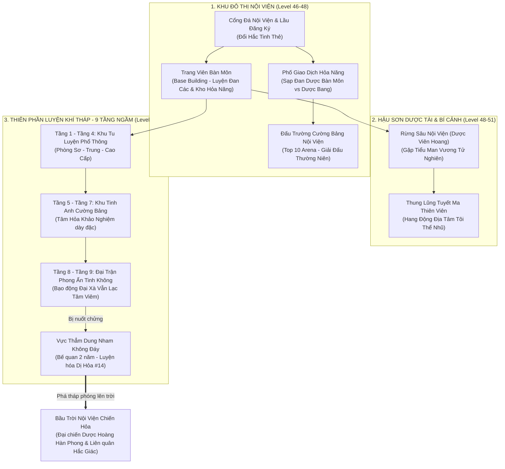

# CHƯƠNG 06: NỘI VIỆN GIÀ NAM & THIÊN PHẦN THÁP — BÀN MÔN TRỖI DẬY, THU PHỤC VẪN LẠC TÂM VIÊM

> **Quyển**: Quyển 02 — Hắc Giác Vực & Học Viện Già Nam
> **Cảnh Giới Yêu Cầu & Đột Phá**: Đấu Linh 6 Tinh → Đấu Vương 9 Tinh Đỉnh Phong (`Level 46 – 59`)
> **Vùng Bản Đồ Chính**: Khu Ký Túc Tân Sinh & Trụ Sở Bàn Môn → Thiên Phần Luyện Khí Tháp (9 Tầng Ngầm) → Sơn Mạch Dược Tài Nội Viện → Đấu Trường Cường Bảng → Vực Thẳm Dung Nham Đáy Tháp
> **Thu Hoạch Cốt Lõi**: Dị Hỏa thứ hai **Vẫn Lạc Tâm Viêm (#14)** & dung hợp **Lưu Ly Liên Tâm Hỏa**, Nội tại thần thánh **"Tu Luyện Gian Lận Khí"**, *Phần Quyết (Địa Giai Đê Cấp)*, *Địa Tâm Tôi Thể Nhũ*, Lò đan *Hải Tâm Đỉnh*, Đồng hành đặc biệt **Tử Nghiên** & **Nữ Hoàng Mỹ Đỗ Toa (Thải Lân)**
> **Bước Nhảy Lối Chơi (Progression Milestone)**: Đột phá **Đấu Vương** mọc đôi cánh **Đấu Khí Hóa Dực** bay lượn vượt địa hình vĩnh viễn; mở khóa **Quản Lý Thế Lực Bàn Môn**, **Leo Tháp Tâm Hỏa** và nâng cấp `Phật Nộ Hỏa Liên` lên **Song Dị Hỏa Dung Hợp** uy lực hủy diệt cấp Đấu Tông!
> **Tài Liệu Tham Chiếu**: [00_Master_Index_Va_Quy_Chuan.md](file:///e:/Project/DauPhaThuongKhung/docs/00_Tong_Quan_Kien_Truc/00_Master_Index_Va_Quy_Chuan.md) | [Bang_23_Di_Hoa_Va_Thu_Hoa.md](file:///e:/Project/DauPhaThuongKhung/docs/02_He_Thong_Tu_Luyen_Va_Di_Hoa/Bang_23_Di_Hoa_Va_Thu_Hoa.md) | [The_Luc_Va_Phe_Phai.md](file:///e:/Project/DauPhaThuongKhung/docs/03_Nhan_Vat_Va_The_Luc/The_Luc_Va_Phe_Phai.md)

---

## 1. Sơ Đồ Khu Vực Bản Đồ (Top-Down 2D World & Tower Dungeon Layout)

Nội Viện Học Viện Già Nam được xây dựng ẩn sâu bên trong một thung lũng núi khép kín có kết giới không gian bảo hộ, lấy tòa **Thiên Phần Luyện Khí Tháp** cắm ngược xuống lòng đất làm trục sinh thái trung tâm.

### Quy Tắc Sinh Thái Nội Viện & Thiên Phần Tháp
* **Đồng Tiền Duy Nhất — Tinh Hỏa Năng (`Fire Energy Economy`)**: Mọi giao dịch mua dược liệu, thuê phòng tu luyện, mở rộng Bàn Môn trong Nội Viện đều thanh toán qua **Hắc Tinh Thẻ**. Mỗi ngày thực tế trong game, Hắc Tinh Thẻ tự động trừ `1 Điểm Hỏa Năng` phí duy trì hộ tịch (ép người chơi phải vận hành kinh tế đan dược hoặc nhận nhiệm vụ học viện).
* **Áp Chế Tầng Sâu Thiên Phần Tháp**: Càng đi xuống các tầng ngầm sâu hơn của tòa tháp đen, nhiệt độ vô hình càng cao. Nếu chỉ số `SOUL` và kháng hỏa không đủ chuẩn, nhân vật sẽ dính hiệu ứng *Tâm Phẫn* (màn hình nháy đỏ theo nhịp tim, tự mất máu mỗi 3 giây).
* **Bầu Trời Mở Khóa Chiều Cao 2.5D (Sau Hồi 6.6)**: Khi đột phá **Đấu Vương** mọc cánh *Đấu Khí Hóa Dực*, người chơi có thể bấm giữ `Space` để bay vọt qua vực sâu, vách núi và chiến đấu không chiến 360 độ trên bầu trời Nội Viện!

---

## 2. Chuỗi Nhiệm Vụ Chính (Main Questline — 7 Hồi Chi Tiết)

### Hồi 6.1: Sáng Lập "Bàn Môn" & Cuộc Chiến Thương Mại Hỏa Năng
* **Cảnh giới khuyến nghị**: Đấu Linh 6 Tinh (`Level 46`).
* **Bối cảnh**: Vừa bước chân vào khu tân sinh và dằn mặt hai gã gác cổng đòi "phí bảo kê", nhóm Tiêu Viêm lập tức bị **Bạch Bang** — thế lực Lão Sinh do **Bạch Thành** (Đấu Linh 6 Tinh, anh trai Bạch Trình, được **Bạch Sơn** về mách lẻo kích động) kéo người đến vây ép, đánh trọng thương các thành viên tân sinh đi lẻ nhằm cướp sạch số Tinh Hỏa Năng vừa thắng được.
* **Diễn biến Gameplay**:
  1. **Dựng Cờ Lập Phái — Bàn Môn (磐门)**: Không chịu cảnh tân sinh bị cá lớn nuốt cá bé, Tiêu Viêm cùng **Huân Nhi, Ngô Hạo, Hổ Gia** chính thức thành lập thế lực riêng mang tên **Bàn Môn** (*Vững chãi như bàn thạch*). Mở khóa giao diện quản lý `Trang Viên Bàn Môn`.
  2. **Phá Thế Độc Quyền Của Dược Bang**: Để Bàn Môn tự chủ tài chính, Tiêu Viêm quyết định luyện đan bán lấy Tinh Hỏa Năng. Thủ lĩnh **Dược Bang** là **Hàn Nhàn** (Luyện dược sư Ngũ phẩm sơ cấp tự phong / Tứ phẩm đỉnh phong kiêu ngạo) kéo cả bang tới đập sạp của Bàn Môn và thách đấu **Luyện Đan Công Khai** tại quảng trường.
  3. **Mini-Game Tỉ Thí Đấu Đan**: Trước sự chứng kiến của hàng ngàn học viên và Trưởng lão, Hàn Nhàn dốc sức luyện *Long Lực Đan*; trong khi Tiêu Viêm ung dung gọi **Thanh Liên Địa Tâm Hỏa** xanh biếc xoay chuyển trong *Song Long Huyết Đỉnh*, luyện thành công **Lục Phẩm Sơ Cấp / Ngũ Phẩm Đỉnh Phong Tuyệt Phẩm Đan Dược** tỏa hương thơm ngát khắp Nội Viện!
  4. **Thôn Tính Thị Trường**: Hàn Nhàn thua tâm phục khẩu phục, Dược Bang sụp đổ và xin sáp nhập làm *Đan Đường của Bàn Môn*. Ba mặt hàng chủ lực (*Băng Tâm Đan, Hồi Khí Đan, Hỏa Liên Đan*) cháy hàng mỗi ngày, biến Bàn Môn thành thế lực giàu tốc độ số 1 Nội Viện!
* **Phần thưởng**: Mở khóa hệ thống **Xây Dựng Thế Lực Bàn Môn**, thu nạp NPC **Hàn Nhàn** quản lý lò đan tự động (+30 Tinh Hỏa Năng/ngày), +25.000 EXP.

### Hồi 6.2: Thiên Phần Luyện Khí Tháp & Cảm Ứng Vẫn Lạc Tâm Viêm
* **Cảnh giới khuyến nghị**: Đấu Linh 6–7 Tinh (`Level 47`).
* **Bối cảnh**: Có nguồn Tinh Hỏa Năng dồi dào từ Bàn Môn, Tiêu Viêm lần đầu tiên bước vào thánh địa tu luyện cốt lõi của Học Viện Già Nam — **Thiên Phần Luyện Khí Tháp**.
* **Diễn biến Gameplay**:
  1. **Trải Nghiệm Phòng Tu Luyện Cao Cấp**: Quẹt thẻ trừ 20 điểm Hỏa Năng để mở cửa thạch thất trung tâm Tầng 3. Ngay khi ngồi xuống bồ đoàn ngọc, luồng nhiệt lượng kỳ dị không màu không mùi lặng lẽ chui thẳng vào tim người chơi, kích hoạt cơ chế **Tâm Hỏa Khảo Nghiệm**!
  2. **Vượt Ải Ảo Cảnh Tâm Ma**: Màn hình chuyển sang không gian nội tâm rực lửa; người chơi phải điều khiển linh hồn thể dùng *Thanh Liên Địa Tâm Hỏa* chém tan các bóng ma chấp niệm trong 60 giây để lọc sạch tạp chất Đấu Khí — giúp cảnh giới nhảy thẳng lên **Đấu Linh 7 Tinh**!
  3. **Tiếng Gầm Dưới Đáy Vực Sâu**: Tò mò đi theo cầu thang xoắn ốc xuống sát rìa phong ấn Tầng 7 – Tầng 8, ngọn Thanh Liên Hỏa trong bụng Tiêu Viêm đột nhiên run rẩy dữ dội và tự động phóng ra hộ thể! Nhìn qua khe nứt hắc ám dưới đáy tháp, một **đôi mắt vô hình khổng lồ** mở bừng giữa hư không, phát ra tiếng rít xé toạc màng nhĩ làm cả tòa tháp rung chuyển trước khi bị đại trận của các Trưởng lão trấn áp trở lại.
  4. **Mưu Đồ Dị Hỏa**: Dược Lão xác nhận quái vật dưới đáy tháp chính là **Vẫn Lạc Tâm Viêm (Bảng Dị Hỏa #14)** — ngọn lửa được mệnh danh là *"Tu Luyện Gian Lận Khí"*. Muốn nuốt nó mà không chết cháy từ trong tim, bắt buộc phải tìm đủ dược liệu luyện chế Lục Phẩm **Địa Linh Đan**!
* **Phần thưởng**: Đột phá **Đấu Linh 7 Tinh**, mở khóa tính năng cày cuốc lặp lại **Thiên Phần Tháp (Tầng 1–6)**, nhận công thức *Địa Linh Đan* (cần 3 đại linh dược: *Thanh Mộc Tiên Đằng, Băng Linh Hàn Tuyền, Long Huyết Chi*).

### Hồi 6.3: Sơn Mạch Dược Tài & "Tiểu Man Vương" Tử Nghiên
* **Cảnh giới khuyến nghị**: Đấu Linh 7–8 Tinh (`Level 48 – 49`).
* **Bối cảnh**: Tiêu Viêm tiến sâu vào vùng rừng nguyên sinh hiểm trở phía sau Nội Viện để tự tay săn tìm *Thanh Mộc Tiên Đằng* và cơ duyên thiên tài địa bảo.
* **Diễn biến Gameplay**:
  1. **Đụng Độ Loli Bạo Lực**: Khi lần theo dấu vết *Thanh Mộc Tiên Đằng* tới một hốc đá cổ, người chơi sững sờ chứng kiến một cô bé tóc tím tết hai bím xinh xắn như búp bê sứ mới chừng 11–12 tuổi đang... dùng nắm đấm nhỏ xíu đấm bay xác một con Ma thú Cấp 5 nặng hàng tấn văng gãy ba gốc cây cổ thụ, rồi nhổ gốc linh dược nhai rộp rộp như ăn kẹo!
  2. **Dụ Dỗ "Man Lực Vương" Tử Nghiên**: Cô bé chính là **Tử Nghiên** — cao thủ thần bí trên Cường Bảng sở hữu sức mạnh cơ bắp thuần túy đáng sợ (bản thể **Thái Hư Cổ Long Hoàng Tộc** ăn nhầm Hóa Hình Thảo) và thiên phú đánh hơi xuyên địa hình mọi bảo vật thiên nhiên! Thấy Tử Nghiên nhăn mặt chê cỏ cây đắng ngắt, Tiêu Viêm bật lửa nướng thảo dược nặn thành **Đan Hoàn Ngọt Dịu** thơm lừng — lập tức thu phục hoàn toàn cô bé tham ăn làm "radar dò kho báu sống"!
  3. **Đột Nhập Thung Lũng Tuyết Ma Thiên Viên**: Tử Nghiên đánh hơi thấy mùi năng lượng cực phẩm và dẫn Tiêu Viêm luồn qua khe núi bí mật tới hang động của **Tuyết Ma Thiên Viên (Khôi Lỗi Thú Vương — Ma thú Cấp 5 Đỉnh Phong ngang Đấu Vương)**. Giữa hang đá lấp lánh thạch bồn chứa **Huyền Hoàng Viêm Tinh** đóng váng bên trên và dòng chất lỏng ngọc bích vạn năm bên dưới: **Địa Tâm Tôi Thể Nhũ**!
  4. **Đánh Lạc Hướng Đoạt Chí Bảo**: Người chơi đặt 1 viên *Hỏa Liên Nhỏ* hẹn giờ ngoài cửa hang làm nổ tung vách đá dụ Tuyết Ma Thiên Viên lao ra đuổi bắt bóng tàn ảnh lôi điện, đồng thời dùng đao ngọc hớt sạch *Địa Tâm Tôi Thể Nhũ* trong 30 giây nghẹt thở trước khi Thú Vương quay lại!
  5. **Tẩy Tủy & Đánh Thức Sư Tôn**: Trở về mật thất pha loãng *Địa Tâm Tôi Thể Nhũ* ngâm mình rèn gân cốt cứng như kim cương (đột phá **Đấu Linh 8 Tinh**), đồng thời dâng giọt tinh túy nhất vào nhẫn giúp **Dược Lão khôi phục hoàn toàn Linh Hồn Lực đỉnh phong** từ trạng thái tổn hao trước đó!
* **Phần thưởng**: Mở khóa đồng hành vĩnh viễn **Tử Nghiên** (nội tại *Tầm Bảo Radar* hiển thị rương/dược liệu ẩn trên minimap + tuyệt chiêu đấm xuyên không gian!), vĩnh viễn +15% `DEF` & +1.200 `HP` gốc nhờ *Địa Tâm Tôi Thể Nhũ*, thu đủ bộ nguyên liệu luyện thành **Địa Linh Đan**.

### Hồi 6.4: Đại Thi Đấu Cường Bảng Nội Viện (Top 10 Arena)
* **Cảnh giới khuyến nghị**: Đấu Linh 8–9 Tinh (`Level 50 – 51`).
* **Bối cảnh**: Giải đấu danh giá nhất Nội Viện — **Đại Thi Đấu Cường Bảng** chính thức khai mạc! Chỉ những ai lọt vào **Top 10 Cường Bảng** mới được cấp quyền bước xuống Tầng 7–8 Thiên Phần Tháp (nơi tiếp cận gần nhất với Vẫn Lạc Tâm Viêm!).
* **Diễn biến Gameplay (Chuỗi Lôi Đài Đỉnh Cao)**:
  1. **Vòng Khởi Động — Dẹp Loạn Bạch Bang & Đập Nát Âm Mưu Diêu Thịnh**:
     * Trận 1: Một xích quét văng thủ lĩnh Bạch Bang là **Bạch Thành** (Đấu Linh 6 Tinh) chỉ trong 15 giây, xóa sổ hoàn toàn cái gai nhức nhối của Bàn Môn.
     * Trận 2: Đánh bại kẻ tiểu nhân **Diêu Thịnh** (Đấu Linh 7 Tinh — gã dùng *Phù Thủy Thuộc Tính Ám Khí* và đầm lầy nước đen định làm nhục Tiêu Viêm trước mặt Huân Nhi). Tiêu Viêm dùng *Thanh Liên Địa Tâm Hỏa* đun sôi bốc hơi toàn bộ đầm nước của hắn ngay trên sân đấu rồi nện hắn bất tỉnh!
     * Trận 3: Tái đấu sòng phẳng hạ gục **Bạch Sơn** (Lôi Hoàng Thương — Đấu Linh 7 Tinh), giải quyết dứt điểm ân oán từ kỳ thi tân sinh.
  2. **Trận Tâm Điểm Lịch Sử — Kịch Chiến Bá Thương Liễu Kình (Top 3 Cường Bảng)**:
     * Đối mặt với **Bá Thương Liễu Kình** (Đấu Linh 8 Tinh Đỉnh Phong, anh họ Liễu Phi, sở hữu bá khí cương mãnh nhất Nội Viện sau Lâm Tu Nhai và Nghiêm Hạo).
     * Trận chiến kéo dài 3 Phase làm vỡ nát 80% gạch đá trên sàn đấu trường! Đỉnh điểm cuối trận, cả hai đều cạn sạch Đấu Khí nhưng vẫn gầm vang tung đòn sinh tử cuối cùng: Liễu Kình vọt lên trời giáng xuống Địa Giai Đấu Kỹ **Đại Liệt Phách Quan Trảo** xé toạc không khí; Tiêu Viêm dồn toàn lực vào nắm đấm bọc hỏa tinh nghênh đón bằng **Bát Cực Băng — Ám Kình Cực Hạn** (hoặc *Tiểu Hỏa Liên*)!
     * Khói bụi tan đi, cả hai người đẫm máu đứng sừng sững như hai pho tượng sắt không ai chịu khuất phục! Đại Trưởng Lão **Tô Thiên** (Đấu Tông) bay ra cứu nguy kịp thời, tuyên bố cả hai **Đồng Hạng 10 / Đặc Cách Vào Top 10** trong tiếng vỗ tay dậy đất! **Lâm Tu Nhai** (Hạng 1 Cường Bảng) và **Liễu Kình** chủ động nâng chén kết giao bằng hữu với Tiêu Viêm.
* **Phần thưởng**: Danh hiệu **Thập Đại Cường Giả Nội Viện**, vé thông hành xuống Tầng Đáy Thiên Phần Tháp, +400 Hảo Cảm **Liễu Kình** & **Lâm Tu Nhai** (cả hai sẽ dẫn đội viện binh theo Tiêu Viêm đánh Vân Lam Sơn ở Chương 07!).

### Hồi 6.5: Phản Đồ Hàn Phong & Đại Bạo Động Thiên Phần Tháp
* **Cảnh giới khuyến nghị**: Đấu Linh 9 Tinh (`Level 52`).
* **Bối cảnh**: Vài ngày sau giải đấu, đại trận phong ấn dưới đáy Thiên Phần Tháp đột ngột nứt toác! Cùng thời khắc sinh tử ấy, hơn mười luồng khí tức Đấu Hoàng và Đấu Vương tà ác từ Hắc Giác Vực xé rách bầu trời bao vây Nội Viện — dẫn đầu là nghịch đồ phản sư từng sát hại Dược Lão năm xưa: **Dược Hoàng Hàn Phong** (Đấu Hoàng, Luyện dược sư Lục phẩm đỉnh phong, sở hữu **Hải Tâm Diễm #15**)!
* **Diễn biến Gameplay**:
  1. **Nhận Diện Nghịch Đồ**: Khi Hàn Phong cất tiếng cười giả nhân giả nghĩa đòi Học Viện Già Nam "nhường" Vẫn Lạc Tâm Viêm đổi lấy đan dược, linh hồn Dược Lão trong nhẫn bùng phát sát ý ngập trời khiến chiếc nhẫn rung bần bật. Hàn Phong mang theo **Kim Ngân Nhị Lão** (hai lão quái Đấu Hoàng Đỉnh Phong hợp kích cầm chân Đấu Tông **Tô Thiên**!), Tông chủ Huyết Tông **Phạm Lao** và đám cường giả tham lam của Hắc Giác Vực.
  2. **Đại Xà Phá Tháp**: *ẦM!* Đỉnh tháp Thiên Phần nổ tung thành vạn mảnh đá đen! Bản thể **Vẫn Lạc Tâm Viêm** hóa thành một con **Đại Xà Hỏa Diễm Vô Hình** dài hàng trăm trượng lao vút lên trời, điên cuồng quẫy đuôi đâm sập màng chắn Tinh Không của chúng Trưởng lão!
  3. **Sống Sót Giữa Thảm Họa (Survival Sequence)**: Người chơi điều khiển Tiêu Viêm chỉ huy đệ tử Bàn Môn sơ tán học viên dưới mặt đất, né tránh những cơn mưa lửa tâm hỏa vô hình rơi xuống từ cuộc hỗn chiến giữa các Trưởng lão Già Nam, đám Đấu Hoàng Hàn Phong và con Đại Xà khổng lồ!
  4. **Cú Nuốt Định Mệnh**: Khi Đại Xà Vẫn Lạc Tâm Viêm bị Tô Thiên cùng thất đại trưởng lão lập trận đánh trọng thương chuẩn bị lùi về đáy tháp, đôi mắt tà ác của nó bỗng khóa chặt vào Tiêu Viêm (kẻ mang *Thanh Liên Địa Tâm Hỏa* và khí tức của Dược Lão đang chực chờ ngư ông đắc lợi). Con mãng xà vô hình bổ nhào xuống **nuốt chửng Tiêu Viêm vào bụng lửa**, kéo tuột chàng lao thẳng xuống vực sâu dung nham ngàn trượng ngay trước mắt Huân Nhi và Tô Thiên vừa khép kín đại trận phong ấn!
* **Phần thưởng**: Mở khóa phân cảnh kịch tính bậc nhất Quyển 02, chuyển tiếp thẳng xuống bí cảnh cô lập **Vực Thẳm Dung Nham Đáy Tháp**.

### Hồi 6.6: Luyện Ngục Dung Nham — Thu Phục Vẫn Lạc Tâm Viêm (2 Năm Dưới Đáy Tháp)
* **Cảnh giới khuyến nghị**: Đấu Linh 9 Tinh → Nhảy vọt **Đấu Vương 9 Tinh Đỉnh Phong** (`Level 53 – 58`).
* **Bối cảnh**: Bị chôn vùi dưới biển dung nham nóng chảy sâu vạn trượng không lối thoát, phía trên là đại trận phong ấn kín mít của Nội Viện, trước mặt là bản thể Dị Hỏa hung tàn xếp thứ 14 đang gào thét đòi thiêu rụi linh hồn kẻ dám ngấp nghé nó!
* **Diễn biến Gameplay (Màn Chơi Tâm Hồn & Sinh Tử)**:
  1. **Sư Đồ Hiệp Lực Khóa Dị Hỏa**: Dược Lão hiện chân thân dưới đáy dung nham, thi triển toàn lực **Cốt Linh Lãnh Hỏa (#11)** đóng băng lớp vỏ ngoài của Đại Xà Vô Hình, đánh tan ý thức hung bạo của nó để ép về dạng **Bản Nguyên Tâm Hỏa**. Kiệt cạn linh hồn lực vì xuất thủ quá giới hạn, Dược Lão dặn dò lần cuối rồi chìm vào giấc ngủ sâu trong nhẫn.
  2. **Hai Năm Vạn Hỏa Phần Tâm**: Tiêu Viêm nuốt chửng **Địa Linh Đan**, ngậm *Băng Linh Hàn Tuyền* rồi nuốt Bản Nguyên Vẫn Lạc Tâm Viêm vào cơ thể! Nhưng Tâm Viêm cực kỳ quỷ quyệt — nó đốt ngược từ trái tim ra kinh mạch, vây bọc Tiêu Viêm trong một cái **Kén Lửa Vô Hình** dưới đáy nham thạch suốt gần **2 năm trời**!
     * *Gameplay Mini-Dungeon Nội Thị*: Người chơi điều khiển dòng chảy **Phần Quyết** dẫn dắt *Thanh Liên Địa Tâm Hỏa* (màu xanh ngọc) va chạm và dung hợp từng nhịp với *Vẫn Lạc Tâm Viêm* (trong suốt vặn vẹo không gian) xuyên qua 12 kinh mạch chính!
  3. **Biến Cố Định Mệnh Với Nữ Hoàng Mỹ Đỗ Toa (Thải Lân)**: Ngay khoảnh khắc hai luồng Dị Hỏa dung hợp bùng phát tà hỏa thiêu đốt lý trí cực hạn, Thất Thải Thôn Thiên Mãng trong tay áo Tiêu Viêm hoàn tất tiến hóa — linh hồn **Nữ Hoàng Mỹ Đỗ Toa** thức tỉnh trọn vẹn ở cảnh giới **Đấu Tông** bước ra! Dưới tác động phản phệ điên cuồng của *Tâm Hỏa Giao Cảm* giữa hai bản thể, sự kiện gắn kết sinh mệnh định mệnh đã diễn ra dưới đáy dung nham (gieo mầm cốt nhục **Tiêu Tiêu**)! Khi tỉnh lại, Mỹ Đỗ Toa thẹn quá hóa giận rút kiếm truy sát Tiêu Viêm chạy bạt mạng khắp biển nham thạch, nhưng vì sinh mệnh hai người đã trói buộc với Thất Thải Thôn Thiên Mãng và đứa con chưa thành hình, nàng đành nghiến răng lập giao ước: Tiêu Viêm phải luyện *Phục Hồn Đan / Thiên Hồn Dung Huyết Đan* cho nàng, đổi lại nàng làm **Bảo Tiêu Đấu Tông** hộ vệ chàng trong 1 năm!
  4. **Luyện Hóa Hoàn Mỹ — Đấu Vương Đỉnh Phong Xuất Thế**: Dung hợp hoàn toàn hai đại Dị Hỏa tạo thành **Lưu Ly Liên Tâm Hỏa**! Kén lửa nổ tung, cảnh giới của Tiêu Viêm xuyên thủng toàn bộ rào cản, nhảy một mạch từ Đấu Linh lên thẳng **Đấu Vương Đỉnh Phong (`Level 58`)**, công pháp **Phần Quyết** tiến hóa lên **Địa Giai Đê Cấp**, sau lưng mọc đôi cánh **Đấu Khí Hóa Dực** màu xanh lưu ly rực rỡ!
* **Phần thưởng Siêu Cấp**:
  * Sở hữu **Vẫn Lạc Tâm Viêm (#14)** & dạng dung hợp **Lưu Ly Liên Tâm Hỏa**.
  * Mở khóa vĩnh viễn Nội tại Thần Thánh **"Tu Luyện Gian Lận Khí"** (+EXP Đấu Khí nhảy tự động mỗi giây 24/7!).
  * Mở khóa cơ chế bay tự do **Đấu Khí Hóa Dực** & Đồng hành Bảo Tiêu cấp Đấu Tông **Mỹ Đỗ Toa (Thải Lân)**.

### Hồi 6.7: Phá Tháp Cứu Viện — Trừng Trị Nghịch Đồ Hàn Phong
* **Cảnh giới khuyến nghị**: Đấu Vương 9 Tinh Đỉnh Phong (`Level 59`).
* **Bối cảnh**: Tròn 2 năm kể từ ngày Tiêu Viêm rơi xuống đáy tháp, ai nấy đều ngỡ chàng đã hóa tro tàn (chỉ có Huân Nhi, Ngô Hạo, Hổ Gia và Tử Nghiên vẫn kiên cường giữ vững **Bàn Môn** chờ môn chủ trở về). Đúng hôm nay, **Dược Hoàng Hàn Phong** một lần nữa dẫn đại quân tà phái Hắc Giác Vực (*Kim Ngân Nhị Lão, Phạm Lao, Địa Viêm Tông, Bát Phiến Môn...*) ập vào tận trung tâm Nội Viện, ép Tô Thiên giao nộp tháp tu luyện và quỳ gối khuất phục!
* **Diễn biến Gameplay**:
  1. **Phá Quan Xuất Thế — Cột Lửa Chọc Trời**: Giữa lúc Hàn Phong cười ngạo nghễ định ra tay tàn sát đệ tử Bàn Môn, mặt đất Thiên Phần Tháp chấn động long trời lở đất — *ĐÙNG!* Một cột hỏa diễm lưu ly xanh biếc khổng lồ đâm xuyên qua 9 tầng tháp bắn thẳng lên chín tầng mây! Người chơi điều khiển Tiêu Viêm vỗ đôi cánh lưu ly lao vút lên bầu trời, một cước đá văng gã Đấu Vương Ma Viêm Cốc đang vung đao về phía Ngô Hạo, cất tiếng cười lạnh vang vọng khắp dãy núi!
  2. **Quần Chiến Bầu Trời Nội Viện**: Đại Trưởng Lão **Tô Thiên** cười lớn chặn đánh Kim Ngân Nhị Lão; **Lâm Tu Nhai, Liễu Kình, Nghiêm Hạo** (nay đều đã bước vào Đấu Vương) sát cánh cùng Trưởng lão đoàn quét sạch phe cánh Hắc Giác Vực; **Mỹ Đỗ Toa** khoanh tay lơ lửng trên tầng mây tỏa uy áp Đấu Tông khiến không một lão quái nào dám nhúng tay cứu Hàn Phong!
  3. **Tử Chiến Nghịch Đồ — Tiêu Viêm vs Dược Hoàng Hàn Phong**: Trận đánh Boss không chiến 1v1 mãn nhãn nhất Chương 06! Tiêu Viêm thay mặt sư tôn Dược Trần thanh toán nợ máu phản sư, cuối cùng dung hợp hai ngọn Dị Hỏa chân chính (*Thanh Liên Địa Tâm Hỏa + Vẫn Lạc Tâm Viêm*) tạo thành **Song Sắc Dị Hỏa Phật Nộ Hỏa Liên** nổ nát bấy nhục thân Đấu Hoàng của Hàn Phong và đánh trọng thương Phạm Lao! *(Linh hồn Hàn Phong được luồng khói đen bí ẩn của Hồn Điện lén cuốn đi trốn thoát về Ma Viêm Cốc — phục bút Hồi 7.7).*
  4. **Hội Quân Hắc Giác Vực — Hướng Về Gia Mã**: Uy danh đánh bại Đấu Hoàng Hàn Phong của Tiêu Viêm làm chấn động toàn bộ Hắc Giác Vực! Thông qua mối quan hệ của Học Viện Già Nam và sức hút đan dược Lục Phẩm, Tiêu Viêm chiêu mộ hàng loạt Đấu Hoàng, Đấu Vương độc hành thành lập **Quân Đoàn Viễn Chinh**. Ngay lúc đó, thám tử từ Gia Mã Đế Quốc đẫm máu chạy tới báo tin khẩn: *Vân Lam Tông đã bao vây tiêu diệt Tiêu Gia, phụ thân Tiêu Chiến mất tích không rõ sống chết!*
* **Phần thưởng**: Đạt đỉnh **Level 59 (Đấu Vương 9 Tinh Đỉnh Phong)**, thu chiến lợi phẩm lò đan Lục Phẩm **Hải Tâm Đỉnh** và cuốn *Dược Phương Thất Phẩm Tàn Quyển* từ xác Hàn Phong, sẵn sàng mở màn **Chương 07: Tam Thượng Vân Lam Sơn**!

---

## 3. Cơ Chế Gameplay Độc Đáo Của Chương (Unique Chapter Mechanics)

### 3.1. Hệ Thống Xây Dựng & Quản Trị Thế Lực "Bàn Môn" (Faction Management)
Tại `Trang Viên Bàn Môn`, người chơi mở bảng điều hành thế lực với 3 phân đường chức năng hoạt động theo thời gian thực:

| Phân Đường | Người Đứng Đầu | Cơ Chế Vận Hành Trong Game | Lợi Ích Cho Người Chơi |
| :--- | :---: | :--- | :--- |
| **Đan Đường (Alchemy Hall)** | **Hàn Nhàn** (& Đệ tử Dược Bang cũ) | Cung cấp dược liệu thô vào kho -> Tự động luyện đan cấp 3–4 bán ở Phố Giao Dịch | Thu nhập thụ động **+40 đến +120 Tinh Hỏa Năng / ngày**, giảm 30% giá mua linh dược hiếm |
| **Võ Đường (Combat Hall)** | **Ngô Hạo** & **Hổ Gia** | Phái đệ tử Bàn Môn đi tuần tra Sơn Mạch Nội Viện và giữ chỗ phòng tu luyện tốt | Tự động thu thập `Ma Hạch Cấp 4–5` mỗi 30 phút chơi, giữ miễn phí phòng VIP Thiên Phần Tháp |
| **Ám Đường / Tầm Bảo** | **Tử Nghiên** (Khách khanh đặc biệt) | Đút `Đan Hoàn Ngọt` cho Tử Nghiên (tối đa 3 viên/lần) để cô bé chạy vào rừng sâu đào đồ | Mang về ngẫu nhiên **Linh Dược Lục Phẩm**, công thức cổ hoặc nguyên liệu nâng cấp Xích! |

#### Bảng Đan Dược Chiến Lược Độc Quyền Của Bàn Môn
| Tên Đan Dược | Phẩm Cấp | Giá Bán (Tinh Hỏa Năng) | Công Dụng Khi Tiêu Viêm Tự Sử Dụng |
| :--- | :---: | :---: | :--- |
| **Băng Tâm Đan** | Tứ Phẩm | 15 Điểm / Viên | Kháng 60% hiệu ứng *Tâm Phẫn* khi tu luyện dưới Tầng 5–7 Thiên Phần Tháp trong 10 phút |
| **Thanh Linh Đan (Tam Văn)** | Ngũ Phẩm | 50 Điểm / Viên | Đột phá tức thời 1 tiểu tinh cấp khi thanh EXP Đấu Linh đạt 85% trở lên |
| **Hỏa Liên Đan** | Ngũ Phẩm Cao Cấp | 85 Điểm / Viên | Tăng +30% sát thương nguyên tố Hỏa và giảm 20% thời gian hồi `Phật Nộ Hỏa Liên` |
| **Địa Linh Đan** | Lục Phẩm | *Không bán (Nhiệm vụ)* | Bảo hộ lục phủ ngũ tạng và tâm mạch khi thôn phệ **Vẫn Lạc Tâm Viêm (#14)** |

### 3.2. Cơ Chế Leo "Thiên Phần Luyện Khí Tháp" & Tâm Hỏa Khảo Nghiệm
Thiên Phần Tháp đóng vai trò là **Phó Bản Cày Cuốc Đột Phá (Progression Tower)** gồm 9 tầng ngầm sâu dần vào lòng đất:

| Cụm Tầng Ngầm | Điều Kiện Mở Cửa | Phí Hỏa Năng | Hệ Số EXP | Đặc Tính Tâm Hỏa & Sự Kiện |
| :--- | :--- | :---: | :---: | :--- |
| **Tầng 1 – Tầng 3** | Mọi học viên Nội Viện | 5 Điểm / phút | `x2.5 EXP` | Nhiệt lượng ôn hòa, không có Tâm Ma quấy nhiễu |
| **Tầng 4 – Tầng 6** | Đấu Linh 7★ (`Lv.47+`) | 15 Điểm / phút | `x5.0 EXP` | Xuất hiện *Tâm Hỏa Khảo Nghiệm* mỗi 90 giây; thắng Tâm Ma nhận buff `+10% ATK` |
| **Tầng 7 – Tầng 8** | Lọt **Top 10 Cường Bảng** | 40 Điểm / phút | `x8.5 EXP` | Áp lực Tâm Viêm cực đại (cần *Băng Tâm Đan*); rớt `Tinh Hoa Tâm Hỏa` nâng chỉ số `SOUL` |
| **Tầng 9 & Vực Đáy** | Cốt truyện Hồi 6.5 – 6.6 | *Phong ấn cổ* | *Đột phá thẳng* | Hang ổ bản thể **Đại Xà Vẫn Lạc Tâm Viêm** & Biển dung nham bế quan 2 năm |

### 3.3. Nội Tại Thần Thánh Của Vẫn Lạc Tâm Viêm: "Tu Luyện Gian Lận Khí"
Ngay khi hoàn thành Hồi 6.6 và dung hợp **Vẫn Lạc Tâm Viêm (#14)** vào trái tim, nhân vật mở khóa cơ chế bị động độc nhất vô nhị bám sát 100% danh xưng trong nguyên tác:
* **Tự Động Tu Luyện 24/7 (`Always-On Cultivation Engine`)**: Một vòng xoáy lửa vô hình nhỏ hiển thị ngay cạnh thanh EXP trên HUD. Bất kể nhân vật đang đi dạo trong thành, mở túi đồ, nói chuyện với NPC hay đang đánh Boss, **mỗi 1 giây trôi qua nhân vật đều tự động nhảy `+EXP Đấu Khí` và hồi phục `+4% QI tối đa`**!
* **Triệu Hồi Tâm Hỏa Nội Thiêu (`Inner Ignition` — Nội tại Đòn Đánh)**: Mỗi đòn đánh trúng kẻ địch tích 1 cộng dồn *Hỏa Chủng Vô Hình*. Đủ 5 cộng dồn, ngọn lửa phát nổ từ bên trong nội tạng mục tiêu gây **Sát Thương Chuẩn (True Damage bỏ qua 100% Giáp vật lý/Đấu Khí)** dựa trên chênh lệch chỉ số `SOUL`!

### 3.4. Hệ Thống Bảng Xếp Hạng "Cường Bảng Nội Viện" (Top 10 Ranking Challenge)
Ngoài mạch truyện chính Hồi 6.4, người chơi có thể khiêu chiến giao hữu các cao thủ Cường Bảng tại Đấu Trường để nhận bổng lộc hàng tuần và chiêu mộ họ vào đội hình viễn chinh:
* **Hạng 1 — Tử Nghiên (Ẩn danh "Man Lực Vương")**: Không cần đánh — chỉ cần đút `Đan Hoàn Ngọt` là tự động đi theo bảo kê!
* **Hạng 2 — Lâm Tu Nhai (Đấu Linh 9★ Đỉnh Phong — Thanh Phong Kiếm)**: Cao thủ phong độ nhất Nội Viện, mở khóa trợ chiến ở Hồi 6.7 & Chương 07.
* **Hạng 3 — Nghiêm Hạo (Đấu Linh 9★ — Hắc Kiếm Sát Phạt)**: Thách đấu thắng nhận bí kíp rèn tốc độ xuất chiêu kiếm/xích `+8% SPD`.
* **Hạng 4 — Bá Thương Liễu Kình (Đấu Linh 8★ Đỉnh Phong)**: Đấu hòa lịch sử ở Hồi 6.4, tặng ấn tín huynh đệ Liễu Gia.

---

## 4. Nhiệm Vụ Phụ & Kỳ Ngộ Ẩn Sát Nguyên Tác (Side Quests & Secrets)

1. **Kỳ Ngộ Ẩn: Chế Tạo "Đan Hoàn Kẹo Ngọt" Nuôi Cổ Long Hoàng (Tử Nghiên)**
   * *Điều kiện kích hoạt*: Mở Lò Đan nhưng không cho ma hạch kích tính mà chỉ cho *Mật Ong Thanh Linh + Chu Quả + Cam Thảo* nặn thành viên tròn bóng bẩy.
   * *Nội dung*: Tử Nghiên sáng rực hai mắt đòi ăn sạch cả mẻ kẹo đan hoàn. Khi độ no của Tử Nghiên đạt 100%, cô bé dẫn người chơi tới một hốc cây mục ở rìa vách đá Hậu Sơn nơi có xác một con ma thú tiền sử vùi lấp.
   * *Phần thưởng*: `Long Huyết Chi Ngàn Năm` (tăng vĩnh viễn +500 `HP`) & mở khóa chiêu trợ chiến *Cổ Long Nhất Quyền* của Tử Nghiên (đấm nứt không gian gây Choáng Boss 3 giây!).

2. **Nhiệm Vụ Phụ: Chữa Trị Hỏa Độc Cho Đại Trưởng Lão Tô Thiên**
   * *Vị trí*: Lầu Các Trưởng Lão sau trận bạo động lần đầu (hoặc sau khi phá tháp ở Hồi 6.7).
   * *Nội dung*: Quanh năm trấn áp Vẫn Lạc Tâm Viêm khiến kinh mạch của Đại Trưởng Lão **Tô Thiên** bị nhiễm *Tâm Hỏa Ám Tật*. Tiêu Viêm dùng bản nguyên *Lưu Ly Liên Tâm Hỏa* hút sạch hỏa độc trong người ông.
   * *Phần thưởng*: Tô Thiên cảm kích trao tặng kinh nghiệm cảm ngộ không gian sơ cấp và hứa Học Viện Già Nam sẽ làm hậu thuẫn vững chắc cho Bàn Môn trước mọi thế lực Hắc Giác Vực.

3. **Nhiệm Vụ Phụ: Ký Ức Đau Thương Của Dược Trần (Ảo Cảnh Tầng Đáy)**
   * *Điều kiện kích hoạt*: Tương tác với chiếc nhẫn *Cốt Viêm Giới* khi Dược Lão chạm mặt Hàn Phong ở Hồi 6.5.
   * *Nội dung*: Trải nghiệm đoạn hồi tưởng ngắn dưới góc nhìn quá khứ của **Dược Tôn Giả Dược Trần** tại Trung Châu — cảnh ông nhặt đứa trẻ mồ côi Hàn Phong về nuôi dạy truyền hết y bát, để rồi bị chính đứa học trò ấy cấu kết với **Mộ Cốt Lão Nhân (Hồn Điện)** đâm lén sau lưng lúc ông đang luyện đan!
   * *Phần thưởng*: Tăng chỉ số `SOUL` đột phá lên ngưỡng **Phàm Cảnh Đỉnh Phong** (sát vách Linh Cảnh), tăng +25% sát thương lên các kẻ địch hệ Hồn Điện & Hàn Phong.

4. **Kỳ Ngộ Ẩn: Mảnh Tinh Thể Lưu Ly Dưới Đáy Dung Nham**
   * *Điều kiện kích hoạt*: Trước khi bay phá tháp rời khỏi Vực Thẳm Dung Nham ở cuối Hồi 6.6, lặn sang nhánh sông ngầm bên phải hang đá nơi Mỹ Đỗ Toa từng lột xác tiến hóa.
   * *Nội dung*: Thu nhặt lớp vảy lột Thất Thải Thôn Thiên Mãng hòa quyện với tinh thể nham thạch vạn năm kết thành **Địa Hỏa Lưu Ly Tinh**.
   * *Phần thưởng*: Khảm trực tiếp vào **Huyền Trọng Xích**, giúp mỗi cú đập xích khi tháo phong ấn để lại vệt dung nham cháy âm ỉ trên mặt đất trong 4 giây!

5. **Nhiệm Vụ Phụ: Giải Cứu Đội Tuần Tra Bàn Môn Khỏi Ma Viêm Cốc**
   * *Vị trí*: Bìa rừng Hòa Bình Trấn ngay sau khi phá tháp (Hồi 6.7).
   * *Nội dung*: Trước khi khởi hành về Gia Mã, tiêu diệt toán thám tử ngầm của **Ma Viêm Cốc** đang rình rập trả thù cho Hàn Phong và lập đại trận hộ phái cho Bàn Môn.
   * *Phần thưởng*: Mở khóa thu nhập tự động xuyên lục địa cho Bàn Môn kể cả khi Tiêu Viêm đã rời Học Viện!

---

## 5. Trích Đoạn Thoại Kinh Điển (Iconic Cutscene Dialogues)

### Phân Cảnh 1: Thu Phục "Tiểu Man Vương" Bằng Kẹo Đan Hoàn (Hồi 6.3 — Sơn Mạch)
> *[Cô bé tóc tím ngồi vắt vẻo trên xác con Ma thú Cấp 5, miệng nhai rộp rộp nhành thảo dược quý hiếm rồi nhăn tít đôi mày thanh tú nhổ phì ra đất.]*
>
> **Tử Nghiên** *(phồng má bực bội)*: "Phì phì! Đắng chết đi được! Rõ ràng ngửi mùi linh khí thơm phức mà nhai cứ như nhai vỏ cây khô ấy! Này tên kia, ngươi nhìn lén cái gì, muốn bị bản cô nương đấm bay giống con khỉ đá này hả?!"
>
> **Tiêu Viêm** *(mồ hôi lạnh chảy ròng nhưng lập tức mỉm cười móc ra viên Đan Hoàn bóng loáng thơm mùi mật nướng)*: "Khụ... Phí của giời quá tiểu cô nương ơi! Linh dược ai lại ăn sống thế kia. Nếm thử viên 'kẹo đan' do ta luyện xem — nếu ngon thì sau này ta bao ăn trọn đời, cô chỉ việc chỉ chỗ có cỏ thơm cho ta là được!"
>
> **Tử Nghiên** *(chộp lấy bỏ vào miệng, hai mắt tím bỗng sáng lấp lánh như sao trời)*: "Ưm!! Ngọt giòn tan luôn! Thành giao! Từ nay ngươi là đầu bếp riêng của Tử Nghiên ta!"

### Phân Cảnh 2: Kịch Chiến Bá Thương — Anh Hùng Trọng Anh Hùng (Hồi 6.4)
> *[Đấu trường Cường Bảng tan hoang như vừa trải qua động đất. Liễu Kình chống cây thương gãy đẫm máu, lồng ngực phập phồng nhìn Tiêu Viêm cũng đang đứng thẳng tắp dù khóe miệng trào máu tươi, thanh Huyền Trọng Xích cắm ngập nửa thước xuống đá xanh.]*
>
> **Bá Thương Liễu Kình** *(bật cười sảng khoái hào sảng, lau vết máu trên cằm)*: "Ha ha ha! Thống khoái! Từ ngày vào Nội Viện tới giờ, trừ Lâm Tu Nhai ra, chưa có kẻ nào dám lấy thịt đè người đối cứng một trảo toàn lực của Liễu Kình ta mà không lùi nửa bước! Tiêu Viêm, từ hôm nay ngươi là huynh đệ của Liễu Kình này!"
>
> **Tiêu Viêm** *(cười nhạt nhưng ánh mắt đầy kính trọng, chắp tay)*: "Đại Liệt Phách Quan Trảo của Liễu huynh quả thực danh bất hư truyền. Nếu không nhờ bộ xương cứng cáp này, e rằng người nằm xuống trước đã là ta rồi!"

### Phân Cảnh 3: Sư Đồ Chạm Mặt Nghịch Đồ Phản Sư (Hồi 6.5 — Bầu Trời Thiên Phần Tháp)
> *[Trên không trung, Hàn Phong khoác bào phục Luyện Dược Sư hoa lệ, bàn tay nâng ngọn lửa xanh biển sâu Hải Tâm Diễm. Dưới mặt đất, linh hồn Dược Lão hiện bóng mờ sau lưng Tiêu Viêm, đôi mắt già nua rực lên hận ý thấu tận cửu tuyền.]*
>
> **Hàn Phong** *(nheo mắt nhìn chằm chằm chiếc nhẫn đen trên tay Tiêu Viêm, sắc mặt chợt biến đổi dữ dội)*: "Luồng linh hồn dao động này... Không thể nào! Lão già Dược Trần, năm đó chính tay ta nhìn ngươi hồn phi phách tán, sao ngươi vẫn còn sống?!"
>
> **Dược Lão** *(giọng lạnh như băng vạn năm từ Cốt Linh Lãnh Hỏa)*: "Nghịch đồ súc sinh... Ngươi chưa đền mạng, lão phu làm sao nhắm mắt nơi chín suối được! Cứ rửa sạch cổ mà đợi, tiểu đệ tử mới của ta sẽ tự tay đòi lại toàn bộ những gì ta đã ban cho ngươi!"

### Phân Cảnh 4: Giao Ước Dưới Biển Dung Nham Với Nữ Hoàng Mỹ Đỗ Toa (Hồi 6.6)
> *[Dưới hang động nham thạch đỏ rực, Nữ Hoàng Mỹ Đỗ Toa y phục đỏ thẫm kiều diễm lạnh lùng kề mũi kiếm thất thải sát cổ Tiêu Viêm, đôi gò má kiêu hãnh thoáng ửng hồng đầy sát khí.]*
>
> **Nữ Hoàng Mỹ Đỗ Toa** *(nghiến răng lạnh giọng)*: "Tên nhân loại vô sỉ... Nếu không phải bản thể Thất Thải Thôn Thiên Mãng đã sinh ra liên kết huyết mạch với ngươi đến mức giết ngươi bản vương cũng tổn hại căn cơ, hôm nay ta đã băm ngươi thành vạn mảnh vứt xuống nham thạch rồi!"
>
> **Tiêu Viêm** *(cười khổ giơ hai tay, giọng chân thành)*: "Lúc đó Tâm Hỏa bạo tẩu cả hai đều mất đi lý trí... Chuyện đã lỡ rồi, Tiêu Viêm ta tuyệt đối không trốn tránh trách nhiệm! Cho ta một năm luyện thành *Thiên Hồn Dung Huyết Đan* giúp nàng ổn định hoàn toàn bản nguyên — đổi lại, xin Nữ Hoàng bệ hạ hộ vệ ta về Gia Mã Đế Quốc san bằng Vân Lam Sơn!"

### Phân Cảnh 5: Phá Tháp Xuất Quan — Quét Sạch Tà Đồ (Hồi 6.7)
> *[Cột lửa lưu ly xanh biếc xé rách mặt đất phóng vút lên trời. Khói bụi tan đi, Tiêu Viêm vỗ đôi cánh Đấu Khí thực chất hóa đứng chắn trước toàn bộ đệ tử Bàn Môn và các Trưởng lão Học Viện Già Nam.]*
>
> **Hàn Phong** *(kinh hãi lùi lại nửa bước trên không trung)*: "Đấu Vương Đỉnh Phong?! Lại còn khí tức của Vẫn Lạc Tâm Viêm?! Ranh con, ngươi rơi xuống đáy nham thạch hai năm không chết mà còn nuốt trọn được Dị Hỏa của bản tọa?!"
>
> **Tiêu Viêm** *(xòe hai bàn tay, bên trái Thanh Liên Hỏa bập bùng, bên phải Tâm Viêm vô hình vặn vẹo không gian)*: "Đồ của ngươi sao? Lão tạp mao Hàn Phong, hai năm trước ngươi cậy cảnh giới Đấu Hoàng làm nhục Học Viện, ép ta vào chỗ chết. Hôm nay, mạng chó của ngươi — Tiêu Viêm ta thay Sư tôn thu nhận!"

---

## 6. Hệ Sinh Thái Quái Vật, Tinh Anh & Bảng Loot (Bestiary & Drops)

| Tên Kẻ Địch / Ma Thú | Cấp Độ / Cảnh Giới | Khu Vực Xuất Hiện | Hành Vi AI Top-Down 2D | Vật Phẩm Rơi (Loot Table) |
| :--- | :---: | :--- | :--- | :--- |
| **Thành Viên Bạch Bang Tinh Nhuệ** | Lv.46–47 (Đấu Linh 5–6★) | Khu Giao Dịch / Đấu Trường | Đánh hội đồng 4 người, dùng thương lôi hệ đâm tầm trung | **+10–20 Tinh Hỏa Năng**, `Hồi Khí Đan` (40%) |
| **Tâm Hỏa Ảo Ảnh (Tâm Ma)** | Lv.47–54 (Scale theo người chơi) | Thiên Phần Tháp (Tầng 3–8) | Sao chép y hệt vũ khí và tốc độ lướt của Tiêu Viêm, miễn nhiễm khống chế mềm | `Tinh Hoa Tâm Hỏa` (+EXP Đấu Khí trực tiếp), `Hồn Tinh Mảnh` (25%) |
| **Thanh Mộc Độc Mãng** | Lv.48–49 (Ma Thú Cấp 5 Sơ Kỳ) | Sơn Mạch Dược Tài Nội Viện | Ngụy trang thành dây leo xanh, quấn trói chân và phun sương độc mù mắt | `Ma Hạch Cấp 5 Mộc` (30%), `Túi Mật Thanh Mãng` (55%) |
| **Tuyết Ma Thiên Viên (Tinh Anh Vương)** | Lv.51 (Ma Thú Cấp 5 Đỉnh Phong) | Thung Lũng Tuyết Ma | Đập ngực gầm vang hất tung diện rộng, ném tảng băng khổng lồ lăn đè nát địa hình | `Ma Hạch Cấp 5 Băng Cực Phẩm` (50%), `Huyền Hoàng Viêm Tinh` (100% lần đầu) |
| **Dung Nham Hỏa Linh Xà** | Lv.53–56 (Linh Thể Hỏa Hệ) | Vực Thẳm Dung Nham Đáy Tháp | Trồi lên từ hồ lava bắn chuỗi cầu lửa nảy 3 lần, nổ tung khi chết | `Hỏa Tinh Thạch Tinh Thuần` (65%), `Tro Tàn Địa Tâm` (40%) |
| **Cường Giả Đấu Vương Hắc Giác Vực** | Lv.57–58 (Đấu Vương 4–7★) | Bầu Trời Nội Viện (Hồi 6.7) | Bay lượn không chiến với cánh Đấu Khí, bắn chưởng khí hội tụ từ ba hướng | `Nạp Giới Chiến Lợi Phẩm` (80%), `Đan Dược Ngũ Phẩm` (45%) |

---

## 7. Thiết Kế Đấu Boss Nhiều Phase (Multi-Phase Boss Encounters)

### Boss 6.1: Bá Thương — Liễu Kình (Chung Kết Top 10 Cường Bảng)
* **Thông số**: `Level 51` | Cảnh giới: **Đấu Linh 8 Tinh Đỉnh Phong** | Địa điểm: Đấu Trường Trung Tâm Nội Viện.
* **Cơ chế đặc trưng**: **Liệt Sơn Bá Khí** — Đòn đánh của Liễu Kình làm rạn nứt các ô gạch sàn đấu. Ô gạch bị nứt lần thứ hai sẽ sụp thành hố sâu làm chậm 50% tốc độ di chuyển của người chơi!
* **Các Giai Đoạn (Phases)**:
  * **Phase 1 (100% – 60% HP — Bá Thương Hoành Tảo)**: Cầm trường thương sắt quét vòng cung 270 độ tầm rộng kèm đột kích *Thương Long Xuất Hải* xuyên giáp.
  * **Phase 2 (60% – 20% HP — Cương Quyền Thiết Thể)**: Liễu Kình vứt thương sang một bên, phủ lớp kim quang cứng như thép lên hai cánh tay, lao vào đấm cận chiến tốc độ cao tạo sóng chấn động liên hoàn.
  * **Phase 3 (Dưới 20% HP — Tuyệt Kỹ Đại Liệt Phách Quan Trảo)**: Liễu Kình bật nhảy lên đỉnh màn hình tụ khí vàng rực 3.5 giây rồi phóng một bàn tay Đấu Khí khổng lồ xé đôi sân đấu!
* **Cách khắc chế chuẩn nguyên tác**: Không chạy trốn ở Phase 3 — bấm giữ `Q/E` tích tụ tối đa ám kình **Bát Cực Băng** bọc *Thanh Liên Địa Tâm Hỏa* đấm thẳng vào tâm bàn tay *Đại Liệt Phách Quan Trảo* đúng khung hình va chạm (`Perfect Clash QTE`) để kích hoạt đoạn kết hòa lịch sử!

### Boss 6.2: Bản Thể Dị Hỏa #14 — Đại Xà Vẫn Lạc Tâm Viêm
* **Thông số**: `Level 54` | Phân loại: **Thiên Địa Dị Hỏa Hóa Hình (Ngang Đấu Hoàng Đỉnh Phong / Bán Bộ Đấu Tông khi cuồng bạo)** | Địa điểm: Tầng Đáy Thiên Phần Tháp & Vực Dung Nham.
* **Cơ chế đặc trưng**: **Vô Hình Tâm Hỏa (Invisible Hitbox Distortion)** — Thân thể con mãng xà trong suốt không màu, chỉ nhận biết vị trí qua hiệu ứng **bẻ cong khúc xạ không khí (Heat Haze Shader)** trên nền nham thạch và quét Linh Hồn (`SOUL`).
* **Các Giai Đoạn (Phases)**:
  * **Phase 1 (Trấn Áp Vỏ Ngoài — Có Dược Lão Trợ Chiến)**: Phối hợp bấm `T` gọi Dược Lão tung *Cốt Linh Lãnh Hỏa* đóng băng từng đốt thân Đại Xà để làm lộ điểm yếu hạt nhân lửa giữa trán nó.
  * **Phase 2 (Đấu Trí Nội Tâm — Không Gian Kinh Mạch)**: Chiến đấu đơn độc bên trong tâm cảnh! Tâm Viêm liên tục phóng các luồng *Tâm Hỏa Châm* thiêu đốt thanh `QI` của người chơi; người chơi phải uống **Địa Linh Đan** đúng lúc thanh nhiệt độ chạm vạch đỏ (90%) và dẫn *Thanh Liên Hỏa* bao vây nuốt chửng hạt nhân Tâm Viêm!
* **Chiến lợi phẩm độc quyền**: Thu phục **Vẫn Lạc Tâm Viêm (#14)**, tiến hóa *Phần Quyết (Địa Giai Đê Cấp)*, mở khóa nội tại **"Tu Luyện Gian Lận Khí"** & đột phá thẳng lên **Đấu Vương Đỉnh Phong**!

### Boss 6.3: Phản Đồ Sư Môn — Dược Hoàng Hàn Phong (Không Chiến Đỉnh Cao)
* **Thông số**: `Level 59` | Cảnh giới: **Đấu Hoàng Hậu Kỳ (Luyện Dược Sư Lục Phẩm Đỉnh Phong)** | Địa điểm: Bầu Trời Nội Viện Già Nam.
* **Cơ chế đặc trưng**: **Khống Chế Hải Tâm Diễm (#15)** — Hàn Phong sử dụng Dị Hỏa xếp thứ 15 màu xanh đại dương thâm thúy, vừa có sức nóng thiêu đốt của lửa vừa có lực ép nghiền nát như sóng thần biển sâu, vô hiệu hóa các loại Hỏa thường!
* **Các Giai Đoạn (Phases)**:
  * **Phase 1 (100% – 65% HP — Thâm Hải Nộ Đào)**: Hàn Phong bay lượn tạo 4 cơn sóng lửa xanh lam cuộn trào từ bốn phía ép hẹp không gian bay của Tiêu Viêm, đồng thời ném đan dược tăng tốc tự cường hóa bản thân.
  * **Phase 2 (65% – 30% HP — Hải Tâm Huyễn Thú)**: Hàn Phong dùng Linh Hồn Lực Lục Phẩm đỉnh phong nhào nặn *Hải Tâm Diễm* thành **Ba Con Cự Sư Tử Lửa Biển** vồ xé liên hoàn trên không kết hợp phóng phi châm linh hồn ám toán.
  * **Phase 3 (Dưới 30% HP — Hải Ma Phệ Thiên)**: Hàn Phong điên cuồng dồn toàn bộ bản nguyên Hải Tâm Diễm hóa thành một đầu thủy quái khổng lồ che khuất cả mặt trời, lao thẳng xuống định đồng quy vu tận với Tiêu Viêm và cả Học Viện!
* **Cách khắc chế chuẩn nguyên tác**: Vỗ cánh *Đấu Khí Hóa Dực* kết hợp *Tam Thiên Lôi Động* lướt qua hàm răng thủy quái, kích hoạt phím `F` lần đầu tiên lắp **2 Khe Dị Hỏa Thật Sự (Thanh Liên Địa Tâm Hỏa + Vẫn Lạc Tâm Viêm)** tạo ra **Song Sắc Dị Hỏa Phật Nộ Hỏa Liên**! Đóa sen lửa xanh ngọc - trong suốt đẹp đến nghẹt thở xoay nhẹ rồi phát nổ xé toạc không gian, nghiền nát Hải Tâm Diễm và nổ tung toàn bộ nhục thân Hàn Phong thành mưa máu!
* **Chiến lợi phẩm độc quyền**: Lò đan Lục Phẩm **Hải Tâm Đỉnh** (tăng +25% tỷ lệ thành đan Lục Phẩm & chống nổ lò khi đón Đan Lôi), `Nạp Giới Dược Hoàng` (chứa hàng chục đơn thuốc cổ quý giá), danh hiệu **Chấn Động Hắc Giác Vực**.

---

## 8. Tổng Kết Đột Phá Chương 06 & Cầu Nối Phục Hận Gia Mã

Kết thúc Chương 06 đánh dấu màn **lột xác về chất lớn nhất nửa đầu game** của Tiêu Viêm:
1. **Từ Học Viên Trở Thành Bá Chủ Một Phương**: Không còn là thiếu niên chạy trốn truy nã ở Trấn Quỷ Quan đầu Chương 05; giờ đây Tiêu Viêm đã là **Đấu Vương Đỉnh Phong** mang hai đại Dị Hỏa, có năng lực nổ chết tươi cả Đấu Hoàng đỉnh cao, đứng sau lưng là **Bàn Môn**, **Học Viện Già Nam**, Bảo tiêu Đấu Tông **Mỹ Đỗ Toa** và cả một liên minh cường giả Hắc Giác Vực!
2. **Mở Khóa Tổ Hợp Hỏa Liên Cấp Cao**: Giao diện `Phật Nộ Hỏa Liên (Phím F)` nay mở rộng sang chế độ dung hợp *Thanh Liên (#19) + Vẫn Lạc (#14)* (và sẵn sàng lắp thêm tia *Cốt Linh Lãnh Hỏa (#11)* ở Chương 07 để tạo ra **Tam Sắc Hỏa Liên** trảm Đấu Tông!).
3. **Ngòi Nổ Báo Thù Bùng Cháy**: Tin dữ Tiêu Chiến mất tích và Tiêu Gia lâm nạn thổi bùng ngọn lửa phẫn nộ tích tụ suốt 3 năm — mở đường cho cuộc hành quân rợp trời **Tam Thượng Vân Lam Sơn** tại **Chương 07**!

### Ma Trận Phục Bút Nguyên Tác & Chuyển Giao Sang Chương 07 (`Continuity Flags`)

| Cờ Trạng Thái (`Flag ID`) | Sự Kiện Khởi Nguồn Tại Chương 06 | Hệ Quả Kích Hoạt Ở Các Chương Tiếp Theo |
| :--- | :--- | :--- |
| `FLAG_PAN_GATE_LEVEL_MAX` | Xây dựng Bàn Môn vượt mặt Bạch Bang & Dược Bang (Hồi 6.1) | Khi lập **Viêm Minh** ở **Chương 07 (Hồi 7.5)**, Bàn Môn tự động trở thành cầu nối thương mại đan dược giữa Học Viện Già Nam và Gia Mã Đế Quốc. |
| `FLAG_ZI_YAN_COMPANION` | Thu phục Tiểu Man Vương **Tử Nghiên** bằng Đan Hoàn (Hồi 6.3) | Tử Nghiên đồng hành cùng Tiêu Viêm sang Trung Châu (**Chương 07 – 10**), mở khóa toàn bộ cốt truyện **Thái Hư Cổ Long Tộc** và Long Hoàng Đảo ở Quyển 04! |
| `FLAG_MEDUSA_SOUL_BOND` | Biến cố định mệnh dưới đáy dung nham với Nữ Hoàng **Mỹ Đỗ Toa** (Hồi 6.6) | Gieo mầm sinh linh **Tiêu Tiêu** (Thất Thải Thôn Thiên Mãng cộng sinh); Mỹ Đỗ Toa hộ giá chém giết ở Vân Lam Sơn và ở lại trấn thủ Viêm Minh ở cuối Chương 07. |
| `FLAG_HAN_FENG_SOUL_ESCAPED` | Nổ nát nhục thân Hàn Phong nhưng linh hồn hắn được Hồn Điện cứu thoát (Hồi 6.7) | Hàn Phong đoạt xá xác Đấu Tông của Ma Viêm Cốc quay lại phục thù tại **Hồi 7.7**, bị Tiêu Viêm bắt sống linh hồn nhốt vào bình ngọc đem tế sư tôn! |
| `FLAG_FALLING_HEART_FLAME` | Luyện hóa hoàn tất **Vẫn Lạc Tâm Viêm (#14)** | Mở vĩnh viễn nội tại nhảy EXP tự động 24/7 và là thành phần bắt buộc để nén **Tam Sắc Phật Nộ Hỏa Liên** tiêu diệt Đấu Tông Vân Sơn ở **Hồi 7.3**! |

### Checklist Hoàn Thành Chương 06 (100% Completionist)
* [ ] Đạt cảnh giới **Đấu Vương 9 Tinh Đỉnh Phong (`Level 59`)** với đôi cánh *Đấu Khí Hóa Dực* lưu ly xanh biếc.
* [ ] Nâng cấp Công Pháp **Phần Quyết** lên bậc **Địa Giai Đê Cấp** và mở khóa nội tại *Tu Luyện Gian Lận Khí*.
* [ ] Nâng cấp cả 3 đường của **Bàn Môn** (*Đan Đường, Võ Đường, Ám Đường*) lên Cấp 3 tối đa.
* [ ] Thu thập **Hải Tâm Đỉnh** (Lò đan Lục Phẩm) và khảm **Địa Hỏa Lưu Ly Tinh** vào Huyền Trọng Xích.
* [ ] Chiêu mộ đầy đủ dàn viện binh Cường Bảng (**Lâm Tu Nhai, Liễu Kình, Nghiêm Hạo**) sẵn sàng xuất chinh về Gia Mã Đế Quốc!

---

## 9. Phụ Lục Kỹ Thuật Chương 06: Thông Số Lưu Ly Liên Tâm Hỏa & Đấu Khí Hóa Dực

### 9.1. Bảng So Sánh Tiến Hóa Dị Hỏa & Công Pháp (Trước & Sau Hồi 6.6)
| Chỉ Số / Cơ Chế | Trước Hồi 6.6 (*Thanh Liên Địa Tâm Hỏa #19*) | Sau Hồi 6.6 (*Lưu Ly Liên Tâm Hỏa: #19 + #14*) |
| :--- | :--- | :--- |
| **Cấp Bậc Phần Quyết** | Huyền Giai Trung Cấp | **Địa Giai Đê Cấp** (+65% tốc độ hấp thu Đấu Khí gốc) |
| **Màu Sắc Pixel Shader** | Xanh ngọc lục bảo tươi (`#00E676`) | Xanh lưu ly thâm thúy viền khúc xạ nhiệt trong suốt (`#00BFA5` + Heat Distortion) |
| **Tốc Độ Hồi `QI` Tự Nhiên** | +2.5% QI / giây | **+7.5% QI / giây** + Tự động nhảy `+EXP Đấu Khí` mỗi giây 24/7 |
| **Hiệu Ứng Đòn Đánh Hỏa** | Thiêu đốt ngoài da (`Burn` sát thương phép) | Thiêu đốt ngoài da + **Tâm Hỏa Nội Thiêu** (nổ **Sát Thương Chuẩn** xuyên giáp mỗi 5 đòn!) |
| **Uy Lực Phật Nộ Hỏa Liên (`F`)** | *Phật Nộ Hỏa Liên Thường* (Dị Hỏa + Tử Hỏa: Sát thương x450% ATK) | **Song Dị Hỏa Hỏa Liên** (2 Dị Hỏa chân chính: Sát thương **x950% ATK**, tạo hố đen nhiệt lượng hút quái!) |

### 9.2. Quy Chuẩn Điều Khiển Không Chiến Đấu Vương (`Đấu Khí Hóa Dực`)
* **Kích hoạt Trạng thái Phi Hành**: Nhấn đúp `Space` ngoài giao tranh hoặc giữ `Space` 0.6s trong chiến đấu để bung đôi cánh **Đấu Khí Hóa Dực** bay lơ lửng cách mặt đất 1 tầng độ cao (`Elevation = 1`).
* **Tương tác Địa hình Top-Down 2D**: Khi ở `Elevation = 1`, nhân vật bay vượt tự do qua sông dung nham, hố chông, vực thẳm và miễn nhiễm toàn bộ sát thương bẫy mặt đất (như vũng độc, sóng chấn địa của quái bộ binh), chỉ chịu sát thương từ đòn đánh tầm cao hoặc kẻ địch bay cùng tầng không!
