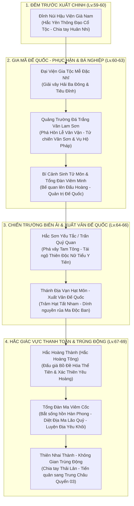

# CHƯƠNG 07: TAM THƯỢNG VÂN LAM SƠN & ĐỘC HỌA XUẤT VÂN — ĐẠI THÙ ĐẮC BÁO, NỖI ĐAU MẤT SƯ TÔN & ĐƯỜNG SANG TRUNG CHÂU

> **Quyển**: Quyển 02 — Hắc Giác Vực & Học Viện Già Nam (Chương Kết Quyển 02)
> **Cảnh Giới Yêu Cầu & Đột Phá**: Đấu Vương Đỉnh Phong → Đột phá **Đấu Hoàng 1 Tinh → Đấu Hoàng 9 Tinh Đỉnh Phong** (`Level 60 – 69`)
> **Vùng Bản Đồ Chính**: Đỉnh Núi Ngoại Viện → Đế Đô Gia Mã (Phủ Mễ Đặc Nhĩ) → Đỉnh Vân Lam Sơn → Bí Cảnh Sinh Tử Môn & Tổng Đàn Viêm Minh → Biên Ải Trấn Quỷ Quan → Xuất Vân Đế Quốc (Vạn Hạt Môn) → Hắc Hoàng Thành & Ma Viêm Cốc → Thiên Nhai Thành
> **Thu Hoạch Cốt Lõi**: Cổ Tộc bí truyền **Đế Ấn Quyết**, **Cốt Viêm Giới & Bản Nguyên Ấn Ký Cốt Linh Lãnh Hỏa (#11)**, Bí pháp **Thiên Hỏa Tam Huyền Biến**, Vệ sĩ bất tử **Địa Yêu Khôi (Cấp Đấu Tông)**, Chí bảo **Bồ Đề Hóa Thể Tiên**, Đồng hành Đấu Tông **Tiểu Y Tiên (Thiên Độc Nữ)**
> **Bước Nhảy Lối Chơi (Progression Milestone)**: Chuyển giao vai trò phím `T` từ *Dược Lão Phụ Thể* (sau biến cố Dược Lão bị Hồn Điện bắt) sang **Triệu Hồi Địa Yêu Khôi / Hồng Nhan Hợp Kích**; mở khóa **Quản Trị Đế Quốc Viêm Minh**, hệ thống rủi ro-phần thưởng **Phong Ấn Đếm Ngược Ma Độc Ban** và kích hoạt *Thiên Hỏa Tam Huyền Biến* (`RMB/C`).
> **Tài Liệu Tham Chiếu**: [00_Master_Index_Va_Quy_Chuan.md](file:///e:/Project/DauPhaThuongKhung/docs/00_Tong_Quan_Kien_Truc/00_Master_Index_Va_Quy_Chuan.md) | [Tieu_Viem_Va_Duoc_Lao.md](file:///e:/Project/DauPhaThuongKhung/docs/03_Nhan_Vat_Va_The_Luc/Tieu_Viem_Va_Duoc_Lao.md) | [Trang_Bi_Nap_Gioi_Va_Khoi_Loi.md](file:///e:/Project/DauPhaThuongKhung/docs/04_Dau_Ky_Cong_Phap_Va_Trang_Bi/Trang_Bi_Nap_Gioi_Va_Khoi_Loi.md)

---

## 1. Sơ Đồ Khu Vực Bản Đồ Liên Quốc Gia (Top-Down 2D Macro World Layout)

Chương 07 mở rộng quy mô bản đồ lên tầm **Chiến Tranh Liên Đế Quốc** trải dài khắp Tây Bắc Đại Lục: từ Học Viện Già Nam vượt ngược về Đế Đô Gia Mã, quét sang vùng đầm độc Xuất Vân Đế Quốc rồi quay lại xóa sổ Ma Viêm Cốc tại Hắc Giác Vực trước khi bước vào Trùng Động Không Gian đi Trung Châu.

### Biến Đổi Môi Trường & Không Khí Cốt Truyện
* **Đỉnh Vân Lam Sơn (Hồi 7.2 – 7.4)**: Chuyển đổi ngoạn mục qua 3 sắc thái ánh sáng Pixel: Mở đầu là sắc **Đỏ Hỷ Sự** lộng lẫy của lễ cưới Cổ Hà – Vân Vận -> chuyển sang sắc **Xanh Lửa Chiến Tranh** khi quân đoàn Tiêu Viêm giáng lâm -> và cuối cùng chìm trong **Sương Đen Quỷ Dị (Hồn Điện Hắc Vụ)** rút cạn ánh sáng mặt trời khi Vụ Hộ Pháp xuất hiện!
* **Chiến Trường Xuất Vân Đế Quốc (Hồi 7.6)**: Toàn bộ bản đồ phủ **Độc Chướng Tím Xám** — các NPC đồng minh thường không thể tiến vào, chỉ Tiêu Viêm (bật Dị Hỏa hộ thể tiêu hao nhẹ `QI/giây`), Mỹ Đỗ Toa và Tiểu Y Tiên miễn nhiễm độc khí.
* **Thiên Nhai Thành (Cuối Hồi 7.7)**: Thành phố cổ có vòng xoáy không gian bạc trắng khổng lồ quay cuồng giữa quảng trường trung tâm, đánh dấu ranh giới kết thúc hành trình Tây Bắc Đại Lục.

---

## 2. Chuỗi Nhiệm Vụ Chính (Main Questline — 7 Hồi Chi Tiết)

### Hồi 7.1: Cuộc Chia Ly Với Huân Nhi — Truyền Thừa Đế Ấn Quyết
* **Cảnh giới khuyến nghị**: Đấu Vương Đỉnh Phong (`Level 59 -> 60`).
* **Bối cảnh**: Đêm trước ngày liên quân của Tiêu Viêm nhổ trại tiến về Gia Mã Đế Quốc, bầu trời trên ngọn núi vắng ngoài Học Viện Già Nam đột ngột bị xé toạc thành một **Hắc Yên Thông Đạo** xuyên không gian! Hộ vệ **Lăng Ảnh** cùng đội Hắc Y Thống Lĩnh uy nghiêm của **Cổ Tộc** bước ra đón Đại Tiểu Thư **Cổ Huân Nhi** trở về Cổ Giới theo sắc lệnh tối cao của tộc trưởng.
* **Diễn biến Gameplay**:
  1. **Đối Diện Khoảng Cách Tàn Khốc**: Lăng Ảnh thẳng thắn cho Tiêu Viêm biết chân tướng thế giới bên ngoài Tây Bắc Đại Lục: tại **Trung Châu**, Cổ Tộc là thế lực thần thoại nơi Đấu Hoàng, Đấu Tông chỉ là kẻ gác cổng, còn những thiên tài mang *Thần Phẩm Huyết Mạch* trong tộc đang nhăm nhe vị trí bên cạnh Huân Nhi.
  2. **Lời Thề Dưới Trăng & Trao Đế Ấn Quyết**: Huân Nhi rơi nước mắt ôm chặt lưng Tiêu Viêm, khẳng định trong tim nàng vĩnh viễn chỉ có một mình *"Tiêu Viêm ca ca"* và thề sẽ đợi chàng tại Trung Châu. Trước khi bóng nàng khuất sau cánh cổng không gian khép lại, một quyển trục vàng ròng bay vào tay Tiêu Viêm: bí kỹ truyền thừa của Cổ Tộc **Đế Ấn Quyết** (*Khai Sơn Ấn, Phiên Hải Ấn, Phúc Địa Ấn, Yểm Nhật Ấn, Cổ Đế Ấn* — ghi ngoài Địa Giai Cao Cấp nhưng hợp nhất ngũ ấn đạt uy lực **Thiên Giai**!).
* **Phần thưởng**: Mở khóa nhánh Đấu Kỹ Thủ Ấn chủ lực **Đế Ấn Quyết** (lĩnh ngộ ngay thức thứ nhất *Khai Sơn Ấn* & thức thứ hai *Phiên Hải Ấn* trang bị ô `Q/E/R`), danh hiệu *Lời Hứa Trung Châu*.

### Hồi 7.2: Tam Thượng Vân Lam Sơn — Huyết Chiến Cứu Tộc & Phá Vỡ Hôn Lễ
* **Cảnh giới khuyến nghị**: Nửa Bước Đấu Hoàng (`Level 60`).
* **Bối cảnh**: Tại Đế Đô Gia Mã, gia tộc Mễ Đặc Nhĩ vì che chở tàn tộc Tiêu Gia đã bị ba vị Đấu Vương và hàng trăm tinh nhuệ Vân Lam Tông bao vây tấn công suốt nhiều ngày đêm; trong khi trên đỉnh Vân Lam Sơn, Vân Sơn ngang nhiên phát thiệp mời khắp thiên hạ dự **Đại Hôn Lễ giữa Tông chủ Vân Vận và Đan Vương Cổ Hà** vào sáng hôm sau!
* **Diễn biến Gameplay**:
  1. **Thần Binh Thiên Giáng Tại Phủ Mễ Đặc Nhĩ**: Đại viện Mễ Đặc Nhĩ ngập trong lửa máu; băng giáp của Băng Hoàng **Hải Ba Đông** đã vỡ nát, đại ca **Tiêu Đỉnh** ngồi trên xe lăn đẫm máu vẫn chắn trước mặt tộc nhân. Ngay giây phút gã Trưởng lão Đấu Vương Vân Lam Tông vung kiếm chém xuống đầu Hải Lão, người chơi điều khiển Tiêu Viêm từ tầng mây lao bổ xuống với tốc độ *Tam Thiên Lôi Động*, **một quyền bọc Lưu Ly Liên Tâm Hỏa đấm xuyên thủng lồng ngực tên Đấu Vương** trước ánh mắt chết lặng của cả Đế Đô! Quân đoàn cường giả Hắc Giác Vực & Già Nam tràn xuống quét sạch quân vây hãm trong 2 phút!
  2. **Tam Thượng Vân Lam Sơn — Phá Tan Hỷ Đường**: Sáng hôm sau, liên quân Hoàng Thất (**Gia Hình Thiên**), Hiệp Hội Luyện Dược Sư (**Pháp Mã**), Tam Đại Gia Tộc và Xà Nhân Tộc (**Thiết Ô**) hội quân cùng đội Đấu Hoàng của Tiêu Viêm bay rợp trời kéo thẳng lên Vân Lam Sơn! Giữa quảng trường đá trắng treo đèn kết hoa đỏ rực, đúng lúc chủ hôn hô vang *"Nhất bái thiên địa!"*, thanh **Huyền Trọng Xích** từ chín tầng mây phóng xuống cắm ngập sâu làm nứt toác lễ đài!
  3. **Giao Thủ Ba Chiêu Với Đan Vương Cổ Hà**: **Cổ Hà** (Đấu Hoàng, Lục phẩm luyện dược sư) vì danh dự bước ra giao ước đấu 3 chiêu với Tiêu Viêm. Người chơi dùng *Khai Sơn Ấn* và *Dị Hỏa Hộ Thể* đánh bại hỏa diễm tím giả tạo của Cổ Hà ngay chiêu thứ ba! Thấy **Vân Vận** mặc hỷ phục đỏ thẫm rơi lệ lắc đầu từ chối cuộc hôn nhân ép buộc, Cổ Hà thở dài nhận thua, tuyên bố rút khỏi ân oán Vân Lam Tông!
* **Phần thưởng**: +50.000 EXP, mở khóa hào quang chiến trường *Thống Soái Liên Quân* (+15% `ATK` & `DEF` cho toàn bộ đồng minh trên sân).

### Hồi 7.3: Chân Tướng Tiêu Chiến & Ác Chiến Vụ Hộ Pháp Hồn Điện
* **Cảnh giới khuyến nghị**: Chiến lực tương đương Đấu Hoàng Đỉnh Phong / Trảm Đấu Tông (`Level 61`).
* **Bối cảnh**: Đám cưới tan vỡ, đại trận *Vân Yên Phúc Nhật Trận* của ngàn đệ tử Vân Lam Tông bị Mỹ Đỗ Toa một cước đạp nát. Lão tông chủ **Vân Sơn** (Đấu Tông 2–3 Tinh) từ hậu sơn bước ra với sát ý ngút trời!
* **Diễn biến Gameplay**:
  1. **Sự Thật Tàn Nhẫn Về Phụ Thân**: Khi Tiêu Viêm gằn giọng đòi giao nộp cha mình là **Tiêu Chiến**, Vân Sơn ngửa mặt cười gằn thừa nhận: Chính hắn đã bắt cóc và **giao nộp Tiêu Chiến cho sứ giả của thế lực hắc ám Hồn Điện** để đổi lấy bí pháp cưỡng ép đột phá cảnh giới **Đấu Tông**!
  2. **Ác Quỷ Lộ Diện — Vụ Hộ Pháp Hồn Điện**: Từ vũng bóng tối quỷ dị sau lưng Vân Sơn, **Vụ Hộ Pháp (Thước Tà Lão Quỷ)** — kẻ thù truyền kiếp chuyên săn bắt linh hồn Luyện Dược Sư bước ra với tiếng cười khặc khặc ghê rợn! Hắn vung **Tỏa Hồn Xích** hút cạn linh hồn của hàng loạt Trưởng lão Vân Lam Tông ngay tại trận để hóa thành khói đen cường hóa bản thân!
  3. **Song Chiến Bầu Trời & Mặt Đất**:
     * Trên tầng mây đen: **Dược Lão** phẫn nộ hiện chân thân Linh Hồn Đỉnh Phong cầm *Cốt Linh Lãnh Hỏa* nghênh chiến trực diện với Vụ Hộ Pháp; **Mỹ Đỗ Toa** vung kiếm thất thải chặn đứng sương độc tràn xuống.
     * Trên phế tích quảng trường: **Tiêu Viêm quyết tử solo Đấu Tông Vân Sơn**! Dù bị *Không Gian Phong Tỏa* và *Phong Chi Cực* của Đấu Tông ép thổ huyết đầm đìa, trong cơn cuồng nộ máu mủ tình thâm, Tiêu Viêm rút tia bản nguyên **Cốt Linh Lãnh Hỏa (#11)** Dược Lão lưu trong nhẫn, dung hợp cùng **Thanh Liên Địa Tâm Hỏa (#19)** và **Vẫn Lạc Tâm Viêm (#14)**!
  4. **Tuyệt Sát Tam Sắc Phật Nộ Hỏa Liên**: Người chơi thực hiện tổ hợp phím QTE cực hạn nén 3 màu lửa (*Xanh Ngọc – Trong Suốt – Trắng Băng*) thành đóa sen hủy diệt **Tam Sắc Phật Nộ Hỏa Liên** ném thẳng vào Vân Sơn! Vụ nổ chấn động trăm dặm xé rách lồng không gian, **nổ tan nát thi thể Đấu Tông Vân Sơn** giữa bầu trời Gia Mã!
* **Phần thưởng**: Mở khóa công thức tối thượng `Tam Sắc Phật Nộ Hỏa Liên`, hoàn thành đại thù ba năm tại Vân Lam Sơn!

### Hồi 7.4: Nỗi Đau Mất Sư Tôn & Lời Biệt Ly Vân Vận
* **Cảnh giới khuyến nghị**: `Level 61 – 62` (Trọng thương kiệt sức — Cắt cảnh tương tác cảm xúc đỉnh cao).
* **Bối cảnh**: Niềm vui đại thù đắc báo chưa kịp kéo dài một nhịp thở thì bi kịch đau đớn nhất hành trình ập xuống đầu Tiêu Viêm.
* **Diễn biến Gameplay**:
  1. **Tỏa Hồn Xích Khóa Chặt Ân Sư**: Ngay khi Vân Sơn bỏ mạng, Vụ Hộ Pháp tàn nhẫn hút trọn linh hồn Đấu Tông của Vân Sơn và hàng trăm oan hồn trên núi vào *Hắc Vụ Khải Giáp*, khiến thực lực của hắn bạo tăng lên Đấu Tông Ngũ Tinh — vượt qua giới hạn chịu đựng của linh hồn thể Dược Lão! Dù Mỹ Đỗ Toa chém nát tay áo hắn và Tiêu Viêm kiệt sức lao lên trong tuyệt vọng (người chơi điều khiển Tiêu Viêm lết từng bước nặng trĩu về phía vòng xoáy trong mưa máu nhưng luôn bị sóng xung kích hất văng!), sợi xích đen **Bổn Mệnh Tỏa Hồn Xích** đã trói chặt lấy **Dược Lão** kéo tuột vào cổng không gian Hồn Điện!
  2. **Di Sản Của Sư Tôn**: Trước giây phút cổng hắc động khép kín hoàn toàn, Dược Lão mỉm cười hiền từ như một người cha nhìn đứa con trai đã đủ lông đủ cánh, dồn tia sức lực cuối cùng bắn chiếc **Cốt Viêm Giới** cùng một đạo **Bản Nguyên Ấn Ký Cốt Linh Lãnh Hỏa** khắc sâu vào mi tâm Tiêu Viêm! Cổng đen biến mất, Tiêu Viêm quỳ sụp trên nền đá lạnh lẽo đấm nát mặt sân chảy máu đầm đìa, ngửa cổ gào lên lời thề máu: *"Hồn Điện! Dù ở chân trời góc bể, Tiêu Viêm ta thề diệt sạch tông môn các ngươi cứu Sư tôn và Phụ thân trở về!"*
  3. **Giải Tán Vân Lam Tông & Biệt Ly Vân Vận**: Nhị ca **Tiêu Lệ** (tính khí cực đoan sau khi nuốt *Phệ Sinh Đan* ở Hắc Giác Vực) muốn đồ sát toàn bộ đệ tử Vân Lam Tông còn sống. **Vân Vận** buông kiếm nhắm mắt đứng chắn trước sơn môn, xin lấy cái chết của mình để đổi mạng cho hàng ngàn đệ tử vô tội. Nhìn mảnh **Hải Tâm Giáp** vỡ nát và ký ức hang đá Ma Thú Sơn Mạch ùa về, người chơi thực hiện cú vung xích cắm sập tảng đá sát cạnh Vân Vận — tha chết cho nàng nhưng hạ lệnh **xóa sổ tên gọi Vân Lam Tông khỏi Gia Mã Đế Quốc vĩnh viễn trong vòng 1 tháng**! Vân Vận ngoái nhìn chàng lần cuối trong dòng lệ lặng lẽ, dắt **Nạp Lan Yên Nhiên** rời bỏ quê hương đi về phương xa (*phục bút Hoa Tông ở Chương 09*).
* **Phần thưởng & Thay đổi cơ chế**:
  * Nhận **Cốt Viêm Giới** (mở toàn bộ kho Dược Phương Bát Phẩm truyền thừa của Dược Tôn Giả & mở rộng Nạp Giới vô hạn).
  * Nhận **Ấn Ký Cốt Linh Lãnh Hỏa** (cho phép tự tay dùng tia lửa trắng băng để tiếp tục nén *Tam Sắc Hỏa Liên* dù không còn Dược Lão!).
  * *Lưu ý hệ thống*: Kỹ năng `Dược Lão Phụ Thể (Phím T)` chính thức khóa lại cho đến khi cứu được Dược Lão ở Chương 09; tạm thời chuyển phím `T` sang **Mỹ Đỗ Toa Hợp Kích**!

### Hồi 7.5: Bế Quan Sinh Tử Môn & Thiết Lập Bá Nghiệp "Viêm Minh"
* **Cảnh giới khuyến nghị**: Đột phá **Đấu Hoàng 1 Tinh → Đấu Hoàng 3 Tinh** (`Level 62 – 64`).
* **Bối cảnh**: Để chữa trị kinh mạch rách nát sau cú nổ Tam Sắc Hỏa Liên và gom góp thế lực đối đầu Hồn Điện, Tiêu Viêm mượn cổ địa **Sinh Tử Môn** của Hoàng thất bế quan suốt 1 năm ròng.
* **Diễn biến Gameplay**:
  1. **Phá Quan Thành Hoàng**: Vượt qua khảo nghiệm ảo cảnh sinh tử trong Sinh Tử Môn, chính thức đột phá đại cảnh giới **Đấu Hoàng (`Level 62`)** — đôi cánh Đấu Khí sau lưng rộng lớn uy nghiêm gấp bội, tốc độ điều động năng lượng thiên địa tăng vọt!
  2. **Sáng Lập Siêu Thế Lực "Viêm Minh" (Yan Alliance)**: Ngay ngày xuất quan, Tiêu Viêm hợp nhất **Tam Đại Gia Tộc (Tiêu – Mễ Đặc Nhĩ – Mộc) + Hoàng Thất Gia Mã + Hiệp Hội Luyện Dược Sư** dựng nên thế lực bá chủ tuyệt đối của đế quốc: **Viêm Minh**, do Tiêu Viêm làm Minh chủ!
  3. **Luyện Đan An Thai Cho Thải Lân (Mỹ Đỗ Toa)**: Thực hiện lời hứa dưới đáy Thiên Phần Tháp, người chơi điều khiển *Lưu Ly Liên Tâm Hỏa* trong *Hải Tâm Đỉnh* vượt qua mini-game **Đón Đan Lôi Lục Phẩm**, luyện thành công **Phục Hồn Đan & Thiên Hồn Dung Huyết Đan** trao cho Mỹ Đỗ Toa (ổn định sinh mệnh thai nhi **Tiêu Tiêu** trong bụng nàng!). Nữ Hoàng kiêu ngạo lần đầu tiên mỉm cười dịu dàng chấp nhận cái tên **Thải Lân** và danh phận thê tử của Tiêu Viêm!
* **Phần thưởng**: Đột phá **Đấu Hoàng 3 Tinh**, mở khóa giao diện **Quản Trị Đế Quốc Viêm Minh**, nâng cấp Hảo Cảm **Thải Lân** lên mức tối đa *Phu Thê Đồng Tâm*.

### Hồi 7.6: Độc Hoạ Xuất Vân Đế Quốc — Tái Ngộ Tiểu Y Tiên & Ma Độc Ban
* **Cảnh giới khuyến nghị**: Đấu Hoàng 4 Tinh → Đấu Hoàng 6 Tinh (`Level 64 – 66`).
* **Bối cảnh**: Sự trỗi dậy của Viêm Minh làm các đế quốc láng giềng hoảng sợ! Liên quân **Tam Đại Tông Môn** gồm **Độc Tông** (Xuất Vân Đế Quốc), **Kim Nhạn Tông** (Tông chủ **Nhạn Lạc Thiên** — Đấu Tông) và **Mộ Lan Cốc** (**Mộ Lan Tam Lão** hợp kích Đấu Tông) kéo đại quân phủ sương độc vây hãm yếu tắc biên giới Gia Mã!
* **Diễn biến Gameplay**:
  1. **Giao Thủ Thiên Độc Nữ — Nhận Ra Cố Nhân Tóc Bạc**: Trên bầu trời biên ải tối tăm mùi tử khí, Thải Lân chặn đánh Nhạn Lạc Thiên và Mộ Lan Tam Lão; còn Tiêu Viêm lao vào cầm chân vị **Tông chủ Độc Tông** bí ẩn khoác hắc bào có mái tóc dài bạc trắng như tuyết (**Đấu Tông 3 Tinh**). Giữa lúc chưởng độc và Dị Hỏa va chạm làm rách tấm mạng che mặt của nàng, cả hai cùng sững sờ đứng khựng giữa không trung — đôi mắt tím u buồn cô độc kia chính là cô gái hái thuốc dịu dàng năm xưa ở Thanh Sơn Trấn: **Tiểu Y Tiên**!
  2. **Hóa Thù Thành Bạn & Quét Tan Liên Quân**: Vì **Ách Nan Độc Thể** bộc phát không kiểm soát khiến mái tóc hóa bạc và đi đến đâu người chết đến đó, Tiểu Y Tiên bị cả thế gian ruồng bỏ nguyền rủa đến mức phải lập Độc Tông tàn khốc để tồn tại. Khi nghe Tiêu Viêm đau lòng gọi tên mình và hứa sẽ tìm đủ 3 loại Dị Hỏa + Bồ Đề Hóa Thể Tiên luyện **Độc Đan Chi Pháp** cứu mạng nàng, Tiểu Y Tiên lập tức phản chiến đứng về phía Tiêu Viêm! Cả hai phối hợp Thải Lân dùng *Tam Sắc Hỏa Liên* đánh trọng thương **Mộ Lan Tam Lão**, chém chết tươi Đấu Tông **Nhạn Lạc Thiên** giải nguy hoàn toàn cho Gia Mã!
  3. **Viễn Chinh Xuất Vân — Diệt Vạn Hạt Môn & Trúng Lời Nguyền Ma Độc Ban**: Tiêu Viêm cùng Tiểu Y Tiên tiến thẳng sang Xuất Vân Đế Quốc giúp nàng nhổ tận gốc kẻ thù truyền kiếp **Vạn Hạt Môn** (do Hồn Điện ngầm giật dây). Sau trận huyết chiến đánh gục lão tổ Đấu Tông **Hạt Tất Nham**, trước khi tắt thở, lão quái độc ác thiêu đốt toàn bộ tinh huyết và kịch độc tu luyện cả đời hóa thành một luồng hắc quang đâm xuyên qua giáp lửa ghim chặt vào lồng ngực Tiêu Viêm: **Ma Độc Ban (Devil Poison Spot)**!
* **Phần thưởng & Cơ chế mới**: Mở khóa đồng hành Đấu Tông **Tiểu Y Tiên (Thiên Độc Nữ)**, đột phá **Đấu Hoàng 6 Tinh**, kích hoạt cơ chế hẹn giờ sinh tử **Phong Ấn Ma Độc Ban** trên ngực Tiêu Viêm!

### Hồi 7.7: Trở Lại Hắc Giác Vực — Luyện Địa Yêu Khôi & Khởi Hành Trung Châu
* **Cảnh giới khuyến nghị**: Đấu Hoàng 7 Tinh → **Đấu Hoàng 9 Tinh Đỉnh Phong** (`Level 67 – 69`).
* **Bối cảnh**: Để tìm **Bồ Đề Hóa Thể Tiên** (chìa khóa vừa giải *Ma Độc Ban* vừa ngưng tụ *Độc Đan* cho Tiểu Y Tiên) và quét sạch hậu họa cho Học Viện Già Nam trước khi đi xa, Tiêu Viêm dẫn **Tiểu Y Tiên** và **Tử Nghiên** quay trở lại **Hắc Giác Vực**!
* **Diễn biến Gameplay**:
  1. **Đấu Giá Hội Hắc Hoàng Tông (Hắc Hoàng Thành)**: Chạm trán các cự đầu Hắc Giác Vực tại tổng đàn của lão già cáo già **Mạc Thiên Hành** (Đấu Tông). Tiêu Viêm dùng đan dược cao cấp và uy thế của Tiểu Y Tiên đoạt được **Xác Khô Ma Thú Thượng Cổ Thiên Yêu Hoàng** (để chế đôi cánh đỉnh cao *Thiên Yêu Hoàng Dực* ở Quyển 03) và đánh bại âm mưu tranh cướp để thu giữ chí bảo màu ngọc biếc **Bồ Đề Hóa Thể Tiên**! Đồng thời dùng *Âm Dương Huyền Long Đan* trao đổi lấy trọn bộ tam biến của bí pháp **Thiên Hỏa Tam Huyền Biến** từ Đại Trưởng Lão Tô Thiên / Ma Viêm Cốc!
  2. **San Bằng Ma Viêm Cốc — Bắt Sống Linh Hồn Nghịch Đồ Hàn Phong**: Tấn công thẳng vào sào huyệt **Ma Viêm Cốc**! Giữa trận chiến, **Hàn Phong** xuất hiện trong thân xác mới (đã đoạt xá một cường giả Đấu Tông sơ kỳ nhờ tà thuật Hồn Điện!). Lần tái đấu này, Tiêu Viêm (nay đã là Đấu Hoàng cao giai sở hữu *Thiên Hỏa Tam Huyền Biến* + *Đế Ấn Quyết*) cùng Tiểu Y Tiên nghiền nát hoàn toàn sự kiêu ngạo của hắn! Tiêu Viêm tự tay đánh vỡ nát nhục thân Đấu Tông của Hàn Phong, rút **Bình Ngọc Nạp Hồn** hút chặt linh hồn gào thét cầu xin của tên phản đồ nhốt sống vào bình để mang đi tế sống trước mặt Sư tôn!
  3. **Đại Chiến Địa Ma Lão Quỷ & Rèn Vệ Sĩ "Địa Yêu Khôi"**: Lão tổ sáng lập Ma Viêm Cốc là **Địa Ma Lão Quỷ** (Đấu Tông 7 Tinh — Băng hệ cực mạnh) phá băng xuất quan! Với sự chi viện kịp thời của **Thiên Bách Đại Trưởng Lão** & **Tô Thiên** từ Nội Viện Già Nam kết hợp quả *Tam Sắc Phật Nộ Hỏa Liên* chí mạng của Tiêu Viêm, Địa Ma Lão Quỷ bị nổ chết đứng nhưng giữ nguyên được nhục thân Đấu Tông cứng như thần thiết! Áp dụng phương pháp luyện khôi lỗi cổ xưa trong *Cốt Viêm Giới*, Tiêu Viêm dùng Dị Hỏa nung chảy hàng tấn kim loại hiếm cùng ma hạch và **thi thể Đấu Tông của Địa Ma Lão Quỷ**, rèn thành công cỗ máy chiến đấu bất tử màu bạc sáng loáng: **Địa Yêu Khôi**!
  4. **Chia Tay Thải Lân — Bước Vào Không Gian Trùng Động**: Trở về dặn dò đại cục lần cuối, Tiêu Viêm ôm tạm biệt **Thải Lân** (nàng ở lại Gia Mã Đế Quốc dưỡng thai **Tiêu Tiêu** và thống lĩnh **Viêm Minh** bảo vệ toàn tộc họ Tiêu). Tại **Thiên Nhai Thành**, đạt đỉnh phong **Đấu Hoàng 9 Tinh (`Level 69`)**, Tiêu Viêm khoác áo đen vác Huyền Trọng Xích, cùng **Tiểu Y Tiên** và **Tử Nghiên** hiên ngang bước vào **Không Gian Trùng Động** hướng thẳng tới vùng đất rộng lớn vạn tộc tranh hùng: **TRUNG CHÂU**!
* **Phần thưởng Kết Quyển 02**: Đạt **Level 69 (Đấu Hoàng 9 Tinh Đỉnh Phong)**, mở khóa kỹ năng biến thân tăng vọt cấp độ **Thiên Hỏa Tam Huyền Biến (`RMB/C`)**, mở khóa triệu hồi **Địa Yêu Khôi (`Phím T`)**, sẵn sàng bước sang **Quyển 03: Trung Châu Phong Vân**!

---

## 3. Cơ Chế Gameplay Độc Đáo Của Chương (Unique Chapter Mechanics)

### 3.1. Nhánh Đấu Kỹ Cổ Tộc "Đế Ấn Quyết" & Bí Pháp "Thiên Hỏa Tam Huyền Biến"
* **Đế Ấn Quyết (Combo Thủ Ấn Tiến Hóa)**: Khác với các Đấu Kỹ rời rạc, các ấn pháp Huân Nhi trao có cơ chế **Liên Hoàn Cộng Hưởng** khi thi triển nối tiếp trong vòng 4 giây:
  * *Thức 1 — Khai Sơn Ấn*: Chưởng ấn kim quang phá vỡ 40% Giáp vật lý của mục tiêu.
  * *Thức 2 — Phiên Hải Ấn*: Đánh bồi lên mục tiêu đang vỡ giáp sẽ tạo sóng thần Đấu Khí hất văng và gây **x1.8 sát thương bạo kích**! *(3 ấn sau là Phúc Địa, Yểm Nhật, Cổ Đế Ấn sẽ lần lượt mở khóa khi nhân vật đột phá Đấu Tông và Đấu Tôn ở Quyển 03).*
* **Thiên Hỏa Tam Huyền Biến (`RMB / Phím C` — Burst Transformation)**: Thay thế hoặc tích hợp cùng tháo phong ấn Trọng Xích. Kích hoạt đốt cháy tinh hoa hai loại Dị Hỏa trong kinh mạch để bước vào trạng thái **Nhị Biến Bạo Phát** trong 25 giây: tóc và vân lửa trên áo rực sáng màu xanh lưu ly - trắng băng, **tăng trực tiếp +5 Tinh Cảnh Giới tạm thời (+45% `ATK`, +30% `SPD`)** đủ sức vượt cấp chém gục Đấu Tông!

### 3.2. Cơ Chế Hẹn Giờ Rủi Ro – Phần Thưởng: "Phong Ấn Ma Độc Ban"
Sau trận diệt Hạt Tất Nham ở Hồi 7.6, một biểu tượng **Đốm Độc Bọ Cạp Đen** xuất hiện ở góc trái thanh máu/năng lượng của Tiêu Viêm:
* **Áp Chế Phong Ấn (Debuff Tạm Thời)**: Tiêu Viêm phải trích một phần *Lưu Ly Liên Tâm Hỏa* đè nén độc tính, làm khóa cứng **10% trần thanh `QI` tối đa**. Đôi khi trong các trận Boss kéo dài quá 3 phút, *Ma Độc Ban* nhói lên gây 1 giây khựng nhẹ nếu không uống đan dược áp chế.
* **Kho Báu Đấu Khí Của Đấu Tông (Delayed Jackpot)**: Bên trong Ma Độc Ban chứa nguyên vẹn tinh hoa Đấu Khí cả đời của Đấu Tông Hạt Tất Nham! Mỗi trận chiến lớn người chơi vượt qua trong trạng thái mang Ma Độc Ban sẽ tích điểm *Tinh Lọc Độc Nguyên* — đến **Chương 08** tại Trung Châu, khi hội đủ điều kiện luyện hóa đốm độc này, nó sẽ nổ tung thành một luồng EXP khổng lồ giúp Tiêu Viêm nhảy vọt liền **2 Tinh ở cảnh giới Đấu Tông**!

### 3.3. Hệ Thống Luyện Chế & Triệu Hồi Vệ Sĩ Bất Tử: "Địa Yêu Khôi" (`Phím T`)
Từ Hồi 7.7, sau khi mất đi sự phụ thể của Dược Lão, phím `T` chính thức trở thành nút **Triệu Hồi Khôi Lỗi Chiến Đấu**:
* **Đặc tính của Địa Yêu Khôi**: Thân thể đúc từ xác Đấu Tông 7 Tinh + kim loại hiếm, có thanh độ bền riêng (không chết hẳn, chỉ thu về nhẫn sửa chữa nếu cạn độ bền), **miễn nhiễm 100% Độc tố, Ảo thuật Linh Hồn và Choáng**.
* **Cơ chế Hấp Thụ Hỏa Năng Tăng Cấp**: Địa Yêu Khôi có thể đứng chắn trước mặt người chơi để **hấp thụ các đòn chưởng năng lượng hoặc sấm sét Đan Lôi**! Hấp thụ càng nhiều đòn sấm sét mạnh, lớp da bạc của nó càng chuyển dần sang ánh kim sắc (tiền đề tiến hóa thành **Thiên Yêu Khôi** cấp Đấu Tôn ở Quyển 03!).

#### Bảng Nguyên Liệu Đúc Thành "Địa Yêu Khôi" (Công Thức Cốt Viêm Giới)
| Thành Phần Cốt Lõi | Nguồn Thu Thập Trong Chương 07 | Vai Trò Trong Cơ Thể Khôi Lỗi |
| :--- | :--- | :--- |
| **Nhục Thân Đấu Tông Thất Tinh** | Chiến lợi phẩm đánh bại Boss **Địa Ma Lão Quỷ** (Hồi 7.7) | Khung xương bất hoại chịu được xung lực không gian cấp Đấu Tông |
| **Hung Hồn Đấu Tông Áp Chế** | Hồn phách tàn dư hoặc Ma Hạch Cấp 7 Đỉnh Phong trong kho Ma Viêm Cốc | Trái tim động lực giúp Yêu Khôi tự động chiến đấu không cần tốn `SOUL` điều khiển |
| **Thiên Thiết & Hàn Tinh Khoáng (x50)** | Chiến lợi phẩm quét sạch Ma Viêm Cốc & mua tại Hắc Hoàng Thành | Nung chảy bằng *Lưu Ly Liên Tâm Hỏa* tráng lớp giáp bạc kháng phép toàn thân |

### 3.4. Hệ Thống Quản Trị Đế Quốc: "Viêm Minh" (Empire Hub)
Mở rộng quy mô từ *Bàn Môn* lên cấp quốc gia tại Đế Đô Gia Mã với 4 Ban Ngành chiến lược:

| Ban Ngành Viêm Minh | Thống Lĩnh Đứng Đầu | Quyền Lực & Phúc Lợi Định Kỳ Cho Minh Chủ Tiêu Viêm |
| :--- | :---: | :--- |
| **Đan Đường** | **Pháp Mã** & **Cổ Hà** (Quy thuận sau) | Cung ứng miễn phí đan dược Lục Phẩm, gửi bổng lộc linh dược quý qua thương đoàn |
| **Hình Đường & Hộ Tộc** | **Thải Lân (Mỹ Đỗ Toa)** & **Hải Ba Đông** | Trấn áp toàn bộ biên ải Tây Bắc, bảo vệ tuyệt đối an nguy cho Tiêu Gia và thai nhi Tiêu Tiêu |
| **Quân Đoàn Hoàng Thất** | **Gia Hình Thiên** & **Yêu Dạ Công Chúa** | Mở kho tàng Sinh Tử Môn và điều động đại quân đẩy lùi ngoại xâm Xuất Vân – Mộ Lan |
| **Ám Võng Tình Báo** | **Mễ Đặc Nhĩ Đằng Sơn** & **Tiêu Đỉnh** | Rải mật thám khắp đại lục truy lùng các **Phân Điện Hồn Điện** và manh mối giam giữ **Tiêu Chiến**! |

---

## 4. Nhiệm Vụ Phụ & Kỳ Ngộ Ẩn Sát Nguyên Tác (Side Quests & Secrets)

1. **Nhiệm Vụ Phụ Cảm Động: Kỷ Vật Của Phụ Thân Tại Phế Tích Ô Thản Thành**
   * *Vị trí*: Quay về nền nhà cũ đổ nát của Tiêu Gia tại Ô Thản Thành sau khi diệt Vân Sơn (Hồi 7.4).
   * *Nội dung*: Giữa từ đường hoang tàn phủ cỏ dại, Tiêu Viêm tìm thấy hầm ngầm bí mật nơi **Tiêu Chiến** từng cất giấu bức thư dặn dò ba anh em trước lúc bị bắt đi, cùng hộp gỗ đựng những tấm thẻ gỗ ghi chép chiều cao của Tiêu Viêm từ năm 4 tuổi đến 15 tuổi.
   * *Phần thưởng*: Vật phẩm cốt truyện vĩnh viễn `Tín Vật Của Tiêu Chiến` (+15% kháng hiệu ứng khống chế tâm trí khi đối đầu Hồn Điện, mở khóa quyết tâm cứu cha ở Chương 11).

2. **Kỳ Ngộ Ẩn: Chữa Lành Tâm Ma Phệ Sinh Đan Cho Nhị Ca Tiêu Lệ**
   * *Vị trí*: Lầu canh biên giới Trấn Quỷ Quan / Thành Hắc Giác trước Hồi 7.6.
   * *Nội dung*: Phát hiện nhị ca **Tiêu Lệ** vì muốn có sức mạnh báo thù cho gia tộc mà đã lén nuốt cấm dược *Phệ Sinh Đan* (đổi tuổi thọ lấy cảnh giới Đấu Vương, chỉ sống được 2–3 năm!). Tiêu Viêm mở kho dược phương trong *Cốt Viêm Giới*, tự tay luyện **Thanh Hồn Hóa Sinh Đan** kéo dài sinh mệnh và giữ lại phần nhân tính cho nhị ca.
   * *Phần thưởng*: Tiêu Lệ thống lĩnh *Tiêu Môn* tại Hắc Giác Vực, thiết lập tuyến đường buôn bán nối liền Học Viện Già Nam – Viêm Minh!

3. **Kỳ Ngộ Ẩn: Hang Đá Cũ Ở Ma Thú Sơn Mạch (Dư Âm Vân Chi)**
   * *Điều kiện kích hoạt*: Sau khi Vân Vận rời đi ở cuối Hồi 7.4, bay một mình về lại sơn động thác nước nhỏ trong Ma Thú Sơn Mạch (bản đồ Chương 02 cũ).
   * *Nội dung*: Trên bàn đá phủ bụi năm xưa xuất hiện một nhành hoa dại vừa mới đặt lại cùng nửa mảnh ngọc bội khắc chữ *"Vân"* mà Vân Vận ghé qua để lại trước lúc vĩnh biệt Gia Mã Đế Quốc sang Trung Châu.
   * *Phần thưởng*: `Mảnh Ngọc Vân Lam Cố Nhân`, cộng hưởng cốt truyện đặc biệt khi gặp lại Vân Vận tại **Hoa Tông (Chương 09)**.

4. **Nhiệm Vụ Phụ: Thanh Trừng Mật Thám Hồn Điện Tại Xuất Vân Đế Quốc**
   * *Vị trí*: Địa lao ngầm dưới phế tích Vạn Hạt Môn (Hồi 7.6).
   * *Nội dung*: Phá hủy tế đàn triệu hồi của một tên *Thiết Hộ Pháp Hồn Điện* cấp thấp đang thu gom linh hồn chiến trường Xuất Vân, thu giữ cuốn sổ mật mã ghi danh sách các Phân Điện Hồn Điện tại Bắc Vực và Trung Châu.
   * *Phần thưởng*: `Túi Linh Hồn Tinh Thuần` (tăng mạnh chỉ số `SOUL` giúp Tiêu Viêm chạm ngưỡng **Phàm Cảnh Đỉnh Phong viên mãn**), `Bình Ngọc Nạp Hồn Đặc Chế` (dùng để nhốt sống linh hồn Hàn Phong ở Hồi 7.7!).

---

## 5. Trích Đoạn Thoại Kinh Điển (Iconic Cutscene Dialogues)

### Phân Cảnh 1: Lời Thề Chia Ly Của Thiếu Nữ Cổ Tộc (Hồi 7.1 — Hắc Yên Thông Đạo)
> *[Cánh cổng không gian đen thẫm xoay tròn sau lưng Lăng Ảnh. Gió đêm thổi tung mái tóc đen mượt của Huân Nhi khi nàng kiễng chân đặt nhẹ quyển trục vàng vào lòng bàn tay ấm nóng của Tiêu Viêm.]*
>
> **Tiêu Huân Nhi** *(nước mắt khẽ lăn dài nhưng ánh mắt kiên định rực sáng)*: "Tiêu Viêm ca ca, đừng nghe những lời hù dọa của Lăng lão... Ở Cổ Giới kia dù có bao nhiêu kẻ gọi là thiên tài đi nữa, trong mắt Huân Nhi cũng không sánh bằng một góc vạt áo đen của ca ca năm đó trong đêm mưa Ô Thản Thành. Huân Nhi về trước đợi huynh — ngày huynh bước chân lên đất Trung Châu, nhất định phải đến đón muội!"
>
> **Tiêu Viêm** *(siết chặt quyển Đế Ấn Quyết vào ngực, nhìn thẳng vào thông đạo không gian)*: "Đợi ta, Huân Nhi! Giải quyết xong ân oán Gia Mã, dù Cổ Tộc là đầm rồng hang hổ, Tiêu Viêm ta cũng sẽ đường đường chính chính bước qua chính môn rước muội ra!"

### Phân Cảnh 2: Đại Nộ Trảm Vân Sơn & Nỗi Đau Xé Ruột Mất Sư Tôn (Hồi 7.3 & 7.4)
> *[Bầu trời Vân Lam Sơn đặc quánh khói đen của Hồn Điện. Vân Sơn bê bết máu me trừng mắt kinh hoàng nhìn đóa sen lửa ba màu Xanh – Trắng – Vô Hình lơ lửng trên tay chàng thanh niên hai mươi tuổi.]*
>
> **Vân Sơn** *(gào rú điên loạn)*: "Dừng tay! Bản tông là cường giả Đấu Tông! Ngươi giết ta, Hồn Điện sẽ rút hồn cả chín họ nhà họ Tiêu các ngươi!!"
>
> **Tiêu Viêm** *(đôi mắt đỏ ngầu tơ máu, giọng gằn từng chữ như sấm rền)*: "Phá gia tộc ta, cướp phụ thân ta, bức hại sư tôn ta... Lão cẩu Vân Sơn, hôm nay dù Thiên Vương Lão Tử có giáng trần cũng không cứu nổi mạng ngươi! **TAM SẮC HỎA LIÊN — NỔ CHO TA!!**"
>
> *[Sau tiếng nổ hủy thiên diệt địa, Vụ Hộ Pháp khóa chặt bóng trắng của Dược Lão kéo lùi vào hắc động. Dược Lão mỉm cười hiền từ ném chiếc Cốt Viêm Giới về phía học trò đang bò lết trong vũng máu...]*
>
> **Dược Lão** *(giọng ấm áp vang vọng lần cuối trong tâm thức)*: "Đừng khóc, tiểu gia hỏa... Nhìn con trưởng thành từ một phế vật ở Ô Thản Thành tới ngày hôm nay, lão già này đã mãn nguyện lắm rồi. Cầm lấy chiếc nhẫn của vi sư, sống tiếp thật tốt... Khi nào con đủ mạnh, hãy tới Hồn Điện đón vi sư về uống rượu!"
>
> **Tiêu Viêm** *(vươn tay chụp vào khoảng không trống rỗng, gào khóc xé toạc bầu trời)*: "**LÃO SƯ ƠI ——!!**"

### Phân Cảnh 3: Tái Ngộ Cố Nhân Tóc Bạc Giữa Biển Độc (Hồi 7.6 — Trấn Quỷ Quan)
> *[Mạng che mặt đen rách đôi rơi xuống giữa không trung. Suối tóc bạc trắng như tuyết xõa tung trong gió độc, để lộ gương mặt thanh tú tái nhợt mà Tiêu Viêm ngỡ đã lạc mất nơi chân trời.]*
>
> **Tiểu Y Tiên** *(run rẩy giấu bàn tay mang khói độc ra sau lưng, lùi lại nửa bước trên hư không, giọng nghẹn ngào tự ti)*: "Tiêu Viêm... Đừng lại gần ta. Bây giờ ta không còn là Tiểu Y Tiên của Thanh Sơn Trấn nữa rồi... Ta là Thiên Độc Nữ tay nhuốm máu vạn người, chạm vào ta huynh sẽ chết đấy..."
>
> **Tiêu Viêm** *(vỗ cánh Đấu Khí bay thẳng xuyên qua màn sương kịch độc không chút do dự, nắm chặt lấy cổ tay lạnh buốt của nàng)*: "Mặc kệ thiên hạ gọi muội là ma đầu hay ôn dịch, trong mắt Tiêu Viêm này, muội mãi mãi là người bằng hữu đã cùng ta chia ngọt sẻ bùi trong hang núi Thanh Sơn! Đi theo ta — ta có Dị Hỏa, cả đời này nhất định chữa khỏi Ách Nan Độc Thể cho muội!"

---

## 6. Hệ Sinh Thái Quái Vật, Tinh Anh & Bảng Loot (Bestiary & Drops)

| Tên Kẻ Địch / Ma Thú | Cấp Độ / Cảnh Giới | Khu Vực Xuất Hiện | Hành Vi AI Top-Down 2D | Vật Phẩm Rơi (Loot Table) |
| :--- | :---: | :--- | :--- | :--- |
| **Hộ Pháp Kiếm Trận Vân Lam** | Lv.60 (Đấu Vương 3–6★) | Quảng Trường Vân Lam Sơn | Đứng thành cụm 5 người phóng kiếm quang hợp kích hình sao | `Vân Lam Tinh Thiết` (50%), `Phong Linh Đan` (40%) |
| **Ám Ảnh Hồn Sứ (Hồn Điện)** | Lv.61–65 (Đấu Vương 9★ – Đấu Hoàng) | Vân Lam Sơn / Vạn Hạt Môn | Tàng hình trong sương đen, quăng xích rút trực tiếp thanh `QI` & gây sát thương Linh Hồn | `Hồn Tinh Đen` (45% — tăng `SOUL`), `Mảnh Xích Tỏa Hồn` (30%) |
| **Độc Thi Chiến Binh (Độc Tông / Xuất Vân)** | Lv.64 (Đấu Vương 7★) | Chiến Trường Trấn Quỷ Quan | Không biết sợ hãi, khi bị đánh chết phát nổ thành vũng độc tím trên sàn 6 giây | `Túi Độc Nang Cấp Cao` (60%), `Hủ Cốt Thảo` (40%) |
| **Huyết Ngạt Độc Sư (Vạn Hạt Môn)** | Lv.65–66 (Đấu Hoàng 2–4★) | Thánh Địa Vạn Hạt Môn | Triệu hồi đàn bọ cạp sắt chui dưới đất cắn lén phá giáp và gây *Tê Liệt* | `Đuôi Hạt Tử Ngàn Năm` (35%), `Đan Giải Độc Lục Phẩm` (40%) |
| **Ma Viêm Cốc Chấp Pháp Trưởng Lão** | Lv.67–68 (Đấu Hoàng 5–8★) | Tổng Đàn Ma Viêm Cốc | Sử dụng hỏa diễm xám tà dị kết hợp chưởng băng hàn của Địa Ma Lão Quỷ | `Huyền Thiết Khôi Lỗi Khuôn` (50% — nguyên liệu đúc Yêu Khôi), `Kim Tệ Lớn` |

---

## 7. Thiết Kế Đấu Boss Nhiều Phase (Multi-Phase Boss Encounters)

### Boss 7.1: Thượng Nhiệm Tông Chủ Vân Lam Tông — Vân Sơn (& Vụ Hộ Pháp Can Thiệp)
* **Thông số**: `Level 61` | Cảnh giới: **Đấu Tông 2–3 Tinh** | Địa điểm: Phế Tích Đỉnh Vân Lam Sơn.
* **Cơ chế đặc trưng**: **Không Gian Phong Tỏa (Spatial Lock)** — Lần đầu tiên người chơi đối mặt với đặc quyền của bậc Đấu Tông! Định kỳ mỗi 20 giây, Vân Sơn bóp chặt bàn tay làm đông cứng không gian quanh Tiêu Viêm trong bán kính 4 ô (khóa nút `Space` nếu không kích hoạt *Lưu Ly Liên Tâm Hỏa* đốt vỡ áp lực không gian!).
* **Các Giai Đoạn (Phases)**:
  * **Phase 1 (100% – 60% HP — Đại Phong Thủ Ấn)**: Vân Sơn đứng lơ lửng trên cao phóng liên tiếp các bàn tay gió khổng lồ quét dọc ngang màn hình và triệu hồi lốc xoáy kiếm khí.
  * **Phase 2 (60% – 25% HP — Phong Chi Cực: Vẫn Sát)**: Vân Sơn nén toàn bộ phong năng thành một tia sáng cực mảnh tốc độ ánh sáng bắn xuyên qua mọi vật cản (cảnh báo bằng đường chỉ la-ze trắng mảnh trước 0.8 giây — phải lướt *Tam Thiên Lôi Động* chính xác để né!). Đồng thời trên bầu trời, Vụ Hộ Pháp thỉnh thoảng phóng luồng khói đen làm mờ màn hình.
  * **Phase 3 (Dưới 25% HP — Cưỡng Nén Tam Sắc Hỏa Liên)**: Vân Sơn tạo *Vạn Phong Bích Lũy* bất khả xâm phạm. Người chơi phải vừa di chuyển né tia *Vẫn Sát*, vừa giữ phím `F` trong 5 giây liên tục để dung hợp đủ 3 vòng sáng **Thanh Liên + Vẫn Lạc + Cốt Linh**, sau đó ném thẳng đóa **Tam Sắc Phật Nộ Hỏa Liên** nghiền nát cả tường gió lẫn sinh mạng Vân Sơn!
* **Chiến lợi phẩm độc quyền**: Giải phóng hoàn toàn ân oán Vân Lam Tông, nhận `Phong Lôi Ngọc Tủy`, kích hoạt biến cố nhận **Cốt Viêm Giới & Ấn Ký Cốt Linh Lãnh Hỏa (#11)**.

### Boss 7.2: Lão Tổ Vạn Hạt Môn — Hạt Tất Nham (Xuất Vân Đế Quốc)
* **Thông số**: `Level 66` | Cảnh giới: **Đấu Tông 4 Tinh** | Địa điểm: Điện Thờ Bọ Cạp Vạn Hạt Môn.
* **Cơ chế đặc trưng**: **Vạn Hạt Độc Pháp Thân** — Hạt Tất Nham mọc chiếc đuôi bọ cạp khổng lồ bằng Đấu Khí đen bóng sau lưng, mỗi đòn đâm tích lũy thanh *Kịch Độc* (đầy 100% sẽ rút 50% máu lập tức nếu không dùng Dị Hỏa tự đốt độc!).
* **Các Giai Đoạn (Phases)**:
  * **Phase 1 (100% – 50% HP)**: Phối hợp cùng đồng hành **Tiểu Y Tiên** phá vỡ các cột totem độc xung quanh điện thờ, tránh đòn quét đuôi tầm rộng và mưa kim độc 360 độ.
  * **Phase 2 (Dưới 50% HP — Huyết Độc Ma Long)**: Hạt Tất Nham phun tinh huyết biến cây trượng thành con rồng rết kịch độc lao ngầm dưới mặt đất trồi lên đớp mục tiêu.
  * **Đòn Hồi Mã Thương Cốt Truyện (0% HP)**: Khi thanh máu về 0, Hạt Tất Nham tự bạo toàn bộ tu vi Đấu Tông phóng ấn ký **Ma Độc Ban** vào ngực Tiêu Viêm (kích hoạt cắt cảnh phong ấn độc đốm bằng Dị Hỏa).
* **Chiến lợi phẩm độc quyền**: Mở khóa cơ chế tích lũy năng lượng Đấu Tông của **Ma Độc Ban**, `Vạn Hạt Ma Hạch Đấu Tông`, thống nhất toàn bộ độc giới Xuất Vân về tay Tiểu Y Tiên.

### Boss 7.3: Lão Tổ Ma Viêm Cốc — Địa Ma Lão Quỷ (& Nghịch Đồ Hàn Phong Đoạt Xá)
* **Thông số**: `Level 69` | Cảnh giới: **Đấu Tông 7 Tinh (Boss Cuối Quyển 02)** | Địa điểm: Đỉnh Băng Hỏa Ma Viêm Cốc.
* **Cơ chế đặc trưng**: **Cửu U Hàn Băng Không Gian** — Boss mạnh nhất toàn bộ Quyển 02! Lão quái vật gầy trơ xương như xác ướp sử dụng Hàn Băng Đấu Khí cấp Đấu Tông cao giai đóng băng cứng cả bầu trời, tạo các mảng gương băng phản chiếu đòn đánh tầm xa!
* **Các Giai Đoạn (Phases)**:
  * **Tiền Trận (Sub-Boss — Hàn Phong Đấu Tông Sơ Kỳ)**: Đánh nát nhục thân mới đoạt xá của Hàn Phong trong 90 giây bằng *Thiên Hỏa Tam Huyền Biến + Khai Sơn Ấn*, kích hoạt QTE rút `Bình Ngọc Nạp Hồn` nhốt sống linh hồn gào khóc của Hàn Phong!
  * **Phase 1 (100% – 65% HP — Băng Phong Vạn Lý)**: Địa Ma Lão Quỷ xuất hiện giam cầm chiến trường trong lồng băng. Người chơi phối hợp cùng **Tiểu Y Tiên** và viện binh **Thiên Bách Đại Trưởng Lão** đập vỡ 4 cột băng trấn góc để tránh đòn sát chiêu đóng băng toàn bản đồ.
  * **Phase 2 (65% – 30% HP — Hư Không Hàn Băng Nhận)**: Địa Ma Lão Quỷ xé rách không gian thò bàn tay xương xẩu băng giá từ ngay sau lưng người chơi bóp nghẹt sinh lực. Bắt buộc dùng *Tam Thiên Lôi Động* để lại tàn ảnh sấm sét lừa cú chộp không gian của lão!
  * **Phase 3 (Dưới 30% HP — Thiên Hỏa Nhị Biến x Tam Sắc Hỏa Liên)**: Địa Ma Lão Quỷ triệu hồi *Băng Ma Chân Thân* cao mười trượng. Người chơi kích hoạt **Thiên Hỏa Tam Huyền Biến** (`RMB`) đẩy sức mạnh lên cực hạn, bay vọt lên đối đầu trực diện và ném **Tam Sắc Phật Nộ Hỏa Liên** nổ xuyên tâm lồng ngực Địa Ma Lão Quỷ — tiêu diệt hoàn toàn linh hồn lão nhưng giữ lại bộ khung xương nhục thân Đấu Tông 7 Tinh bất hoại!
* **Chiến lợi phẩm Kết Quyển 02**:
  * **Thi Thể Đấu Tông 7 Tinh** -> Đúc thành vệ sĩ bất tử **Địa Yêu Khôi (Cấp Đấu Tông)** gắn phím `T`!
  * **Bình Ngọc Nhốt Hồn Hàn Phong** (vật phẩm nhiệm vụ cốt lõi mang tới Trung Châu giao cho Dược Lão ở Chương 09!).
  * Toàn bộ bảo khố Ma Viêm Cốc + hoàn tất chuẩn bị **Bồ Đề Hóa Thể Tiên** & **Xác Thiên Yêu Hoàng**.

---

## 8. Tổng Kết Khép Lại Quyển 02 & Khởi Đầu Kỷ Nguyên Trung Châu

Khi bước chân vào vòng xoáy **Không Gian Trùng Động** tại Thiên Nhai Thành ở cuối Chương 07, người chơi khép lại trọn vẹn chặng đường **Quyển 02 (Level 40 – 69)** với hành trang rực rỡ và những mục tiêu lớn lao phía trước:

| Hạng Mục Hành Trang | Trạng Thái Kết Thúc Quyển 02 (`Level 69`) | Định Hướng Đột Phá Tại Quyển 03 (Trung Châu) |
| :--- | :--- | :--- |
| **Cảnh Giới & Linh Hồn** | **Đấu Hoàng 9 Tinh Đỉnh Phong** \| `SOUL`: **Phàm Cảnh Đỉnh Phong Viên Mãn** | Hóa giải *Ma Độc Ban* & tắm *Thiên Sơn Huyết Đàm* đột phá **Đấu Tông**; Linh hồn bước vào **Linh Cảnh** tham dự **Đan Hội Trung Châu**! |
| **Sở Hữu Dị Hỏa** | **Thanh Liên Địa Tâm Hỏa (#19)** + **Vẫn Lạc Tâm Viêm (#14)** + *Ấn ký Cốt Linh Lãnh Hỏa (#11)* | Săn tìm Dị Hỏa thứ ba **Tam Thiên Diễm Viêm Hỏa (#9 — Bất Tử Hỏa)** tại Đan Tháp để tiến hóa *Phần Quyết* lên Địa Giai Cao Cấp / Chuẩn Thiên Giai! |
| **Trang Bị & Trợ Thủ** | *Huyền Trọng Xích*, *Cốt Viêm Giới*, *Hải Tâm Đỉnh*, Vệ sĩ **Địa Yêu Khôi**, Đồng hành **Tiểu Y Tiên & Tử Nghiên** | Chế tạo đôi cánh **Thiên Yêu Hoàng Dực**, thăng cấp Địa Yêu Khôi lên **Thiên Yêu Khôi**, hội ngộ sau bão không gian tại Bắc Vực! |
| **Đại Thù & Lời Hứa** | Đã chém chết Vân Sơn, nhốt sống hồn Hàn Phong, lập **Bàn Môn** & **Viêm Minh** | San bằng Phân Điện **Hồn Điện** giải cứu **Dược Lão** (**Chương 09**), đối mặt truy sát của **Phong Lôi Các** và giữ trọn lời hẹn với **Huân Nhi**! |

---

## 9. Phụ Lục Kỹ Thuật & Đột Phá Đỉnh Phong Quyển 02

### 9.1. Lời Thoại Biệt Ly Cuối Quyển 02: Hẹn Ngày Đoàn Tụ (Hồi 7.4 & Hồi 7.7)

#### Khúc Vĩ Thanh Vân Lam Sơn — Tha Mạng Vân Vận (Hồi 7.4)
> *[Trước sơn môn đẫm máu, Vân Vận thu hồi trường kiếm, nhắm nghiền đôi mắt đẹp chờ đợi lưỡi xích phán quyết. Rầm! Thanh Huyền Trọng Xích sượt qua lọn tóc nàng, đánh nát tấm biển đá ngàn năm của Vân Lam Tông phía sau.]*
>
> **Vân Vận** *(mở bừng mắt, hàng mi run rẩy)*: "Ngươi... tại sao không giết ta để trừ hậu họa?"
>
> **Tiêu Viêm** *(quay lưng bước đi trong gió lạnh, giọng khàn đục)*: "Kẻ hủy diệt Tiêu Gia là Vân Sơn đã đền mạng. Một nhát không giết nàng hôm nay là trả cho chiếc Hải Tâm Giáp của cô nương tên 'Vân Chi' trong Ma Thú Sơn Mạch năm xưa... Từ nay về sau, Gia Mã Đế Quốc không còn Vân Lam Tông nữa. Bảo trọng!"

#### Chia Tay Thải Lân Trước Cổng Trùng Động (Hồi 7.7)
> *[Ánh sáng bạc của Không Gian Trùng Động chiếu lên tà váy đỏ rực của Nữ Hoàng Mỹ Đỗ Toa. Khác hẳn vẻ sát phạt lạnh lùng thường ngày, bàn tay ngọc của nàng khẽ đặt lên bụng mình, đôi mắt phượng nhìn Tiêu Viêm ẩn chứa sự dịu dàng hiếm thấy.]*
>
> **Thải Lân** *(chỉnh lại cổ áo đen cho Tiêu Viêm, hừ nhẹ che giấu nỗi lưu luyến)*: "Trung Châu không giống cái ao nhỏ Tây Bắc này đâu... Đi cùng Tiểu Y Tiên và con nhóc Tử Nghiên kia thì nhớ giữ cái mạng của ngươi cho kỹ. Viêm Minh và Tiêu Gia cứ giao cho bản vương — khi nào ngươi rước được lão sư của ngươi về, mẹ con ta ở Gia Mã đợi ngươi!"
>
> **Tiêu Viêm** *(ôm nhẹ Thải Lân vào lòng, mỉm cười kiên nghị)*: "Yên tâm đi Thải Lân. Đợi ta san bằng ân oán ở Trung Châu, nhất định sẽ mang đan dược tốt nhất thiên hạ trở về đón nàng và con!"

### 9.2. Bảng Thông Số Bộ Kỹ Năng Đỉnh Cao Mở Khóa Ở Chương 07
| Tên Kỹ Năng / Triệu Hồi | Phẩm Cấp | Phím Gán | Tiêu Hao | Chi Tiết Cơ Chế Chiến Đấu Top-Down 2D |
| :--- | :---: | :---: | :---: | :--- |
| **Đế Ấn Quyết (Khai Sơn + Phiên Hải)** | Địa Giai Cao Cấp *(Gốc Thiên Giai)* | `Q` -> `E` | 55 + 70 QI | Combo 2 ấn liên hoàn: Ấn 1 phá 40% Giáp mục tiêu -> Ấn 2 nổ sóng xung kích kim quang gây `x1.8 Crit DMG`. |
| **Thiên Hỏa Tam Huyền Biến (Nhị Biến)** | Bí Pháp Thượng Cổ | `RMB / C` | 30% QI hiện tại | Cường hóa 25 giây: **+5 Tinh Cảnh Giới tạm thời**, +45% `ATK`, +30% `SPD`, đòn thường bắn kèm kiếm khí lửa. |
| **Tam Sắc Phật Nộ Hỏa Liên** | Đấu Kỹ Sáng Tạo *(Chuẩn Thiên Giai)* | `F` *(Giữ 3s)* | 85% QI tối đa | Dung hợp *Thanh Liên + Vẫn Lạc + Ấn ký Cốt Linh*: Vụ nổ bán kính 10 ô gây **x1.800% ATK**, phá vỡ *Không Gian Phong Tỏa* của Đấu Tông! |
| **Triệu Hồi: Địa Yêu Khôi** | Khôi Lỗi Đấu Tông | `T` | Không tốn QI *(Hồi 45s)* | Triệu hồi vệ sĩ bạc cấp **Đấu Tông 3–5 Tinh** cận chiến tự động trong 40s, khiêu khích Boss và hút tia sét Đan Lôi! |

### 9.3. Checklist Hoàn Thành 100% Quyển 02 (Trước Khi Vào Không Gian Trùng Động)
* [ ] Đạt cảnh giới tối đa Quyển 02: **Đấu Hoàng 9 Tinh Đỉnh Phong (`Level 69`)**.
* [ ] Hoàn tất luyện chế **Địa Yêu Khôi** từ nhục thân Đấu Tông 7 Tinh của Địa Ma Lão Quỷ.
* [ ] Sở hữu trong Nạp Giới: **Cốt Viêm Giới**, **Bình Ngọc Nhốt Hồn Hàn Phong**, **Bồ Đề Hóa Thể Tiên**, **Xác Khô Thiên Yêu Hoàng**, và **3/4 Mảnh Tàn Đồ Tịnh Liên Yêu Hỏa**.
* [ ] Thiết lập tối đa 4 Ban Ngành **Viêm Minh** và hoàn thành tâm nguyện luyện *Thiên Hồn Dung Huyết Đan* cho **Thải Lân**.
* [ ] Sẵn sàng tiến vào màn sương bão tố không gian mở đầu **Quyển 03 — Chương 08: Bắc Vực & Đan Hội Trung Châu**!
