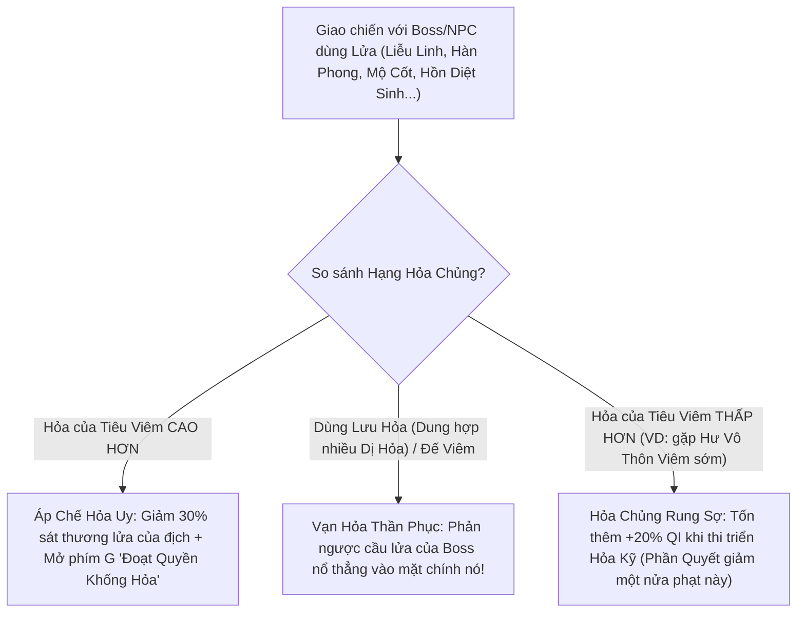

# BẢNG 23 DỊ HỎA, THÚ HỎA, SHADER PIXEL & LỘ TRÌNH TIẾN HÓA "PHẦN QUYẾT"

> **Thuộc phân hệ**: `02_He_Thong_Tu_Luyen_Va_Di_Hoa`
> **Tham chiếu quy chuẩn**: [00_Master_Index_Va_Quy_Chuan.md](../00_Tong_Quan_Kien_Truc/00_Master_Index_Va_Quy_Chuan.md) · [Canh_Gioi_Va_Linh_Hon.md](./Canh_Gioi_Va_Linh_Hon.md)
> **Mục tiêu thiết kế**: Biến việc **Săn Lùng Dị Hỏa** và **Tự Tay Phối Trộn Phật Nộ Hỏa Liên** thành vòng lặp sưu tầm – xây dựng cấu hình nhân vật (Custom Build Synergy) gây nghiện nhất trò chơi, đồng thời tối ưu hóa tài nguyên mỹ thuật bằng kỹ thuật **Pixel Palette-Swap Shader**.

---

## 1. Kiến Trúc Kỹ Thuật: Pixel Palette-Swap Shader Cho Hệ Thống Hỏa Diễm

Thay vì phải vẽ lại từ đầu hàng chục bộ Animation kỹ năng mỗi khi Tiêu Viêm nuốt một ngọn lửa mới, toàn bộ Sprite hiệu ứng lửa (vệt chém Trọng Xích, Đấu Khí Sa Y, Cánh Hỏa Dực, Cánh Sen Nổ, Vòng Lửa Lò Đan) đều được vẽ ở dạng **Grayscale Index Map 4 Tông Độ Sáng** và tô màu thời gian thực qua Fragment Shader `u_FlamePalette`:

```glsl
// Quy tắc ánh xạ 4 dải độ sáng Grayscale sang Bảng Màu Hỏa Chủng (Palette Ramp)
// Luminance > 0.85  -> Core_Hex  (Tâm lửa nóng nhất / điểm lóe sáng)
// 0.50 .. 0.85      -> Mid_Hex   (Thân ngọn lửa chủ đạo)
// 0.20 .. 0.49      -> Outer_Hex (Viền khói lửa / tàn tro phát sáng)
// < 0.20            -> Alpha 0   (Trong suốt + Distortion UV nếu là Vẫn Lạc Tâm Viêm / Hư Vô!)
```

* **Khi chuyển đổi Chủ Hỏa**: Chỉ trong `1 frame`, toàn bộ vệt chém Xích, màu mắt khi bộc phát, hào quang chân và giao diện Lò Đan đồng loạt đổi sang bảng mã Hex của ngọn lửa đó.
* **Khi dung hợp nhiều Dị Hỏa (Lưu Hỏa / Đế Viêm)**: Shader chạy chế độ `Multi_Ramp_Cycle`, xoay vòng chuyển sắc mượt mà giữa các cánh sen tương ứng đúng các mã Hex được lắp trong khe **Phật Nộ Hỏa Liên**!

---

## 2. Giai Đoạn Khởi Đầu & Đệm Chuyển Tiếp: 5 Thú Hỏa & Hóa Sinh Hỏa

Trước khi đủ thực lực nuốt Dị Hỏa thật sự ở cuối Chương 3, người chơi trải nghiệm sự khác biệt của chất lượng ngọn lửa thông qua **5 loại Phàm/Thú/Giả Hỏa** quan trọng dưới đây:

| STT | Tên Ngọn Lửa | Bảng Màu Pixel Shader (`Core / Mid / Outer`) | Hình Thái Đặc Trưng (Pixel VFX) | Nơi Thu Thập Trong Game | Hiệu Ứng Nội Tại (Passive) | Hiệu Ứng Khe Phụ Hỏa Liên (`F`) |
| :---: | :--- | :--- | :--- | :--- | :--- | :--- |
| **T1** | **Phàm Hỏa**<br>*(Đấu Khí Hỏa Thường)* | `#FFF3B0` / `#FF7B00` / `#B82900`<br>*(Vàng nhạt – Cam – Đỏ sẫm)* | Tia lửa cam bập bùng cơ bản, tàn lửa bay ngắn. | Mặc định mở khóa khi đạt **Đấu Giả (`Lv 10`)**. | Cho phép luyện đan Nhất – Nhị Phẩm cơ bản; đòn đánh kèm `+5%` sát thương Hỏa. | *Chưa đủ độ cô đặc để kết Hỏa Liên* (chỉ tạo *Bạo Viêm Chưởng* nhỏ). |
| **T2** | **Xích Lang Thú Hỏa**<br>*(Thú Hỏa Cấp 2)* | `#FFE0E0` / `#E63946` / `#6A040F`<br>*(Trắng hồng – Đỏ máu – Đỏ đen)* | Ngọn lửa hình nanh sói hung hãn, phát tiếng tru nhẹ khi bùng lửa. | Rơi từ Tiểu Boss **Xích Viêm Lang Vương** (Ma Thú Sơn Mạch ngoài rìa — Chương 2) hoặc Đấu Giá Ô Thản Thành. | `+8% ATK` khi đánh Ma thú; `+10%` tốc độ nung thảo dược Tam Phẩm trở xuống. | **Nanh Lửa Xé Thịt**: Kèm hiệu ứng *Chảy Máu* (`15% ATK/s` trong `4s`). |
| **T3** | **Tử Tinh Dực Sư Hỏa (Tử Hỏa)**<br>*(Thú Hỏa Cấp 6 Vương Thú)* | `#F3D5FF` / `#9D4EDD` / `#3C096C`<br>*(Trắng tím – Tím ngọc – Tím thẫm)* | Ngọn lửa tím quý phái kết tinh vảy pha lê và bóng sư tử mọc cánh. | **Mạch truyện chính Chương 2**: Hang Tử Tinh Dực Sư Vương (thu được *Tử Linh Tinh* sau cuộc chiến giữa Vân Chi & Sư Vương). | **Bước ngoặt đầu tiên kích hoạt Phần Quyết!** `+15%` sát thương Hỏa, `+12%` tỷ lệ thành đan Tứ – Ngũ Phẩm, kháng choáng nhẹ. | **Tử Tinh Phá Giáp**: Vụ nổ bắn văng `8` mảnh tinh thể tím xuyên thấu mục tiêu phía sau, giảm `15% DEF` địch. |
| **T4** | **Hóa Sinh Hỏa**<br>*(Giả Dị Hỏa Bách Thú)* | `#FFF1D0` / `#F77F00` / `#582F0E`<br>*(Vàng kem – Hổ phách – Nâu đồng)* | Vòng lửa xoáy biến ảo liên tục hình dáng hàng chục loài thú nhỏ. | **Bí cảnh Đan Hội Gia Mã (Chương 4)** *(Chiến thắng Liễu Linh)* hoặc tự hợp thành từ `10` Thú Hỏa tại *Vạn Hỏa Quật Hắc Giác Vực*. | Uy lực bằng `65%` Dị Hỏa hạng cuối; `+0.10 Realm_Pen`, giảm `15%` tiêu hao `QI` khi khống lò liên tục. | **Bách Hỏa Xung Trận**: Đẩy lùi cực mạnh (`Knockback 4 ô`) và tăng `+25%` bán kính nổ Hỏa Liên. |
| **T5** | **Cửu U Minh Hỏa**<br>*(Thú Hỏa Dị Biến Cấp Thánh)* | `#D8F3DC` / `#2D6A4F` / `#081C15`<br>*(Xanh ma trơi – Lục âm u – Đen mực)* | Lửa âm hàn xanh lục thẫm mang tiếng rít của vạn xà dưới cửu tuyền. | **Kỳ ngộ Chương 9–10**: Tầng sâu *Hoàng Tuyền Âm Hàn Trì* của Cửu U Địa Minh Mãng Tộc (Yêu Minh). | Sức mạnh ngang ngửa Dị Hỏa hạng `#14–#16`! Đòn lửa ăn mòn cả `QI` lẫn `SOUL` của địch; `+20%` kháng Băng/Độc. | **Âm Minh Thực Cốt**: Để lại vũng đầm lầy lửa âm hàn dưới đất `6s`, làm chậm `45%` và cấm hồi máu kẻ địch. |

---

## 3. Toàn Cảnh Bảng Xếp Hạng 23 Dị Hỏa Thiên Địa (`#23` → `#1`)

Để tôn trọng tuyệt đối nguyên tác mà vẫn thỏa mãn ước mơ sưu tầm trọn vẹn **23/23 Dị Hỏa** của game thủ cày cuốc:
* **6 Dị Hỏa Tiêu Viêm trực tiếp thôn phệ trong cốt truyện chính** (`#19, #14, #11, #15, #9, #3`) nằm trên trục nhiệm vụ chính tuyến bắt buộc.
* **Các Dị Hỏa thuộc Tứ Đại Đế Tộc đồng minh / Vô chủ / Khuyết danh** được mở khóa thông qua **Nhiệm Vụ Hảo Cảm Tối Đa** (nhận *Tử Hỏa Bản Nguyên* như Huân Nhi trao `#4`), **Bí Cảnh Săn Hỏa Ẩn Độc Quyền**, và cuối cùng quy tụ thành **#1 Đế Viêm** tại Chương 11!

### 3.1. Nhóm Phong Vân Đại Lục: Hạng `#23` Đến Hạng `#13`

| Hạng | Tên Dị Hỏa | Mã Hex Shader (`Core / Mid / Outer`) | Hình Thái Đặc Trưng (Pixel VFX) | Nguồn Thu Thập (Chính Tuyến / Bí Cảnh Ẩn) | Nội Tại Khi Hấp Thu (`Passive`) | Hiệu Ứng Khe Dung Hợp `Phật Nộ Hỏa Liên` |
| :---: | :--- | :--- | :--- | :--- | :--- | :--- |
| **#23** | **Huyền Hoàng Viêm** | `#FFF8DC` / `#DAA520` / `#5C4033`<br>*(Vàng sáng – Hoàng thổ – Nâu đất cổ)* | Ngọn lửa vàng nâu nặng trịch như núi thái sơn, rơi xuống đất nứt toác đá. | **Bí Cảnh Ẩn Trung Châu (Ch 8)**: *Long Mạch Huyền Hoàng Cổ Quật* phía nam Bàn Sơn (`Lv 72+`). | `+0.20 Realm_Pen`; tăng vĩnh viễn `+12% DEF` và `+25%` độ bền *Đấu Khí Khải Giáp*. | **Trọng Nhạc Áp Đỉnh**: Vụ nổ Hỏa Liên gây hiệu ứng *Trọng Lực Gấp Đôi*, đè bẹp quái bay xuống đất và làm choáng `1.8s`. |
| **#22** | **Vạn Thú Linh Hỏa** | `#FFE5EC` / `#FF4D6D` / `#590D22`<br>*(Hồng kim – Đỏ chu sa – Huyết dụ)* | Biển lửa hóa hình vạn ma thú (hổ, ưng, lân, mãng) gầm thét lao đi. | **Kỳ ngộ Dược Điển (Ch 10)**: Chiến thắng Dược Vạn Quy tại *Dược Giới* để nhận *Vạn Thú Hỏa Chủng* (hoặc săn tại *Vạn Thú Ma Sơn*). | `+0.20 Realm_Pen`; tăng `+25%` sát thương lên hệ Ma Thú & Yêu Tộc; Ma thú cấp thấp tự thuần phục. | **Vạn Thú Bôn Đằng**: Sau khi Hỏa Liên nổ, phóng ra `6` linh thú lửa tự động truy đuổi mục tiêu còn sống quanh đó. |
| **#21** | **Âm Dương Song Viêm**<br>*(Khuyết danh trong truyện — Thiết kế độc quyền)* | `#FFFFFF` & `#1A1A2E` *(Xoay Thái Cực)*<br>Mid: `#8ECAE6` / `#FB8500` | *(Ghi chú: Nguyên tác khuyết danh hạng #21)* — Hai luồng lửa Đen (Chí Âm) – Trắng (Chí Dương) quấn xoắn hình cá Thái Cực. | **Bí Cảnh Độc Quyền (Ch 6–7)**: *Âm Dương Huyền Tuyền Phế Tích* nằm ở ranh giới Hắc Giác Vực – Trung Châu (`Lv 58+`). | `+0.22 Realm_Pen`; cân bằng khí huyết: khi `HP < 50%` tăng `+20% Hút máu`, khi `HP >= 50%` tăng `+20% Tốc đánh`. | **Lưỡng Nghi Nghịch Chuyển**: Nổ 2 nhịp liên tiếp — Nhịp 1 hút gom quái vào tâm (Âm), Nhịp 2 bùng nổ hất tung chí mạng (Dương)! |
| **#20** | **U Minh Độc Hỏa**<br>*(Khuyết danh trong truyện — Thiết kế độc quyền)* | `#E0AAFF` / `#38B000` / `#240046`<br>*(Tím độc – Lục huỳnh quang – Tím đen)* | *(Ghi chú: Nguyên tác khuyết danh hạng #20)* — Ngọn lửa xanh tím bốc khói đầu lâu, đốt cháy vạn chất kịch độc thành năng lượng. | **Bí Cảnh Độc Quyền (Ch 7)**: *Đầm Lầy U Minh Vạn Độc* sâu trong Xuất Vân Đế Quốc *(đi cùng Tiểu Y Tiên mở cửa ẩn, `Lv 63+`)*. | `+0.22 Realm_Pen`; chuyển hóa `50%` sát thương Độc nhận vào thành `QI`; cộng hưởng cực mạnh với *Ma Độc Ban* & *Tiểu Y Tiên*. | **U Minh Hủ Thực Liên**: Khiến mục tiêu trúng nổ chịu trạng thái *Độc Hỏa Thiêu Tâm* — rút `3% Max HP/s` trong `6s` (tối đa ngưỡng Boss). |
| **#19** | **Thanh Liên Địa Tâm Hỏa** | `#D8F3DC` / `#00B4D8` / `#0077B6`<br>*(Trắng ngọc – Xanh ngọc bích – Thanh lam)* | **Đóa Sen Xanh 8 Cánh** tinh khiết nở rộ trên đài ngọc, bước chân đi để lại dấu sen lửa xanh. | **Mạch truyện chính Chương 3**: Đáy hồ dung nham Sa Mạc Tháp Qua Nhĩ / Thánh Thành Xà Nhân *(Dị Hỏa đầu tiên của Tiêu Viêm!)*. | `+0.25 Realm_Pen`; miễn nhiễm địa hình Dung Nham; khi đứng trên mặt đất nhận `+15% QI Regen/s`; mở khóa *Địa Tâm Hỏa Liên*. | **Thanh Liên Địa Bạo**: Triệu hồi `3` cột dung nham xanh phun trào từ dưới chân mục tiêu sau vụ nổ chính, gây sát thương dồn dập. |
| **#18** | **Phong Lôi Phẫn Nộ Diễm** | `#E0FBFC` / `#48CAE4` / `#3F37C9`<br>*(Trắng điện – Xanh bão – Tím chớp)* | Cơn lốc lửa mang theo tia hồ quang điện xé gió gào thét dữ dội. | **Bí Cảnh Ẩn Cổ Vực (Ch 8)**: *Phong Lôi Hoang Nguyên Cổ Trận* phía bắc Trung Châu (`Lv 76+`). | `+0.24 Realm_Pen`; tăng vĩnh viễn `+10% SPD` chạy và giảm `20%` tiêu hao của thân pháp *Tam Thiên Lôi Động*. | **Cuồng Phong Lôi Liên**: Tăng `+50%` tốc độ bay của quả cầu Hỏa Liên và giật sét tê liệt (`Paralyze 1.2s`) chuỗi 5 mục tiêu. |
| **#17** | **Hỏa Sơn Thạch Diễm** | `#FFEDD8` / `#E85D04` / `#370617`<br>*(Vàng lửa – Đỏ nham thạch – Đen đá núi lửa)* | Khối lửa bọc vỏ đá nham thạch nứt nẻ, mỗi đòn vung rơi mảnh thiên thạch nhỏ. | **Bí Cảnh Viêm Giới Ngoại Vi (Ch 10)**: Khảo nghiệm tại *Thiên Trụ Hỏa Sơn* do trưởng lão Viêm Tộc mở cửa thử thách (`Lv 96+`). | `+0.25 Realm_Pen`; đòn bổ *Huyền Trọng Xích* tăng `+30%` sát thương Phá Khiên (Shield Break). | **Thiên Thạch Tinh Lưu**: Vụ nổ Hỏa Liên gọi thêm `5` tảng đá núi lửa rực cháy giáng từ trên trời xuống vùng nổ trong `3s`. |
| **#16** | **Hỏa Vân Thủy Viêm** | `#CAF0F8` / `#FF6B6B` / `#4361EE`<br>*(Sương trắng – Hồng mây lửa – Lam thủy)* | Đám mây lửa mềm mại trôi nổi như dòng nước, sóng sánh thủy – hỏa giao dung. | **Bí Cảnh Ẩn Trung Châu (Ch 9)**: *Thác Hỏa Vân Thiên Đoạn* vùng Đông Nam Trung Châu (`Lv 84+`). | `+0.26 Realm_Pen`; dòng chảy lửa mềm mại giúp giảm `15%` thời gian hồi chiêu (`Cooldown`) của 3 ô Đấu Kỹ `Q, E, R`. | **Hỏa Vân Lan Tỏa**: Biến vụ nổ tức thời thành làn sóng mây lửa lan rộng dần ra `8 ô`, đẩy lùi mọi đạn đạo của địch trên đường đi. |
| **#15** | **Hải Tâm Diễm** | `#E0FBFC` / `#0096C7` / `#023E8A`<br>*(Bọt trắng – Xanh đại dương – Lam biển sâu)* | Ngọn lửa xanh thẫm cuộn trào từng đợt sóng biển kỳ dị, khắc chế thủy pháp. | **Mạch truyện chính Chương 8–9**: Đoạt từ *Hàn Phong / Mộ Cốt Lão Nhân* trong trận đại chiến cứu Dược Lão tại Vong Hồn Sơn Mạch! | `+0.28 Realm_Pen`; hóa giải sự xung khắc giữa các Dị Hỏa hung hãn — **giúp tăng `+20%` tốc độ gồng dung hợp Phật Nộ Hỏa Liên!** | **Nộ Hải Cuồng Đào**: Phóng 3 vòng sóng lửa đại dương đồng tâm quét rộng, áp dụng hiệu ứng *Áp Suất Biển Sâu* (`-25% Tốc đánh` địch). |
| **#14** | **Vẫn Lạc Tâm Viêm** | `#FFFFFF` *(Lõi mờ)* / `Khúc xạ UV trong suốt` / `#FFB703` *(Viền nhiệt)* | **Lửa Vô Hình!** Chỉ làm không khí trên màn hình Pixel vặn xoắn gợn sóng nhiệt lấp lánh, đốt từ trong tim kẻ địch cháy ra! | **Mạch truyện chính Chương 6**: Đáy *Thiên Phần Luyện Khí Tháp* (Học viện Già Nam) — Tử chiến phong ấn đại xà vô hình! | `+0.30 Realm_Pen`; **"Máy Gia Tốc Tu Luyện"**: Thường trực tăng **`+25% EXP Đấu Khí`** & tự động hồi `1.5% Max QI/s` suốt đời! | **Tâm Hỏa Tự Thiêu**: Không thể bị đỡ bằng khiên vật lý! Kích phát lửa từ bên trong nội tạng mục tiêu, gây `+35%` sát thương chuẩn xuyên giáp. |
| **#13** | **Quy Linh Địa Hỏa** | `#F4F1DE` / `#BC6C25` / `#283618`<br>*(Trắng ngà – Nâu hổ phách – Lục rêu cổ)* | Hình thái cự quy mai nham thạch cắm đầy gai nhọn cuộn tròn bất khả xâm phạm. | **Kỳ ngộ Dược Điển (Ch 10)**: Vượt *Huyền Quy Địa Cung* giao lưu cùng Dược Tinh Cực để trích xuất Hỏa Chủng (`Lv 98+`). | `+0.28 Realm_Pen`; tăng `+20% Max HP` và tạo lớp *Mai Rùa Hỏa Giáp* chặn đứng `1` đòn chí mạng mỗi `60 giây`! | **Huyền Quy Phản Chấn Liên**: Khi đang gồng Hỏa Liên, Tiêu Viêm nhận khiên bất tử giảm `80%` sát thương và phản toàn bộ sát thương đó vào quả cầu nổ! |

### 3.2. Nhóm Bá Chủ Viễn Cổ & Thần Thoại Tối Thượng: Hạng `#12` Đến Hạng `#1`

| Hạng | Tên Dị Hỏa | Mã Hex Shader (`Core / Mid / Outer`) | Hình Thái Đặc Trưng (Pixel VFX) | Nguồn Thu Thập (Chính Tuyến / Bí Cảnh Ẩn) | Nội Tại Khi Hấp Thu (`Passive`) | Hiệu Ứng Khe Dung Hợp `Phật Nộ Hỏa Liên` |
| :---: | :--- | :--- | :--- | :--- | :--- | :--- |
| **#12** | **Cửu Long Lôi Cương Hỏa** | `#FFFFFF` / `#CED4DA` / `#5A189A`<br>*(Trắng chói – Bạc kim – Tím lôi cương)* | **Chín Con Rồng Lửa Bạc** quấn tia sét tím gầm vang trong tâm ngọn lửa, chấn nhiếp tà ma. | **Tuyến Phần Viêm Cốc (Ch 8–10)**: Giúp Cốc chủ *Đường Chấn* luyện *Hỏa Bồ Đan* cứu Đường Hỏa Nhi & vượt *Cửu Long Lôi Trì* nhận Long Hỏa Bản Nguyên. | `+0.32 Realm_Pen`; đòn đánh kèm *Lôi Cương Chấn Nhiếp* gây `+30%` sát thương thêm lên Hồn Thể của Hồn Điện! | **Cửu Long Phệ Lôi Trận**: Khi nổ phóng ra `9` đầu rồng bạc cắn xé khu vực trong `2.5s`, phá nát mọi Kết Giới Không Gian của Boss. |
| **#11** | **Cốt Linh Lãnh Hỏa** | `#FFFFFF` / `#E0FBFC` / `#4CC9F0`<br>*(Trắng sương – Băng lam nhạt – Hàn quang)* | Ngọn lửa **Trắng Như Xương Khô**, tỏa hàn khí đóng băng mặt đất nhưng lại thiêu rụi linh hồn — Cực Hàn Cực Nhiệt! | **Mạch truyện chính Chương 3 (Mượn) & Chương 9 (Chân truyền)**: Kỷ vật tối cao **Dược Lão** trao trọn Bản Nguyên cho ái đồ trước khi Tiêu Viêm đi tranh đoạt Tịnh Liên! | `+0.35 Realm_Pen`; miễn nhiễm `100%` Đóng Băng/Làm Chậm; đòn lửa gây chồng ấn **Hàn Viêm** (đủ 5 cộng dồn đóng băng cứng kẻ địch `2s`!). | **Cực Hàn Băng Hỏa Bạo**: Tạo xung đột Băng – Hỏa cực đại trong Hỏa Liên, tăng **`+45% Crit DMG`** và đóng băng toàn bộ quái sống sót sau vụ nổ! |
| **#10** | **Cửu U Phong Viêm** | `#F8F9FA` / `#2EC4B6` / `#011627`<br>*(Trắng bạc – Xanh gió âm – Đen thăm thẳm)* | Lửa đen xanh rít lên tiếng gió thổi ra từ chín tầng địa ngục, làm rối loạn tâm trí người nghe. | **Bí Cảnh Săn Hỏa Ẩn (Ch 9)**: *Vực Sâu Cửu U Phong Nhãn* vùng Tây Bắc Trung Châu (`Lv 89+`, giải đố hướng gió âm dương). | `+0.33 Realm_Pen`; mỗi đòn lướt `Space` để lại *Phong Viêm Tàn Ảnh* chém rách kẻ địch đuổi theo và gây hiệu ứng *Hoảng Loạn*. | **Cửu U Tuyệt Phong Trảm**: Vụ nổ sinh ra hàng chục lưỡi đao gió lửa vô hình chém liên hoàn `12 hits` vào mục tiêu ở tâm vụ nổ. |
| **#9** | **Tam Thiên Diễm Viêm Hỏa** | `#F72585` / `#7209B7` / `#10002B`<br>*(Hồng tinh vân – Tím sẫm – Đen ngân hà)* | **Bất Tử Chi Hỏa!** Ngọn lửa tím đen điểm ngàn ánh sao trời, ngưng tụ hình dáng *Thái Hư Cổ Long* thu nhỏ. | **Mạch truyện chính Chương 8**: Quán quân **Đan Hội Trung Châu**, tiến vào *Tinh Vực Đan Tháp* nhờ ấn ký Cổ Long của Tử Nghiên thu phục! | `+0.36 Realm_Pen`; **Tam Thiên Tinh Thần Thể**: Tăng hồi máu tự nhiên **gấp 5 lần**; khi chịu đòn tử vong (`HP = 0`), lập tức hồi sinh với `50% HP` *(Hồi chiêu `300s`)*! | **Tinh Vực Bất Diệt Liên**: Hấp thu ánh sao trời tăng `+40%` sát thương nổ vào ban đêm / trong Bí Cảnh tối, và hút `10%` sát thương gây ra hồi thẳng vào `HP` Tiêu Viêm! |
| **#8** | **Hồng Liên Nghiệp Hỏa** | `#FFD6E0` / `#D90429` / `#2B2D42`<br>*(Hồng phấn sáng – Đỏ thẫm nghiệp chướng – Xám tro)* | Đóa sen đỏ thẫm như máu tội lỗi, kẻ sát sinh càng nhiều bị lửa này đốt càng đau đớn! | **Tuyến Liên Minh Viêm Tộc (Ch 10–11)**: Cùng *Hỏa Huyễn* trấn áp ma triều tại *Nghiệp Hỏa Hồng Liên Đàn* nhận Hỏa Ấn cộng sinh. | `+0.36 Realm_Pen`; **Thẩm Phán Nghiệp Chướng**: Tăng tới `+40%` sát thương lên kẻ địch mang tà khí/sát nghiệp nặng (đặc biệt **Hồn Điện & Hồn Tộc**!). | **Nghiệp Hỏa Phần Tội**: Sát thương nổ Hỏa Liên cộng thêm phần trăm theo số máu mà Boss đã gây ra cho Tiêu Viêm trong trận chiến đó! |
| **#7** | **Cửu U Kim Tổ Hỏa** | `#FFF3B0` / `#FFB703` / `#7F4F24`<br>*(Trắng kim – Vàng kim loại – Đồng cổ)* | Ngọn lửa vàng ròng sắc bén như vạn thanh thần binh nóng chảy, chém sắt như chém bùn. | **Bí Cảnh Viêm Giới (Ch 10)**: Khảo nghiệm rèn xích tại *Tổ Hỏa Kim Lô* của Viêm Tộc (`Lv 104+`). | `+0.38 Realm_Pen`; cộng thẳng **`+25% Xuyên Giáp Vật Lý & Đấu Khí`** cho mọi đòn vung Huyền Trọng Xích! | **Kim Tổ Vạn Kiếm Nổ**: Hỏa Liên nổ tung bắn ra cơn mưa `24` thanh kim kiếm lửa vàng xuyên qua toàn màn hình! |
| **#6** | **Bát Hoang Phá Diệt Viêm** | `#FFE5D9` / `#FB5607` / `#3A0CA3`<br>*(Trắng cam – Cam hủy diệt – Tím chấn không)* | Đôi hỏa dực khổng lồ trăm trượng đập một nhịp làm sụp đổ cả một góc không gian! | **Tuyến Viêm Tộc Đại Chiến (Ch 11)**: Sát cánh cùng *Hỏa Chuy / Viêm Tẫn* bảo vệ Viêm Giới trước Hồn Tộc, nhận *Bát Hoang Hỏa Tinh*. | `+0.40 Realm_Pen`; kích thước Hitbox mọi chiêu thức Hỏa tăng `+35%`, cánh *Hóa Dực* bay nhanh thêm `+30%`. | **Bát Hoang Toái Không Bạo**: Đập nát hoàn toàn không gian vùng nổ — gây sát thương chí mạng chắc chắn (`100% Guaranteed Crit`) ở tâm chấn! |
| **#5** | **Sinh Linh Chi Diễm** | `#E9F5DB` / `#52B788` / `#1B4332`<br>*(Trắng ngọc lục – Xanh mầm sống – Lục đại ngàn)* | Ngọn lửa kỳ lạ không mang tính hủy diệt mà tràn ngập sinh cơ, đi đến đâu cỏ cây trăm năm nở hoa kết trái trong chớp mắt! | **Bí Cảnh Thần Nông Lão Nhân (Ch 10–11)**: Gặp gỡ truyền kỳ *Thần Nông Lão Nhân* xin mượn lửa luyện đan cứu viện Liên Minh (`Lv 106+`). | `+0.38 Realm_Pen`; **Trường Sinh Chi Hỏa**: Tăng `+35%` hiệu quả mọi loại Đan Dược uống vào; thảo dược trồng ở Tông Môn lớn nhanh **gấp 3 lần**! | **Sinh Tử Luân Chuyển Liên**: Vụ nổ vừa gây sát thương cho địch, vừa tỏa vòng sương lục **hồi lập tức `30% Max HP`** cho Tiêu Viêm và Đồng hành! |
| **#4** | **Kim Đế Phần Thiên Viêm** | `#FFFFFF` / `#FFD700` / `#B8860B`<br>*(Trắng kim cương – Hoàng kim rực rỡ – Vàng đế vương)* | Bá chủ chi hỏa của Cổ Tộc — ngọn lửa **Vàng Ròng Tôn Quý** ngay cả Đấu Khí bên trong cơ thể đối thủ cũng bị nó đốt cháy thành tro! | **Mạch truyện chính & Tuyến Huân Nhi (Ch 10)**: Khi Hảo cảm **Tiêu Huân Nhi** đạt tối đa tại Cổ Giới, nàng chủ động chia sẻ một phần **Bản Nguyên Kim Đế Phần Thiên Viêm** vào trong cơ thể Tiêu Viêm! | `+0.42 Realm_Pen`; **Phần Đốt Đấu Khí**: Mỗi đòn đánh trúng đốt cháy trực tiếp `5%` thanh Năng lượng/Giáp của Boss, khóa chiêu đại chiêu của địch! | **Kim Đế Phần Thiên Liên**: Vụ nổ hoàng kim thiêu rụi cả không gian, xóa sạch mọi Buff có lợi trên người Boss và gây thêm `+50%` sát thương tổng! |
| **#3** | **Tịnh Liên Yêu Hỏa** | `#FFFFFF` / `#FFB3C6` / `#FB6F92`<br>*(Trắng sữa – Hồng phấn ngọc – Đỏ sen yêu mị)* | **Đóa Sen Trắng Hồng Yêu Dị** & Linh trí hóa thành *Yêu Hỏa Hài Đồng / Tiểu Y (Y Hỏa)* đáng yêu đứng trên vai chủ nhân — tịnh hóa vạn vật thành hư vô! | **Mạch truyện chính Chương 10**: Mở *Yêu Hỏa Không Gian* khi gom đủ **4 Mảnh Tàn Đồ Tịnh Liên**, hợp sức cùng Huân Nhi luyện hóa thành *Lưu Hỏa*! | **`+0.48 Realm_Pen`**; mở khóa Linh sủng **Tiểu Y (Hỏa Nô Tinh Linh)** bay theo tự động búng chỉ tịnh hóa đạn địch; mở đại trận **Luyện Thiên Cổ Trận** biến kẻ địch bại trận thành *Hỏa Nô* trợ chiến! | **Tịnh Thế Yêu Liên (Hủy Diệt Hỏa Liên)**: Phủ sắc trắng sữa thần thánh — **Tịnh hóa xuyên 100% kháng Hỏa** của mọi mục tiêu (trừ Hồn Thiên Đế cấp Đế)! |
| **#2** | **Hư Vô Thôn Viêm** | `#ADB5BD` / `#212529` / `#000000`<br>*(Viền xám bạc cắt không gian – Đen đặc – Hố đen tuyệt đối)* | Hố đen nuốt chửng cả ánh sáng và vạn vật thiên địa, không có hình dạng cố định ngoài bóng tối nuốt trọn hư không. | **Hậu kỳ Chương 11 (Chiến lợi phẩm Song Đế Chi Chiến)**: Đánh bại *Hư Vô Thôn Viêm Bản Thể* và *Hồn Thiên Đế*, rút Bản Nguyên Hắc Viêm dung nhập vào Đế Viêm! | **`+0.50 Realm_Pen`**; **Thôn Thiên Phệ Địa**: Hấp thu `25%` mọi sát thương phép/Đấu Khí bắn vào người chuyển thẳng thành `HP` & `QI`! | **Hư Vô Thôn Thế Liên**: Tạo lỗ đen trọng lực khổng lồ hút chặt toàn bộ chiến trường vào một điểm suốt `3s` trước khi xóa sổ không gian! |
| **#1** | **Đế Viêm (Viêm Đế Chi Hỏa)** | **Shader Đa Sắc Lăng Kính (`22-Flame Prism Cycle`)**: `#FFD700` $\leftrightarrow$ `#00B4D8` $\leftrightarrow$ `#FFB3C6` $\leftrightarrow$ `#7209B7` $\leftrightarrow$ `#FFFFFF` | **Ngọn Lửa Khởi Nguyên Rực Rỡ Muôn Màu** hợp nhất từ 22 loại Dị Hỏa thiên địa — hóa hình thành thanh **Dị Hỏa Hằng Cổ Xích** cắt đôi cả thương khung! | **Đỉnh cao Chương 11 (`Lv 120`)**: Thừa kế *Đà Xá Cổ Đế* và hiệu triệu Vạn Hỏa Triều Tông hợp nhất thành công Đế Viêm! | **`+1.50 Realm_Pen` (Áp Chế Vạn Hỏa Tuyệt Đối)**; mọi kẻ địch sử dụng Hỏa trên thế gian bị phế `90%` sát thương trước mặt Viêm Đế! | **Dị Hỏa Hằng Cổ Xích — Khai Thiên Liên**: Triệu hồi **Dị Hỏa Quảng Trường** gồm 22 cột lửa thần cùng lúc kết đại trận trấn áp cấp Đấu Đế! |

---

## 4. Lộ Trình Tiến Hóa Công Pháp Độc Nhất Vô Nhị: "PHẦN QUYẾT"

Khác với mọi công pháp cố định phẩm cấp trên Đấu Khí Đại Lục, **Phần Quyết** khởi đầu chỉ là **Hoàng Giai Đê Cấp** (yếu hơn cả công pháp gia tộc bình thường!), nhưng cứ mỗi lần thôn phệ thành công một ngọn Hỏa mới lại lột xác vượt bậc lên tới **Thiên Giai Đỉnh Phong (Chuẩn Đế Giai)**.

### 4.1. Bảng 10 Bậc Tiến Hóa Của Phần Quyết Theo Số Lượng Hỏa Thôn Phệ

| Bậc Tiến Hóa | Phẩm Cấp Phần Quyết Hiển Thị | Yêu Cầu Hỏa Thôn Phệ Tối Thiểu | Hiệu Suất Chuyển Hóa `QI` | Cộng Thêm `Realm_Pen` | Số Khe Lắp `Phật Nộ Hỏa Liên` Mở Khóa | Quyền Năng Đặc Thù Mở Khóa Cho Tiêu Viêm |
| :---: | :--- | :--- | :---: | :---: | :---: | :--- |
| **0** | **Hoàng Giai — Đê Cấp** *(Gốc)* | *Chưa nuốt Dị Hỏa (Dùng Phàm Hỏa)* | `85%` *(Chậm hơn thường!)* | `0.00` | *Khóa* | Khổ tu đặt nền móng kinh mạch chịu nhiệt cao. |
| **1** | **Hoàng Giai — Cao Cấp** | Đã luyện hóa **Tử Hỏa (Tử Tinh Dực Sư)** | `105%` | `+0.05` | **2 Khe Sơ Khởi** *(Tử + Thanh/Cốt)* | Đấu Khí nhuốm ánh tím nóng rực; mở sơ thức *Bạo Bộ*. |
| **2** | **Huyền Giai — Trung Cấp** | **1 Dị Hỏa** *(Thanh Liên Địa Tâm Hỏa `#19`)* | `135%` | `+0.20` | **2 Khe Chuẩn** *(Song Sắc Hỏa Liên)* | Mở khóa chính thức tuyệt kỹ **Phật Nộ Hỏa Liên (`Phím F`)**! |
| **3** | **Địa Giai — Đê Cấp** | **2 Dị Hỏa** *(Ví dụ: `#19` + Vẫn Lạc Tâm Viêm `#14`)* | `175%` | `+0.35` | **3 Khe** *(Tam Sắc Hỏa Liên)* | Dung hợp 2 Dị Hỏa tạo **Lưu Ly Liên Tâm Hỏa** xanh biếc vô hình! |
| **4** | **Địa Giai — Cao Cấp** | **3 Dị Hỏa** *(Thêm Hải Tâm Diễm `#15` hoặc Bí cảnh)* | `220%` | `+0.50` | **3 Khe Ổn Định** *(Giảm 30% tự sát thương)* | Kích hoạt trọn vẹn **Thiên Hỏa Tam Huyền Biến — Đệ Tam Biến** bằng 3 Dị Hỏa thật! |
| **5** | **Địa Giai — Đỉnh Phong (Chuẩn Thiên)** | **4 Dị Hỏa** *(Thêm Tam Thiên Diễm Viêm Hỏa `#9`)* | `275%` | `+0.65` | **4 Khe** *(Tứ Sắc Hủy Diệt Hỏa Liên!)* | Tự động tuần hoàn Đấu Khí ngay cả khi bị đánh choáng hoặc phong ấn. |
| **6** | **Thiên Giai — Đê Cấp** | **5 Dị Hỏa** *(Kế thừa trọn vẹn Cốt Linh Lãnh Hỏa `#11`)* | `340%` | `+0.75` | **4 Khe Siêu Tốc** *(Vừa chạy vừa kết Liên!)* | Đấu Khí thiên địa tự động cuộn về quy phục mỗi nhịp hít thở. |
| **7** | **Thiên Giai — Trung Cấp** | **6 – 8 Dị Hỏa** *(Gồm Tịnh Liên Yêu Hỏa `#3` + Tử hỏa `#4`)* | `420%` | `+0.85` | **5 Khe** *(Ngũ Luân Hủy Diệt Liên)* | Dung hợp vạn hỏa thành **Tịnh Liên Lưu Hỏa** màu hồng phấn trắng sữa! |
| **8** | **Thiên Giai — Cao Cấp** | **9 – 14 Dị Hỏa** *(Quét sạch Bí Cảnh Săn Hỏa Ẩn)* | `520%` | `+0.95` | **5 Khe + Linh Hồn Tự Kết Liên** | Miễn nhiễm hoàn toàn phản phệ khi trộn các Dị Hỏa xung khắc cực đoan. |
| **9** | **Thiên Giai — Đỉnh Phong (Đế Giai)** | **15 – 23 Dị Hỏa (Chứng Đạo Đế Viêm `#1`)** | **Vô Cực (`999%`)** | **`+1.20`** | **Vạn Hỏa Hằng Cổ Trận** | Đạt cực hạn truyền thuyết của Đà Xá Cổ Đế — một ý niệm triệu vạn hỏa! |

### 4.2. Quy Trình & Công Thức Mini-game "Thôn Phệ Luyện Hóa Dị Hỏa"

Nuốt Dị Hỏa là trải nghiệm sinh tử nghẹt thở bậc nhất trong nguyên tác (Tiêu Viêm suýt cháy thành tro ở Sa Mạc hay bị giam dưới đáy tháp hơn một năm). Trong game, quá trình Thôn Phệ gồm **3 Bước Chuẩn Bị Vật Phẩm Hộ Mạng** để đẩy tỷ lệ sống sót lên an toàn:

1. **Ba Bảo Vật Hộ Thể Bắt Buộc Khi Nuốt Dị Hỏa**:
   * **Huyết Liên Tinh (Blood Lotus Pill)**: Ngưng kết lớp màng máu hoa sen bọc quanh da thịt và kinh mạch, chặn `60%` sát thương đốt cháy ban đầu của Dị Hỏa hoang dã.
   * **Băng Linh Hàn Tuyền / Âm Hàn Đan**: Giữ mát lục phủ ngũ tạng trong suốt `60 giây` đấu trí điều khiển dòng lửa chạy dọc lộ tuyến Phần Quyết.
   * **Nạp Linh (Storage Spirit)**: Viên ngọc không gian cấy vào khí hải làm "ngôi nhà chứa Hỏa Chủng" — bắt buộc phải có mới mở thêm ô chứa Dị Hỏa mới trong người!
2. **Mini-game Thuần Phục Bản Nguyên Hỏa Linh**:
   * Bước 1: Đánh bại **Hỏa Linh Hóa Hình** (ví dụ: *Vô Hình Hỏa Mãng* của `#14`, *Tinh Thần Cổ Long* của `#9`, hay *Yêu Hỏa Thánh Giả* của `#3`) trong đấu trường Tâm Thức để ép nó co về dạng **Bản Nguyên Hỏa Chủng**.
   * Bước 2: Giữ nhịp cân bằng nhiệt kế Lạnh – Nóng bằng `LMB / RMB` dẫn Hỏa Chủng đi hết `36` chu thiên kinh mạch để khắc ấn Linh Hồn vĩnh viễn!

---

## 5. Toán Học Dung Hợp Tuyệt Kỹ: "Phật Nộ Hỏa Liên" (`Phím F`)

Người chơi được tự do mở bảng **Hỏa Liên Phối Trận** để kéo-thả các ngọn lửa đã thu thập vào `N` khe cánh sen ($N \in [2, 5]$). Công thức tính sát thương nổ, thời gian gồng và phản chấn lên bản thân như sau:

$$\text{DMG}_{\text{Lotus}} = \text{ATK}_{\text{Final}} \times \left(\sum_{i=1}^{N} W_{\text{Flame}}(i)\right) \times 1.65^{(N - 1)} \times \left(1 + \text{Synergy\_Bonus}\right)$$

* Trong đó $W_{\text{Flame}}(i)$ là hệ số uy lực của từng ngọn lửa lắp vào khe: Thú Hỏa $= 1.2$; Dị Hỏa `#23–#13` $= 2.0 \sim 2.6$; Dị Hỏa `#12–#6` $= 2.8 \sim 3.6$; Dị Hỏa `#5–#2` $= 4.0 \sim 5.2$.
* **Hàm mũ $1.65^{(N - 1)}$** thể hiện đúng quy luật nguyên tác: Càng trộn nhiều loại Dị Hỏa khác nhau, uy lực nổ càng tăng theo cấp số nhân khủng khiếp!
* **Cái Giá Của Hủy Diệt (Recoil & Exhaustion)**:
  * Tiêu hao `35%` đến `75% Max QI` tùy số khe lắp.
  * Nếu tổng cấp độ hung hãn của các Dị Hỏa vượt quá khả năng kiểm soát của `SOUL` hiện tại, vụ nổ ở cự ly quá gần (`< 3 ô`) sẽ gây **Sóng Xung Kích Phản Chấn** làm Tiêu Viêm mất `15% HP hiện tại` (không gây chết người, nhưng tái hiện đúng cảnh Tiêu Viêm rách áo hộc máu sau khi ném Hỏa Liên lật kèo!).
* **Các Tổ Hợp Cộng Hưởng Nguyên Tố Tiêu Biểu (`Synergy_Bonus`)**:
  * **Băng Cốt Cực Viêm** (`#11 Cốt Linh` + `#19 Thanh Liên` / `#15 Hải Tâm`): `+25% Synergy`, nổ kèm bão băng phong tỏa diện rộng.
  * **Vô Hình Thực Hồn** (`#14 Vẫn Lạc` + `#20 U Minh` / `#8 Hồng Liên`): `+30% Synergy`, quả cầu Hỏa Liên bay tàng hình khó bị Boss né tránh, gây sát thương tâm hồn cực đại.
  * **Tứ Sắc Hủy Diệt Hỏa Liên Kinh Điển** (`#19 Thanh Liên` + `#14 Vẫn Lạc` + `#11 Cốt Linh` + `#9 Tam Thiên`): **`+50% Synergy`** — tái hiện tuyệt phẩm 4 màu chấn động Trung Châu của Tiêu Viêm, để lại hố đen không gian rút máu Boss liên tục trong `5 giây`!


---

## 6. Thiết Kế Chi Tiết Bí Cảnh Săn Hỏa & Giải Mã Hai Dị Hỏa Khuyết Danh

Trong tiểu thuyết gốc của Thiên Tằm Thổ Đậu, hai vị trí **Hạng `#20`** và **Hạng `#21`** trên Dị Hỏa Bảng chưa từng được nêu tên chính thức. Đội ngũ thiết kế tận dụng khoảng trống quý giá này để sáng tạo **2 Bí Cảnh Săn Hỏa Độc Quyền** gắn chặt với địa lý và nhân vật sẵn có của Đấu Khí Đại Lục, bên cạnh việc tái hiện sống động các đại bí cảnh kinh điển trong truyện:

### 6.1. Bí Cảnh Độc Quyền #1: Đầm Lầy U Minh Vạn Độc — Săn `#20 U Minh Độc Hỏa`

* **Ghi chú Nguyên tác & Hợp thức hóa Lore**: Hạng `#20` khuyết danh trong truyện. Game đặt ngọn lửa này tại vùng lõi cấm địa của **Xuất Vân Đế Quốc** (quốc gia của vạn cổ độc sư) — nơi xác hàng vạn ma thú kịch độc mục rữa suốt vạn năm giao thoa với mạch lửa ngầm sinh ra **U Minh Độc Hỏa**.
* **Điều kiện Mở Cửa (`Chương 7`, Yêu cầu `Lv 63+`)**: Phải đưa **Tiểu Y Tiên** vào ô Đồng Hành Chủ Chiến. Khi đến rìa *Vạn Độc Thâm Uyên*, lớp sương mù tím rút `20% HP/s` với người thường sẽ được *Ách Nan Độc Thể* của Tiểu Y Tiên hấp thu sạch sẽ, mở ra con đường đá cổ dẫn xuống lòng đầm.
* **Cơ chế Giải đố & Boss Hộ Hỏa**:
  * **Bẫy Đầm Lầy Bong Bóng Độc**: Mặt nước sủi bọt khí lục — nếu dùng Phàm Hỏa chém vào sẽ kích nổ dây chuyền! Người chơi phải bật *Thanh Liên Địa Tâm Hỏa* lướt trên các lá sen đá.
  * **Boss Canh Giữ — U Minh Thiên Ngô Hoàng (Đấu Hoàng Đỉnh Phong)**: Con rết khổng lồ chín đầu phun lửa độc xanh tím. Chặt đứt từng đốt giáp lưng của nó để lộ viên *Độc Hỏa Tinh Hạch* trước khi nó chui xuống bùn hồi máu.
* **Phần thưởng Độc quyền**: Hỏa chủng `#20 U Minh Độc Hỏa` + Đan phương *Hóa Độc Ngưng Khí Đan* (giúp kiểm soát thanh *Ma Độc Ban* trên ngực Tiêu Viêm cực kỳ hiệu quả!).

### 6.2. Bí Cảnh Độc Quyền #2: Phế Tích Âm Dương Huyền Tuyền — Săn `#21 Âm Dương Song Viêm`

* **Ghi chú Nguyên tác & Hợp thức hóa Lore**: Hạng `#21` khuyết danh trong truyện. Game xây dựng một di tích cổ đại sụp đổ nằm ngay khe nứt địa chất giao thoa giữa **Hắc Giác Vực** và **Trung Châu** — nơi suối băng cực âm và mạch nham cực dương va chạm vạn năm hóa thành song ngư lửa Đen – Trắng.
* **Điều kiện Mở Cửa (`Chương 6–7`, Yêu cầu `Lv 58+`)**: Ghép đủ `2 Mảnh Ngọc Bội Âm Dương` (1 mảnh mua tại Đấu Giá Trường Hắc Ấn Thành, 1 mảnh nhặt trong Kho Báu Nội Viện Già Nam nhờ mũi thính của Tử Nghiên).
* **Cơ chế Giải đố Song Hành Top-down 2D**:
  * Bản đồ chia làm hai nửa Trắng (Nóng bỏng) và Đen (Đóng băng). Người chơi phải ra lệnh cho **Đồng Hành / Địa Yêu Khôi** đứng giữ bàn đạp bên Cực Âm trong khi bản thân Tiêu Viêm phá trụ gương bên Cực Dương trong vòng `5 giây` đồng bộ để mở phong ấn đài Thái Cực.
  * **Boss Canh Giữ — Song Sinh Viêm Linh (Đấu Hoàng 6 Tinh x2)**: Nếu giết 1 con mà không hạ gục con còn lại trong vòng `12 giây`, con sống sót sẽ chia nửa máu hồi sinh đồng bọn! Buộc người chơi gom cả hai vào tâm rồi kết thúc cùng lúc bằng *Phật Nộ Hỏa Liên*.

### 6.3. Bốn Đại Kỳ Ngộ Thu Phục Dị Hỏa Kinh Điển Sát Nguyên Tác

1. **Tiềm Hành Hồ Dung Nham Sa Mạc (`#19 Thanh Liên Địa Tâm Hỏa` — Chương 3)**:
   * **Nhịp độ lén lút nghẹt thở**: Trong lúc **Cổ Hà, Nghiêm Sư, Phong Lê** đang kịch chiến với **Mỹ Đỗ Toa Nữ Vương** trên bầu trời Thánh Thành Xà Nhân (bóng chiến đấu và tia năng lượng rơi ầm ầm xuống mặt đất!), người chơi khoác Hắc Bào lợi dụng góc khuất lẻn xuống đảo giữa hồ.
   * **Khám phá Sông Ngầm Sau Khi Đoạt Lửa (Fan-Service Bí Mật!)**: Sau khi Mỹ Đỗ Toa tiến hóa thành Tiểu Thất Thải Thôn Thiên Mãng, nếu người chơi **quay trở lại lặn sâu xuống đáy hồ dung nham** bằng hộ tráo *Cốt Linh Lãnh Hỏa*, sẽ phát hiện toàn bộ báu vật đi kèm đài sen đúng y nguyên tác: **Thanh Liên Đài** (ngồi tĩnh tọa tăng `+50% QI Regen` và tự báo động kẻ địch lén đến gần!) cùng **Địa Tâm Hỏa Chi Tinh**!
2. **Phong Ấn Hỏa Mãng Đáy Tháp Thiên Phần (`#14 Vẫn Lạc Tâm Viêm` — Chương 6)**:
   * Phối hợp cùng **Tô Thiên Đại Trưởng Lão** và thập đại trưởng lão Nội Viện giữ đại trận trên không; khi Hỏa Mãng Vô Hình đâm thủng trận pháp kéo Tiêu Viêm rơi xuống biển lửa đáy tháp, mở ra trường đoạn chiến đấu trong không gian nhiệt lượng vặn xoắn và đột phá thẳng lên **Đấu Vương Đỉnh Phong**!
3. **Đoạt Hỏa Giữa Ngân Hà Đan Tháp (`#9 Tam Thiên Diễm Viêm Hỏa` — Chương 8)**:
   * Giữa *Tinh Vực* tím thẫm lơ lửng hàng trăm ngôi sao vỡ, người chơi phải vừa né chiêu ám toán của **Mộ Cốt Lão Nhân (Hồn Điện)**, vừa nhảy lên lưng *Thái Hư Cổ Long Lửa* khắc ấn Linh Hồn dưới sự trợ giúp của *Long Hoàng Ấn Ký* do **Tử Nghiên** để lại!
4. **Huyết Nguyệt Yêu Hỏa Hàng Thế (`#3 Tịnh Liên Yêu Hỏa` — Chương 10)**:
   * Gom đủ **4 Mảnh Tàn Đồ Tịnh Liên** (từ Hải Ba Đông, Đấu Giá Hắc Ấn Thành, Cổ Sát Môn và Di Tích Viễn Cổ) để nhận buff **Yêu Hỏa Bản Nguyên Nhận Chủ**.
   * Trong *Yêu Hỏa Không Gian*, vượt qua khảo nghiệm **Mộng Ma Huyễn Cảnh** (sống lại cảnh gia tộc ở Ô Thản Thành nhưng phải cắn răng chém tan ảo ảnh giả dối!), thu nhận truyền thừa **Luyện Thiên Cổ Trận** của *Tịnh Liên Yêu Thánh* và hợp lực cùng **Huân Nhi** luyện hóa thành tinh linh **Tiểu Y (Y Hỏa)**!

---

## 7. Quy Luật "Áp Chế Vạn Hỏa" & Tương Tác Hệ Thống Luyện Đan – Rèn Xích

### 7.1. Cơ Chế Khắc Chế Tuyệt Đối Khi Giao Chiến Với Kẻ Địch Hệ Hỏa

Trong thế giới *Đấu Phá Thương Khung*, bậc xếp hạng trên Dị Hỏa Bảng mang tính tôn ti huyết thống cực kỳ nghiêm ngặt:



* **Kỹ Năng Tương Tác Môi Trường `Đoạt Hỏa Phản Phệ` (`Phím G`, Hồi chiêu `25s`)**:
  * Khi một Luyện Dược Sư tà phái hoặc Tôn Lão hệ Hỏa (như *Hàn Phong* dùng Hải Tâm Diễm lúc Tiêu Viêm đã có Lưu Ly Liên Tâm Hỏa cấp cao hơn, hoặc *Liễu Linh* dùng Hóa Sinh Hỏa) tung chiêu cầu lửa lớn, trên đầu đạn hiện biểu tượng **Ấn Hỏa Nhấp Nháy**. Bấm đúng nhịp `Phím G`, Tiêu Viêm vung tay đoạt quyền điều khiển ngọn lửa đó quật ngược `150%` sát thương trả lại chủ cũ!

### 7.2. Bảng Gia Thành Của Nhóm Hỏa Lên Luyện Đan & Tôi Luyện Huyền Trọng Xích

| Phân Nhóm Ngọn Lửa Sở Hữu | Tốc Độ Nung Chảy Dược Liệu | Tăng Tỷ Lệ Thành Đan & Xuất Hiện Đan Văn | Mở Khóa Cấp Cường Hóa "Huyền Trọng Xích" |
| :--- | :---: | :---: | :--- |
| **Phàm Hỏa** | `1.0x` *(Chuẩn)* | `+0%` *(Giới hạn tối đa Tam Phẩm)* | Tôi luyện Xích Bậc `1 → 2` *( Viêm Thiết Sơ Cấp)* |
| **Thú Hỏa / Hóa Sinh Hỏa** | `1.35x` | `+10%` Thành đan *(Tối đa Ngũ – Lục Phẩm)* | Tôi luyện Xích Bậc `3 → 4` *(Khảm Ma Hạch Tử Tinh)* |
| **Dị Hỏa Hạng `#23 – #13`** | `1.80x` | `+20%` Thành đan, `+10%` tỷ lệ ra Đan Văn | Tôi luyện Xích Bậc `5 → 6` *(Nung chảy Diễm Vân Huyền Thiết)* |
| **Dị Hỏa Hạng `#12 – #6`** | `2.40x` | `+32%` Thành đan, `+25%` gọi Đan Lôi Bát Phẩm | Tôi luyện Xích Bậc `7 → 8` *(Khắc Không Gian Hỏa Văn)* |
| **Dị Hỏa Hạng `#5 – #2`** | `3.20x` | **`+45%` Thành đan**, đủ nhiệt luyện **Cửu Phẩm Huyền/Kim Đan**! | Tôi luyện Xích Bậc `9` *(Bán Thánh Thần Binh)* |
| **#1 Đế Viêm** | **Tức Thì (`Instant Melt`)** | **`100%` Không Nổ Lò** — Luyện chế **Đế Phẩm Đan**! | Hóa hình **Dị Hỏa Hằng Cổ Xích** *(Thần Khí Tối Thượng)* |

---

## 8. Cấu Trúc Dữ Liệu JSON Mẫu Cho Engine (`FlameData Schema`)

```json
{
  "flame_id": "heavenly_flame_19",
  "rank": 19,
  "name_vi": "Thanh Liên Địa Tâm Hỏa",
  "category": "HEAVENLY_FLAME",
  "shader_palette": {
    "core_hex": "#D8F3DC",
    "mid_hex": "#00B4D8",
    "outer_hex": "#0077B6",
    "uv_distortion": 0.05,
    "particle_sprite": "vfx_lotus_petal_cyan"
  },
  "acquisition": {
    "chapter": 3,
    "zone_id": "tagor_desert_lava_core",
    "required_items": ["blood_lotus_pill", "ice_spirit_cold_spring", "storage_spirit"]
  },
  "stats_passive": {
    "realm_penetration": 0.25,
    "ground_qi_regen_pct": 0.15,
    "lava_immunity": true
  },
  "lotus_slot_effect": {
    "lotus_weight": 2.2,
    "post_explosion_hazard": "cyan_magma_pillars_x3",
    "synergy_tags": ["EARTH", "LOTUS", "PURE_HEAT"]
  }
}
```


---

## 9. Cơ Chế "Lưu Hỏa Dung Hợp Thường Trực", Hỏa Linh Tiểu Y & Luyện Thiên Cổ Trận

Một chi tiết tinh túy khiến fan cứng *Đấu Phá Thương Khung* mê mẩn là Tiêu Viêm không chỉ dùng riêng lẻ từng ngọn lửa mà còn **dung hợp vĩnh viễn chúng thành những loại Hỏa Mới chưa từng có trên bảng xếp hạng** để chiến đấu hàng ngày mà không bị kiệt sức như khi ném Hỏa Liên:

### 9.1. Bảng 4 Cấp "Lưu Hỏa Thường Trực" (Permanent Fused Flames)

Khi sở hữu đúng cặp Dị Hỏa cốt lõi, người chơi mở khóa nhánh **Hợp Hỏa Vĩnh Hằng** trong giao diện *Phần Quyết*:

| Tên Lưu Hỏa Dung Hợp | Công Thức Tổ Hợp Cốt Lõi | Mã Màu Shader Đặc Trưng | Hạng Tương Đương Trên Bảng | Đặc Quyền Thực Chiến Độc Nhất |
| :--- | :--- | :--- | :---: | :--- |
| **1. Tử Thanh Song Viêm** *(Sơ Khởi)* | `Tử Hỏa` + `#19 Thanh Liên Địa Tâm Hỏa` | `#E0AAFF` $\leftrightarrow$ `#00B4D8` *(Tím xen Xanh ngọc)* | ~ Hạng `#17` | Không tốn thời gian chuyển đổi giữa công vật lý và khống nhiệt luyện đan; `+12%` tốc độ vung Xích. |
| **2. Lưu Ly Liên Tâm Hỏa** *(Chuẩn Nguyên Tác Ch 6–8!)* | `#19 Thanh Liên` + `#14 Vẫn Lạc Tâm Viêm` | `#A8F9FF` / `#06D6A0` / `#073B4C`<br>*(Xanh ngọc lưu ly trong vắt như pha lê)* | ~ Hạng **`#10`** | Vừa mang sức nóng hủy diệt của dung nham địa tâm, vừa kích phát *Tâm Hỏa* thiêu đốt nội tạng kẻ thù mỗi đòn đánh thường; tạo **Hỏa Lưu Ly Giáp** hấp thụ `25%` sát thương! |
| **3. Tứ Cực Lưu Ly Hỏa** *(Trung Châu Ch 9)* | `Lưu Ly Liên Tâm` + `#11 Cốt Linh` + `#9 Tam Thiên` | `#FFFFFF` $\leftrightarrow$ `#7209B7` $\leftrightarrow$ `#06D6A0` | ~ Hạng **`#5`** | Tích hợp Cực Hàn + Tâm Hỏa + Bất Tử Tinh Thần vào mỗi nhát chém Xích; tự hồi `2% HP/s` khi đứng trong vùng biển lửa do chính mình tạo ra! |
| **4. Tịnh Liên Lưu Hỏa** *(Đỉnh Cao Ch 10)* | Hợp nhất **6 Dị Hỏa** xoay quanh hạt nhân `#3 Tịnh Liên Yêu Hỏa` + Bản nguyên `#4 Kim Đế` | `#FFF0F3` / `#FF8FA3` / `#FFD166`<br>*(Trắng sữa hồng phấn điểm ánh kim)* | **Trên `#3` — Dưới `#2`** | Xóa bỏ hoàn toàn thời gian trễ khi thi triển **Hủy Diệt Hỏa Liên**; đòn đánh thường kèm hiệu ứng *Tịnh Hóa Hư Không* xóa sổ mọi khiên chắn dưới Tam Tinh Đấu Thánh! |

### 9.2. Linh Sủng Hỏa Linh "Tiểu Y (Y Hỏa)" & Đại Trận Luyện Chế Hỏa Nô

Ngay sau khi thu phục `#3 Tịnh Liên Yêu Hỏa` tại Chương 10, toàn bộ các Dị Hỏa trong cơ thể Tiêu Viêm dung hợp linh trí sinh ra **Tiểu Y (Y Hỏa)** — bé trai búp bê mặc yếm sen hồng trắng cực kỳ lanh lợi bay lơ lửng bên vai phải của Tiêu Viêm (đối xứng với Tiểu Thất Thải trên vai trái ở giai đoạn đầu!):

1. **Kỹ Năng Tự Động Của Tiểu Y Trên Chiến Trường**:
   * **Yêu Hỏa Điểm Chỉ** *(Mỗi `4 giây`)*: Tiểu Y cười khanh khách búng ngón tay bắn một tia lửa trắng sữa hủy diệt đạn đạo nguy hiểm nhất đang bay về phía Tiêu Viêm, hoặc đốt mục tiêu thấp máu nhất gây `220% ATK` sát thương chuẩn.
   * **Hộ Chủ Hóa Liên**: Khi Tiêu Viêm đang mải mê Luyện Đan Cửu Phẩm hoặc mở cổng không gian, Tiểu Y tự động bung *Đài Sen Hồng Trắng* đẩy lùi mọi kẻ địch áp sát trong bán kính `3 ô`.
2. **Tuyệt Học Truyền Thừa "Luyện Thiên Cổ Trận" & Hệ Thống Hỏa Nô**:
   * Kế thừa từ tàn hồn *Tịnh Liên Yêu Thánh*: Khi đánh bại một Tiểu Boss hoặc Cường giả Hồn Điện cấp Đấu Tôn / Bán Thánh còn thoi thóp (`HP < 5%`), người chơi có thể kích hoạt **Luyện Thiên Cổ Trận** mất `6 giây` để xóa bỏ tà niệm, biến kẻ đó thành **Yêu Hỏa Khôi Lỗi (Hỏa Nô)** mắt rực lửa hồng trắng!
   * Người chơi được lưu trữ tối đa **2 Hỏa Nô** trong không gian nhẫn để triệu hồi ra giữ cửa **Thiên Phủ Liên Minh** hoặc làm bia đỡ đạn cảm tử trong các trận đại chiến Hồn Tộc ở Chương 11.

### 9.3. Quy Tắc Thiết Kế Khảo Nghiệm "Chia Sẻ Tộc Hỏa" (Viêm Tộc & Dược Tộc)

Để người chơi có thể hoàn tất bộ sưu tập **23/23 Dị Hỏa** mà không phá vỡ đạo đức nhân vật chính (Tiêu Viêm không bao giờ đi giết đồng minh Viêm Tộc hay Dược Tộc để cướp lửa!), các Dị Hỏa trấn tộc đồng minh (`#5, #6, #7, #8, #13, #16, #17, #22`) sử dụng cơ chế **"Hỏa Chủng Cộng Sinh (Sub-Spark Symbiosis)"**:

* Khi Danh Vọng với **Viêm Tộc** hoặc **Dược Tộc** đạt mức *Đồng Minh Sắt Đá* ở Chương 10–11 (sau khi cứu Dược Tộc thoát nạn diệt tộc hoặc giao lưu đan thuật cùng Thần Nông Lão Nhân / Viêm Tẫn), người chơi bước vào **Tổ Hỏa Thánh Đàn** của tộc đó.
* Vượt qua bài khảo nghiệm đối luyện công bằng với Người Giữ Lửa (ví dụ: chịu đựng 10 chiêu *Bát Hoang Phá Diệt Viêm* của Hỏa Chuy hoặc thi tốc độ ngưng đan cùng Dược Vạn Quy), vị trưởng lão đó sẽ tách **1 Tia Tử Hỏa Bản Nguyên** tặng cho Tiêu Viêm nuôi lớn bằng *Phần Quyết* — vừa hợp tình hợp lý 100% với cảnh Vạn Hỏa quy tụ ở cuối truyện, vừa tạo thêm 8 trận Boss đối luyện Endgame cực chất lượng!


---

## 10. Lộ Trình Sưu Tầm Trọn Bộ 28 Hỏa Chủng Theo Dòng Thời Gian Game (`100% Completion`)

Bảng tổng hợp dưới đây đóng vai trò Checklist kiểm thử tiến độ phân bổ tài nguyên (Pacing Curve) từ đầu đến cuối game cho đội thiết kế màn chơi:

| Giai Đoạn Cốt Truyện | Khung Level Dự Kiến | Hỏa Chủng Chính Tuyến (Bắt Buộc) | Hỏa Chủng Khám Phá / Bí Cảnh Phụ (Tùy Chọn) | Tổng Số Khe Hỏa Liên |
| :--- | :---: | :--- | :--- | :---: |
| **Quyển 1 — Ch 1: Ô Thản Thành** | `Lv 1 – 14` | `T1 Phàm Hỏa` *(Mở ở Đấu Giả)* | — | *Chưa mở* |
| **Quyển 1 — Ch 2: Ma Thú Sơn Mạch** | `Lv 15 – 26` | `T3 Tử Hỏa (Tử Tinh Dực Sư)` | `T2 Xích Lang Thú Hỏa` *(Rìa rừng)* | **2 Khe** *(Sơ khởi)* |
| **Quyển 1 — Ch 3: Sa Mạc Tháp Qua Nhĩ** | `Lv 27 – 36` | `#19 Thanh Liên Địa Tâm Hỏa` + Tia mượn `#11` | — | **2 Khe** *(Chuẩn)* |
| **Quyển 1 — Ch 4: Đế Đô Gia Mã** | `Lv 37 – 46` | — | `T4 Hóa Sinh Hỏa` *(Đan Hội Gia Mã)* | 2 Khe |
| **Quyển 2 — Ch 5–6: Già Nam Học Viện** | `Lv 47 – 62` | `#14 Vẫn Lạc Tâm Viêm` *(Hợp Lưu Ly Hỏa!)* | `#21 Âm Dương Song Viêm` *(Phế tích ranh giới)* | **3 Khe** *(Tam Sắc)* |
| **Quyển 2 — Ch 7: Vân Lam & Độc Tông** | `Lv 63 – 69` | — | `#20 U Minh Độc Hỏa` *(Đầm lầy Xuất Vân cùng Tiểu Y Tiên)* | 3 Khe |
| **Quyển 3 — Ch 8: Bắc Vực & Đan Hội** | `Lv 70 – 84` | `#9 Tam Thiên Diễm Viêm Hỏa` | `#23 Huyền Hoàng Viêm`, `#18 Phong Lôi Phẫn Nộ Diễm`, `#12 Cửu Long Lôi Cương Hỏa` *(Phần Viêm Cốc)* | **4 Khe** *(Tứ Sắc Hủy Diệt!)* |
| **Quyển 3 — Ch 9: Cứu Sư & Thiên Mộ** | `Lv 85 – 96` | `#15 Hải Tâm Diễm` + Chân truyền `#11 Cốt Linh Lãnh Hỏa` | `#16 Hỏa Vân Thủy Viêm`, `#10 Cửu U Phong Viêm`, `T5 Cửu U Minh Hỏa` | 4 Khe Siêu Tốc |
| **Quyển 4 — Ch 10: Yêu Hỏa Hàng Thế** | `Lv 97 – 110` | `#3 Tịnh Liên Yêu Hỏa` + Chia sẻ `#4 Kim Đế Phần Thiên Viêm` | `#22 Vạn Thú Linh Hỏa`, `#13 Quy Linh Địa Hỏa`, `#5 Sinh Linh Chi Diễm`, `#17 Hỏa Sơn Thạch Diễm` | **5 Khe** *(Tịnh Liên Lưu Hỏa)* |
| **Quyển 4 — Ch 11: Song Đế Chi Chiến** | `Lv 111 – 120` | `#2 Hư Vô Thôn Viêm` $\rightarrow$ **Hợp Nhất `#1 Đế Viêm`!** | `#8 Hồng Liên Nghiệp Hỏa`, `#7 Cửu U Kim Tổ Hỏa`, `#6 Bát Hoang Phá Diệt Viêm` *(Liên minh Viêm Tộc)* | **Vạn Hỏa Hằng Cổ Trận (23/23)** |
