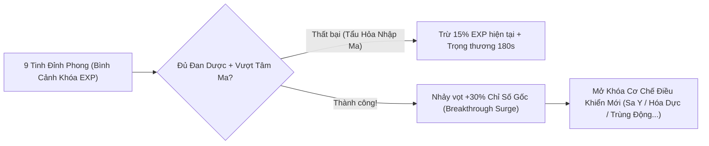

# HỆ THỐNG TU LUYỆN ĐẤU KHÍ, ÁP CHẾ CẢNH GIỚI & TỨ CẢNH LINH HỒN

> **Thuộc phân hệ**: `02_He_Thong_Tu_Luyen_Va_Di_Hoa`
> **Tham chiếu quy chuẩn**: [00_Master_Index_Va_Quy_Chuan.md](../00_Tong_Quan_Kien_Truc/00_Master_Index_Va_Quy_Chuan.md)
> **Mục tiêu thiết kế**: Biến mỗi lần đột phá Đại Cảnh Giới thành một bước nhảy vọt về **cơ chế điều khiển thực chiến (Qualitative Gameplay Evolution)** thay vì chỉ cộng chỉ số khô khan; đồng thời giải bài toán *"Dưới Đấu Hoàng/Đấu Tông đều là kiến hôi"* mà không gây lạm phát con số hàng tỷ trên màn hình Pixel 2D.

---

## 1. Triết Lý Số Học & Quy Chiếu Cấp Độ (Level 1 → 120)

Trong nguyên tác *Đấu Phá Thương Khung*, khoảng cách giữa một Đấu Giả và một Đấu Thánh là một trời một vực. Nếu dùng hàm mũ thuần túy lên máu (`HP`) và sát thương (`ATK`), con số ở cuối game sẽ phình lên hàng nghìn tỷ — gây rác thị giác (Visual Clutter) cho game Top-down 2D Pixel Art.

Do đó, hệ thống toán học của dự án tách thành **2 tầng độc lập**:
1. **Tầng Chỉ Số Hiển Thị (Flat & Polynomial Stats)**: Giữ con số đẹp, dễ đọc trên màn hình Pixel (`HP` khởi đầu `120` tại Level 1 và đạt `265.000` tại Level 120 Đấu Đế; `ATK` từ `14` lên `18.800`).
2. **Tầng Hệ Số Áp Chế Cảnh Giới (`Realm Suppression Multiplier`)**: Áp dụng hàm chênh lệch bậc tu luyện trực tiếp vào công thức sát thương đầu ra/nhận vào, tái hiện hoàn hảo uy áp tuyệt đối của bậc bề trên nhưng vẫn mở lối cho cơ chế **"Đánh Vượt Cấp" (`Xuyên Áp Chế`)** đặc trưng của Tiêu Viêm nhờ Dị Hỏa, Phần Quyết và Thiên Hỏa Tam Huyền Biến.

### 1.1. Bảng Tổng Quan 12 Đại Cảnh Giới & Quy Chiếu Level

Mỗi Đại Cảnh Giới từ bậc 2 đến bậc 8 chiếm **10 Level** (`X0` đến `X8` tương ứng `1 Tinh → 9 Tinh`, và `X9` là trạng thái **Cửu Tinh Đỉnh Phong — Bình Cảnh Đột Phá**). Các cảnh giới cuối có cấu trúc phân tầng đặc biệt sát nguyên tác:

| Bậc ($R$) | Đại Cảnh Giới | Khung Level | Phân Chia Tiểu Cảnh Giới Trong Game | Base HP (Đầu → Đỉnh) | Base QI (Đầu → Đỉnh) | Base ATK (Đầu → Đỉnh) | Base DEF (Đầu → Đỉnh) | Base SPD | QI Regen (`/s`) |
| :---: | :--- | :---: | :--- | :---: | :---: | :---: | :---: | :---: | :---: |
| **1** | **Đấu Chi Khí** | `Lv 1 – 9` | 1 Đoạn → 9 Đoạn *(Chưa ngưng Khí Tuyền)* | 120 → 360 | 40 → 120 | 14 → 38 | 6 → 18 | 95 → 103 | 2.0 |
| **2** | **Đấu Giả** | `Lv 10 – 19` | 1–9 Tinh + 9 Tinh Đỉnh Phong (`Lv 19`) | 520 → 1.150 | 200 → 425 | 55 → 118 | 28 → 64 | 108 → 117 | 4.5 |
| **3** | **Đấu Sư** | `Lv 20 – 29` | 1–9 Tinh + 9 Tinh Đỉnh Phong (`Lv 29`) | 1.550 → 2.900 | 550 → 955 | 155 → 281 | 85 → 157 | 122 → 131 | 7.5 |
| **4** | **Đại Đấu Sư** | `Lv 30 – 39` | 1–9 Tinh + 9 Tinh Đỉnh Phong (`Lv 39`) | 3.800 → 6.500 | 1.250 → 1.970 | 360 → 585 | 205 → 340 | 136 → 145 | 12.0 |
| **5** | **Đấu Linh** | `Lv 40 – 49` | 1–9 Tinh + 9 Tinh Đỉnh Phong (`Lv 49`) | 8.200 → 13.600 | 2.500 → 3.670 | 740 → 1.145 | 430 → 673 | 150 → 159 | 18.0 |
| **6** | **Đấu Vương** | `Lv 50 – 59` | 1–9 Tinh + 9 Tinh Đỉnh Phong (`Lv 59`) | 17.000 → 27.800 | 4.600 → 6.580 | 1.450 → 2.170 | 850 → 1.282 | 168 → 177 | 28.0 |
| **7** | **Đấu Hoàng** | `Lv 60 – 69` | 1–9 Tinh + 9 Tinh Đỉnh Phong (`Lv 69`) | 34.000 → 53.800 | 8.200 → 11.350 | 2.750 → 3.965 | 1.620 → 2.340 | 185 → 194 | 45.0 |
| **8** | **Đấu Tông** | `Lv 70 – 79` | 1–9 Tinh + 9 Tinh Đỉnh Phong (`Lv 79`) | 65.000 → 99.200 | 14.000 → 19.040 | 4.850 → 6.740 | 2.900 → 4.070 | 205 → 214 | 70.0 |
| **9** | **Đấu Tôn** | `Lv 80 – 94` | `Lv 80–88`: 1–9 Tinh Đấu Tôn<br>`Lv 89–94`: **Cửu Chuyển Đấu Tôn (1–9 Chuyển)** | 118.000 → 165.000 | 23.500 → 34.000 | 8.100 → 11.600 | 4.900 → 7.050 | 225 → 242 | 110.0 |
| **10** | **Bán Thánh** | `Lv 95 – 99` | `Lv 95–96`: Sơ Cấp · `Lv 97`: Trung Cấp<br>`Lv 98`: Cao Cấp · `Lv 99`: Đỉnh Phong | 178.000 → 198.000 | 38.000 → 44.000 | 12.600 → 14.200 | 7.700 → 8.700 | 248 → 256 | 155.0 |
| **11** | **Đấu Thánh** | `Lv 100 – 119` | 1–9 Tinh *(Mỗi Tinh chia 4 tiểu kỳ: Sơ - Trung - Hậu - Đỉnh Phong)* | 212.000 → 248.000 | 50.000 → 78.000 | 15.200 → 17.600 | 9.400 → 11.200 | 265 → 290 | 240.0 |
| **12** | **Đấu Đế** | `Lv 120` | **Viêm Đế Chứng Đạo (Cực Hạn Thần Thoại)** | **265.000** | **100.000** *(Vô Hạn khi bật Đế Thân)* | **18.800** | **12.500** | **320** | **600.0** |

### 1.2. Công Thức Tăng Trưởng Chỉ Số Nội Bộ Từng Cấp & Đột Phá Nhảy Vọt

Bên trong mỗi Đại Cảnh Giới $R$ (có cấp khởi đầu $L_0(R)$ và bước nhảy mỗi Tinh $\Delta_{\text{Star}}(R)$), chỉ số gốc tại cấp $L$ tính theo công thức tuyến tính từng khúc, tạo ra **Cú Nhảy Đột Phá (`Breakthrough Surge = +25% ~ +42%`)** ngay khoảnh khắc bước qua ngưỡng Đại Cảnh Giới:

$$\text{BaseStat}(L) = \text{AnchorStat}(R) + (L - L_0(R)) \times \Delta_{\text{Star}}(R)$$



### 1.3. Bảng Chi Tiết Quy Chiếu Tam Cảnh Cuối (Level 80 → 120)

Để lập trình viên dễ dàng cài đặt UI hiển thị danh hiệu cảnh giới sát 100% tiểu thuyết cho giai đoạn Trung Châu – Viễn Cổ Bát Tộc:

| Khung Level | Danh Hiệu Hiển Thị Trên UI | Cơ Chế Nén Khí / Phân Tầng Đặc Biệt | Thưởng Độc Quyền Mỗi Tiểu Bậc |
| :---: | :--- | :--- | :--- |
| `Lv 80 – 88` | **Nhất Tinh → Cửu Tinh Đấu Tôn** | Tu luyện Quy Tắc Không Gian tiêu chuẩn (`1 Level = 1 Tinh`). | Mỗi Tinh giảm `0.15s` hồi chiêu *Không Gian Xuyên Toa*. |
| `Lv 89` | **Đấu Tôn Đỉnh Phong — Nhất & Nhị Chuyển** | Mở giao diện **Cửu Chuyển Tinh Tuyền**: Tích đầy 100% Đấu Khí rồi chủ động *Tán Khí Ngưng Tinh* (hủy 50% bề mặt để cô đặc hạt nhân). | `+0.08 Realm_Pen`, `+5%` Kháng Không Gian Phong Tỏa. |
| `Lv 90` | **Cửu Chuyển Đấu Tôn — Tam & Tứ Chuyển** | Chu kỳ nén khí xoáy ốc lần 3 & 4 (Đấu Khí chuyển sang dạng bán tinh thể vàng óng). | `+0.08 Realm_Pen`, giảm `10%` tiêu hao `QI` của Đấu Kỹ Thiên Giai. |
| `Lv 91` | **Cửu Chuyển Đấu Tôn — Ngũ & Lục Chuyển** | Chu kỳ nén khí lần 5 & 6 (Đạt ngưỡng Tôn Lão cấp cao của Hồn Điện / Thiên Tôn phổ thông). | `+0.08 Realm_Pen`, mở khe Phụ Trợ Linh Hồn thứ 2. |
| `Lv 92 – 93` | **Cửu Chuyển Đấu Tôn — Thất & Bát Chuyển** | Chu kỳ nén khí lần 7 & 8 (Sức chấn động sánh ngang Thanh Tiên Tử / Hắc Kình). | `+0.10 Realm_Pen`, sát thương bạo kích Đấu Khí `+20%`. |
| `Lv 94` | **Cửu Chuyển Đỉnh Phong (Cửu Chuyển Viên Mãn)** | Hoàn tất vòng xoáy thứ 9 — Chạm ngưỡng Bán Thánh, chờ cơ duyên *Bồ Đề Tử*. | `+0.11 Realm_Pen` *(Tổng trọn 9 Chuyển cộng **`+0.45 Realm_Pen`**)*. |
| `Lv 95 – 99` | **Sơ Cấp (`95–96`) · Trung Cấp (`97`) · Cao Cấp (`98`) · Bán Thánh Đỉnh (`99`)** | Ngưng tụ tia *Thánh Quang* đầu tiên trong huyết nhục; xóa bỏ hoàn toàn áp chế không gian của Đấu Tôn. | Miễn nhiễm khống chế của mọi kẻ địch có $R \le 9$. |
| `Lv 100 – 107` | **Nhất Tinh → Tứ Tinh Đấu Thánh** *(Mỗi Tinh 2 Lv: Sơ-Trung / Hậu-Đỉnh)* | Đấu Thánh Phổ Thông — Chưởng khống Không Gian Giao Giới, đòn tay chân đều mang lực nghiền nát hư không. | Mỗi Tinh tăng `+1.5%` xuyên giáp tuyệt đối. |
| `Lv 108 – 113` | **Ngũ Tinh → Thất Tinh Đấu Thánh** *(Mỗi Tinh 2 Lv: Sơ-Trung / Hậu-Đỉnh)* | Đấu Thánh Cấp Cao — Bắt đầu tự mở **Tiểu Thế Giới (Khai Tịch Không Gian)** như Tịnh Liên / Đan Giới. | Mở *Tịnh Liên Giới Vực* cấp 2, tự hồi `2% HP/s` trong Giới Vực. |
| `Lv 114 – 119` | **Bát Tinh (`114–116`) & Cửu Tinh Đấu Thánh (`117`: Sơ · `118`: Trung-Hậu · `119`: Đỉnh Phong)** | Đỉnh Cao Đại Lục (Chuẩn Đế) — Sánh vai Cổ Nguyên, Hồn Thiên Đế, Chúc Khôn, Tiêu Huyền. | `Lv 119` mở khóa nhiệm vụ cuối **Cổ Đế Động Phủ**. |
| `Lv 120` | **Đấu Đế — Viêm Đế Tiêu Viêm** | Dung hợp Nguyên Khí Thiên Địa cổ xưa, cải tạo huyết mạch toàn tộc thành Đế Tộc mới! | **Vạn Hỏa Triều Bái**: Triệu hồi 22 Dị Hỏa đồng thời trợ chiến. |

---

## 2. Công Thức EXP Cày Cuốc & Nguồn Tích Lũy Đấu Khí

### 2.1. Hàm Yêu Cầu EXP Theo Cấp (`EXP_Req`)

Để nhịp độ đầu game (Ô Thản Thành → Ma Thú Sơn Mạch) thăng cấp sướng tay nhưng nửa sau game mang đúng sức nặng tu luyện ngàn năm mà không ép người chơi farm nhàm chán hàng trăm giờ, hàm EXP chia theo miền với **Hệ Số Bình Cảnh (`B_Factor`)**:

$$\text{EXP\_Req}(L) = \left\lfloor 100 \times L^{2.15} \times 1.12^{\lfloor L / 10 \rfloor} \times B_{\text{Factor}}(L) \right\rfloor$$

Trong đó hệ số Bình Cảnh $B_{\text{Factor}}(L)$ được định nghĩa:
* $B_{\text{Factor}}(L) = 1.0$ với các cấp tăng sao thông thường.
* $B_{\text{Factor}}(L) = 2.4$ tại các cấp **Đỉnh Phong trước đột phá Đại Cảnh Giới** (`Lv 9, 19, 29, 39, 49, 59, 69, 79, 88, 94, 99, 119`) — buộc người chơi kết hợp thực chiến, luyện đan và tìm cơ duyên thay vì chỉ chém quái nhỏ.

| Mốc Level | Cảnh Giới Tương Ứng | `EXP_Req` Cần Tích Lũy | EXP Trung Bình 1 Quái Đồng Cấp | Nhịp Độ Cày Cuốc Tiêu Chuẩn |
| :---: | :--- | :---: | :---: | :--- |
| `Lv 1 → 2` | Đấu Chi Khí 1 Đoạn | `100 EXP` | `18 EXP` | ~6 lượt đánh cọc gỗ / Ma thú nhỏ (2 phút) |
| `Lv 9 → 10` | 9 Đoạn → **Đấu Giả** *(Bình Cảnh)* | `26.900 EXP` | `160 EXP` | Dùng *Trúc Cơ Linh Dịch* + nhiệm vụ Hậu Sơn (~20 phút) |
| `Lv 29 → 30` | 9 Tinh Đấu Sư → **Đại Đấu Sư** | `428.000 EXP` | `1.450 EXP` | Săn Ma Thú Sơn Mạch đeo Trọng Xích + cắn đan (~45 phút) |
| `Lv 59 → 60` | 9 Tinh Đấu Vương → **Đấu Hoàng** | `2.790.000 EXP` | `6.800 EXP` | Cày sâu đáy *Thiên Phần Luyện Khí Tháp* + *Đấu Linh Đan* |
| `Lv 79 → 80` | 9 Tinh Đấu Tông → **Đấu Tôn** | `6.480.000 EXP` | `12.500 EXP` | Tẩy lễ *Thiên Sơn Huyết Đàm* + Luyện hóa *Ma Độc Ban* |
| `Lv 99 → 100` | Bán Thánh Đỉnh → **Đấu Thánh** | `14.500.000 EXP` | `24.000 EXP` | Đại cơ duyên *Bồ Đề Cổ Thụ* tại Hoang Cổ Mãng Nguyên |
| `Lv 119 → 120` | 9 Tinh Đấu Thánh Đỉnh → **Đấu Đế** | `29.800.000 EXP` | *Khóa quái thường* | Bắt buộc hoàn thành **Đà Xá Cổ Đế Truyền Thừa** |

### 2.2. Công Thức Tổng Hợp EXP Nhận Vào (`EXP_Gain`)

$$\text{EXP\_Gain} = \text{EXP}_{\text{Base}} \times \left(1 + M_{\text{Ruler}} + M_{\text{Flame}} + M_{\text{Zone}} + M_{\text{Pill}}\right) \times P_{\text{LevelDiff}}$$

* **$M_{\text{Ruler}} = +0.30$ (+30%)**: Khi đeo **Huyền Trọng Xích ở chế độ Phong Ấn (Trọng Áp)** — trụ cột *Khổ Tu Có Thưởng*.
* **$M_{\text{Flame}}$**: Thưởng tốc độ tu luyện từ Công pháp *Phần Quyết* (`+5%` đến `+45%`) và nội tại **Vẫn Lạc Tâm Viêm** (`+25%` tốc độ luyện hóa Đấu Khí thường trực — *"Máy gia tốc tu luyện"*).
* **$M_{\text{Zone}}$**: Thưởng địa mạch (`+50%` đến `+150%` khi Tĩnh Tọa gần Tâm Lửa dưới đáy *Thiên Phần Luyện Khí Tháp*, *Dương Hỏa Cổ Đàn* hoặc *Thiên Mộ Năng Lượng Thể*).
* **$P_{\text{LevelDiff}}$**: Phạt chênh lệch cấp để chống đứng spam quái cấp thấp: nếu $L_{\text{player}} - L_{\text{mob}} > 8$, hệ số giảm dần theo $\max(0.05,\; 1 - 0.12 \times (\Delta L - 8))$. Ngược lại, hạ gục Tinh Anh/Boss cao hơn cấp sẽ thưởng tối đa `1.8x EXP`.

---

## 3. Đột Phá Đại Cảnh Giới: Vật Phẩm, Tâm Ma & Mở Khóa Gameplay

Tại mỗi mốc Đỉnh Phong (`Lv 9, 19, 29...`), thanh EXP đầy `100%` sẽ khóa cứng cho đến khi người chơi bấm nút **"Bế Quan Đột Phá"** tại điểm an toàn (Khách điếm, Mật thất, Sơn động có Đồng hành hộ pháp) và đáp ứng đủ điều kiện Đan dược + Khảo nghiệm:

| Đại Cảnh Giới Mở Khóa | Vật Phẩm / Đan Dược Bắt Buộc | Mini-game / Khảo Nghiệm Tâm Ma Khi Đột Phá | Cơ Chế Gameplay Mới Mở Khóa (Thay Đổi Hẳn Lối Chơi!) |
| :--- | :--- | :--- | :--- |
| **1. Đấu Chi Khí**<br>*(Khởi đầu)* | Ngâm mình *Trúc Cơ Linh Dịch* 3 lần để bù đắp 3 năm mất khí | *Không có* — Hướng dẫn đánh cọc gỗ & điều tiết hơi thở | **Cảm Khí Sơ Cấp**: Mở thanh Thể Lực cơ bản, đòn đánh cận chiến vật lý thuần túy. |
| **2. Đấu Giả**<br>*(`Lv 10`)* | **Tụ Khí Tán** (Tứ Phẩm Đan do Dược Lão luyện) | **Ngưng Tụ Đấu Khí Tuyền**: Điều khiển tâm xoáy bằng chuột hút 9 luồng khí rải rác hội tụ vào Đan Điền trong `20s` mà không chạm tạp khí đen. | **Nội Thị (Inner Vision) & Khai Mở Phần Quyết**: Mở giao diện Kinh Mạch bên trong cơ thể, mở 3 khe gắn Đấu Kỹ (`Q, E, R`) và thanh năng lượng `QI`. |
| **3. Đấu Sư**<br>*(`Lv 20`)* | **Hộ Mạch Đan** + 3 Ma Hạch Cấp 2 | **Quán Thông Kinh Mạch**: Dẫn dòng Đấu Khí dạng lỏng chạy đúng nhịp QTE qua 12 huyệt đạo bị tắc nghẽn trước khi nhiệt lượng nổ mạch. | **Đấu Khí Sa Y (Gauze Cloak)**: Tự động phủ lớp lụa khí mờ quanh Pixel Sprite; chuyển `18%` sát thương nhận vào sang trừ thanh `QI`, tăng kháng khựng đòn (Poise) `+25%`. |
| **4. Đại Đấu Sư**<br>*(`Lv 30`)* | **Tam Văn Thanh Linh Đan** *(1–3 vân tùy phẩm chất)* | **Ngưng Tinh Hóa Giáp**: Đập vỡ vỏ kén khí lỏng để kết tinh viên *Đấu Tinh* hình thoi trong Đan Điền dưới áp lực xung chấn. | **Đấu Khí Khải Giáp & Ngoại Phóng**: Sa Y kết tinh thành Giáp cứng Pixel quanh người (`+35% DEF`, phản `10%` sát thương cận chiến); đòn vung Xích thường phóng thêm **Xích Mang** bay xa `3.5 ô`! |
| **5. Đấu Linh**<br>*(`Lv 40`)* | **Tử Tâm Phá Chướng Đan** (hoặc *Thanh Linh Đan* cao cấp) | **Ngưng Hư Vi Thực**: Khắc chế ảo ảnh sương độc ăn mòn ý chí và đúc khối Đấu Tinh thành hình thái cầu gai. | **Đấu Khí Ngưng Vật (Solidification)**: Triệu hồi gai lửa / bóng xích ngưng thực tồn tại trên mặt đất `4s` sau chiêu thức; miễn nhiễm tự động chướng khí đầm lầy & kịch độc bậc thấp. |
| **6. Đấu Vương**<br>*(`Lv 50`)* | **Đấu Linh Đan** (hoặc *Huyết Liên Đan* + Thiên Hỏa rèn mạch) | **Phá Không Hóa Dực**: Bay ngược luồng lốc xoáy trong tâm thức, né các lưỡi đao gió để xé mở hai huyệt đạo xương bả vai. | **Đấu Khí Hóa Dực (Dou Qi Wings)**: Mọc đôi cánh năng lượng thực thụ! Cho phép bật chế độ **Phi Hành Tầm Thấp** bay vượt qua vực sâu, sông dung nham, vách đá trên bản đồ Top-down; giảm `25%` hồi chiêu lướt `Space`. |
| **7. Đấu Hoàng**<br>*(`Lv 60`)* | **Hoàng Cực Đan** (hoặc năng lượng *Vẫn Lạc Tâm Viêm* phản哺) | **Tâm Ma Nỗi Nhục Ba Năm & Thiên Địa Cộng Minh**: Chiến thắng ảo ảnh kẻ thù cũ trong không gian tâm thức để hòa nhịp cùng năng lượng trời đất. | **Điều Động Thiên Địa Năng Lượng**: Mọi Đấu Kỹ diện rộng tăng `+30%` bán kính nổ (Hitbox AoE); tốc độ hồi `QI` không còn bị giảm khi đang giao tranh; tỏa *Hoàng Giả Uy Áp* khiến quái dưới Đấu Linh tự động hoảng loạn! |
| **8. Đấu Tông**<br>*(`Lv 70`)* | **Phá Tông Đan** + Tẩy lễ *Thiên Sơn Huyết Đàm* | **Tâm Ma Huyết Chiến Vân Lam**: Phá vỡ xiềng xích oán hận khi Dược Lão bị bắt, dùng tay trần đấm nát bức tường gương không gian. | **Đạp Hư Không & Không Gian Phong Tỏa**: Nhân vật lơ lửng hoàn toàn trên không (miễn nhiễm 100% bẫy đinh, đầm độc, chấn động mặt đất); mở **Không Gian Phong Tỏa** (khóa cứng vùng không gian bán kính `6 ô` trong `2.5s`, cấm kẻ địch Dash/Blink và làm chậm `60%`). |
| **9. Đấu Tôn**<br>*(`Lv 80`)* | **Âm Dương Huyền Long Đan** (hoặc Đan Dược Bát Phẩm Tam Sắc Đan Lôi) | **Hư Không Hỗn Lưu Khảo Nghiệm**: Điều hướng hồn phách xuyên qua cơn bão mảnh vỡ không gian đen kịt để nắm bắt Quy Tắc Không Gian. | **Xé Rách Không Gian & Trùng Động (Wormhole)**: Mở tính năng **Tự Dựng Trùng Động Dịch Chuyển** tới bất kỳ tọa độ đã khám phá nào trên đại lục tức thì miễn phí; đòn lướt `Space` tiến hóa thành *Không Gian Xuyên Toa* (biến mất `0.35s`, xuyên tường mỏng & né tuyệt đối mọi đạn đạo). |
| **10. Bán Thánh**<br>*(`Lv 95`)* | **Bồ Đề Tử** (hoặc *Cửu Âm Hoàng Tuyền Đan*) | **Bách Thế Luân Hồi Sơ Cảm**: Trải qua 3 kiếp ảo cảnh phàm nhân (sinh - lão - bệnh - tử) dưới gốc cổ thụ, chọn đúng đáp án giữ vững Đạo Tâm. | **Thánh Quang Sơ Khởi**: Tự động thanh tẩy 1 hiệu ứng khống chế cứng mỗi `15s`; xóa bỏ `50%` độ trễ gồng chiêu (Cast Time) của các Đấu Kỹ Địa Giai trở xuống. |
| **11. Đấu Thánh**<br>*(`Lv 100`)* | **Bồ Đề Tâm + Cửu Phẩm Bảo Đan** | **Trảm Thi Tâm Ma & Hư Vô Thánh Lôi**: Đơn độc chiến đấu với *Hắc Ám Tiêu Viêm* (sao chép 100% trang bị và Dị Hỏa của người chơi!) giữa biển sấm sét chín màu. | **Tịnh Liên Giới Vực / Chưởng Trung Không Gian**: Mở kho chứa không gian vô hạn; mở kỹ năng Lĩnh Vực biến toàn bộ màn hình chiến đấu thành **Hỏa Liên Giới Vực** trong `15s` (`+40%` sát thương Hỏa, kẻ địch chịu sát thương sụp đổ không gian mỗi đòn đánh). |
| **12. Đấu Đế**<br>*(`Lv 120`)* | **Đà Xá Cổ Đế Truyền Thừa** *(Mở tại Cổ Đế Động Phủ Chương 11)* | **Chứng Đạo Thương Khung — Vạn Hỏa Triều Tông**: Thu nhận sự quy phục của 22 ngọn Dị Hỏa giữa hư không để đúc lại nhục thân cấp Đế. | **Đấu Đế Chi Thân & Dị Hỏa Hằng Cổ Xích**: Kích hoạt thần thái Viêm Đế — thanh `QI` hóa vô tận trong suốt thời gian bật Đế Viêm, triệu hồi *Dị Hỏa Quảng Trường* khóa chết cả Đấu Thánh Đỉnh Phong, mở New Game+! |

### 3.1. Thông Số Kỹ Thuật Các Cơ Chế Cảnh Giới Trên Engine Top-down 2D

Để đội lập trình triển khai chính xác trên bản đồ lưới Tilemap (`1 Tile = 32x32 px`), bảng dưới quy định thông số vận hành thực tế của các cơ chế mở khóa:

| Cơ Chế Mở Khóa | Phím Kích Hoạt / Trạng Thái | Tiêu Hao `QI` | Quy Tắc Va Chạm Tilemap (Collision Layer) & Hiệu Ứng Thị Giác |
| :--- | :--- | :---: | :--- |
| **Đấu Khí Sa Y** (`Đấu Sư`) | Tự động bật khi `QI > 15%` | `1.2 QI` mỗi `10 HP` hấp thụ | Vẽ Shader viền sáng mảnh `1px` quanh nhân vật theo màu Chủ Hỏa; tự vỡ khi `QI = 0` và hồi lại sau `8s`. |
| **Đấu Khí Khải Giáp** (`Đại Đấu Sư`) | Bật/Tắt nhanh hoặc tự bật khi vào Combat | `3.5 QI/s` *(Miễn phí từ Đấu Hoàng)* | Chèn Sprite Overlay Giáp Kết Tinh lên thân nhân vật; miễn nhiễm đòn đẩy lùi nhẹ của quái thường. |
| **Đấu Khí Hóa Dực** (`Đấu Vương`) | Nhấn giữ `Space` `0.4s` để cất cánh / hạ cánh | `8.0 QI/s` khi bay qua địa hình hiểm trở | Đổi Collision Mask từ `Ground_Layer` sang `Air_Layer`: đi xuyên qua các ô `Pit` (vực), `Lava` (dung nham), `Water` (sông sâu), `Low_Wall` (hàng rào thấp); đổ bóng tròn nhỏ dưới mặt đất cách nhân vật `14px` tạo chiều sâu giả 3D! |
| **Đạp Hư Không & Phong Tỏa** (`Đấu Tông`) | Thường trực lơ lửng; `Ctrl + Space` để Phong Tỏa | `0 QI/s` lơ lửng; `120 QI` cho 1 lần Phong Tỏa (`CD: 14s`) | Vùng `6x6 Tiles` quanh mục tiêu bị phủ hiệu ứng nứt kính xám bạc; mọi kẻ địch có $RS < RS_{\text{Player}} + 0.5$ bị khóa kỹ năng dịch chuyển, tốc chạy giảm `60%`. |
| **Trùng Động Không Gian** (`Đấu Tôn`) | Mở Bản Đồ Thế Giới (`M`) → Click *"Xé Không Gian"* | `250 QI` ngoài giao tranh (`CD: 5s`) | Rạch một vết nứt đen đầy sao trời ngay trước mặt nhân vật; bước vào dịch chuyển tức thì xuyên vùng không cần trả Kim Tệ cho Trận Pháp Không Gian của thành trì! |
| **Tịnh Liên Giới Vực** (`Đấu Thánh`) | Phím tổ hợp `Shift + F` (`CD: 90s`) | `1.200 QI` kích hoạt | Phủ nền toàn màn hình bằng hoa sen hồng trắng rực cháy `15s`; xóa toàn bộ địa hình bất lợi của Boss (như Hồn Vụ của Hồn Điện hay Băng Kết của Băng Hà Cốc). |

---

## 4. Toán Học Áp Chế Cảnh Giới (`Realm Suppression`) & Xuyên Áp Chế

### 4.1. Công Thức Chênh Lệch Bậc Thực Tế (`Effective Realm Gap`)

Gọi mỗi nhân vật/quái vật có **Chỉ Số Vị Thế Cảnh Giới (`Realm_Score`, ký hiệu $RS$)** tính liên tục theo Đại Cảnh Giới $R \in [1, 12]$ và tiến độ tiểu cảnh giới $s \in [0, 0.99]$ bên trong bậc đó:

$$RS = R + s \quad \text{(Ví dụ: Đấu Vương 9 Tinh có } RS = 6.88\text{; Đấu Tông 2 Tinh có } RS = 8.11\text{)}$$

Khi Kẻ Tấn Công ($A$) đánh vào Mục Tiêu ($D$):
1. **Độ Chênh Cảnh Giới Thô**: $\Delta RS = RS_D - RS_A$.
2. **Độ Chênh Sau Xuyên Áp Chế (`Net_Gap`)**: Nếu $\Delta RS > 0$ (đánh kẻ mạnh hơn mình), người tấn công được trừ đi tổng chỉ số **Xuyên Áp Chế (`Realm_Pen`)** mà mình sở hữu:

$$\text{Net\_Gap} = \max\Big(0,\; (RS_D - RS_A) - \text{Realm\_Pen}_A\Big)$$

3. **Hệ Số Sát Thương Áp Chế (`Supp_Mult`)**:
   * **Trường hợp Đánh Kẻ Cao Cảnh Giới Hơn ($\text{Net\_Gap} > 0$)**:
     $$\text{Supp\_Mult}_{\text{Up}} = \frac{1}{1 + 1.85 \times (\text{Net\_Gap})^{2.4}} \times P_{\text{Boundary}}$$
     Trong đó **Hệ số Ranh Giới Tuyệt Đối (`P_Boundary`)** mô phỏng bức tường ngăn cách giữa Phàm và Không Gian/Thánh:
     * Nếu mục tiêu đạt **Đấu Tông trở lên ($R_D \ge 8$)** còn người đánh dưới Đấu Tông ($R_A < 8$) và $\text{Net\_Gap} \ge 1.2 \Rightarrow P_{\text{Boundary}} = 0.25$ *(hiện chữ **"Không Gian Uy Áp!"**)*.
     * Nếu mục tiêu đạt **Đấu Thánh trở lên ($R_D \ge 11$)** còn người đánh dưới Bán Thánh ($R_A < 10$) và $\text{Net\_Gap} \ge 1.0 \Rightarrow P_{\text{Boundary}} = 0.10$ *(hiện chữ **"Thánh Giả Kiến Hôi!"**)*.
     * Ngược lại (hoặc đã có `Realm_Pen` kéo $\text{Net\_Gap} < 1.0$) $\Rightarrow P_{\text{Boundary}} = 1.0$.
   * **Trường hợp Đánh Kẻ Thấp Cảnh Giới Hơn ($RS_A > RS_D$)**:
     Gọi $\text{Adv} = \max(0,\; (RS_A - RS_D) - \text{Realm\_Pen}_D)$:
     $$\text{Supp\_Mult}_{\text{Down}} = 1 + \min\Big(3.0,\; 0.65 \times (\text{Adv})^{1.35}\Big)$$

### 4.2. Nguồn Cộng Chỉ Số "Xuyên Áp Chế" (`Realm_Pen`) Giúp Tiêu Viêm Vượt Cấp

| Nguồn Sức Mạnh Của Tiêu Viêm | Giá Trị `Realm_Pen` Cộng Thêm | Giải Thích Theo Nguyên Tác |
| :--- | :---: | :--- |
| Mỗi **Dị Hỏa** đã thôn phệ hoàn chỉnh *(Cộng dồn theo cấp Phần Quyết)* | `+0.20` đến `+0.45` / Hỏa *(tùy hạng Bảng)* | Uy năng hủy diệt thiên địa bẩm sinh của Dị Hỏa không sợ chênh lệch Đấu Khí thường. |
| Công pháp **Phần Quyết** (Địa Giai → Thiên Giai Đỉnh) | `+0.25` → `+0.90` | Độ tinh thuần Đấu Khí dung hợp đa hỏa vượt xa công pháp đồng cấp. |
| Bí pháp **Thiên Hỏa Tam Huyền Biến** (Đệ Nhất → Đệ Tam Biến) | `+0.35` / `+0.70` / `+1.15` *(Khi kích hoạt)* | Đốt cháy năng lượng ba loại Dị Hỏa ép thực lực vọt thẳng lên nhiều sao! |
| **Đế Tộc Văn (Tiêu Tộc Huyết Mạch)** *(Từ Chương 9)* | `+0.45` *(Khi kích hoạt)* | Sức mạnh huyết mạch Đấu Đế cổ xưa thức tỉnh trên trán. |
| Tuyệt kỹ **Phật Nộ Hỏa Liên** (2 Hỏa / 3 Hỏa / 4 Hỏa Hủy Diệt Liên) | `+0.60` / `+1.10` / **`+1.85`** *(Riêng cho đòn nổ)* | Vũ khí hạt nhân của Tiêu Viêm — Đấu Vương ném Hỏa Liên vẫn nổ trọng thương Đấu Tông! |
| **Cửu Chuyển Đấu Tôn** (Hoàn thành đủ 9 Chuyển ở `Lv 94`) | `+0.45` *(Nội tại vĩnh viễn)* | Nền tảng Đấu Khí tinh luyện gấp chín lần Đấu Tôn thường. |
| **Linh Hồn Lực Vượt Trội** (Cao hơn đối thủ $\ge 1$ Đại Cảnh Giới Hồn) | `+0.30` | Nhìn thấu sơ hở phòng ngự không gian của kẻ địch bằng cảm quan Linh Hồn. |

### 4.3. Bảng Kiểm Chứng Thực Chiến (Simulation Proof)

Giả sử **Vân Sơn** là Boss **Đấu Tông 2 Tinh** ($RS_D = 8.11$):
* **Trường hợp 1 — Một Đấu Vương 9 Tinh bình thường của Gia Mã Đế Quốc** ($RS_A = 6.88$, `Realm_Pen = 0`) lao lên chém Vân Sơn:
  * $\text{Net\_Gap} = 8.11 - 6.88 = 1.23 \ge 1.2 \Rightarrow P_{\text{Boundary}} = 0.25$.
  * $\text{Supp\_Mult}_{\text{Up}} = \frac{1}{1 + 1.85 \times 1.23^{2.4}} \times 0.25 \approx 0.247 \times 0.25 = \mathbf{0.061}$ (**Mất 93.9% sát thương** — chém vào lớp áo Vân Sơn chỉ nảy tia lửa vô hại đúng chất *"Dưới Đấu Tông đều là kiến hôi"*!).
* **Trường hợp 2 — Tiêu Viêm Đấu Vương 9 Tinh** ($RS_A = 6.88$) sở hữu *Thanh Liên + Vẫn Lạc Tâm Viêm* (`+0.50`), *Phần Quyết Địa Giai* (`+0.35`), bật *Tam Huyền Biến* (`+0.70`):
  * Khi đánh thường bằng Xích: Tổng `Realm_Pen = 1.55` > `1.23` $\Rightarrow \text{Net\_Gap} = \mathbf{0} \Rightarrow \text{Supp\_Mult}_{\text{Up}} = \mathbf{1.00}$ (Đánh sòng phẳng ngang ngửa Đấu Tông!).
  * Khi ném **Tam Sắc Phật Nộ Hỏa Liên** (`+1.10` thêm vào đòn nổ): Sát thương bạo phát xuyên thủng hoàn toàn lớp Không Gian Phong Tỏa, đánh gục Vân Sơn thuyết phục 100%!

---

## 5. Hệ Thống Tứ Đại Cảnh Giới Linh Hồn (`SOUL` Cultivation)

Song hành cùng Đấu Khí là tu luyện **Linh Hồn Lực (`SOUL`)** — thước đo quyết định phẩm cấp **Luyện Đan**, khả năng khống chế nhiều Dị Hỏa cùng lúc không nổ lò, tầm quét **Radar Cảm Ứng**, và sức sát thương trực tiếp lên Hồn Thể của **Hồn Điện**.

### 5.1. Bảng Chi Tiết 16 Bậc Linh Hồn (Phàm → Linh → Thiên → Đế Cảnh)

| Bậc | Cảnh Giới Linh Hồn | Điểm `SOUL` Yêu Cầu | Trần Luyện Đan Tối Đa | Bán Kính Radar (`Tiles`) | Quyền Năng Linh Hồn & Buff Thực Chiến Mở Khóa |
| :---: | :--- | :---: | :--- | :---: | :--- |
| 1 | **Phàm Cảnh — Sơ Kỳ** | `1` | Nhất – Nhị Phẩm | `6 ô` | Cảm nhận nhiệt độ Lò Đan cơ bản; phát hiện cỏ thuốc phát sáng gần. |
| 2 | **Phàm Cảnh — Trung Kỳ** | `80` | Tam – Tứ Phẩm | `9 ô` | `+5%` tỷ lệ thành đan; nghe được âm thanh Linh Hồn Truyền Âm của Dược Lão. |
| 3 | **Phàm Cảnh — Hậu Kỳ** | `300` | Ngũ – Lục Phẩm | `12 ô` | **Phân Tâm Nhị Dụng**: Duy trì cùng lúc 2 luồng Hỏa khác nhau trong Lò Đan; kháng ảo giác sơ cấp. |
| 4 | **Phàm Cảnh — Đại Viên Mãn** | `750` | **Thất Phẩm Cao Cấp** | `16 ô` | Nhìn thấu cấp độ thực của NPC đeo mặt nạ che giấu khí tức (nếu dưới Đấu Tôn). |
| 5 | **Linh Cảnh — Sơ Kỳ** | `1.200` | **Bát Phẩm Sơ Cấp** *(1–2 Sắc Đan Lôi)* | `20 ô` | Linh hồn ngưng kết như thực chất; kháng `35%` sát thương tiếng gầm & xiềng xích Hồn Điện. |
| 6 | **Linh Cảnh — Trung Kỳ** | `3.200` | Bát Phẩm *(3–4 Sắc Đan Lôi)* | `23 ô` | Phát hiện kẻ địch tàng hình trong bóng tối (*Ám Ảnh Cổ Tộc / Thích khách Hắc Giác Vực*). |
| 7 | **Linh Cảnh — Hậu Kỳ** | `7.500` | Bát Phẩm *(5–6 Sắc Đan Lôi)* | `26 ô` | **Khống Hỏa Nhập Vi**: Giảm `20%` thời gian dung hợp *Phật Nộ Hỏa Liên* 3 màu. |
| 8 | **Linh Cảnh — Đại Viên Mãn** | `15.000` | Bát Phẩm *(7–8 Sắc Đan Lôi)* | `30 ô` | Phá giải tức thì các trận pháp mê cung cấp Tôn Giả trên bản đồ Bí Cảnh. |
| 9 | **Thiên Cảnh — Sơ Kỳ** | `22.000` | **Bát Phẩm Đỉnh Phong** *(Cửu Sắc Đan Lôi!)* | `35 ô` | **Thiên Cảnh Uy Áp**: Bước qua ranh giới Tôn Giả Đan Tháp — tăng `+0.30 Realm_Pen` khi đánh Hồn Thể! |
| 10 | **Thiên Cảnh — Trung Kỳ** | `40.000` | **Cửu Phẩm Bảo Đan** | `42 ô` | **Linh Hồn Phân Thân**: Tách 1 bóng hồn bạc đứng cạnh phụ giữ Lò Đan hoặc tự niệm chú Hỏa Liên hộ chủ! |
| 11 | **Thiên Cảnh — Hậu Kỳ** | `65.000` | **Cửu Phẩm Huyền Đan** | `50 ô` | Cảm nhận trực tiếp vị trí các mảnh *Tịnh Liên Yêu Hỏa Tàn Đồ* hoặc dị động không gian ẩn. |
| 12 | **Thiên Cảnh — Đại Viên Mãn** | `92.000` | Cửu Phẩm Huyền Đan Đỉnh *(Nửa bước Kim Đan)* | `64 ô` | Linh hồn chạm ngưỡng cực hạn nhân gian (như Tiêu Viêm trước khi vào Thiên Mộ tầng 3); miễn nhiễm *Yêu Hỏa Mộng Ma*. |
| 13 | **Đế Cảnh — Sơ Kỳ** | `110.000` | **Cửu Phẩm Kim Đan** *(Hóa Hình Thú/Người!)* | **Toàn Khu Vực** | **Đế Hồn Khai Mở** *(Truyền thừa từ Tiêu Huyền tại Thiên Mộ)*: Mọi Hồn Kỹ gây sát thương chuẩn xuyên `100% DEF`! |
| 14 | **Đế Cảnh — Trung Kỳ** | `150.000` | Cửu Phẩm Kim Đan Thập Toàn | Toàn Khu Vực | Ánh mắt Đế Hồn khiến Hộ Pháp / Tôn Lão Hồn Điện tự nổ tung túi hồn nếu dưới Bán Thánh. |
| 15 | **Đế Cảnh — Hậu Kỳ** | `200.000` | Chuẩn Đế Phẩm Đan | Toàn Đại Lục | Dung hợp hoàn hảo **Hủy Diệt Hỏa Liên 4–5 Dị Hỏa** chỉ trong `0.8s` không cần gồng đứng yên! |
| 16 | **Đế Cảnh — Đại Viên Mãn** | `260.000` | **Đế Phẩm Đan Dược** | **Thấu Thị Thương Khung** | Cảnh giới tối thượng sánh ngang Đà Xá Cổ Đế — miễn nhiễm tuyệt đối mọi tà thuật *Huyết Linh Trận* của Hồn Thiên Đế. |

### 5.2. Cơ Chế "Radar Linh Hồn Cảm Ứng" & Hệ Thống Hồn Kỹ Thực Chiến

1. **Sóng Quét Radar Linh Hồn (`Phím Tab` nhấn giữ `0.5s` hoặc nội tại thụ động)**:
   * Khi phát xung Linh Hồn trên bản đồ Top-down, một vòng sóng gợn bạc lan tỏa từ Tiêu Viêm ra bán kính tương ứng bảng trên, đánh dấu bằng mã màu trực quan xuyên qua lớp sương mù/vách đá:
     * **Đốm Xanh Ngọc (`#4ADE80`)**: Linh dược hiếm / Mạch ngầm Địa Tâm Diễm Tủy dưới lòng đất (có thể đào!).
     * **Đốm Vàng Kim (`#FACC15`)**: Mật thất ẩn sau vách núi (ví dụ: Sơn động Tử Vân Dực ở Thanh Sơn Trấn!), di hài tiền bối chứa Nạp Giới cổ.
     * **Đốm Đỏ Thẫm / Đen Tím (`#DC2626` / `#7E22CE`)**: Sát khí kẻ địch ẩn nấp hoặc đặc vụ Hồn Điện giả dạng dân thường trong thành.
2. **Kho Hồn Kỹ Chuyên Biệt (Soul Combat Arts)**:
   * Các kẻ địch thuộc **Hồn Điện** có lớp **Hồn Giáp** giảm `70%` sát thương vật lý thông thường trừ khi bị đốt bằng **Dị Hỏa** hoặc đánh bằng **Hồn Kỹ** (tính sát thương theo công thức $\text{DMG}_{\text{Soul}} = \text{SOUL}^{0.72} \times K_{\text{Skill}}$):
     * **Kinh Thần Thứ** *(Phàm Cảnh Hậu Kỳ)*: Phóng kim hồn vô hình đâm thẳng vào mi tâm mục tiêu, ngắt chiêu gồng (Interrupt) của Boss tức thì.
     * **Hồn Thủ Ấn** *(Linh Cảnh Trung Kỳ — đoạt từ Hồn Điện)*: Bàn tay linh hồn khổng lồ chụp xuống bóp nghẹt vùng `4x4 ô`, rút mảnh linh hồn hồi lại `QI`.
     * **Hoàng Tuyền Thiên Nộ** *(Thiên Cảnh Sơ Kỳ — Thiên Giai Sóng Âm Hồn Kỹ lấy tại Hoàng Tuyền Các)*: Tiếng gầm sóng âm xé nát linh hồn toàn màn hình, làm choáng toàn bộ kẻ địch có `SOUL` thấp hơn Tiêu Viêm trong `3.5s`!

### 5.3. Bốn Con Đường Rèn Luyện Điểm `SOUL` Trong Game

1. **Thực Chiến Lò Luyện Đan & Đón Đan Lôi**: Mỗi mẻ đan thành công cộng từ `+2 SOUL` (Nhất Phẩm) đến `+1.500 SOUL` (Cửu Phẩm). Nếu người chơi chủ động dùng thân thể & linh hồn **Ngạnh Kháng Đan Lôi** thay vì giao toàn bộ cho Thiên Yêu Khôi đỡ hộ, điểm `SOUL` nhận được nhân **`x2.5`**!
2. **Tịnh Hóa "Bản Nguyên Hồn Châu" Của Hồn Điện**: Tiêu diệt Hộ Pháp / Tôn Lão / Thiên Tôn Hồn Điện luôn rơi ra *Túi Hồn Ô Nhiễm*. Dùng Dị Hỏa đốt sạch oán niệm bên ngoài trong giao diện Nạp Giới sẽ thu được **Linh Hồn Bản Nguyên Châu** tinh khiết (`+200` đến `+8.500 SOUL`/viên) — biến mọi cuộc tập kích của Hồn Điện thành "đội vận chuyển kinh nghiệm Linh Hồn tận nhà" đúng chuẩn tiểu thuyết!
3. **Thiên Địa Linh Vật Dưỡng Hồn**: Săn lùng tại Đấu Giá Hội và Bí cảnh: *Dưỡng Hồn Đản* (`+80`), *Thất Huyễn Thanh Linh Tiên* (`+450`), *Phục Hồn Đan* (`+1.200`), và **Hồn Anh Quả** tại Di Tích Viễn Cổ Chương 9 (`+7.000 SOUL` giúp nhảy vọt thẳng lên **Thiên Cảnh**!).
4. **Cơ Duyên Truyền Thừa Thiên Mộ**: Tại cuối Chương 9 dưới tầng 3 Thiên Mộ, tổ tiên **Tiêu Huyền** dùng trận pháp chuyển hóa toàn bộ Linh Hồn Bản Nguyên của Thiên Mộ Chi Hồn giúp Tiêu Viêm phá vỡ bức tường vạn năm, bước chân thẳng vào **Đế Cảnh Linh Hồn (`SOUL >= 110.000`)**!


---

## 6. Giao Diện "Nội Thị Kinh Mạch", Tỷ Lệ Đột Phá & Cơ Chế Hộ Pháp

### 6.1. Giao Diện Nội Thị Kinh Mạch (`Phím K` — Mở Khóa Từ Đấu Giả `Lv 10`)

Ngay khi nuốt *Tụ Khí Tán* ngưng tụ thành công **Đấu Khí Tuyền** tại `Lv 10`, trò chơi mở khóa màn hình **Nội Thị (Inner Meridian View)** thay cho bảng cộng điểm tiềm năng kiểu RPG phương Tây truyền thống:

* **Tâm Đan Điền (Core Vortex)**:
  * Hiển thị hình thái tiến hóa trực quan của nguồn Đấu Khí theo từng bậc cảnh giới: *Khí Tuyền Xoáy Mờ* (`Đấu Giả`) $\rightarrow$ *Giọt Khí Hóa Lỏng* (`Đấu Sư`) $\rightarrow$ *Đấu Tinh Hình Thoi* (`Đại Đấu Sư`) $\rightarrow$ *Cầu Gai Năng Lượng* (`Đấu Linh`) $\rightarrow$ *Tinh Hoàn Kim Đan Chuyển Động* (`Đấu Vương – Đấu Hoàng`) $\rightarrow$ *Tinh Vân Không Gian* (`Đấu Tông – Đấu Tôn`) $\rightarrow$ *Tiểu Thế Giới Lửa Sen* (`Đấu Thánh – Đấu Đế`).
  * Lõi Đan Điền tự động đổi màu ánh sáng theo **Chủ Hỏa** đang vận chuyển bởi *Phần Quyết*.
* **Thập Nhị Chính Kinh & Kỳ Kinh Bát Mạch (Star Node Tree)**:
  * Mỗi lần tăng `1 Tinh` trong tiểu cảnh giới, người chơi nhận **3 Điểm Khai Mạch** để kích hoạt các Huyệt Đạo nhánh:
    * **Mạch Dương Duy (Nhánh Cuồng Bạo)**: Cộng dồn `ATK`, `Crit DMG` và sát thương nổ Hỏa Liên.
    * **Mạch Âm Duy (Nhánh Hộ Thể)**: Cộng dồn `HP`, `DEF`, độ dày *Đấu Khí Khải Giáp* và kháng nguyên tố.
    * **Mạch Nhâm – Đốc (Nhánh Chu Thiên)**: Tăng `Max QI`, tốc độ `QI Regen/s` và giảm thời gian hồi chiêu Đấu Kỹ.

### 6.2. Công Thức Tỷ Lệ Đột Phá & Hệ Quả "Tẩu Hỏa Nhập Ma"

Để tạo cảm giác hồi hộp chân thực mỗi lần chuẩn bị bước sang Đại Cảnh Giới mới, tỷ lệ thành công của phiên Bế Quan được tính minh bạch trên UI trước khi bấm bắt đầu:

$$\text{Success\_Rate} = \text{Clamp}\Big(P_{\text{Base}}(R) + B_{\text{PillQuality}} + B_{\text{Soul}} + B_{\text{Guard}} + B_{\text{MiniGame}},\; 15\%,\; 100\%\Big)$$

| Thành Phần Công Thức | Biên Độ Giá Trị | Giải Thích Cơ Chế Tác Động Trong Game |
| :--- | :---: | :--- |
| **$P_{\text{Base}}(R)$** *(Tỷ lệ nền theo bậc)* | `75%` (`Đấu Giả`) giảm dần về `25%` (`Đấu Thánh`) | Càng lên cao, rào cản thiên địa càng khắc nghiệt, không thể đột phá tay không. |
| **$B_{\text{PillQuality}}$** *(Phẩm chất Đan dược)* | `+15%` *(Đan thô)* / `+30%` *(Đan chuẩn)* / **`+50%`** *(Đan có Đan Văn / Đan Lôi!)* | Khuyến khích người chơi tự tay luyện đan đạt điểm Hoàn Mỹ thay vì mua đan chợ cấp thấp. |
| **$B_{\text{Soul}}$** *(Linh Hồn vượt chuẩn)* | `+5%` đến `+20%` | Linh Hồn Lực cao giúp kiểm soát dòng Đấu Khí cuồng bạo không đâm rách kinh mạch. |
| **$B_{\text{Guard}}$** *(Đồng hành Hộ Pháp)* | `+10%` *(Có Đồng hành Cấp Hảo Cảm $\ge 5$ canh cửa)* | Huân Nhi, Thải Lân, Dược Lão hoặc Thiên Yêu Khôi đứng chặn thú dữ/kẻ thù quấy nhiễu ngoài động. |
| **$B_{\text{MiniGame}}$** *(Thao tác Khảo nghiệm)* | `-20%` *(Lỗi nhiều)* đến **`+25%`** *(Hoàn hảo)* | Kỹ năng tay của người chơi trong pha điều khí / chém Tâm Ma trực tiếp định đoạt thành bại! |

* **Hình Phạt Khi Đột Phá Thất Bại (Phản Phệ Kinh Mạch)**:
  * Nhân vật bị nổ ngược khí hải hất văng ra khỏi trạng thái tĩnh tọa, rơi vào Debuff **Kinh Mạch Tổn Thương** trong `180 giây` (`-25% Max QI`, `-15% ATK`, có thể xóa ngay lập tức nếu uống *Hồi Xuân Đan / Phục Tử Đan*).
  * Tổn thất `15%` cây EXP của cấp Đỉnh Phong hiện tại *(không bao giờ tụt cấp Level đã đạt!)*. Nếu trước khi đột phá có uống phụ trợ **Hộ Mạch Đan**, tổn thất EXP giảm về `0%`.

### 6.3. Sự Kiện "Độ Kiếp Động Động Thiên Địa" (Từ Đấu Tông → Đấu Thánh)

Kể từ mốc đột phá **Đấu Tông (`Lv 70`)** trở đi, khí tức đột phá ngoài vùng hoang dã sẽ tạo cột sáng chọc trời trên bản đồ, kích hoạt kịch bản **Độ Kiếp Thực Chiến (2 Phút Sinh Tử)**:

1. **Quái Vật & Cường Giả Đánh Hơi Kéo Tới**: Dị tượng năng lượng thu hút 3 đợt Ma thú hung hãn hoặc thám tử **Hồn Điện / Phong Lôi Các** lao vào phá đám.
2. **Vai Trò Của Đồng Hành & Khôi Lỗi**: Trong lúc Tiêu Viêm ngồi xếp bằng ở tâm trận (màn hình chia đôi hoặc chuyển sang điều khiển tạm thời **Thải Lân / Tiểu Y Tiên / Thiên Yêu Khôi** trong `45 giây` đầu!), người chơi phải giữ không cho kẻ địch bước vào vòng tròn Hộ Pháp bán kính `4 ô` quanh bản thể Tiêu Viêm.
3. **Khoảnh Khắc Xuất Quan Phản Sát**: Ngay giây phút đột phá thành công, Tiêu Viêm mở bừng mắt phóng thích sóng chấn động **Tân Cảnh Giới Uy Áp** hất tung toàn bộ vòng vây, hồi đầy `100% HP & QI` và nhận buff **Sơ Nhập Tân Cảnh (`+25% Toàn Bộ Chỉ Số` trong `60s`)** để quét sạch đám kẻ thù dám tới quấy rối — mang lại khoảnh khắc thỏa mãn tột đỉnh sau chuỗi giờ cày cuốc!

---

## 7. Bảng Hằng Số Cân Bằng Cho Lập Trình Viên (`Config Constants`)

```yaml
# File cấu hình tham chiếu: data/balance/realm_And_soul_config.yaml
level_cap: 120
major_realms_count: 12
exp_curve:
  base_constant: 100
  poly_exponent: 2.15
  tier_growth_base: 1.12
  bottleneck_multiplier: 2.40
  heavy_ruler_sealed_exp_bonus: 0.30

realm_suppression:
  upward_k: 1.85
  upward_power: 2.40
  dou_zong_boundary_penalty: 0.25    # R >= 8 vs R < 8 khi Net_Gap >= 1.2
  dou_sheng_boundary_penalty: 0.10   # R >= 11 vs R < 10 khi Net_Gap >= 1.0
  downward_k: 0.65
  downward_power: 1.35
  downward_max_bonus: 3.00

soul_tiers:
  mortal_threshold: 1
  spiritual_threshold: 1200
  heavenly_threshold: 22000
  emperor_threshold: 110000
  max_soul_points: 260000
```
