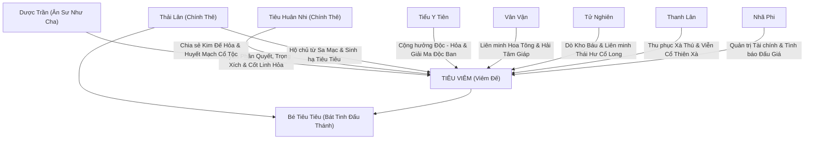

# HỆ THỐNG HỒNG NHAN, ĐỒNG HÀNH TRỢ CHIẾN, ĐỘ HẢO CẢM & ĐỒNG MINH TRỌNG YẾU

> **Thuộc phân hệ**: `03_Nhan_Vat_Va_The_Luc`
> **Tham chiếu quy chuẩn**: [00_Master_Index_Va_Quy_Chuan.md](../00_Tong_Quan_Kien_Truc/00_Master_Index_Va_Quy_Chuan.md) · [Tieu_Viem_Va_Duoc_Lao.md](./Tieu_Viem_Va_Duoc_Lao.md)
> **Mục tiêu thiết kế**: Biến dàn nhân vật kinh điển của *Đấu Phá Thương Khung* thành những người bạn đồng hành thực thụ trên bản đồ Top-down 2D — mỗi người sở hữu **cơ chế khám phá thế giới độc nhất** (dò kho báu, thu phục xà thú, thao túng kinh tế, hút chướng độc), **tuyến nhiệm vụ riêng giàu cảm xúc**, và **Tuyệt Kỹ Hợp Kích Đôi** mãn nhãn cùng Tiêu Viêm.

---

## 1. Kiến Trúc Hệ Thống Đồng Hành Trợ Chiến (`Companion System`)

Để giữ trọn chất Action RPG điều khiển trực tiếp Tiêu Viêm mà không biến màn hình thành đám đông hỗn loạn, tổ đội xuất chinh gồm **2 Ô Đồng Hành Chiến Thuật**:

1. **Ô Chủ Chiến (`Active Field Companion` — Chạy cùng trên Bản đồ)**:
   * Nhân vật xuất hiện trực tiếp dưới dạng Sprite Pixel đi theo Tiêu Viêm, tự động thi triển đòn đánh thường, kỹ năng đặc trưng và kích hoạt **Nội Tại Thám Hiểm Bản Đồ** (như *Tử Nghiên* ngửi mùi dược liệu hay *Thanh Lân* bắt thú họ Xà).
   * **Không thể bị giết vĩnh viễn**: Đồng hành có thanh `HP` riêng bằng `85%` máu quy chuẩn cùng cấp; khi `HP = 0`, họ lùi về trạng thái *Điều Tức Hồi Khí* bên ngoài chiến trường trong `25 giây` rồi tự quay lại trận (hoặc Tiêu Viêm ném 1 viên *Hồi Xuân Đan* cứu dậy tức thì!).
2. **Ô Chi Viện Hợp Kích (`Striker Support Slot` — Giấu trong Hậu Tuyến)**:
   * Không chạy thường trực trên màn hình để đỡ rối mắt, nhưng cộng `50%` hiệu ứng Nội Tại cho đội và nhảy ra tung **Chiêu Chi Viện (`Alt + E`, `CD: 18s`)** rồi rút lui như game đối kháng Tag-Team!
3. **Ba Chế Độ AI Thông Minh (`F1 / F2 / F3`) & Thanh Cộng Hưởng Tình Nghĩa (`Bond Gauge`)**:
   * `F1 — Phối Hợp Tiêu Điểm`: Tập trung dồn sát thương vào đúng mục tiêu Tiêu Viêm vừa chém trúng.
   * `F2 — Hộ Vệ Thân Cận`: Luôn giữ khoảng cách `< 3 ô` quanh Tiêu Viêm, ưu tiên chặn đạn đạo và đẩy lùi quái đánh lén lúc Tiêu Viêm đang gồng *Phật Nộ Hỏa Liên* hoặc *Luyện Đan*.
   * `F3 — Tự Do Quét Tạp Binh`: Chủ động lướt ra rìa màn hình dọn quái bắn tỉa tầm xa.
   * **Tuyệt Kỹ Hợp Kích Đôi (`Alt + T` khi `Bond Gauge = 100%`)**: Mỗi đòn đánh phối hợp giữa Tiêu Viêm và Đồng hành Chủ Chiến làm tăng thanh Tình Nghĩa. Khi đầy `100%`, kích hoạt đoạn cắt cảnh Pixel tốc độ cao `1.5s` (Time-Freeze) thi triển chiêu thức phối hợp chấn thiên động địa!

---

## 2. Hệ Thống Độ Hảo Cảm 10 Cấp & Kỷ Vật Hồng Nhan (`Affinity & Keepsake`)

### 2.1. Bảng 10 Cấp Độ Hảo Cảm & Phần Thưởng Mở Khóa

Điểm Hảo Cảm (`Affinity EXP`) tăng thông qua: **Chiến đấu chung tổ đội**, **Tặng đúng Đan Dược / Vật phẩm yêu thích**, **Trò chuyện bên Lửa Trại ban đêm**, và **Lựa chọn đối thoại bảo vệ đối phương trong Nhiệm Vụ Cốt Truyện**:

| Cấp Hảo Cảm | Danh Hiệu Quan Hệ | Điểm Tích Lũy | Phần Thưởng Cơ Chế & Cốt Truyện Mở Khóa |
| :---: | :--- | :---: | :--- |
| **Cấp 1** | *Sơ Ngộ Giang Hồ* | `0` | Mở khóa hồ sơ nhân vật trong Sổ Tay Đại Lục. |
| **Cấp 2** | *Đồng Hành Lịch Luyện* | `200` | Cho phép mời vào **Ô Chi Viện** (nếu tiến độ cốt truyện thời điểm đó đang ở gần). |
| **Cấp 3** | *Tin Cậy Lẫn Nhau* | `500` | Cho phép đưa vào **Ô Chủ Chiến** đi cùng trên bản đồ; mở Đối Thoại Lửa Trại #1. |
| **Cấp 4** | *Đồng Sinh Cộng Tử* | `1.000` | Tăng `+15%` tốc độ tích thanh `Bond Gauge`; Đồng hành tự động uống đan giải cứu Tiêu Viêm khi bị choáng! |
| **Cấp 5** | **Tri Âm Khắc Cốt** | `1.800` | **Nhận Kỷ Vật Độc Quyền (Bậc 1)** gắn vào Nạp Giới; mở **Chương Nhiệm Vụ Phụ Riêng Tư #1**. |
| **Cấp 6** | *Tâm Ý Tương Thông* | `2.800` | Mở khóa chính thức **Tuyệt Kỹ Hợp Kích Đôi (`Alt + T`)** cấp sơ khởi! |
| **Cấp 7** | *Vượt Ngàn Phong Ba* | `4.200` | Mở **Chương Nhiệm Vụ Phụ Riêng Tư #2**; giảm `25%` thời gian hồi phục khi Đồng hành kiệt sức. |
| **Cấp 8** | **Thề Ước Không Phai** | `6.000` | Mở khóa ngoại trang Pixel đặc biệt của nhân vật + Đối Thoại Đêm Trăng Riêng. |
| **Cấp 9** | *Mạng Đổi Mạng* | `8.200` | **Đỡ Đòn Tử Vong (`1 lần / trận Boss`)**: Khi Tiêu Viêm chịu sát thương kết liễu, Đồng hành lập tức lao ra bật khiên bất tử gánh trọn đòn đó! |
| **Cấp 10** | **Vĩnh Kết Đồng Tâm / Sinh Tử Tri Giao** | `11.000` | **Tiến hóa Kỷ Vật Độc Quyền (Bậc Thần Phẩm)**; nâng cấp Hợp Kích lên cực hạn & mở kết cục **Viêm Đế Quy Ẩn Ô Thản Thành** cuối game! |

---

## 3. Hồ Sơ Chi Tiết 8 Vị Hồng Nhan Kinh Điển

### 3.1. Tiêu Huân Nhi (Cổ Huân Nhi) — Thần Phẩm Huyết Mạch & Kim Đế Phần Thiên Viêm

* **Ngoại Hình Pixel Đặc Trưng**: Thiếu nữ thanh y lục nhạt thanh nhã như sen tuyết ban mai, dải lụa tóc ngọc bích bay nhẹ; khi bước vào chiến đấu ở nửa sau game, đôi mắt lấp lánh ánh vàng kim tôn quý và hai bàn tay rực cháy ngọn lửa hoàng kim `#FFD700` của **Kim Đế Phần Thiên Viêm**.
* **Tính Cách & Vai Trò Đội Hình**: Dịu dàng tuyệt đối trước mặt *"Tiêu Viêm ca ca"* nhưng lạnh lùng quyết đoán với cả thiên hạ. Vai trò: **Sát Thương Bạo Phát Hoàng Kim & Khắc Tinh Tối Thượng Của Hồn Điện**.
* **Kỷ Vật Độc Quyền**: **Cổ Ngọc Ôn Mạch** *(Cấp 5: `+15% QI Regen` ban đêm $\rightarrow$ Cấp 10 hóa **Kim Đế Tâm Liên**: Chia sẻ trực tiếp Bản Nguyên `#4 Kim Đế Phần Thiên Viêm` cho Tiêu Viêm!)*.
* **Chuỗi Nhiệm Vụ Phụ Riêng Sâu Sắc**:
  1. *Ánh Đèn Khuya Hậu Sơn (Chương 1)*: Nhớ lại ký ức thuở nhỏ Huân Nhi lén ôn dưỡng kinh mạch cho Tiêu Viêm suốt 2 năm; tặng nàng trâm ngọc mua ở phường thị Ô Thản Thành.
  2. *Bóng Tối Sau Lưng Thiếu Nữ (Chương 5)*: Đối mặt trực tiếp hộ vệ **Lăng Ảnh** tại Già Nam Học Viện, thề trước mặt Cổ Tộc sẽ tự dùng thực lực bước tới đón nàng thay vì dựa dẫm.
  3. *Kim Đế Hàng Lâm Dẹp Tứ Phương (Chương 8)*: Khoảnh khắc kinh điển Huân Nhi bước ra từ hư không dọa lui cả **Băng Hà Cốc lẫn Hồn Điện** để bảo vệ Tiêu Viêm sau Đan Hội.
  4. *Thiên Mộ Đồng Sinh & Đại Hôn Cổ Giới (Chương 9–11)*: Hai năm kề vai dưới đáy Thiên Mộ đánh bại Thiên Mộ Chi Hồn, hoàn thành đại lễ thành thân rúng động Bát Tộc!
* **Kỹ Năng Trợ Chiến & Hợp Kích**:
  * *Trợ chiến*: **Đế Ấn Quyết — Khai Sơn & Cổ Hư Ấn** (chưởng ấn vàng kim đè nát khiên địch) + **Kim Đế Tịnh Tà** (đốt sạch sương mù Hồn Điện, đốt cháy `10%` năng lượng của Boss).
  * *Hợp Kích Đôi (`Alt + T`)*: **Viêm Kim Song Đế Liên** — Huân Nhi rót thẳng *Kim Đế Phần Thiên Viêm* vào tâm *Phật Nộ Hỏa Liên* của Tiêu Viêm, tạo ra đóa sen vàng kim khổng lồ rộng `10x10 ô` gây `1.250% ATK` sát thương xuyên mọi kháng tính!

### 3.2. Thải Lân (Mỹ Đỗ Toa Nữ Vương) — Lưỡng Thái Chuyển Đổi: Linh Xà & Nữ Vương

* **Ngoại Hình Pixel Đặc Trưng (2 Trạng Thái Chuyển Đổi Độc Đáo)**:
  * **Trạng thái 1 — Tiểu Thất Thải Thôn Thiên Mãng**: Chú rắn nhỏ 7 sắc cầu vồng dài chỉ `12px` quấn quanh cổ tay hoặc ló đầu từ tay áo Tiêu Viêm cực kỳ sinh động.
  * **Trạng thái 2 — Mỹ Đỗ Toa Nữ Vương Chân Thân**: Tuyệt thế giai nhân mặc chiến bào đỏ tím viền vàng, đội miện xà vương, đôi mắt phượng sắc lạnh vương giả lơ lửng giữa không trung cầm *Thất Thải Xà Kiếm*.
* **Tính Cách & Vai Trò Đội Hình**: Kiêu ngạo, ngoài lạnh trong nóng, ban đầu luôn miệng đòi giết Tiêu Viêm nhưng lúc sinh tử lại đem cả tính mạng ra chắn trước ngực chàng. Vai trò: **Đấu Sĩ Tốc Độ Cận Chiến & Hộ Thuẫn Phản Đòn**.
* **Kỷ Vật Độc Quyền**: **Thất Thải Nghịch Lân** *(Tăng `+20%` kháng sát thương bạo kích & gọi Thải Lân tự động chặn 1 đòn kết liễu)*.
* **Chuỗi Nhiệm Vụ Phụ Riêng Sâu Sắc**:
  1. *Lôi Kiếp Hóa Sinh Sa Mạc (Chương 3)*: Chăm sóc Tiểu Thất Thải bằng *Phục Linh Thanh Đan* và *Bạn Sinh Tử Tinh Nguyên* để kéo thiện cảm linh hồn đầu tiên.
  2. *Khế Ước Đáy Tháp Thiên Phần (Chương 6)*: Giải quyết xung đột hai linh hồn, cùng nhau trấn giữ **Viêm Minh** suốt những năm Tiêu Viêm đi Trung Châu.
  3. *Huyết Chiến Cửu Thiên Bảo Vệ Gia Mã (Chương 7–8)*: Điều khiển trực tiếp Thải Lân cầm chân liên quân *Tam Tông (Mộ Lan – Vạn Yết – Độc Tông)* chờ Tiêu Viêm xuất quan!
  4. *Cửu Thải Thôn Thiên Mãng Tiến Hóa (Chương 10)*: Đưa Thải Lân xuống đáy **Cửu U Hoàng Tuyền Trì**, giúp nàng hấp thu huyết mạch cổ xưa lột xác thành **Cửu Thải Thôn Thiên Mãng (Đấu Thánh)**!
* **Kỹ Năng Trợ Chiến & Hợp Kích**:
  * *Trợ chiến*: *Trạng thái Rắn Nhỏ* tự động nuốt đạn ma pháp bay tới mỗi `6s`; *Trạng thái Nữ Vương* lướt chém **Thất Thải Vạn Xà Trảm** và ánh mắt **Hung Sát Vương Uy** hóa đá quái thường `2.5s`.
  * *Hợp Kích Đôi (`Alt + T`)*: **Cửu Thải Trảm Thiên Xích** — Thải Lân hóa bóng cự mãng chín màu quấn chặt quanh *Huyền Trọng Xích* của Tiêu Viêm, cả hai bổ thẳng từ chín tầng mây xuống chẻ đôi kết giới Boss!

### 3.3. Tiểu Y Tiên — Ách Nan Độc Thể (Từ Bạch Y Y Sư Đến Thiên Độc Nữ)

* **Sự Chuyển Hóa Gameplay Theo Cốt Truyện Độc Nhất**:
  * **Giai đoạn Đầu Game (Chương 2 — Thanh Sơn Trấn)**: Mặc váy vải trắng mộc mạc đeo giỏ trúc hái thuốc, tóc đen dịu hiền. Đóng vai trò **Y Sư Thuần Hỗ Trợ (Healer)** — ném túi bột thảo dược hồi máu và giải độc cho Tiêu Viêm!
  * **Giai đoạn Giữa & Cuối Game (Chương 7–11 — Tông Chủ Độc Tông)**: Khoác trường y tím khói, **mái tóc hóa trắng xóa như tuyết mùa đông** đầy bi thương do *Ách Nan Độc Thể* thức tỉnh toàn diện. Bộ kỹ năng lột xác 180 độ thành **Pháp Sư Sương Độc Hủy Diệt Diện Rộng (AoE DoT Nuke)** — đi tới đâu cỏ cây héo úa, quái vật chảy máu tím tới đó!
* **Kỷ Vật Độc Quyền**: **Thất Thải Độc Kinh Tàn Quyển $\rightarrow$ Bích Tinh Độc Đan Hoàn**.
* **Chuỗi Nhiệm Vụ Phụ Riêng Sâu Sắc**:
  1. *Mật Thất Vách Núi Thanh Sơn (Chương 2)*: Cùng rơi xuống hang đá cổ, chia nhau kho báu (*Tử Vân Dực* & *Thất Thải Độc Kinh*), tiễn biệt đẫm nước mắt trên lưng Lam Ưng.
  2. *Nhận Lại Cố Nhân Giữa Triều Độc (Chương 7)*: Giữa chiến trường Xuất Vân Đế Quốc, Tiêu Viêm một câu *"Ta vẫn là bằng hữu của nàng"* phá tan lớp vỏ băng giá của Thiên Độc Nữ.
  3. *Ngưng Tụ Độc Đan Tại Lạc Thần Giản (Chương 8 — Cột Mốc Sinh Tử!)*: Truy tìm *Thiên Độc Hạt Long Thú Ma Hạch* + *Bồ Đề Hóa Thể Tiên* + 3 Dị Hỏa, tự tay khắc trận pháp giúp Tiểu Y Tiên kết **Ách Nan Độc Đan**, vĩnh viễn thoát khỏi lời nguyền độc phát bỏ mạng, bước thẳng lên **Đấu Tôn**!
  4. *Độc Đế Động Phủ Xuất Vân (Chương 10)*: Trở lại cố hương thu phục di tàng tiền bối Độc Đế, thăng cấp **Đấu Thánh**.
* **Kỹ Năng Trợ Chiến & Hợp Kích**:
  * *Trợ chiến*: **Thiên Độc Lao Lung** (phủ màn sương xám rút `% HP` và giảm `30% ATK` mọi kẻ địch bên trong).
  * *Hợp Kích Đôi (`Alt + T`)*: **Độc Viêm Phệ Cốt Bạo** — Tiểu Y Tiên xả biển khí kịch độc bao trùm toàn màn hình rồi Tiêu Viêm ném tia Dị Hỏa châm ngòi, kích nổ dây chuyền độc hỏa cực đại!

### 3.4. Vân Vận (Vân Chi) — Phong Chi Cực & Khúc Mắc Ân Oán Vân Lam

* **Ngoại Hình Pixel Đặc Trưng**: Bạch bào thêu mây xanh thanh nhã quý phái (ẩn bên trong là *Tử Tinh Hải Tâm Giáp*), tay cầm thanh trường kiếm xanh biếc sắc lẹm, bước chân lướt trên ngọn gió.
* **Tính Cách & Vai Trò Đội Hình**: Điềm đạm, trọng tình nghĩa, luôn day dứt giữa ân dưỡng dục của thầy (Vân Sơn) và mối tình khắc cốt trong hang đá với chàng thiếu niên Dược Nham. Vai trò: **Kiếm Khách Tốc Độ Xuyên Giáp Đường Thẳng**.
* **Kỷ Vật Độc Quyền**: **Mảnh Hải Tâm Nội Giáp Kỷ Niệm** *(Giảm `20%` sát thương từ các đòn đâm/bắn xuyên và tăng `+15% SPD`)*.
* **Chuỗi Nhiệm Vụ Phụ Riêng Sâu Sắc**:
  1. *Nướng Cá Bên Suối Ma Thú Sơn Mạch (Chương 2)*: Cứu chữa Vân Chi bị phong ấn Đấu Khí trong sơn động, hài hước pha nhầm *Hợp Hoan Độc* và nhận tặng *Hải Tâm Nội Giáp*.
  2. *Ba Lần Lên Vân Lam — Giằng Xé Đạo Và Tình (Chương 4 & Chương 7)*: Lựa chọn đối thoại tha mạng cho đệ tử phổ thông Vân Lam Tông theo lời cầu xin của nàng trước khi nàng rời quê hương sang Trung Châu.
  3. *Trọng Chấn Hoa Tông — Kế Vị Tông Chủ (Chương 9)*: Cùng Vân Vận đánh bại cặp đôi bỉ ổi *Hoa Cẩm – Yêu Hoa Tà Quân*, dùng Dị Hỏa phá tan phong ấn giúp nàng dung hợp trọn vẹn Đấu Khí suốt đời của **Hoa Bà Bà**, trở thành Tông chủ Hoa Tông gia nhập Thiên Phủ Liên Minh!
* **Kỹ Năng Trợ Chiến & Hợp Kích**:
  * *Trợ chiến*: **Phong Chi Cực — Vẫn Sát** (Tia kiếm laser xanh biếc cực mảnh bắn xuyên toàn màn hình trong `0.2s`, bỏ qua `100% DEF` mục tiêu) & **Phong Linh Phân Hình Kiếm**.
  * *Hợp Kích Đôi (`Alt + T`)*: **Phong Trợ Hỏa Thế — Cửu Thiên Long Quyển Viêm** — Vân Vận dựng vòi rồng kiếm khí cuốn chặt toàn bộ kẻ địch vào tâm bão, hút Dị Hỏa của Tiêu Viêm hóa thành cột bão lửa xanh ngọc khổng lồ!

### 3.5. Tử Nghiên — "Radar Dò Kho Báu Sống" & Thái Hư Cổ Long Hoàng

* **Ngoại Hình Pixel Đặc Trưng (2 Giai Đoạn)**:
  * *Chương 6–8 (Tiểu Man Vương Nội Viện)*: Cô bé loli tóc tím tết hai bím siêu đáng yêu nhưng vung nắm đấm tay trần đấm vỡ tường đá và lén gặm dược liệu quý rau ráu!
  * *Chương 9–11 (Long Hoàng Trưởng Thành)*: Tuyệt sắc thiếu nữ khoác Long Hoàng Kim Tử Y uy nghiêm, sau lưng hiện hư ảnh Rồng Tím vạn trượng chưởng khống không gian.
* **Đặc Quyền Cày Cuốc Độc Nhất Bản Đồ (`Treasure Hunter Passive`)**:
  * Khi đưa Tử Nghiên đi cùng trên bản đồ, **trên đầu bé luôn hiện biểu tượng Mũi Tên Khứu Giác Tím** chỉ thẳng hướng tới **Linh Dược Hiếm, Rương Bí Mật Chôn Ngầm hoặc Tinh Hạch Không Gian** trong phạm vi toàn bản đồ!
  * Ngoài ra mở tính năng **Vo Viên Đan Kẹo (Raw Herb Crunch)**: Đưa cỏ thuốc thừa cho Tử Nghiên dùng man lực... nặn tay không cần Lò Đan tạo ra *Đan Kẹo Hồi Thể Lực* cực nhanh!
* **Kỷ Vật & Tuyến Quest**: **Long Hoàng Tinh Tinh Hoàn**; chuỗi nhiệm vụ *Cướp Kho Dược Già Nam (Ch 6)* $\rightarrow$ *Phá Thạch Hóa Long Hoàng Quả (Ch 9)* $\rightarrow$ *Đại Chiến Thống Nhất Tam Đảo Cổ Long (Ch 10)*.
* **Kỹ Năng Trợ Chiến & Hợp Kích**: Đấm nát không gian bằng **Cổ Long Nhất Quyền**; Hợp kích **Thái Hư Toái Không Long Xích** mở cổng không gian ngay sau gáy Boss cho Tiêu Viêm bổ lén chí mạng `100% Crit`!

### 3.6. Thanh Lân — Bích Xà Tam Hoa Đồng & Thuần Thú Sư Loài Xà

* **Ngoại Hình Pixel Đặc Trưng**: Thiếu nữ mắt ngọc lục bảo mang mặc cảm lai Xà Nhân – Con Người ở Thạch Mạc Thành, sau trưởng thành là cường giả thanh y của Thiên Xà Phủ với **3 đóa hoa lục sắc xoay tròn trong tròng mắt**.
* **Đặc Quyền Bản Đồ Độc Nhất (`Serpent Tamer Mechanic`)**:
  * Khi Thanh Lân ở trong đội, mọi Ma thú / Tinh Anh / Tiểu Boss thuộc **họ Xà – Mãng – Giao – Thằn Lằn Cổ** khi máu tụt xuống `< 25%` sẽ hiện nút khống chế **Bích Xà Tam Hoa Đồng**!
  * Thanh Lân thu phục linh hồn chúng cất vào không gian đồng tử (lưu trữ tối đa **3 Xà Thú Chiến Đấu** như *Bát Dực Hắc Xà Hoàng*, *Lục Dực Huyền Mãng*, *Viễn Cổ Song Đầu Hỏa Linh Xà* để gọi ra đánh hội đồng Boss!).
* **Chuỗi Nhiệm Vụ Phụ**: *Giải Cứu Thị Nữ Đoàn Thiết Huyết (Ch 3)* $\rightarrow$ *Đại Náo Mặc Gia Trang Đoạt Lại Thanh Lân (Ch 4)* $\rightarrow$ *Thu Phục Tàn Hồn Viễn Cổ Thiên Xà (Ch 9)*.
* **Hợp Kích Đôi**: **Vạn Xà Triều Tông Hỏa Ngục** — Triệu hồi hư ảnh Viễn Cổ Thiên Xà chín đầu phun độc hỏa khóa cứng chiến trường.

### 3.7. Nhã Phi — Nữ Hoàng Kinh Tế, Đấu Giá Trường & Tài Chính Thế Lực

* **Ngoại Hình Pixel Đặc Trưng**: Mỹ nhân quyến rũ bậc nhất Gia Mã Đế Quốc trong tà sườn xám đỏ thẫm xẻ cao, tay phe phẩy chiếc quạt lông kim tơ, bước đi uyển chuyển sắc sảo.
* **Đặc Quyền Kinh Tế Chiến Lược Độc Nhất (`Merchant Empress`)**:
  * Nhã Phi không thiên về solo 1v1 mà là **Trụ Cột Kinh Tế Không Thể Thiếu Cho Dân Cày Cuốc**:
    1. Giảm **`20%` giá chốt sàn** tại toàn bộ các **Đấu Giá Trường** trên đại lục và miễn thuế ký gửi vật phẩm.
    2. Tăng **`+25%` sản lượng Kim Tệ** thu về mỗi chu kỳ của *Viêm Minh / Thiên Phủ Thương Hội*.
    3. Mở mạng lưới **Mật Báo Chợ Đen Mễ Đặc Nhĩ**: Tự động gửi thư bồ câu báo trước khi thương nhân thần bí xuất hiện bán *Mảnh Tàn Đồ Tịnh Liên Yêu Hỏa*, *Dược Đỉnh Thiên Bảng* hoặc *Quyển Đấu Kỹ Địa/Thiên Giai*!
  * *Khi mang ra chiến trường*: Nhã Phi tung quạt **Lưu Kim Thủy Mạc** tạo khiên nước bảo vệ Tiêu Viêm và dùng tiền vàng gọi **2 Kỵ Sĩ Giáp Bạc Mễ Đặc Nhĩ** lao ra chém thuê!
* **Chuỗi Nhiệm Vụ Phụ**: *Trúc Cơ Linh Dịch Gây Chấn Động Ô Thản Thành (Ch 1)* $\rightarrow$ *Giải Vây Tộc Mễ Đặc Nhĩ Khỏi Cuộc Tàn Sát Của Vân Lam Tông (Ch 7)*.

### 3.8. Nạp Lan Yên Nhiên — Từ Ước Hẹn Ba Năm Đến Đồng Minh Kiếm Khách

* **Ngoại Hình Pixel Đặc Trưng**: Nữ kiếm khách nguyệt bạch bào buộc tóc cao kiêu kỳ thuở thiếu thời $\rightarrow$ Khoác áo choàng xám bạc phong sương điềm tĩnh sau những biến cố mất mát tông môn ở Trung Châu.
* **Chuỗi Nhiệm Vụ Hóa Giải Định Kiến**:
  1. *Tờ Hưu Thư Chấn Động Sảnh Đường (Chương 1)* $\rightarrow$ *Đỉnh Vân Lam Ước Hẹn Ba Năm Rửa Nhục (Chương 4)*.
  2. *Tương Phùng Giữa Đàn Phệ Kim Thử Ở Mê Cung Âm Sóng (Chương 8)*: Sát cánh phá vây ở Bắc Vực Trung Châu, Tiêu Viêm nhường một suất tẩy lễ quý giá tại **Thiên Sơn Huyết Đàm** giúp nàng đột phá Đấu Tông, khép lại hoàn toàn ân oán thiếu thời bằng sự tôn trọng của hai kiếm khách – võ giả.
* **Kỹ Năng Trợ Chiến & Hợp Kích**: **Phong Linh Phân Hình Kiếm** (`9` bóng kiếm công kích tốc độ cao phá giáp); Hợp kích **Xích Kiếm Tề Minh** dồn nhịp liên kích chớp nhoáng.

---

## 4. Hồ Sơ 9 Đồng Minh Lão Bối, Huynh Đệ & Hậu Duệ Trọng Yếu

Bên cạnh 8 Hồng Nhan chính, những nhân vật nam kiệt xuất và hậu duệ dưới đây đều có thể tuyển mộ làm **Trưởng Lão Trấn Phái**, **Khách Khanh Chi Viện** hoặc **Đồng Hành Đặc Biệt** theo tiến trình chương truyện:

| Nhân Vật | Định Vị & Cảnh Giới Tiêu Biểu | Cơ Chế Trợ Chiến / Đóng Góp Độc Quyền Cho Người Chơi | Tuyến Sự Kiện Cốt Lõi Gắn Kết Với Tiêu Viêm |
| :--- | :--- | :--- | :--- |
| **1. Hải Ba Đông (Băng Hoàng)** | Trưởng lão Mễ Đặc Nhĩ *(Đấu Hoàng $\rightarrow$ Đấu Tông)* | Trợ chiến đầu/giữa game cực mạnh với **Huyền Băng Long Tường** đóng băng diện rộng; người vẽ bản đồ địa hình và trao **Mảnh Tàn Đồ Tịnh Liên Yêu Hỏa #1**! | Bị phong ấn ở tiệm bản đồ Sa Mạc (Ch 3) $\rightarrow$ Hộ vệ trung thành bậc nhất suốt đại chiến Vân Lam (Ch 4 & 7). |
| **2. Thiên Hỏa Tôn Giả (Diệu Thiên Hỏa)** | Khách khanh Tôn Giả *(Đấu Tôn $\rightarrow$ Cửu Chuyển)* | Truyền thụ bí kỹ khống hỏa cực phẩm **Ngũ Luân Ly Hỏa Pháp**; hỗ trợ phá giải Không Gian Phong Tỏa và hộ pháp đắc lực suốt giai đoạn Dược Lão bị bắt. | Hài cốt dưới đáy biển dung nham Già Nam (Ch 6) $\rightarrow$ Phục sinh bằng thi thể Vân Sơn tại Trung Châu (Ch 8). |
| **3. Phong Tôn Giả (Phong Nhàn)** | Phó Các Chủ Tinh Vẫn Các *(Đấu Tôn 4 Tinh $\rightarrow$ Bán Thánh)* | Sinh tử chi giao của Dược Trần; mở khóa hệ thống quản lý **Tinh Vẫn Các Trung Châu** và cho mượn *Cương Phong Chi Dực* di chuyển tốc hành xuyên tứ phương. | Nhận ra Cốt Viêm Giới tại Đại hội Tứ Phương Các (Ch 8) $\rightarrow$ Tiên phong chiến dịch phá Vong Hồn Điện cứu bạn thân (Ch 9). |
| **4. Tiêu Đỉnh & Tiêu Lệ** | Đại Ca & Nhị Ca Tiêu Viêm *(Đoàn Mạc Thiết $\rightarrow$ Viêm Minh)* | **Tiêu Đỉnh** (trầm ổn, ngồi xe lăn sau biến cố): Quản lý mạng lưới Tình Báo Quân Sự (+30% hiệu suất thám thính). **Tiêu Lệ** (cuồng bạo sau khi nuốt *Phệ Sinh Đan* báo thù): Tướng lĩnh tấn công liều mạng mang thuộc tính Huyết Lôi! | Bảo vệ đệ đệ ở Thạch Mạc Thành (Ch 3) $\rightarrow$ Xây dựng *Tiêu Môn* ở Hắc Giác Vực (Ch 6) $\rightarrow$ **Quest luyện Trường Thọ Đan hóa giải tác dụng phụ Phệ Sinh Đan cứu mạng Nhị Ca Tiêu Lệ (Ch 8–9)!** |
| **5. Lâm Tu Nhai – Liễu Kình – Ngô Hạo** | Tam Đại Chiến Tướng Nội Viện *(Đấu Linh $\rightarrow$ Đấu Hoàng/Tông)* | Ba đội trưởng nòng cốt dẫn dắt đệ tử đi săn tài nguyên và giữ cổng Tông Môn: *Lâm Tu Nhai* (Thanh Phong Kiếm linh hoạt), *Liễu Kình* (Đại Liệt Phách Quan Trảo phá giáp), *Ngô Hạo* (Huyết Trọng Kiếm hút máu cuồng chiến). | Đối thủ Cường Bảng Nội Viện Già Nam (Ch 6) $\rightarrow$ Huynh đệ vào sinh ra tử theo Tiêu Viêm về giải cứu Gia Mã (Ch 7) & lên Tinh Vẫn Các (Ch 9). |
| **6. Lăng Ảnh (Lăng Lão)** | Hộ Vệ Ám Ảnh Cổ Tộc *(Đấu Hoàng Đỉnh Phong)* | **Easter Egg Tinh Tế**: Ngay từ Chương 1 ở Ô Thản Thành, nếu người chơi tinh mắt nhìn lên mái ngói ban đêm sẽ thấy bóng đen Lăng Ảnh lướt qua! Khi thân thiết sẽ tặng *Tình Báo Mật Hồn Điện* & dạy kỹ năng ẩn nấp **Ám Ảnh Bộ**. | Âm thầm bảo vệ Huân Nhi từ Ch 1 $\rightarrow$ Ra tay đẩy lui Vân Sơn cứu mạng Tiêu Viêm ở Vân Lam Tông (Ch 4). |
| **7. Tiêu Tiêu** | Ái Nữ Của Tiêu Viêm & Thải Lân *(Đấu Tông Bẩm Sinh $\rightarrow$ **Bát Tinh Đấu Thánh**!)* | Đồng hành đặc biệt cực đáng yêu và bá đạo mở khóa từ Chương 8–11! Cưỡi trên đầu *Thất Thải Thôn Thiên Mãng*, dùng bàn tay nhỏ ném **Tiểu Hỏa Liên Bảy Màu** bắt chước cha làm quái nổ tung! | Chào đời tại Viêm Minh đã đạt Đấu Tông (Ch 8) $\rightarrow$ Cộng sinh linh hồn cùng Cửu Thải Thôn Thiên Mãng vọt lên **Bát Tinh Đấu Thánh** sát cánh cùng cha mẹ ở trận quyết chiến cuối cùng (Ch 11)! |

---

## 5. Sơ Đồ Tương Tác Mạng Lưới Nhân Vật Quanh Tiêu Viêm




---

## 6. Ma Trận Sở Thích Tặng Quà & Sự Kiện "Đối Thoại Đêm Lửa Trại"

Để hệ thống Hảo cảm không biến thành việc nhét bừa rác trong túi đồ cho NPC, mỗi nhân vật có gu thưởng thức riêng gắn liền với tính cách trong truyện:

| Nhân Vật | Vật Phẩm Yêu Thích Nhất (`+150 Affinity` — Nhân `x3`) | Vật Phẩm Ưa Chuộng (`+50 Affinity`) | Vật Phẩm Khắc Kỵ / Từ Chối Nhận | Khung Cảnh Hẹn Gặp Độc Quyền (Cấp Hảo Cảm 8+) |
| :--- | :--- | :--- | :--- | :--- |
| **Tiêu Huân Nhi** | *Thanh Liên Ngọc Trâm*, *Cửu Phẩm Dưỡng Nhan Đan*, Đồ ăn vặt Tiêu Viêm tự nướng | Cổ thư lịch sử Đấu Khí, Trà Linh Vụ | Độc dược tà đạo, Túi hồn ô nhiễm | Đỉnh đồi lá phong sau lưng Tiêu Gia / Hồ Sen Cổ Giới. |
| **Thải Lân (Mỹ Đỗ Toa)** | *Phục Linh Thanh Đan*, *Thiên Hồn Huyết Cốt Đan*, *Tinh Huyết Thượng Cổ Dị Thú* | Đan dược thất – bát phẩm tinh thuần | Rượu mạnh cay nồng, Đồ trang sức lòe loẹt rẻ tiền | Ốc đảo trăng khuyết Sa Mạc / Lầu cao Viêm Minh ngắm bé Tiêu Tiêu ngủ. |
| **Tiểu Y Tiên** | *Thất Thải Độc Thảo Hiếm*, *Băng Tâm Đan*, *Sách Y Dược Cổ* | Các loại Ma Hạch hệ Độc/Mộc, Khăn lụa trắng | Vũ khí thô kệch dính sát khí oan hồn | Vách núi hoa dại Thanh Sơn Trấn *(nơi cả hai từng hứa hái thuốc ẩn cư)*. |
| **Vân Vận (Vân Chi)** | *Món Cá Suối Nướng Muối Tiêu* *(Kỷ niệm hang đá!)*, *Phong Hành Kiếm Phổ* | Trà xanh Vân Lam, Ngọc bội hệ Phong | Kỷ vật gợi nhắc máu đổ của Vân Sơn | Bờ suối rừng trúc Ma Thú Sơn Mạch / Biển hoa bạt ngàn Hoa Tông. |
| **Tử Nghiên** | **Mọi loại Đan Hoàn Ngọt Tiêu Viêm Nặn Riêng**, *Thiên Địa Linh Quả Hiếm* | Kẹo hồ lô đường phố, Dược liệu vạn năm | Thảo dược đắng nghét chưa khử mùi! | Kho thảo dược Nội Viện ban đêm / Đảo rồng lơ lửng Hư Không. |
| **Thanh Lân** | *Táo Đỏ Ngào Đường Thạch Mạc*, *Tinh Hạch Loài Xà Cao Cấp* | Váy lụa xanh ngọc, Hoa tai bạc nhỏ | Dây xích sắt *(gợi ám ảnh thời làm nô tỳ)* | Hiên nhà Đoàn Đánh Thuê Mạc Thiết. |
| **Nhã Phi** | *Dạ Minh Châu Cực Phẩm*, *Đan Dược Đấu Giá Độc Bản Có Đan Văn* | Sổ sách thương hội cổ, Rượu vang Đế Đô | Nguyên liệu thô dính bùn đất chưa tinh chế | Phòng VIP tầng thượng Mễ Đặc Nhĩ Đấu Giá Trường. |
| **Nạp Lan Yên Nhiên** | *Thanh Phong Kiếm Tuệ*, *Tử Tâm Phá Chướng Đan* | Rượu thanh mai, Kiếm thạch mài sắc | *Tờ Hưu Thư Cũ* *(Khóa tặng — Kỷ vật lịch sử)* | Đỉnh núi mây mù Thiên Sơn Bắc Vực. |

---

## 7. Bảng Thông Số Kỹ Năng Trợ Chiến & Tuyệt Kỹ Hợp Kích Đôi (`Combat Specs`)

Toàn bộ kỹ năng của Đồng hành tự động tịnh tiến theo cấp độ của Tiêu Viêm (`Dynamic Level Sync = Lv_Player`) để không một nhân vật yêu thích nào bị phế ở cuối game:

| Nhân Vật | Kỹ Năng Tự Động Chính (`AI Skill`) | Chiêu Chi Viện `Alt + E` (`CD: 18s`) | Tuyệt Kỹ Hợp Kích Đôi `Alt + T` (`Bond = 100%`) | Phạm Vi Hitbox & Hiệu Ứng Đặc Biệt |
| :--- | :--- | :--- | :--- | :--- |
| **Tiêu Huân Nhi** | *Đế Ấn Liên Hoàn* (`180% ATK` mỗi `5s`) | **Kim Đế Tịnh Tà Chưởng**: Quét sạch vùng `5x5 ô`, xóa Buff khiên của Boss. | **Viêm Kim Song Đế Liên**: **`1.250% ATK`** sát thương Hỏa Hoàng Kim + Thiêu đốt `15% QI` tối đa của Boss. | AoE Tròn `10x10 ô` tâm mục tiêu; cộng thêm `+50%` sát thương lên Hồn Tộc! |
| **Thải Lân** | *Thất Thải Kiếm Vũ* (`210% ATK` chém lướt `4s`) | **Xà Vương Triền Thân**: Quấn trói mục tiêu tại chỗ `2.2s` và phá `25% DEF`. | **Cửu Thải Trảm Thiên Xích**: **`1.180% ATK`** bổ dọc chẻ đôi chiến trường + Gây *Trọng Thương Chảy Máu*. | Đường thẳng rộng `4x12 ô`; chắc chắn phá vỡ trạng thái Gồng Chiêu Đỏ của Boss! |
| **Tiểu Y Tiên** | *Bích Lân Độc Tiễn / Tán Dược* (`4.5s`) | **Ách Nan Độc Chướng**: Phủ mây độc `6x6 ô` làm chậm `40%` và rút máu `6s`. | **Độc Viêm Phệ Cốt Bạo**: **`950% ATK` + `8% Max HP Boss`** *(Có trần theo bậc)*. | Nổ toàn màn hình (`14x14 ô`); cấm Boss hồi máu trong `12 giây`! |
| **Vân Vận** | *Phong Cực Loạn Nhận* (`165% ATK` xuyên hàng) | **Phong Chi Cực: Vẫn Sát**: Tia kiếm xuyên thấu `100% DEF` đường thẳng `12 ô`. | **Cửu Thiên Long Quyển Viêm**: **`1.050% ATK`** hút gom toàn bộ quái vào vòi rồng lửa suốt `3.5s`. | Tâm lốc xoáy `8x8 ô`; kỹ năng gom quái dọn bản đồ Bí Cảnh mạnh số 1 game! |
| **Tử Nghiên** | *Tiểu Man Vương Chùy* (`240% ATK` choáng nhẹ) | **Hư Không Phá Chướng**: Đấm vỡ rào chắn không gian, choáng Boss `1.8s`. | **Thái Hư Toái Không Long Xích**: **`1.300% ATK`** đánh lén từ khe nứt không gian sau lưng (`100% Crit`). | Đơn mục tiêu / Cụm hẹp `3x3 ô`; chuyên trị Boss đơn lẻ siêu trâu! |
| **Thanh Lân** | *Triệu Hồi Xà Hồn Cắn Xé* *(Đánh liên tục)* | **Tam Hoa Đồng Nhiếp Phách**: Khống chế quái thường quay sang cắn Boss trong `8s`! | **Vạn Xà Triều Tông Hỏa Ngục**: **`980% ATK`** + gọi `3` Xà Hoàng đã thu phục đồng loạt phun nọc lửa. | Hình nón rộng `90°` tầm xa `9 ô`; gây tê liệt thần kinh giảm `35% SPD` địch. |
| **Nhã Phi** | *Kim Vũ Phi Tiêu* + *Thủy Mạc Hộ Thuẫn* | **Thiên Kim Thuê Tướng**: Gọi `2` Kỵ sĩ Mễ Đặc Nhĩ ra đỡ đòn và tăng `+20% ATK` cho Tiêu Viêm `10s`. | **Hoàng Kim Hỏa Vũ Khuynh Thành**: **`820% ATK`** mưa tiền vàng bọc Dị Hỏa + **Rớt thêm `+35% Kim Tệ` nếu hạ Boss bằng đòn này!** | Toàn vùng trước mặt `8x8 ô`; tuyệt chiêu tối ưu nhất để đi cày tiền! |
| **Nạp Lan Yên Nhiên** | *Phong Linh Tật Kiếm* (`3 hits` nhanh mỗi `4s`) | **Lạc Nhật Kiếm Trận**: Cắm kiếm khí tăng `+25% SPD & Crit Rate` cho vùng đứng `6s`. | **Xích Kiếm Tề Minh — Phá Vân**: **`1.020% ATK`** liên hoàn `16` nhát chém kiếm – xích đan chéo. | Vùng vuông `6x6 ô`; bào mòn thanh Stagger (Choáng) của Boss nhanh gấp đôi! |

---

## 8. Quy Tắc Luân Chuyển Đồng Hành Theo Cốt Truyện & Chế Độ "Thiên Phủ Triệu Hồi"

Để đảm bảo tính logic chặt chẽ của cốt truyện (tránh việc đang ở Chương 2 Ma Thú Sơn Mạch mà lại dẫn Thải Lân hay Tử Nghiên chạy lon ton trước khi gặp nhau!):

1. **Giai Đoạn Mạch Truyện Đang Diễn Ra (Chương 1 → Chương 9)**:
   * Sự có mặt của Đồng hành tuân theo **Định Vị Thời Gian Thực Của Kịch Bản**:
     * *Ví dụ*: Ở Chương 2 Thanh Sơn Trấn, người chơi đồng hành cùng **Tiểu Y Tiên**; sang nửa sau Chương 2 gặp **Vân Chi**; Chương 3 đi cùng **Thanh Lân & Hải Ba Đông**; Chương 5–6 sát cánh cùng **Huân Nhi, Tử Nghiên, Ngô Hạo, Lâm Tu Nhai**; Chương 8–9 hành tẩu Trung Châu cùng **Tiểu Y Tiên, Thiên Hỏa Tôn Giả, Thanh Lân, Tử Nghiên**!
   * Khi một nhân vật tạm rời đội theo cốt truyện (như Huân Nhi về Cổ Giới cuối Chương 5 hay Thải Lân ở lại giữ nhà cho Viêm Minh đầu Chương 8), **Kỷ Vật Độc Quyền** của họ trong Nạp Giới vẫn giữ nguyên `100%` hiệu lực hộ thân cho Tiêu Viêm, kèm hệ thống **Truyền Âm Ngọc Giản** gửi thư thăm hỏi định kỳ cực kỳ ấm lòng!
2. **Giai Đoạn Đại Thống Nhất & Endgame Cày Cuốc (Chương 10 → Chương 11 & Hậu Truyện)**:
   * Ngay khi thành lập **Thiên Phủ Liên Minh** và Tiêu Viêm đạt cảnh giới **Đấu Tôn Đỉnh / Đấu Thánh** mở được *Trùng Động Không Gian Liên Giới*, toàn bộ rào cản khoảng cách địa lý được xóa bỏ!
   * Người chơi có thể tự do biên chế **bất kỳ ai trong toàn bộ 8 Hồng Nhan & 9 Đồng Minh Lão Bối/Huynh Đệ** tại *Đại Sảnh Tinh Vẫn Các* để đi chinh phục *Bí Cảnh Săn Hỏa Ẩn*, *Thiên Mộ Tầng Sâu* hay *Phó Bản Cửu Huyền Kim Lôi*!

---

## 9. Cấu Trúc Dữ Liệu Đồng Hành Mẫu (`CompanionSchema JSON`)

```json
{
  "companion_id": "comp_cai_lin",
  "name_vi": "Thải Lân (Mỹ Đỗ Toa Nữ Vương)",
  "forms": [
    { "form_id": "tiny_seven_colored_python", "mode": "SHOULDER_PET", "auto_eat_projectile_cd": 6.0 },
    { "form_id": "queen_medusa_true_body", "mode": "ACTIVE_COMBATANT", "weapon": "seven_colored_serpent_sword" }
  ],
  "keepsake_relic": {
    "tier_1_affinity_5": "seven_colored_reverse_scale",
    "tier_2_affinity_10": "nine_colored_heaven_swallowing_crown"
  },
  "dual_ultimate": {
    "skill_id": "dual_nine_colored_sky_cleaving_ruler",
    "damage_atk_pct": 11.80,
    "guaranteed_interrupt": true
  }
}
```


---

## 10. Quy Chuẩn Pixel Art Cho Dàn Đồng Hành & Kết Cục "Gia Đình Viêm Đế"

### 10.1. Bảng Quy Chuẩn Kích Thước Sprite & Nhận Diện Màu Sắc Trên Chiến Trường

Để người chơi không bao giờ bị nhầm lẫn vị trí giữa nhân vật chính Tiêu Viêm, Đồng hành và Boss giữa hàng chục hiệu ứng nổ lửa trên màn hình Top-down 2D:

* **Vòng Chân Định Vị Mờ (`Subtle Foot Ring`)**: Tiêu Viêm có vòng sáng Vàng Cam mảnh dưới chân; Đồng hành Chủ Chiến có vòng sáng **Xanh Ngọc Lam (`#38BDF8`, độ mờ `35%`)** để dễ phối hợp vị trí tung chiêu Hợp Kích.
* **Bảng Màu Nhận Diện Tức Thì (`Silhouette & Color Coding`)**:
  * **Tiêu Huân Nhi**: Lục thanh nhã `#A7F3D0` + Lửa Kim Đế `#FFD700`.
  * **Thải Lân**: Hồng Cẩm Tú `#F43F5E` + Lụa Tím Vương Giả `#9333EA` + Hào quang 7 sắc.
  * **Tiểu Y Tiên**: Trắng Tinh Khôi *(Đầu game)* $\rightarrow$ Tóc Bạc Tuyết `#F8FAFC` + Khói Độc Tím Sẫm `#581C87` *(Giữa/Cuối game)*.
  * **Vân Vận**: Trắng Mây Bạc `#E2E8F0` + Kiếm Quang Phong Cực `#2DD4BF`.
  * **Tử Nghiên**: Tím Cổ Long `#A855F7` + Viền Hoàng Kim `#FBBF24` *(Kích thước Sprite dạng Loli chỉ `36x36 px`, dạng Long Hoàng `48x48 px`)*.
  * **Thanh Lân**: Lục Bích Xà `#10B981` + Ba đóa hoa sáng trong mắt khi tung chiêu.
  * **Nhã Phi**: Đỏ Thẫm Quyến Rũ `#BE123C` + Ánh Vàng Kim Tiền `#F59E0B`.
  * **Nạp Lan Yên Nhiên**: Xanh Nguyệt Bạch `#BAE6FD` + Vệt kiếm xé gió trắng bạc.

### 10.2. Kịch Bản Kết Cục "Song Thê Đồng Quy & Hậu Truyện Đại Thiên Thế Giới"

Bám sát chương kết viên mãn của tiểu thuyết *Đấu Phá Thương Khung* khi mọi sóng gió Hồn Tộc đã lắng xuống:

1. **Đại Lễ Song Hôn Chấn Động Đấu Khí Đại Lục (Sau `Lv 120`)**:
   * Nếu người chơi đạt Cấp Hảo Cảm tối đa (`Cấp 10`) với **Huân Nhi** và **Thải Lân**, trò chơi mở khóa trường đoạn sự kiện trọng đại tại **Ô Thản Thành** — nơi bắt đầu tất cả! Cường giả khắp Trung Châu, Gia Mã, Cổ Tộc, Viêm Tộc kéo về chúc phúc cho Viêm Đế.
2. **Đài Quan Sát Cố Hương & Nhiệm Vụ Ngoại Truyện Mở Cổng Dị Giới**:
   * Tiêu Viêm đưa gia đình về sống những ngày bình yên tại ngọn núi nhỏ ngoại ô Ô Thản Thành (mở khu vực **Viêm Đế Điền Viên** — nơi người chơi có thể ghé thăm tất cả Hồng Nhan, Dược Lão, Tiêu Đỉnh, Tiêu Chiến, bé Tiêu Tiêu và cậu út Tiêu Lâm!).
   * Khi sưu tầm đủ `23/23 Dị Hỏa` và hoàn tất toàn bộ Tuyến Hảo Cảm Hồng Nhan, kích hoạt đoạn kết ẩn **"Ngũ Đế Phá Không"**: **Tiêu Viêm, Huân Nhi, Thải Lân, Cổ Nguyên và Chúc Khôn** cùng đứng trước khe nứt vị diện cổ xưa, mở ra Bí Cảnh Hậu Kỳ thách thức cực hạn thông sang *Đại Thiên Thế Giới*!


---

## 11. Bảng Nhanh Điều Kiện Chiêu Mộ Toàn Bộ 17 Nhân Vật Đồng Hành & Khách Khanh

| STT | Tên Nhân Vật | Mốc Chương Mở Khóa Đầu Tiên | Điều Kiện Chiêu Mộ Chính Thức Vào Đội Hình |
| :---: | :--- | :---: | :--- |
| 1 | **Tiêu Huân Nhi** | Chương 1 *(Ô Thản Thành)* | Tự động mở sau Lễ Thành Niên Tiêu Gia; tái hợp vĩnh viễn từ Chương 8–10. |
| 2 | **Tiểu Y Tiên** | Chương 2 *(Thanh Sơn Trấn)* | Hoàn thành *Mật Thất Vách Núi Thanh Sơn*; tái hợp dạng Thiên Độc Nữ ở Chương 7. |
| 3 | **Vân Vận (Vân Chi)** | Chương 2 *(Sơn Động)* | Đồng hành tạm ở Ch 2; chiêu mộ vĩnh viễn sau nhiệm vụ *Kế Vị Hoa Tông (Chương 9)*. |
| 4 | **Thanh Lân** | Chương 3 *(Thạch Mạc Thành)* | Giải cứu khỏi Mặc Gia Trang (Ch 4) & hoàn tất tuyến *Thiên Xà Phủ (Ch 9)*. |
| 5 | **Hải Ba Đông** | Chương 3 *(Sa Mạc)* | Luyện thành công *Phá Ách Đan (Lục Phẩm)* giải trừ phong ấn của Mỹ Đỗ Toa cho ông! |
| 6 | **Nhã Phi** | Chương 4 *(Đế Đô Gia Mã)* | Giúp nàng giữ vững quyền điều hành *Mễ Đặc Nhĩ Đấu Giá Trường* & lập Viêm Minh (Ch 7). |
| 7 | **Thải Lân** | Chương 3 *(Dạng Rắn)* / Chương 6 *(Chân Thân)* | Dạng Rắn đi theo từ cuối Ch 3; mở Chân Thân Nữ Vương từ cuối Chương 6 (Đáy tháp). |
| 8 | **Tử Nghiên** | Chương 6 *(Nội Viện Già Nam)* | Tặng đủ `5` lọ *Đan Hoàn Kẹo Ngọt* sau khi đánh bại nàng trên Tàng Thư Các Nội Viện! |
| 9–11 | **Lâm Tu Nhai · Liễu Kình · Ngô Hạo** | Chương 6 *(Cường Bảng)* | Giành Top 10 Đại Thi Đấu Cường Bảng Nội Viện & sáng lập **Bàn Môn**. |
| 12–13 | **Tiêu Đỉnh · Tiêu Lệ** | Chương 3 / Chương 6 *(Hắc Giác Vực)* | Xây dựng *Tiêu Môn* tại Phong Thành & cứu chữa phản phệ *Phệ Sinh Đan* cho Tiêu Lệ. |
| 14 | **Lăng Ảnh** | Chương 5 *(Già Nam)* | Đạt Hảo cảm Cấp 6 với Huân Nhi & có Linh Hồn đạt *Linh Cảnh* soi thấy ông trong bóng tối. |
| 15 | **Thiên Hỏa Tôn Giả** | Chương 6 Cuối *(Biển Dung Nham)* | Thu nhận tàn hồn dưới đáy tháp & luyện nhục thân Đấu Tôn cho ông tại Chương 8. |
| 16 | **Nạp Lan Yên Nhiên** | Chương 8 *(Thiên Sơn Huyết Đàm)* | Sát cánh vượt *Hoàng Tuyền Âm Sóng Trận* & nhường suất ngâm Huyết Đàm. |
| 17 | **Phong Tôn Giả & Bé Tiêu Tiêu** | Chương 8–9 *(Tinh Vẫn Các)* | Tái lập **Tinh Vẫn Các** (Phong Tôn Giả) & hoàn thành sự kiện *Bảo Vệ Viêm Minh* (Tiêu Tiêu). |
