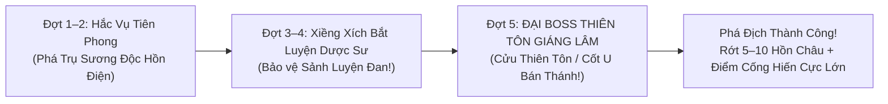
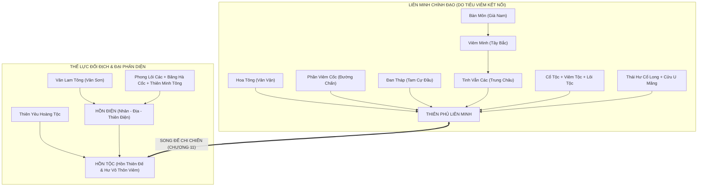

# HỆ THỐNG QUẢN LÝ TÔNG MÔN TỰ LẬP, DANH VỌNG & TOÀN CẢNH THẾ LỰC ĐẠI LỤC

> **Thuộc phân hệ**: `03_Nhan_Vat_Va_The_Luc`
> **Tham chiếu quy chuẩn**: [00_Master_Index_Va_Quy_Chuan.md](../00_Tong_Quan_Kien_Truc/00_Master_Index_Va_Quy_Chuan.md) · [Hong_Nhan_Dong_Hanh_Va_NPC.md](./Hong_Nhan_Dong_Hanh_Va_NPC.md)
> **Mục tiêu thiết kế**: Tạo ra vòng lặp **Xây Dựng Đế Chế Cày Cuốc Tự Động (Idle-Action Sect Management)** gắn liền với hành trình gây dựng thế lực từ hai bàn tay trắng của Tiêu Viêm (`Bàn Môn` $\rightarrow$ `Viêm Minh` $\rightarrow$ `Tinh Vẫn Các` $\rightarrow$ `Thiên Phủ Liên Minh`), đồng thời quy hoạch toàn bộ hệ sinh thái phe phái từ Tây Bắc sang Trung Châu và Viễn Cổ Bát Tộc.

---

## 1. Gameplay Quản Lý Thế Lực Tự Lập: Tiến Hóa 4 Cấp Độ Xuyên Suốt Truyện

Thay vì bắt người chơi xây nhà rồi bỏ phí mỗi khi chuyển bản đồ lớn, hệ thống **Thế Lực Của Tiêu Viêm** kế thừa `100%` quỹ tài nguyên, cấp công trình và đội ngũ cán bộ nòng cốt qua **4 Cấp Tiến Hóa Lịch Sử**:

| Cấp Tiến Hóa | Tên Thế Lực & Mốc Mở Khóa | Đại Bản Doanh Trên Bản Đồ | Tiền Tệ Vận Hành Chính | Quy Mô Đệ Tử & Cán Bộ Quản Lý Nòng Cốt | Đặc Quyền Cốt Lõi Mở Khóa Cho Người Chơi |
| :---: | :--- | :--- | :--- | :--- | :--- |
| **Cấp 1** | **BÀN MÔN**<br>*(Chương 6 — Nội Viện Già Nam)* | Khu Lầu Các Nam Viện — Học Viện Già Nam | **Hỏa Năng (Fire Energy)** *(Đổi ngày tu luyện Tháp Thiên Phần!)* | Tối đa `30` học viên<br>*Phó môn chủ*: Huân Nhi, Ngô Hạo, Hổ Gia, Lâm Tu Nhai, Liễu Kình | Mở **Đội Hái Thuốc Rừng Nội Viện** & Quầy bán *Đan Dược Giá Rẻ* đập tan thế độc quyền của *Dược Bang (Hàn Nhàn)*! |
| **Cấp 2** | **VIÊM MINH**<br>*(Chương 7 — Bá Chủ Gia Mã)* | Đỉnh Đế Đô Gia Mã Thành *(Hợp nhất Tam Tộc + Đan Hội + Hoàng Thất)* | **Kim Tệ Hoàng Kim** & **Cống Hiến Minh Hội** | Tối đa `100` đệ tử tinh anh<br>*Tổng quản*: **Thải Lân** (Quân sự), **Nhã Phi** (Tài chính), **Pháp Mã & Hải Ba Đông** | Thu thuế thương mại toàn Đế Quốc; mở **Sảnh Luyện Đan Công Nghiệp** và mạng lưới vận chuyển dược liệu xuyên Tây Bắc! |
| **Cấp 3** | **TINH VẪN CÁC**<br>*(Chương 8–9 — Cự Đầu Trung Châu)* | **Tinh Giới Không Gian** ẩn trên đỉnh Tinh Vẫn Sơn *(Dị không gian phòng thủ)* | **Linh Ngọc Trung Châu** & **Tinh Thần Điểm** | Tối đa `250` đệ tử + Khách khanh Đấu Tôn<br>*Các chủ*: **Dược Trần** · *Phó*: **Phong Tôn Giả** · *Thiếu các chủ*: **Tiêu Viêm** | Mở khóa **Tinh Thần Hộ Phái Đại Trận** (chống Đấu Thánh sơ kỳ!), **Kho Đấu Kỹ Địa – Thiên Giai** & Lò Đan Bát – Cửu Phẩm! |
| **Cấp 4** | **THIÊN PHỦ LIÊN MINH**<br>*(Chương 10–11 — Siêu Thế Lực Đỉnh Cao)* | Liên thông Trùng Động giữa *Tinh Vẫn Các – Hoa Tông – Phần Viêm Cốc – Đan Tháp* | **Thánh Tinh Nguyên** & **Bản Nguyên Hồn Điểm** | Quy mô **Liên Minh Cấp Thánh** *(Vân Vận, Đường Chấn, Huyền Không Tử, Tử Nghiên, Yêu Minh tham chiến!)* | Triệu tập **Đại Quân Liên Minh** đánh thẳng vào Phân Điện Hồn Điện, tự động cày nguyên liệu Thánh Phẩm toàn đại lục! |

---

## 2. Bốn Trụ Cột Gameplay Quản Lý Tông Môn Gây Nghiện Cho Dân Cày Cuốc

Người chơi có thể truy cập nhanh bảng điều hành Tông Môn qua **Ngọc Giản Minh Chủ (`Phím J`)** ở bất cứ đâu trên thế giới mà không cần chạy bộ về thành liên tục:

### 2.1. Trụ Cột 1: Phân Công Đệ Tử Thu Thập Dược Liệu Thời Gian Thực (`Real-Time Herb Dispatch`)

Giải phóng người chơi khỏi việc phải tự tay cuốc từng bụi cỏ cấp thấp hàng ngàn lần để luyện đan:
* **Cơ chế điều phái**: Chia đệ tử thành tối đa `4 Tiểu Đội Thám Hiểm` (mỗi đội gồm `1 Đội Trưởng NPC` như *Ngô Hạo / Lâm Tu Nhai / Thanh Lân* + `5 Đệ tử nội môn`), cử tới các vùng nguyên liệu đã mở khóa (*Ma Thú Sơn Mạch*, *Sa Mạc Tháp Qua Nhĩ*, *Thâm Sơn Hắc Giác Vực*, *Vong Hồn Sơn Mạch*, *Hoang Cổ Mãng Nguyên*).
* **Công thức Sản Lượng Thảo Dược Thu Về Mỗi Chu Kỳ `10 Phút Thực Tế`**:
  $$\text{Herb\_Yield} = \text{BaseZoneRate} \times \left(1 + \frac{\text{Team\_Power}}{\text{Zone\_Req\_Power}}\right) \times \left(1 + B_{\text{Leader}} + B_{\text{LifeFlame}}\right)$$
  * *Chú thích*: $B_{\text{LifeFlame}} = +2.0$ (+200% sản lượng vườn thuốc!) nếu Tiêu Viêm đã thu thập `#5 Sinh Linh Chi Diễm`.
* **Sự Kiện Ngẫu Nhiên Sống Động ("Tín Hiệu Cầu Cứu Đệ Tử")**:
  * Khi cử đội vào vùng **Nguy Hiểm Đỏ** (tỷ lệ rớt dược liệu Thất – Bát Phẩm cao gấp `3 lần`), có `15%` xác suất đội hái thuốc đụng phải toán tuần tra của **Hồn Điện / Băng Hà Cốc** và bắn pháo hiệu cầu cứu lên góc màn hình!
  * Nếu Tiêu Viêm xé không gian tới giải vây kịp trong vòng `180 giây`, cả đội không mất giỏ hàng mà còn thưởng thêm **1 Rương Chiến Lợi Phẩm Tinh Anh + Hồn Châu** và tăng vọt Sĩ Khí Tông Môn!

### 2.2. Trụ Cột 2: Sảnh Luyện Đan Tông Môn (`Sect Alchemy Hall`) — Cỗ Máy In Tiền & Hỏa Năng

* Người chơi chỉ cần tự tay luyện **1 Viên Đan Mẫu Đạt Chuẩn Hoàn Mỹ (`Mastery = 100%`)** của một loại đan tiêu hao (như *Hồi Khí Đan*, *Phục Thương Đan*, *Thanh Linh Đan*, *Bạo Khí Đan*), sau đó giao **Đan Phương Mẫu** đó cho dàn Luyện Dược Sư của Tông Môn (*Pháp Mã, Cổ Hà, Liễu Linh, Diệp Trọng, Trưởng lão Đan Tháp*) sản xuất dây chuyền!
* **Hai hướng tiêu thụ sản phẩm**:
  1. **Cấp Phát Nội Bộ**: Đệ tử có đan dược uống tự động tăng tốc độ đột phá cảnh giới và giảm `50%` thương vong khi đi hái thuốc.
  2. **Đẩy Ra Thương Hội Của Nhã Phi**: Tự động quy đổi thành dòng tiền thụ động **Kim Tệ / Hỏa Năng / Linh Ngọc** chảy vào kho bạc mỗi `15 phút` chơi — nuôi sống toàn bộ chi phí mua sắm ở Đấu Giá Trường!

### 2.3. Trụ Cột 3: Kho Đấu Kỹ & Tàng Kinh Các (`Sect Skill Pavilion`)

* Trong quá trình đi săn Boss và vét sạch kho báu kẻ thù, người chơi sẽ nhặt được rất nhiều quyển Đấu Kỹ trùng lặp hoặc thuộc hệ Phong / Lôi / Băng / Thủy không hợp với Tiêu Viêm.
* Đem **Cống Hiến Vào Tàng Kinh Các** giúp tăng chỉ số **Nội Tình Tông Môn (`Sect Heritage`)**:
  * Mở khóa các Buff Toàn Cục vĩnh viễn cho Tiêu Viêm (`+10% EXP toàn bản đồ`, `+15% túi chứa Nạp Giới`, `+1 Khe Đan Dược Đai Lưng`).
  * Cho phép ghép `5` tàn quyển Địa Giai thành `1` hộp **Thiên Giai Tàn Đồ Bí Ẩn**!

### 2.4. Trụ Cột 4: Sự Kiện "Phòng Thủ Tông Môn" Trước Tập Kích Của Hồn Điện (`Sect Siege Defense`)

Đỉnh cao kịch tính của hệ thống thế lực (tái hiện đại chiến *Tam Tông vây Viêm Minh* ở Chương 7 và *Hồn Điện Thiên Tôn huyết tẩy Tinh Vẫn Các* ở Chương 9–10!):



* **Cơ Chế Chiến Đấu Thủ Thành Kết Hợp Chặt Chém (Action Tower-Defense)**:
  * Bản đồ Đại Bản Doanh *Tinh Vẫn Các* có **3 Cổng Sơn Môn** dẫn về **Đài Trung Tâm Tinh Thần Đại Trận** (nơi Dược Lão và các Luyện Dược Sư đang duy trì kết giới).
  * Trước trận đánh `60 giây`, người chơi dùng điểm Quân Nhu bố trí phòng tuyến:
    * Đặt **Địa Yêu Khôi / Thiên Yêu Khôi** và **Hỏa Nô** đứng chặn yết hầu cầu đá.
    * Phân công **Thải Lân** giữ Cổng Đông, **Tiểu Y Tiên** rải sương độc Cổng Tây, còn **Tiêu Viêm** cơ động bay lượn bằng *Hóa Dực / Trùng Động* giữa các mặt trận tiêu diệt những tên **Hộ Pháp Hồn Điện** đang tung xiềng xích đen kéo lê đệ tử Luyện Dược Sư đi!
  * **Khoảnh Khắc Cao Trào Đợt 5**: Đại Boss cấp **Thiên Tôn / Bán Thánh Hồn Điện** (như *Bát Thiên Tôn, Tứ Thiên Tôn Huyết Hà, Nhị Thiên Tôn Cốt U*) xé toạc bầu trời bước ra chưởng vỡ một góc kết giới — người chơi bật *Tinh Thần Đại Trận* gom ánh sao truyền vào *Phật Nộ Hỏa Liên* đánh tan nát cuộc xâm lăng!

---

## 3. Hệ Thống Danh Vọng Thế Lực 7 Bậc (`Faction Reputation`)

Mọi hành động của Tiêu Viêm trên đại lục đều làm dịch chuyển thanh quan hệ với từng phe phái qua **7 Bậc Danh Vọng**:

| Bậc Danh Vọng | Ngưỡng Điểm | Thái Độ AI Trên Bản Đồ & Hệ Quả Gameplay Thực Tế |
| :--- | :---: | :--- |
| **1. Huyết Hải Thâm Thù** *(Truy Sát)* | `-10.000` | Lính gác thành tấn công ngay khi thấy mặt (trừ khi mặc *Hắc Bào* kín kẽ); cứ mỗi `20 phút` ngoài dã ngoại sẽ có **Đội Ám Sát Tinh Anh** của phe đó truy đuổi! |
| **2. Thù Địch** | `-3.000` | Đóng cửa toàn bộ Cửa hiệu / Đấu Giá / Trận pháp dịch chuyển thuộc quyền kiểm soát của phe đó. |
| **3. Lạnh Nhạt / Đề Phòng** | `-500` | Giá mua vật phẩm đắt hơn `+30%`; NPC từ chối giao nhiệm vụ phụ. |
| **4. Trung Lập** *(Mặc định)* | `0` | Giao thương bình thường theo giá gốc. |
| **5. Thân Thiện** | `+2.000` | Giảm `10%` giá dịch vụ; mở Nhiệm vụ Ủy Thác Luyện Đan cấp trung. |
| **6. Kính Trọng** | `+8.000` | Mở quyền bước vào **Khu Vực Cấm Địa / Bí Cảnh Nội Môn** (ví dụ: *Cửu Long Lôi Trì* của Phần Viêm Cốc!). |
| **7. Sùng Bái / Minh Chủ Đồng Minh** | `+20.000` | Gửi quân đoàn viện trợ khi Tông Môn bị Hồn Điện vây hãm; mở mua **Trấn Phái Đấu Kỹ Thiên Giai & Chia Sẻ Tộc Hỏa**! |

---

## 4. Hồ Sơ Toàn Cảnh Các Thế Lực Lớn Trên Đấu Khí Đại Lục

### 4.1. Khu Vực Tây Bắc Đại Lục: Gia Mã Đế Quốc, Tam Tông Lân Cận & Hắc Giác Vực

| Tên Thế Lực | Địa Bàn & Người Đứng Đầu | Thực Lực Đỉnh Cao | Quan Hệ Với Tiêu Viêm & Vai Trò Trong Gameplay |
| :--- | :--- | :---: | :--- |
| **Vân Lam Tông** | Vân Lam Sơn (Đế Đô Gia Mã) — *Vân Vận* $\rightarrow$ Thái thượng *Vân Sơn* | Đấu Tông 2–3 Tinh *(Nhờ Hồn Điện nâng đỡ)* | **Kẻ thù chính Quyển 1–2**: Từ ước hẹn 3 năm đến đại chiến giải tán tông môn ở Chương 7 (sau khi diệt Vân Sơn và Vụ Hộ Pháp). |
| **Hoàng Thất Gia Mã & Tam Đại Gia Tộc** | Đế Đô — *Gia Hình Thiên* · *Mễ Đặc Nhĩ (Đằng Sơn/Hải Ba Đông)* · *Mộc Gia* · *Nạp Lan Gia* | Đấu Hoàng Đỉnh Phong | Từ trung lập chuyển sang **Đồng minh cốt cán hợp nhất thành Viêm Minh** ở Chương 7. |
| **Hiệp Hội Luyện Dược Sư Gia Mã** | Đế Đô — Hội trưởng *Pháp Mã* & Đan Vương *Cổ Hà* | Lục Phẩm Đỉnh Phong / Đấu Hoàng | Tổ chức sân chơi **Đan Hội Gia Mã (Ch 4)** chống lại gián điệp Xuất Vân (*Viêm Lợi*); sáp nhập Đan Đường Viêm Minh. |
| **Tam Đại Tà Tông Lân Cận: Mộ Lan Cốc · Vạn Yết Môn · Độc Tông** | Mộ Lan Đế Quốc & Xuất Vân Đế Quốc — *Mộ Lan Tam Lão*, *Hạt Tất Nham / Hạt Sơn*, *Tiểu Y Tiên* | Đấu Hoàng Đỉnh $\rightarrow$ Đấu Tông 5 Tinh | Liên quân vây đánh Gia Mã ở Chương 7; riêng **Độc Tông** dưới tay Tiểu Y Tiên trở thành cánh quân trợ chiến đắc lực, còn Vạn Yết Môn bị diệt sạch. |
| **Ma Viêm Cốc & Hắc Hoàng Tông** | Hắc Giác Vực — *Địa Ma Lão Quỷ* (Ma Viêm Cốc) & *Mạc Thiên Hành* (Hắc Hoàng Tông) | Đấu Tông 4–7 Tinh | **Thế lực thù địch Hắc Giác Vực (Ch 5–7)**: Ma Viêm Cốc cấu kết Hàn Phong nên bị Tiêu Viêm san bằng để lấy xác Địa Ma Lão Quỷ luyện chế **Địa Yêu Khôi** đầu tiên! |
| **Học Viện Già Nam (Ngoại & Nội Viện)** | Thành Hòa Bình giáp Hắc Giác Vực — Viện trưởng *Mãng Thiên Xích* & Đại trưởng lão *Tô Thiên* | Đấu Tông Đỉnh $\rightarrow$ Bán Thánh *(Mãng Thiên Xích)* | **Ngôi nhà thứ hai của Tiêu Viêm (Ch 5–6)**: Nơi khai sinh Bàn Môn, cày *Thiên Phần Luyện Khí Tháp* và liên minh vĩnh cửu bảo vệ Tây Bắc. |

### 4.2. Trung Châu Đỉnh Phong: "Nhất Điện – Nhất Tháp – Nhị Tông – Tam Cốc – Tứ Phương Các"

Trung Châu là trung tâm phồn hoa và khốc liệt nhất của thế giới loài người (Quyển 3: `Lv 70 – 99`), quy tụ **11 siêu thế lực** định hình cục diện chính tà:

| Phân Nhóm | Tên Thế Lực | Thủ Lĩnh Tiêu Biểu & Cảnh Giới | Định Vị Chính – Tà & Tương Tác Cốt Lõi Với Người Chơi |
| :--- | :--- | :--- | :--- |
| **Tứ Phương Các** | **1. Tinh Vẫn Các**<br>**2. Phong Lôi Các**<br>**3. Vạn Kiếm Các**<br>**4. Hoàng Tuyền Các** | *Dược Trần / Phong Tôn Giả* (Bán Thánh – Đấu Thánh)<br>*Lôi Tôn Giả* (Đấu Tôn 3–4 Tinh)<br>*Kiếm Tôn Giả* (Đấu Tôn 3 Tinh)<br>*Hoàng Tuyền Tôn Giả* (Đấu Tôn 2–3 Tinh) | • **Tinh Vẫn Các**: Đại bản doanh của người chơi!<br>• **Phong Lôi Các**: **Tử địch Bắc Vực** — săn đuổi Tiêu Viêm vì học trộm *Tam Thiên Lôi Động*!<br>• **Vạn Kiếm Các**: Trung lập thiên cạnh tranh kiếm đạo.<br>• **Hoàng Tuyền Các**: Thù địch với Phong Tôn Giả; nơi có bí cảnh *Hoàng Tuyền Bia* mở khóa *Hoàng Tuyền Chỉ/Chưởng/Thiên Nộ*! |
| **Tam Cốc** | **5. Phần Viêm Cốc**<br>**6. Băng Hà Cốc**<br>**7. Âm Dương Huyền Long Cốc** | Cốc chủ *Đường Chấn* (Đấu Tôn 5 Tinh) & Hoả Vân Lão Tổ<br>Cốc chủ *Băng Tôn Giả* (Đấu Tôn 4–6 Tinh)<br>Cốc chủ ẩn thế *(Bát Phẩm Huyền Long Đan)* | • **Phần Viêm Cốc**: **Đồng minh sống còn!** Nơi truyền trọn bộ *Thiên Hỏa Tam Huyền Biến* và gia nhập Thiên Phủ.<br>• **Băng Hà Cốc**: **Tử địch!** Điên cuồng truy bắt *Ách Nan Độc Thể* của Tiểu Y Tiên, sau bị Tiêu Viêm dẫn quân diệt cốc.<br>• **Âm Dương Cốc**: Khu vực giao dịch & bí cảnh rèn luyện *Huyền Long Đan* (tăng xác suất phục sinh kỳ diệu). |
| **Nhị Tông** | **8. Hoa Tông**<br>**9. Thiên Minh Tông** | *Hoa Bà Bà* $\rightarrow$ **Vân Vận** (Đấu Tôn Đỉnh)<br>*Thiên Minh Lão Yêu* (Bán Thánh Cao Cấp) | • **Hoa Tông**: Chỉ thu nữ đệ tử; sau khi Vân Vận kế vị trở thành thành viên sáng lập **Thiên Phủ Liên Minh**.<br>• **Thiên Minh Tông**: Tổng hợp của *Huyền Minh Tông – Thiên Sát Môn – Cốt U Tông* tàn độc, về sau đầu hàng làm chó săn cho Hồn Điện và bị Tiêu Viêm đánh sập! |
| **Nhất Tháp** | **10. Đan Tháp** | Tam Đại Cự Đầu (*Huyền Không Tử, Huyền Y, Thiên Lôi Tử*) & **Đan Tháp Lão Tổ** (Lục Tinh Đấu Thánh!) | **Thánh Địa Luyện Dược Sư Toàn Đại Lục**: Sân khấu vĩ đại của **Đan Hội Trung Châu (Ch 8)**, nơi cất giữ `#9 Tam Thiên Diễm Viêm Hỏa` và hậu thuẫn vững chắc nhất cho học trò của Dược Trần! |

### 4.3. Giải Phẫu Kẻ Thù Truyền Kiếp Xuyên Suốt Game: "Nhất Điện — HỒN ĐIỆN"

Là cánh tay nối dài của Hồn Tộc rải khắp Đấu Khí Đại Lục chuyên bắt bớ Linh Hồn và Luyện Dược Sư, **Hồn Điện** được thiết kế theo cấu trúc tháp 3 tầng rõ rệt để làm chuỗi **Boss Săn Lùng Rớt Hồn Châu** từ Chương 4 đến tận Chương 11:

1. **Nhân Điện (Tầng Đáy — Các Hộ Pháp Áo Đen)**:
   * Phân cấp: *Thiết Hộ Pháp (Đấu Vương)* $\rightarrow$ *Huyền Hộ Pháp (Đấu Hoàng)* $\rightarrow$ *Địa Hộ Pháp (Đấu Tông 1–4 Tinh, như Vụ Hộ Pháp, Xích Hộ Pháp)* $\rightarrow$ *Thiên Hộ Pháp (Đấu Tông Đỉnh)*.
   * Cơ chế chiến đấu: Luôn bay trong làn sương đen, dùng xiềng xích sắt quấn bắt Hồn Thể và tự nuốt oan hồn trong túi để cường hóa cấp độ giữa trận!
2. **Địa Điện (Tầng Giữa — Tôn Lão & Cửu Đại Thiên Tôn)**:
   * Các **Tôn Lão** (Đấu Tôn 1–5 Tinh như *Thanh Hải, Hiên Hộ, Vanh Lão*) và đặc biệt là bảng **Cửu Đại Thiên Tôn** lừng danh Trung Châu:
     * *Cửu Thiên Tôn (Mộ Cốt — Đấu Tôn 8 Tinh, kẻ phản sư cùng Hàn Phong!)* · *Bát Thiên Tôn (Đấu Tôn 8 Tinh)* · *Ngũ Thiên Tôn (Trích Tinh Lão Quỷ — Đấu Tôn Đỉnh Ngũ Chuyển, kẻ chưởng trọng thương Tiêu Viêm ở Vong Hồn Điện!)* · *Tứ Thiên Tôn (Huyết Hà — Bán Thánh)* · *Tam Thiên Tôn & Nhị Thiên Tôn (Cốt U Thánh Giả — Bán Thánh Cao Cấp)* · *Nhất Thiên Tôn (Phổ Tôn Giả — Đấu Thánh Sơ Kỳ)*.
3. **Thiên Điện (Tầng Đỉnh Tối Mật — Các Cường Giả Cấp Đấu Thánh)**:
   * Trấn giữ bởi **Phó Điện Chủ Hồn Điện** *(Tam Tinh Đấu Thánh)*, **Hồn Thanh Thánh Giả**, và trùm cuối của Hồn Điện: **Điện Chủ Hồn Diệt Sinh** *(Ngũ Tinh Đấu Thánh Hậu Kỳ, mang trong người Tử Hỏa của `#2 Hư Vô Thôn Viêm` — bị Tiêu Viêm đánh bại và rút hồn luyện tại Chương 10–11!)*.

---

## 5. Viễn Cổ Bát Tộc & Tam Đại Ma Thú Bá Chủ (Endgame Quyển 4)

Khi bước vào Chương 10–11 (`Lv 95 – 120`), bức màn bí mật đằng sau sự biến mất của Đấu Đế hàng vạn năm trước mở ra với **8 Viễn Cổ Chủng Tộc** nắm giữ *Đà Xá Cổ Đế Ngọc* và **3 Vương Tộc Ma Thú**:

### 5.1. Bảng Thiết Kế Viễn Cổ Bát Tộc (8 Đại Tộc Huyết Mạch Đấu Đế)

| Tên Đế Tộc | Tộc Trưởng & Cường Giả Đỉnh Cao | Cấp Độ Huyết Mạch Hiện Tại | Không Gian Giới & Dị Hỏa Trấn Tộc | Vai Trò Cốt Truyện & Tương Tác Trong Game |
| :--- | :--- | :--- | :--- | :--- |
| **1. Cổ Tộc** | Tộc trưởng **Cổ Nguyên** *(Cửu Tinh Đấu Thánh Đỉnh Phong)* · Hắc Yên Vương *Cổ Liệt* | Cực thịnh *(Huân Nhi đạt Thần Phẩm!)* | **Cổ Giới** · `#4 Kim Đế Phần Thiên Viêm` | **Đồng minh mạnh nhất!** Nơi diễn ra Lễ Thành Nhân Cổ Tộc, mở cổng *Thiên Mộ* và sát cánh quyết chiến Hồn Tộc. |
| **2. Hồn Tộc** | Tộc trưởng **Hồn Thiên Đế** *(Cửu Tinh Đấu Thánh Đỉnh $\rightarrow$ **Huyết Đế**)* · **Hư Vô Thôn Viêm** *(Cửu Tinh Đấu Thánh)* · Tứ Ma Thánh | Cực thịnh nhờ thôn phệ các tộc khác! | **Hồn Giới** · `#2 Hư Vô Thôn Viêm` | **ĐẠI PHẢN DIỆN TỐI THƯỢNG CỦA GAME!** Âm mưu gom đủ 8 mảnh Cổ Đế Ngọc và lập *Trảm Đế Huyết Trận* đồ sát toàn Trung Châu để thành Đế! |
| **3. Viêm Tộc** | Tộc trưởng **Viêm Tẫn** *(Bát Tinh Đấu Thánh Đỉnh)* · *Hỏa Diệu, Hỏa Huyễn* | Thịnh vượng | **Viêm Giới** · **5 Dị Hỏa** (`#6, #7, #8, #16, #17`)! | Đồng minh trụ cột trong *Tam Tộc Liên Minh*; nơi mở các khảo nghiệm chia sẻ Tộc Hỏa cuối game. |
| **4. Lôi Tộc** | Tộc trưởng **Lôi Doanh** *(Bát Tinh Đấu Thánh Hậu Kỳ)* · *Hắc Ma Lôi (Lôi Động)* | Thịnh vượng, hiếu chiến | **Lôi Giới** · Cửu Huyền Lôi Trì | Nổi tiếng bá đạo cương liệt; ban đầu cạnh tranh ở Thiên Mộ nhưng sau nể phục thực lực Tiêu Viêm và liên minh chống Hồn Tộc. |
| **5. Dược Tộc** | Tộc trưởng **Dược Đan** *(Thất Tinh Đấu Thánh)* · *Dược Vạn Quy* | Đang suy yếu dần | **Dược Giới** · `#13 Quy Linh Địa Hỏa` & `#22 Vạn Thú Linh Hỏa` | Quê hương gốc từng trục xuất Dược Trần! Ở Chương 11 mở **Đại Chiến Cứu Viện Dược Giới** khi Hồn Tộc đánh úp diệt tộc (Tiêu Viêm cứu sống một bộ phận tinh anh về Thiên Phủ!). |
| **6. Thạch Tộc** | Tộc trưởng *Thạch Mạc* *(Lục – Thất Tinh Đấu Thánh)* | Suy tàn | **Thạch Giới** *(Bị Hồn Tộc đánh sập bí mật!)* | Nạn nhân thứ hai bị Hồn Tộc âm thầm thôn phệ toàn tộc để lấy mảnh Đế Ngọc và máu tế; người chơi vào điều tra phế tích *Thạch Giới Đổ Nát*. |
| **7. Linh Tộc** | Tộc trưởng *Linh Thôn* *(Ngũ – Lục Tinh Đấu Thánh)* | Bị diệt vong đầu tiên | **Linh Giới** *(Hóa vùng đất chết Hồn Ma)* | Biến cố chấn động mở màn sự tàn khốc của Quyển 4 — toàn bộ Linh Giới biến mất trong một đêm dưới miệng *Hư Vô Thôn Viêm*! |
| **8. Tiêu Tộc** | Tổ tiên **Tiêu Huyền** *(Cửu Tinh Đấu Thánh Đỉnh — Bán Bộ Đấu Đế)* · Tộc trưởng **Tiêu Chiến** $\rightarrow$ **Viêm Đế Tiêu Viêm**! | Phế huyết mạch $\rightarrow$ **Tái Sinh Đế Huyết Ở `Lv 120`!** | Từng ở Tiêu Giới cổ $\rightarrow$ Ô Thản Thành $\rightarrow$ **Viêm Đế Cung** | Cội nguồn bi tráng! Tiêu Viêm cứu cha **Tiêu Chiến** khỏi nhà giam Hồn Tộc bằng giao dịch Đế Ngọc và chứng đạo **Viêm Đế**, phục hưng huyết mạch toàn tộc! |

### 5.2. Tam Đại Ma Thú Gia Tộc Thống Trị Giới Tự Nhiên

1. **Thái Hư Cổ Long Tộc**: Bá chủ tuyệt đối về **Không Gian Lực** và nhục thân mạnh nhất muôn loài. Nội bộ bị chia cắt thành Đông – Tây – Nam – Bắc Long Đảo suốt nhiều năm sau khi Lão Long Hoàng **Chúc Khôn** *(Cửu Tinh Đấu Thánh Đỉnh Phong)* bị kẹt dưới đáy Cổ Đế Động Phủ. Người chơi cùng **Tử Nghiên** đánh bại Tam Đại Long Vương phản loạn để thống nhất Cổ Long Tộc (Chương 10) và hóa giải hiểu lầm của Chúc Khôn ở Chương 11!
2. **Thiên Yêu Hoàng Tộc**: Loài phượng hoàng yêu tà mang đôi cánh xương huyết ngọc, kẻ thù truyền kiếp chuyên ăn thịt Cổ Long (và ngược lại!). Vì Tiêu Viêm từng lấy thi thể Thiên Yêu Hoàng cổ chế tạo **Thiên Yêu Hoàng Cốt Dực** và tinh huyết nên tộc trưởng **Hoàng Thiên** *(Ngũ Tinh Đấu Thánh)* và *Cửu Phượng* liên tục tìm cách trả thù trên đường tranh đoạt Bồ Đề Tâm & Yêu Hỏa!
3. **Cửu U Địa Minh Mãng Tộc**: Tộc rắn khổng lồ đông đảo hung hãn dưới đầm lầy âm hàn. Nhờ cứu đại tộc trưởng **Yêu Minh** *(Nhị Tinh Đấu Thánh)* bị em trai *Yêu Khiếu Thiên* giam cầm dưới đáy *Hoàng Tuyền Âm Hàn Trì* (Chương 9–10), Tiêu Viêm thu nhận toàn bộ đại quân Cửu U Địa Minh Mãng làm tiên phong sắt đá cho **Thiên Phủ Liên Minh**!


---

## 6. Cây Kiến Trúc Đại Bản Doanh & Toán Học Kinh Tế Tông Môn

Để việc quản lý `Bàn Môn -> Viêm Minh -> Tinh Vẫn Các -> Thiên Phủ` có chiều sâu chiến thuật rõ ràng nhưng không tốn quá 2 phút thao tác mỗi giờ chơi, giao diện Đại Bản Doanh chia làm **6 Công Trình Cốt Lõi (Nâng cấp Bậc `1 → 10`)**:

| Tên Công Trình Tông Môn | Vai Trò Vận Hành Chính | Hiệu Ứng Ở Cấp Đầu (`Lv 1` — Bàn Môn) | Hiệu Ứng Ở Cấp Tối Đa (`Lv 10` — Thiên Phủ Liên Minh) |
| :--- | :--- | :--- | :--- |
| **1. Nghị Sự Chính Điện** | Giới hạn quy mô đệ tử & trần cấp công trình khác | Chứa `30` đệ tử; mở `1` Đội Hái Thuốc. | Chứa `300` tinh anh + `12` Trưởng lão Khách khanh; mở đủ `4` Đội Thám Hiểm. |
| **2. Đan Đường Công Nghiệp** | Sản xuất đan dược tự động & Doanh thu thụ động | Luyện tự động Nhất – Tam Phẩm (`+500 Vàng / 15p`). | Luyện dây chuyền Thất – Bát Phẩm (`+45.000 Linh Ngọc / 15p` + cấp phát miễn phí *Hồi Khí Đan* cho Tiêu Viêm!). |
| **3. Dược Viên Linh Mạch** | Trồng hạt giống thảo dược quý hiếm không sợ tuyệt chủng | `4` ô đất thường *(Chu kỳ thu hoạch `30p`)*. | `24` ô đất Linh Tuyền tưới bằng *Sinh Linh Chi Diễm* *(Nhân bản cả dược liệu Cửu Phẩm!)* |
| **4. Tàng Kinh Võ Các** | Tăng Chiến Lực Đệ Tử & Buff Toàn Cục cho Minh Chủ | Đệ tử tăng `+10% ATK/DEF`; Tiêu Viêm `+2% EXP`. | Đệ tử tăng `+120% ATK/DEF`; Tiêu Viêm nhận vĩnh viễn **`+12% EXP` & `+8% All Stats`**! |
| **5. Hộ Sơn Tinh Thần Đại Trận** | Khiên máu kết giới & Pháo đài bắn trả khi bị Công Thành | Chắn đòn cơ bản (`10.000 Shield`). | **Cửu Thiên Tinh Thần Trận** do Dược Thánh chủ trì (`500.000 Shield` + giáng mưa sao băng mỗi `5s` lên quân Hồn Điện!). |
| **6. Khôi Lỗi & Thần Binh Phường** | Sửa chữa / Nâng cấp Yêu Khôi & Trang bị Đệ tử | Đúc giáp sắt chuẩn cho đội tuần tra. | Tích trữ năng lượng sấm sét nuôi dưỡng dàn **10 Địa Yêu Khôi** đứng gác cổng sơn môn! |

### 6.1. Công Thức Tính Thu Nhập Thụ Động Mỗi Chu Kỳ (`15 Phút Thực Tế`)

$$\text{Net\_Revenue}_{15\text{m}} = \Big(\text{BaseAlchemyOut} \times N_{\text{Alchemists}} + \text{CityTax}_{\text{YanAlliance}}\Big) \times \Big(1 + 0.25 \times \mathbb{I}_{\text{YaFei}} + \text{MarketShare}\Big) - \text{Upkeep}_{\text{Array}}$$

* Trong đó $\mathbb{I}_{\text{YaFei}} = 1$ nếu bổ nhiệm **Nhã Phi** làm Tổng Quản Thương Mại (`+25%` doanh thu ròng).
* $\text{MarketShare} \in [0.0, 0.5]$ là **Thị Phần Đan Dược Khu Vực**: Tăng lên mỗi khi người chơi đánh bại đối thủ cạnh tranh thương mại (như đè bẹp *Dược Bang* ở Nội Viện hay dẹp bỏ sòng chợ đen của *Ma Viêm Cốc*!).

---

## 7. Hệ Thống Chiến Dịch "Đánh Úp Phân Điện Hồn Điện" (`Soul Hall Raid Bounties`)

Song song với việc phòng thủ nhà, từ Chương 8 trở đi người chơi chuyển sang thế **Chủ Động Phản Công** thông qua bản đồ tình báo của *Phong Tôn Giả & Lăng Ảnh*, lần lượt nhổ tận gốc **6 Cứ Điểm Chiến Lược Của Hồn Điện**:

| Thứ Tự Cứ Điểm | Tên Phân Điện & Vùng Bản Đồ | Cấp Độ Khuyến Nghị | Trùm Trấn Giữ (`Boss`) | Phần Thưởng Giải Phóng Độc Quyền |
| :---: | :--- | :---: | :--- | :--- |
| **1** | **Thiết Hồn Cứ Điểm** *(Rìa Hắc Giác Vực)* | `Lv 64+` *(Đấu Hoàng)* | *Thiết/Huyền Hộ Pháp Tam Quỷ* | Giải cứu `3` Luyện Dược Sư Ngũ Phẩm về làm việc cho *Viêm Minh* + `600 SOUL`. |
| **2** | **Hoàng Tuyền Ám Điểm** *(Nam Vực Trung Châu)* | `Lv 76+` *(Đấu Tông)* | *Vanh Hộ Pháp & Thanh Hải Tôn Lão* | Bản đồ kho tàng Hồn Kỹ *Hồn Thủ Ấn* + `2.500 SOUL`. |
| **3** | **Vong Hồn Phân Điện** *(Vong Hồn Sơn Mạch — Ch 9)* | `Lv 84+` *(Đấu Tôn)* | **Hiên Hộ Pháp · Mộ Cốt · Ngũ Thiên Tôn Trích Tinh** | **Cột mốc Cốt truyện**: Giải cứu thành công **Dược Lão** + Giải phóng hàng trăm linh hồn Luyện Dược Sư! |
| **4** | **Minh Hà Phân Điện** *(Tây Vực Trung Châu)* | `Lv 91+` *(Cửu Chuyển)* | **Bát Thiên Tôn & Cửu Thiên Tôn** | Thu giữ `2` thi thể Đấu Tôn Đỉnh Phong để luyện thêm **Thiên Yêu Khôi** + `12.000 SOUL`! |
| **5** | **Nhân – Địa Song Điện Tổng Đàn** *(Ch 10)* | `Lv 101+` *(Đấu Thánh Sơ)* | **Tứ Thiên Tôn Huyết Hà & Nhị Thiên Tôn Cốt U** | Đoạt lại *Thiên Hồn Dung Huyết Đan Phương* + `28.000 SOUL`. |
| **6** | **Thiên Điện Huyết Đàn** *(Trận Quyết Tử Ch 10 Cuối)* | `Lv 108+` *(Tam – Tứ Tinh Đấu Thánh)* | **Phó Điện Chủ & Điện Chủ Hồn Diệt Sinh** | Xóa sổ vĩnh viễn Hồn Điện khỏi Trung Châu! Thu phục tia **Hư Vô Tử Hỏa** & danh hiệu *Thiên Phủ Chí Tôn*! |

---

## 8. Cơ Chế "Đấu Giá Trường & Giết Người Cướp Của Hắc Ấn Thành"

Một trải nghiệm cực kỳ đặc sắc gắn liền với hệ thống Thế lực (Mễ Đặc Nhĩ / Bát Phiến Môn Hắc Ấn Thành) là các phiên **Đấu Giá Bảo Vật Định Kỳ**:

1. **Tâm Lý Chiến Trên Sàn Đấu Giá (`Auction Bidding Duel`)**:
   * Khi xuất hiện bảo vật hiếm (*Tàn đồ Tịnh Liên Yêu Hỏa*, *Tam Thiên Lôi Động*, *Âm Dương Huyền Long Đan*, *Bồ Đề Hóa Thể Tiên*), các NPC thế lực thù địch (như *Gia Liệt Áo*, *Phạm Lăng của Huyết Tông*, *Thiếu các chủ Phong Lôi Các*) sẽ liên tục đẩy giá cạnh tranh.
   * Người chơi có 3 nút chiến thuật:
     * **Nâng Giá Nhỏ Giọt (`+5%`)**: Thăm dò ngân sách đối thủ.
     * **Đập Bàn Hét Giá Áp Đảo (`+30%` + Tỏa Uy Áp `SOUL`)**: Nếu `SOUL` hoặc Danh tính Hắc Bào của Tiêu Viêm đủ đáng sợ, NPC nhát gan sẽ toát mồ hôi bỏ cuộc ngay lập tức giúp tiết kiệm tiền!
     * **Dùng Đan Dược Cao Cấp Thế Chấp Tại Chỗ**: Đúng phong cách Tiêu Viêm — hết tiền mặt liền móc ngay 1 lọ *Lục/Thất Phẩm Đan Dược* tự luyện đặt lên bàn làm cả hội trường nín thở định giá vượt mặt kẻ thù!
2. **Sự Kiện Kinh Điển "Ra Khỏi Cổng Thành Bị Chặn Cướp" (Đặc Sản Hắc Giác Vực!)**:
   * Tại **Hắc Ấn Thành (Chương 5)**, dù người chơi đấu giá thắng hay cố tình... nhường cho tên thiếu tông chủ Huyết Tông mua mất bảo vật, ngay khi bước ra rừng hoang ngoài thành đều kích hoạt kịch bản **Hoàng Tước Tại Hậu**!
   * Nếu mình mua thắng: Đám sát thủ *Huyết Tông / Bát Phiến Môn* nhảy ra chặn cướp $\rightarrow$ Tiêu Viêm tháo chốt Trọng Xích giết sạch, lột luôn Nạp Giới của chúng bù lại tiền đấu giá!
   * Nếu không đủ tiền mua để NPC mua mất: Người chơi có thể khoác **Hắc Bào** bám theo đoàn hộ tống của tên thiếu gia tà phái trong rừng đêm và... đoạt lại bảo vật từ tay kẻ ác đúng chuẩn quy tắc sinh tồn Hắc Giác Vực!

---

## 9. Cấu Hình Dữ Liệu Thế Lực & Tông Môn Mẫu (`FactionAndSect YAML`)

```yaml
# File tham chiếu: data/factions/player_sect_progression.yaml
player_sect_tiers:
  - tier: 1
    id: "pan_gate"
    name_vi: "Bàn Môn"
    unlock_chapter: 6
    currency: "fire_energy"
    max_disciples: 30
  - tier: 2
    id: "yan_alliance"
    name_vi: "Viêm Minh"
    unlock_chapter: 7
    currency: "gold_coin"
    max_disciples: 100
    chief_managers: ["cai_lin", "ya_fei", "fa_ma", "hai_bodong"]
  - tier: 3
    id: "falling_star_pavilion"
    name_vi: "Tinh Vẫn Các"
    unlock_chapter: 8
    currency: "spirit_jade"
    max_disciples: 250
    grand_array: "nine_heavens_starlight_formation"
  - tier: 4
    id: "sky_mansion_alliance"
    name_vi: "Thiên Phủ Liên Minh"
    unlock_chapter: 10
    currency: "saint_essence"
    member_factions: ["falling_star", "flower_sect", "burning_flame_valley", "pill_tower", "ancient_void_dragon", "nine_serene_python"]

reputation_thresholds:
  blood_vendetta: -10000
  hostile: -3000
  wary: -500
  neutral: 0
  friendly: 2000
  honored: 8000
  exalted_ally: 20000
```


---

## 10. Hệ Thống Bồi Dưỡng Đệ Tử Tông Môn & Sơ Đồ Cục Diện Chiến Lược Đại Lục

### 10.1. Phân Phẩm Tư Chất Đệ Tử & Lộ Trình Đột Phá Nội Môn

Để người chơi thực sự có cảm giác mình là một vị Tông Chủ / Minh Chủ đáng kính như Dược Trần hay Tiêu Viêm, đệ tử tuyển mộ vào Tông Môn chia làm **4 Phẩm Tư Chất** và tự động thăng tiến cảnh giới theo tài nguyên người chơi đầu tư:

| Bậc Tư Chất Đệ Tử | Tỷ Lệ Xuất Hiện Khi Chiêu Mộ | Giới Hạn Cảnh Giới Tối Đa Đạt Được | Năng Suất Hái Thuốc & Trợ Chiến Công Thành |
| :--- | :---: | :--- | :--- |
| **Phổ Thông (Trắng)** | `55%` | Đại Đấu Sư – Đấu Linh | `1.0x` sản lượng cỏ thuốc cơ bản; lính gác vòng ngoài. |
| **Tinh Anh (Lam)** | `30%` | Đấu Vương – Đấu Hoàng | `1.5x` sản lượng; biết kết *Hợp Kích Trận Pháp* 5 người bắn cung năng lượng giữ tường thành. |
| **Thiên Tài (Tím)** | `12%` | Đấu Tông – Đấu Tôn Sơ Kỳ | `2.2x` sản lượng; có thể bổ nhiệm làm **Đội Trưởng Thám Hiểm Phụ** hoặc **Đan Đồng Phụ Lò**. |
| **Kỳ Tài Chân Truyền (Vàng)** | `3%` *(Hoặc giải cứu từ nhiệm vụ phụ!)* | **Cửu Chuyển Đấu Tôn – Bán Thánh** | `3.5x` sản lượng; sở hữu tên tuổi, ngoại hình riêng và có thể mang theo làm lính cận vệ tinh nhuệ! |

* **Cơ Chế "Truyền Thụ Tinh Hỏa & Ban Đan"**:
  * Mỗi tuần trong game, Minh Chủ Tiêu Viêm có thể tổ chức **Buổi Giảng Đạo Khống Hỏa** tại quảng trường chính (tốn `30 giây` hiệu ứng): Toàn bộ đệ tử nhận buff **Viêm Hỏa Rèn Mạch (`+50% EXP Tu Luyện Đệ Tử` trong 3 giờ chơi)**, giúp đội quân của người chơi lớn mạnh thần tốc kịp theo nhịp độ khốc liệt của Trung Châu!

### 10.2. Sơ Đồ Tổng Quan Đối Đầu Liên Minh Toàn Đấu Khí Đại Lục


