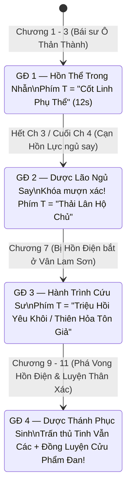

# HỒ SƠ THIẾT KẾ NHÂN VẬT CHÍNH: TIÊU VIÊM & ĐẠI SƯ PHỤ DƯỢC TRẦN (DƯỢC LÃO)

> **Thuộc phân hệ**: `03_Nhan_Vat_Va_The_Luc`
> **Tham chiếu quy chuẩn**: [00_Master_Index_Va_Quy_Chuan.md](../00_Tong_Quan_Kien_Truc/00_Master_Index_Va_Quy_Chuan.md) · [Canh_Gioi_Va_Linh_Hon.md](../02_He_Thong_Tu_Luyen_Va_Di_Hoa/Canh_Gioi_Va_Linh_Hon.md)
> **Mục tiêu thiết kế**: Tái hiện trọn vẹn hành trình từ phế vật gia tộc Ô Thản Thành vươn lên ngôi vị **Viêm Đế** thông qua cơ chế chiến đấu chuyển nhịp kép (*Trọng Xích Khổ Tu $\leftrightarrow$ Giải Phong Bạo Tốc*), kiến trúc mỹ thuật Pixel tách lớp tiết kiệm `>80%` khối lượng vẽ tay, và sự biến thiên đầy cảm xúc của phím Át Chủ Bài `Phím T` gắn liền với số phận **Dược Lão**.

---

## 1. Hệ Thống Toán Học 6 Chỉ Số Chiến Đấu, Hồi Phục & Kháng Nguyên Tố Của Tiêu Viêm

Khác với các nhân vật chỉ dùng một loại vũ khí cố định, **Tiêu Viêm** là một chiến binh lai hoàn hảo giữa **Trọng Binh Sư cận chiến**, **Khống Hỏa Pháp Sư tầm trung** và **Tông Sư Luyện Đan**. Mọi chỉ số chiến đấu thực tế (`Final Stats`) được tổng hợp minh bạch theo 4 nguồn: *Cảnh Giới Gốc (`Base`) + Rèn Thể Trọng Xích (`BodyTemper`) + Trang Bị/Đan Dược (`Flat`) + Hệ Số Phần Quyết/Dị Hỏa (`Pct`)*.

### 1.1. Công Thức Tổng Hợp 6 Chỉ Số Cốt Lõi (`Core Stats Formula`)

1. **Sinh Lực Tối Đa (`HP_Max`)**:
   $$\text{HP\_Max} = \Big(\text{BaseHP}(L) + \text{HP}_{\text{Temper}} + \text{HP}_{\text{Gear}} + \text{HP}_{\text{Elixir}}\Big) \times \Big(1 + \sum \text{PctHP}_{\text{Meridian + Flame}}\Big)$$
   * *Chú thích*: $\text{HP}_{\text{Temper}}$ là máu vĩnh viễn tích lũy nhờ vung **Huyền Trọng Xích ở chế độ Phong Ấn**; $\text{HP}_{\text{Elixir}}$ đến từ các kỳ trân cải tạo nhục thân một lần duy nhất (*Trúc Cơ Linh Dịch*, *Băng Linh Hàn Tuyền*, *Long Hoàng Bản Nguyên Quả*, *Thiên Sơn Huyết Đàm*).

2. **Đấu Khí Tối Đa (`QI_Max`)**:
   $$\text{QI\_Max} = \Big(\text{BaseQI}(L) + \text{QI}_{\text{Gear}} + \text{QI}_{\text{PoisonRefined}}\Big) \times \Big(1 + M_{\text{FenJue}} + \sum \text{PctQI}_{\text{Meridian}}\Big)$$
   * *Chú thích*: $M_{\text{FenJue}}$ là hệ số khuếch đại khí hải của công pháp **Phần Quyết** (tăng từ `-15%` ở Hoàng Giai Đê Cấp lên tới `+420%` ở Thiên Giai Cao Cấp!).

3. **Công Kích Tổng Hợp (`ATK_Final`)**:
   $$\text{ATK\_Final} = \Big(\text{BaseATK}(L) + \text{ATK}_{\text{Temper}} + \text{ATK}_{\text{Ruler}}\Big) \times \Big(1 + \text{PctATK}_{\text{Buff}} + \text{PctATK}_{\text{Bloodline}}\Big)$$

4. **Phòng Ngự & Giảm Sát Thương Vật Lý/Đấu Khí (`DEF_Final` & `Mitigation`)**:
   $$\text{DEF\_Final} = \Big(\text{BaseDEF}(L) + \text{DEF}_{\text{InnerArmor}}\Big) \times \Big(1 + M_{\text{DouQiArmor}}\Big)$$
   $$\text{Damage\_Taken\_Ratio} = \frac{400 + 12 \times L_{\text{Attacker}}}{400 + 12 \times L_{\text{Attacker}} + \text{DEF\_Final}}$$
   * *Ý nghĩa Game Design*: Hằng số mẫu số phụ thuộc cấp độ kẻ tấn công giúp `DEF` không bao giờ bị bão hòa thành bất tử 100%, nhưng mặc **Hải Tâm Nội Giáp / Đấu Khí Khải Giáp** luôn giảm vững chắc từ `35% – 65%` sát thương đòn đánh đồng cấp.

5. **Thân Pháp, Tốc Chạy & Tỷ Lệ Chí Mạng (`SPD_Final` & `Crit_Rate`)**:
   $$\text{MoveSpeed (px/s)} = \text{Clamp}\Big(\text{SPD\_Final} \times 1.15 \times M_{\text{RulerState}},\; 85,\; 380\Big)$$
   $$\text{Crit\_Rate (\%)} = 5\% + \min\Big(45\%,\; \frac{\text{SPD\_Final}}{10}\%\Big) + \text{BonusCrit}_{\text{Unsealed + Skill}}$$

6. **Linh Hồn Lực (`SOUL_Final`)**:
   $$\text{SOUL\_Final} = \text{SOUL}_{\text{Cultivated}} + \text{SOUL}_{\text{SoulOrbPurified}} + \text{SOUL}_{\text{Relic}}$$
   * Trực tiếp điều khiển: Trần phẩm cấp Lò Luyện Đan, số lượng Dị Hỏa dung hợp an toàn vào *Phật Nộ Hỏa Liên*, bán kính *Radar Cảm Ứng* và sát thương của *Hồn Kỹ*.

### 1.2. Công Thức Tốc Độ Hồi Phục (`Regen`) & Ma Trận 6 Kháng Nguyên Tố

* **Hồi Phục Đấu Khí (`QI_Regen/s`)**:
  * *Ngoài giao tranh*: $\text{QI\_Regen}_{\text{Out}} = \text{BaseRegen}(R) \times \text{FenJue\_Eff} + 1.5\% \text{ MaxQI}$ *(nếu đã nuốt Vẫn Lạc Tâm Viêm `#14`)*.
  * *Đang giao tranh*: Trước cảnh giới **Đấu Hoàng (`Lv 60`)**, tốc độ hồi tự nhiên giảm còn `40%` để buộc người chơi quản lý nhịp uống *Hồi Khí Đan* chuẩn như Tiêu Viêm ngậm cả nắm đan dược trong miệng lúc đánh nhau! Từ Đấu Hoàng trở đi, nhờ khả năng *Điều Động Thiên Địa Năng Lượng*, hồi phục trong giao tranh giữ nguyên `100%`.
* **Hồi Phục Sinh Lực (`HP_Regen/s`)**:
  * Cơ bản ngoài giao tranh hồi `0.8% MaxHP/s`; khi sở hữu **Tam Thiên Diễm Viêm Hỏa (`#9`)**, kích hoạt nội tại *Bất Tử Tinh Thần Thể* hồi tới **`4.0% MaxHP/s`** ngay cả khi đang chạy né đòn Boss!

| Loại Kháng Nguyên Tố | Ký Hiệu | Trần Tối Đa (Cap) | Nguồn Kháng Đặc Trưng Của Tiêu Viêm Trong Cốt Truyện |
| :--- | :---: | :---: | :--- |
| **1. Kháng Hỏa** | `Res_Fire` | `85%` *(**100% Miễn Nhiễm** nếu Chủ Hỏa cao hạng hơn đối thủ!)* | *Phần Quyết*, Dị Hỏa hộ thể, *Huyết Liên Tinh*. |
| **2. Kháng Băng Hàn** | `Res_Ice` | `85%` *(**100%** khi có `#11 Cốt Linh Lãnh Hỏa`)* | *Băng Linh Hàn Tuyền*, *Cốt Linh Lãnh Hỏa* (miễn đóng băng tuyệt đối trước Băng Hà Cốc). |
| **3. Kháng Độc & Ăn Mòn** | `Res_Poison` | `90%` | Luyện hóa hoàn chỉnh **Ma Độc Ban**, *Bồ Đề Hóa Thể Tiên*, `#20 U Minh Độc Hỏa`. |
| **4. Kháng Lôi Điện** | `Res_Lightning` | `85%` | Tôi thể bằng *Địa Tâm Lôi Châu*, *Tam Thiên Lôi Động*, ngạnh kháng *Cửu Sắc Đan Lôi*. |
| **5. Kháng Linh Hồn** | `Res_Soul` | `90%` | Cấp bậc `SOUL` (Linh Cảnh / Thiên Cảnh / Đế Cảnh), *Thanh Liên Đài* trấn tâm. |
| **6. Kháng Không Gian** | `Res_Space` | `85%` | Đột phá Đấu Tông/Đấu Tôn, *Cửu Chuyển Tinh Tuyền*, ấn ký *Thái Hư Cổ Long*. |

---

## 2. Năm Hình Thái Sprite Pixel Theo Quyển & Giải Pháp Tách Lớp (Modular Layering)

### 2.1. Bảng Thiết Kế 5 Hình Thái Tiến Hóa Của Tiêu Viêm Xuyên Suốt Trò Chơi

Kích thước khung chuẩn nhân vật là **`48x48 px`** (khung vung vũ khí mở rộng **`96x96 px`** để thanh Huyền Trọng Xích khổng lồ vung hết tầm lực đạo mà không bị cắt mép):

| Hình Thái (Form) | Giai Đoạn Cốt Truyện | Mô Tả Thiết Kế Pixel Art & Khí Chất Nhận Diện | Hiệu Ứng Hào Quang Chân & Nhịp Chuyển Đổi |
| :--- | :--- | :--- | :--- |
| **Form 1: Thiếu Niên Tiêu Gia** | Quyển 1 *(Chương 1 – đầu Chương 2)* | Áo võ phục cộc tay màu đen thô viền xám bạc của đệ tử Tiêu Gia, tóc đen buộc đuôi ngựa cao gọn gàng, cổ tay quấn băng vải trắng, đeo nhẫn đen *Cốt Viêm Giới* lóe sáng nhẹ. | Chưa có hào quang nổi bật; bước chân tung bụi đất nhẹ. |
| **Form 2: Hắc Bào Lịch Luyện "Nham Kiêu"** | Quyển 1 – 2 *(Chương 2 – Chương 5)* | **Áo choàng đen rộng trùm mũ kín nửa mặt** (ẩn giấu thân phận đi Đấu Giá Hội, Sa Mạc & Đan Hội!), thanh **Huyền Trọng Xích** đen kịt to bản bằng nửa thân người vác chéo sau lưng. | Người chơi có thể bật/tắt mũ trùm Hắc Bào bằng phím tắt ngoại trang để tránh bị kẻ thù nhận diện trong thành! |
| **Form 3: Thanh Sam Bàn Môn Nội Viện** | Quyển 2 *(Chương 6 – Chương 7)* | Trường bào xanh mực phối giáp vai đen gọn khỏe khoắn, ngực thêu huy hiệu *Đan Dược Bàn Môn*, gương mặt góc cạnh trưởng thành sau 2 năm rèn luyện dưới đáy tháp. | Đốm lửa xanh lưu ly lượn quanh vạt áo; lưng mọc *Tử Vân Dực / Thanh Hồng Đấu Dực*. |
| **Form 4: Huyền Bào Tinh Vẫn Các Tôn Giả** | Quyển 3 *(Chương 8 – Chương 9)* | Huyền y đen tuyền thêu vân mây ám kim sang trọng của Thiếu Các Chủ Tinh Vẫn Các, mái tóc dài buông xõa bay phấp phới trong gió không gian, ánh mắt sắc lạnh bậc Đấu Tôn. | Nhân vật **lơ lửng cách mặt đất `4px`** thường trực (Đạp Hư Không), dưới chân gợn sóng bạc không gian. |
| **Form 5: Hắc Phát Đế Bào "Viêm Đế"** | Quyển 4 *(Chương 10 – Chương 11)* | Đế bào huyền kim thêu chìm hoa văn vạn hỏa chuyển sắc động, tóc đen dài chấm thắt lưng không gió tự bay, **trên trán rực sáng Thất Thải Đế Tộc Văn**, sau lưng treo vòng sáng *Đế Viêm Luân*! | Mỗi bước đi nở một đóa sen lửa 5 màu dưới hư không rồi tan thành sao sáng. |

### 2.2. Kiến Trúc Vẽ Tách Lớp (`Modular Paper-Doll Layering`) — Tiết Kiệm `81.4%` Công Vẽ Tay!

Nếu vẽ gộp truyền thống (Baked Sprite): `5 Trang phục` $\times$ `2 Vũ khí (Tay không / Xích)` $\times$ `4 Trạng thái Cánh` $\times$ `23 Màu Lửa` $=$ **920 biến thể nhân vật**, hoàn toàn bất khả thi cho đội ngũ Indie!

Giải pháp chuẩn của dự án là tách Tiêu Viêm thành **7 Lớp Đồng Bộ Tâm Pivot (`Anchor Point` tại gót chân `(24, 42)`)** kết hợp tái sử dụng xương chuyển động gốc:

```text
[Z-Order Từ Dưới Lên Trên Trên Engine 2D]
L0: Shadow_Blob        -> Bóng tròn bán trong suốt dưới đất (tự thu nhỏ khi nhân vật nhảy/bay)
L1: Back_Attachment    -> Cánh Phi Hành (Tử Vân Dực / Cốt Dực / Hỏa Dực) HOẶC Trọng Xích đeo lưng
L2: Base_Body_Rig      -> 1 Bộ cơ thể gốc duy nhất chuẩn hóa toàn bộ động tác chạy, lướt, vung tay!
L3: Outfit_Overlay     -> 5 Bộ quần áo/áo choàng mỏng vẽ khớp đúng tọa độ xương của L2
L4: Head_Hair_Tattoo   -> Đầu, kiểu tóc & lớp phát sáng Đế Tộc Văn trên trán
L5: Weapon_Swing_Arc   -> Thanh Huyền Trọng Xích vung 96x96 + vệt chém Grayscale
L6: Shader_Flame_Aura  -> Hạt lửa, Đấu Khí Khải Giáp & Palette-Swap Shader đổi 28 màu tự động!
```

* **Bảng Chứng Minh Hiệu Suất Tiết Kiệm Khối Lượng Vẽ Pixel**:
  * Bộ động tác chuẩn gồm `8 Actions` (`Idle 6f`, `Run 8f`, `Dash 4f`, `Unarmed_Combo 12f`, `Ruler_Combo 18f`, `Cast_Skill 8f`, `Lotus_Charge 6f`, `Hit/Meditate 6f` $=$ `68 frames` $\times$ `3 hướng gốc [Down, Up, Side — hướng Left tự lật ngang FlipX!]` $=$ **`204 frames` chuẩn**).
  * **Nếu vẽ gộp thủ công** (5 Form $\times$ Có/Không Xích $\times$ 3 Cánh): $204 \times 5 \times 2 \times 1.5 \approx \mathbf{3.060\text{ frames}}$!
  * **Áp dụng Modular Layering**: Vẽ `1` Body gốc (`204f`) + `5` lớp Áo đơn giản hóa vùng ngực/vạt (`5 x 48f = 240f`) + `1` lớp Xích rời (`54f`) + `3` Cánh lặp chu kỳ (`3 x 8f = 24f`) $=$ **Tổng cộng chỉ `522 frames` vẽ tay (`Tiết kiệm 82.9%` khối lượng công việc mà tạo ra hàng nghìn tổ hợp hình ảnh sống động!)**.

---

## 3. Ba Cơ Chế Gameplay Độc Quyền Làm Nên Thương Hiệu Tiêu Viêm

### 3.1. Cơ Chế (a): Phong Ấn & Giải Phong "Huyền Trọng Xích" (`Chuột Phải` / `Phím C`)

Thanh thước đen khổng lồ do Dược Lão trao tặng không chỉ là vũ khí mà là **"quả tạ tu hành"** định hình nhịp điệu chiến đấu độc nhất của Tiêu Viêm:

| Thuộc Tính So Sánh | Trạng Thái 1: PHONG ẤN XÍCH *(Trọng Áp Khổ Tu)* | Trạng Thái 2: GIẢI PHONG XÍCH / BỎ XÍCH *(Bạo Tốc Lật Kèo!)* |
| :--- | :--- | :--- |
| **Tốc độ chạy & Tốc đánh** | **`-25% SPD chạy`**, **`-20% Tốc độ vung xích`** *(Đòn bổ có lực khựng màn hình Hitstop `0.08s` cực đầm tay!)* | Xóa bỏ toàn bộ giảm tốc + Nhận ngay Buff **Thích Ứng Nhẹ Nhõm** trong `8s` đầu: **`+35% SPD chạy`, `+40% Tốc đánh`, `+15% Crit Rate`**! |
| **Lợi thế Chiến đấu** | `+30%` Kháng khựng đòn (Hyper-Armor khi vung nhát thứ 3); `+35%` sát thương **Phá Khiên / Làm Choáng Boss (Stagger Gauge)**. | Mở khóa chuỗi liên hoàn quyền cước tốc độ chớp giật (*Bát Cực Băng*, *Xuy Hỏa Chưởng*) + múa *Lục Hợp Du Thân Xích* phản đạn! |
| **Phần thưởng Tu luyện** | **`+30% EXP Đấu Khí`** từ mọi nguồn sát quái + Tích điểm **Rèn Thể Chất Vĩnh Viễn** *(Mỗi `500` nhát bổ trúng quái cộng vĩnh viễn `+10 Max HP` & `+1 ATK`, có trần mỗi Cảnh Giới)*. | *Tạm dừng cộng thêm `+30% EXP` khổ tu* — chuyên dùng khi đấu Boss sinh tử, PVP Đấu Trường hoặc cần lật kèo chớp nhoáng! |
| **Hồi chiêu Chuyển đổi** | Bật lại bất kỳ lúc nào (`CD: 3s`). | Kích hoạt nổ khí xung quanh hất văng quái áp sát (`CD: 12s` cho hiệu ứng bùng nổ 8s đầu). |

### 3.2. Cơ Chế (b): "Ma Độc Ban" — Con Dao Hai Lưỡi Trên Ngực (Chương 7 → Chương 8)

Cuối Chương 7 tại Xuất Vân Đế Quốc, cường giả Đấu Tông **Hạt Sơn Lão Quỷ** trước lúc chết đã đánh toàn bộ bản mệnh kịch độc vào ngực Tiêu Viêm tạo thành **Ma Độc Ban** đen kịt (được phong ấn tạm bằng *Bồ Đề Hóa Thể Tiên*). Thay vì chỉ là một dòng chữ cốt truyện, game biến nó thành **Thanh Độc Tích Lũy Chiến Thuật (`0% → 100%`)** suốt Chương 7–8:

* **Lựa chọn 1 — Chủ Động Hé Phong Ấn Bộc Phát Độc Lực (`Emergency Corrupt Burst`)**:
  * Khi gặp Boss quá trâu ở Hắc Giác Vực / Bắc Vực Trung Châu, người chơi có thể bấm mở nhẹ phong ấn Ma Độc Ban trong `10 giây`: Đòn đánh phủ khói đen ăn mòn **`-35% DEF` của Boss** và gây sát thương độc theo `% máu tối đa`.
  * *Rủi ro*: Thanh Ô Nhiễm Độc tăng `+15%` mỗi lần dùng và rút `2% HP/s`. Nếu lạm dụng chạm mức `100%`, Tiêu Viêm bị **Độc Khí Công Tâm** giảm một nửa chỉ số cho đến khi tìm Tiểu Y Tiên hút bớt độc khí!
* **Lựa chọn 2 — Đại Thành Luyện Hóa Vĩnh Viễn (Sự Kiện Đỉnh Cao Chương 8)**:
  * Khi Tiêu Viêm đạt **Đấu Tông trung kỳ**, hội tụ đủ **3 Dị Hỏa** + *Tinh Huyết Thiên Độc Nữ (Tiểu Y Tiên hỗ trợ)*, mở Mini-game nung chảy hoàn toàn Ma Độc Ban suốt 7 ngày đêm trong mật thất.
  * **Phần thưởng Bùng Nổ**: Khối kịch độc của một Đấu Tông hóa thành biển Đấu Khí tinh thuần khổng lồ — **giúp Tiêu Viêm nhảy vọt trực tiếp `+2 Tinh Đấu Tông` ngay lập tức**, cộng vĩnh viễn `+1.500 Max QI` và `+25% Kháng Độc` trọn đời!

### 3.3. Cơ Chế (c): "Đế Tộc Văn — Tiêu Tộc Huyết Mạch" (Mở Khóa Từ Cuối Chương 9)

Từ đầu game, người chơi biết Tiêu Tộc từng là Viễn Cổ Đế Tộc nhưng huyết mạch đã cạn kiệt phế bỏ. Đến cuối Chương 9 dưới tầng đáy **Thiên Mộ**, anh linh tổ tiên **Tiêu Huyền** đã dùng bí pháp nghịch thiên rút máu của mình, tinh huyết *Phệ Kim Thử* và một giọt huyết mạch Thần Phẩm của **Huân Nhi** đúc lại **Đế Tộc Văn** rực rỡ trên trán Tiêu Viêm!

* **Cách Vận Hành Trong Thực Chiến (`Tổ hợp Shift + C`, Hồi chiêu `90 giây`)**:
  * Có thể **Xếp Chồng (Stack!)** trực tiếp lên trên trạng thái *Thiên Hỏa Tam Huyền Biến* đúng y nguyên tác!
  * Ngay khi hoa văn cổ xưa lóe sáng giữa mi tâm trong `18 giây`:
    1. **Nhảy Cấp Sao Thực Chiến**: Tăng vọt tương đương **`+2 đến +3 Tinh`** ở cảnh giới Đấu Tôn (`+0.45 Realm_Pen`), hoặc tăng thẳng **`+1 Tiểu Kỳ`** khi đã ở cảnh giới **Đấu Thánh**!
    2. **Huyết Mạch Hồi Khí**: Ngay khoảnh khắc kích hoạt, hút năng lượng thiên địa hồi tức thì **`60% Max QI`** (cứu cánh hoàn hảo để ném liên tiếp quả *Phật Nộ Hỏa Liên* thứ hai trong một trận Boss!).
    3. **Giảm Tiêu Hao Đấu Kỹ Thiên Giai**: Mọi tuyệt học như *Đại Thiên Tạo Hóa Chưởng*, *Hoàng Tuyền Chỉ/Chưởng/Thiên Nộ*, *Kim Đế Phần Thiên Trảm* giảm `40%` lượng `QI` tiêu thụ.

---

## 4. Hồ Sơ Thiết Kế Dược Trần (Dược Lão) & Sự Tiến Hóa 4 Giai Đoạn Của `Phím T`

Một trong những thiết kế giàu chiều sâu tự sự (Narrative Gameplay) nhất của dự án là gắn kết số phận thăng trầm của **Dược Trần (Dược Tôn Giả)** thẳng vào phím kỹ năng đặc biệt **`Phím T`**. Người chơi sẽ cảm nhận rõ sự ấm áp khi có thầy che chở đầu game, nỗi chông chênh buộc phải tự đứng trên đôi chân mình khi thầy ngủ say/bị bắt, và niềm tự hào vỡ òa khi đón thầy phục sinh!



### 4.1. Chi Tiết Cơ Chế Gameplay Từng Giai Đoạn Của Dược Lão

#### Giai Đoạn 1 (Chương 1 → Chương 3 & Khoảnh Khắc Vân Lam Chương 4): Hồn Thể Truyền Thụ & "Cốt Linh Phụ Thể"
* **Hỗ Trợ Thụ Động**:
  * Dược Lão bay lơ lửng dạng Hồn Thể bán trong suốt bên cạnh khi Tiêu Viêm mở Lò Luyện Đan, tự động cảnh báo bằng giọng truyền âm mỗi khi lửa sắp quá nhiệt (`+15% Tỷ lệ thành đan` bậc 1–4 Phẩm).
  * Tự động phát hiện nguy hiểm chết người (như cường giả Đấu Hoàng đi ngang qua ở Ma Thú Sơn Mạch / Sa Mạc) để bật khiên hồn che giấu khí tức cho đồ đệ.
* **Kỹ Năng `Phím T` — Cốt Linh Phụ Thể (`Thời lượng: 12 giây`, `CD: 180s`)**:
  * Dược Lão truyền linh hồn mượn tạm quyền điều khiển thân xác Tiêu Viêm! Đôi mắt Pixel của Tiêu Viêm rực sáng lửa trắng băng giá `#E0FBFC`, tốc độ và sức mạnh **vọt thẳng lên ngưỡng Đấu Linh Đỉnh / Đấu Vương** (tăng `+2.0 Realm_Pen`, toàn bộ đòn đánh phủ *Cốt Linh Lãnh Hỏa* đóng băng quái tức thì!).
  * **Giới Hạn Chống Lạm Dụng (Soul Fatigue Meter)**: Mỗi lần bấm mượn xác tiêu tốn `35%` thanh *Bản Nguyên Hồn Lực Dược Lão* (chỉ hồi lại chậm rãi khi người chơi dâng *Dưỡng Hồn Đản / Tử Tâm Đan*). Hết `12 giây`, cơ thể non nớt của Tiêu Viêm chịu phản chấn rách cơ bắp, bị giảm `-25% SPD` trong `5s`. Cuối Chương 3 (và lần cháy hết mình bảo vệ Tiêu Viêm trước Vụ Hộ Pháp / Vân Sơn), thanh hồn lực cạn đáy dẫn thẳng sang Giai đoạn 2!

#### Giai Đoạn 2 (Chương 4 → Chương 5/6): Dược Lão Ngủ Say — Buộc Người Chơi Tự Lập & Thải Lân Hộ Chủ
* **Cú Sốc Trưởng Thành Cho Người Chơi**:
  * Khi Dược Lão chìm vào giấc ngủ sâu trong *Cốt Viêm Giới* (sau trận nổ Phật Nộ Hỏa Liên đầu tiên ở Mặc Gia và suốt hành trình tiến vào Hắc Giác Vực / Già Nam), tính năng nhắc lửa Luyện Đan tự động biến mất! Người chơi thực sự phải tự nhìn màu lửa và nghe tiếng lò đan bằng chính kỹ năng đã học ở 3 chương đầu.
* **Thay Thế `Phím T` — Thất Thải Thôn Thiên Mãng / Thải Lân Hiện Thân (`8 giây`, `CD: 90s`)**:
  * Con rắn nhỏ bảy màu trong tay áo bay vọt ra hóa khổng lồ (hoặc thoáng hiện bóng dáng kiêu kỳ của **Mỹ Đỗ Toa Nữ Vương**!), quét đuôi thất thải chấn văng toàn bộ kẻ địch áp sát và nuốt chửng mọi đạn năng lượng trong `8s`.
  * *Chi tiết thú vị chuẩn nguyên tác*: Nếu người chơi quên cho Tiểu Thất Thải ăn *Phục Linh Thanh Đan / Đan hoàn dự trữ* quá lâu, khi bấm `Phím T` nó sẽ... ngáp một cái quay đầu đi chỗ khác chỉ tạo khiên nhỏ `50%` hiệu lực, buộc người chơi phải chiều chuộng "Nữ Vương đại nhân"!

#### Giai Đoạn 3 (Chương 6 Cuối → Chương 8): Dược Lão Bị Hồn Điện Bắt — Yêu Khôi & Thiên Hỏa Tôn Giả
* **Động Lực Cốt Truyện Tối Thượng**:
  * Cuối Chương 7 trên đỉnh Vân Lam Sơn, Dược Lão vì bảo vệ Tiêu Viêm mà bị *Vụ Hộ Pháp* xích linh hồn giải về **Vong Hồn Phân Điện** ở Trung Châu (trước khi bị bắt kịp ném lại *Cốt Viêm Giới* chứa *Đế Ấn Quyết* và di huấn cho Tiêu Viêm). Trên góc giao diện chính thức xuất hiện mục tiêu dài hạn: **"Tìm Đủ Vật Liệu Phục Sinh & Cứu Sư Phụ"**.
* **Thay Thế `Phím T` (Cho phép chọn 1 trong 2 Át Chủ Bài ở Trung Châu)**:
  1. **Triệu Hồi Địa Yêu Khôi $\rightarrow$ Thiên Yêu Khôi (`Thời lượng: 22 giây`, `CD: 75s`)**: Con rối kim loại không biết sợ chết do Tiêu Viêm luyện từ thi thể Đấu Tông + Ma Hạch nhảy ầm từ trên trời xuống dậm nứt mặt đất, **khiêu khích (Taunt) toàn bộ quái/Boss trong bán kính `8 ô`** đánh vào lớp thân đồng da sắt của nó! Đặc biệt: Mỗi lần người chơi luyện đan Bát Phẩm gọi **Đan Lôi**, cho Địa Yêu Khôi nhảy lên nuốt sấm sét sẽ tích lũy tiến độ lột xác thành **Thiên Yêu Khôi màu ám kim (Cấp Đấu Tôn)**!
  2. **Thiên Hỏa Tôn Giả (Diệu Thiên Hỏa) Trợ Trận**: Vị lão tôn giả hào sảng kết bạn dưới đáy tháp Già Nam tạm trú trong nhẫn, khi bấm `Phím T` sẽ phóng ra 5 vòng thú hỏa của *Ngũ Luân Ly Hỏa Pháp* và phá vỡ *Không Gian Phong Tỏa* của kẻ địch Đấu Tôn.

#### Giai Đoạn 4 (Chương 9 → Chương 11): Đại Phục Sinh Bán Thánh / Đấu Thánh — Trấn Thủ Tinh Vẫn Các
* **Nhiệm Vụ Huyền Thoại "Tái Tạo Nhục Thân Sư Phụ" (Chương 9)**:
  * Sau trận huyết chiến san phẳng Vong Hồn Phân Điện đoạt lại bản thể linh hồn Dược Lão, người chơi gom đủ 3 chí bảo: **Sinh Cốt Dung Huyết Đan (Bát Phẩm Đỉnh)** + **Hài Cốt Đấu Thánh (Di Tích Viễn Cổ)** + **Huyết Nhục Tinh Thuần**, tự tay điều khiển lò đan đúc lại nhục thân hoàn mỹ giúp Dược Trần phục sinh bước thẳng lên cảnh giới **Bán Thánh Cao Cấp** (và tiến tiếp lên **Nhất Tinh Đấu Thánh** ở Chương 10 nhờ *Hoàng Tuyền Yêu Thánh Tinh Huyết*!).
* **Quyền Năng Tối Hậu Khi Sư Phụ Tái Xuất**:
  1. **Đệ Nhất Các Chủ Trấn Thủ Tinh Vẫn Các**: Chỉ số Phòng Ngự Đại Bản Doanh tăng vọt **`+50%`**; mọi đợt tập kích quy mô vừa của Hồn Điện đều bị Dược Lão phẩy tay đánh lui tự động!
  2. **Song Sư Đồ Đồng Luyện Cửu Phẩm Đan**: Mở khóa chế độ Luyện Đan Đôi — Dược Lão đứng đối diện bên kia Dược Đỉnh phụ trách ổn định dược tính và chắn `50%` uy lực *Huyền Đan Lôi*, giúp Tiêu Viêm tăng `+25%` tỷ lệ luyện thành **Cửu Phẩm Bảo Đan / Huyền Đan**!
  3. **Chi Viện Đại Chiến (`Phím T` tại các Map Quyết Chiến Ch 10–11)**: Dược Thánh xé rách không gian giáng lâm tung tuyệt kỹ **Cốt Linh Phần Thiên Hải**, biến toàn bộ chiến trường thành băng ngục trắng xóa làm chậm `70%` quân đoàn Hồn Tộc trong `12 giây`!

---

## 5. Khung Dữ Liệu Combo Đánh Thường Của Tiêu Viêm (`LMB` Frame Data)

Để cảm giác chặt chém Top-down 2D mượt mà ngang tầm *Hades / Hyper Light Drifter*, chuỗi đòn đánh `LMB` được tinh chỉnh chính xác từng khung hình (`60 FPS`):

| Chế Độ Vũ Khí | Nhịp Combo (`LMB`) | Frame Khởi Động (`Startup`) | Frame Gây Sát Thương (`Active`) | Frame Thu Chiêu (`Recovery` — Có thể Dash Cancel!) | Hệ Số Sát Thương (`% ATK`) & Hình Dạng Hitbox |
| :--- | :--- | :---: | :---: | :---: | :--- |
| **1. Trọng Xích (Phong Ấn)** | Nhát 1: Quét Ngang Trái<br>Nhát 2: Quét Ngược Phải<br>Nhát 3: **Nhảy Bổ Đập Đất** | `12f`<br>`10f`<br>`18f` | `6f`<br>`6f`<br>`8f` | `14f`<br>`14f`<br>`22f` *(Rung chấn nhẹ camera)* | `115%` *(Hình quạt `130°`, tầm `2.8 ô`)*<br>`130%` *(Hình quạt `140°`, tầm `2.8 ô`)*<br>**`210%`** *(Vùng tròn nổ đất `3.2 ô`, hất tung nhẹ)* |
| **2. Trọng Xích (Giải Phong)** | Nhát 1 $\rightarrow$ Nhát 2 $\rightarrow$ Nhát 3 (Xoay Lốc Xích) $\rightarrow$ Nhát 4 (**Xích Mang Phóng Thẳng**) | `7f`<br>`6f`<br>`8f`<br>`11f` | `4f`<br>`4f`<br>`10f` *(2 hits)*<br>`6f` | `8f`<br>`8f`<br>`10f`<br>`14f` | `85%` $\rightarrow$ `95%` $\rightarrow$ `65% x 2` *(Xoay `360°` quanh người)* $\rightarrow$ **`165%`** *(Bắn lưỡi sóng lửa bay xa `5 ô`!)* |
| **3. Quyền Chưởng Hỏa Viêm** *(Khi cất Xích / Bị tước vũ khí)* | Nhát 1: Thốn Quyền<br>Nhát 2: Hấp Chưởng Gom Quái<br>Nhát 3: **Bát Cực Ám Kình Chưởng** | `5f`<br>`6f`<br>`9f` | `3f`<br>`5f`<br>`5f` | `6f`<br>`7f`<br>`12f` | `70%` *(Tầm gần `1.5 ô`)*<br>`60%` *(Hút nhẹ quái trước mặt vào `1.5 ô`!)*<br>**`175%`** *(Xuyên `30% DEF` nhờ Ám Kình nổ ngầm!)* |


---

## 6. Hệ Thống Xếp Chồng Bạo Phát ("Triple Overdrive") & Cải Trang Hắc Bào

### 6.1. Cơ Chế Xếp Chồng Bí Pháp Tăng Sao: Thiên Hỏa Tam Huyền Biến + Đế Tộc Văn

Điểm phấn khích bậc nhất khi điều khiển Tiêu Viêm ở nửa sau game là khả năng **bật chồng nhiều tầng Bí Pháp kích phát tiềm năng** cùng lúc trước khi tung đòn quyết định. Để giữ cân bằng không bị "bấm một nút thắng mọi trận", hệ thống áp dụng thanh **Áp Lực Kinh Mạch (`Meridian Strain: 0% → 100%`)**:

| Tầng Bạo Phát Mở Khóa | Điều Kiện Sơ Khởi | Tăng Thực Lực Tức Thì (`ATK / SPD / Realm_Pen`) | Tốc Độ Tăng `Meridian Strain` | Hậu Quả Nếu Để Quá Tải (`Strain = 100%`) |
| :--- | :--- | :--- | :---: | :--- |
| **Đệ Nhất Biến** *(Chương 5 — Mua ở Hắc Ấn Thành)* | Có ít nhất `1` Dị Hỏa / Tử Hỏa | `+18% ATK`, `+10% SPD`, `+0.35 Realm_Pen` | `+4% / giây` *(Duy trì được `25s`)* | Ngắt trạng thái, giảm `15% DEF` trong `6s`. |
| **Đệ Nhị Biến** *(Chương 8 — Phần Viêm Cốc trao tặng)* | Có ít nhất `2` Dị Hỏa thật sự | `+38% ATK`, `+20% SPD`, `+0.70 Realm_Pen` | `+6.5% / giây` *(Duy trì được `15s`)* | Ngắt trạng thái, mất `15% HP hiện tại` và khựng `1s`. |
| **Đệ Tam Biến** *(Chương 8 Cuối — Trọn bộ bí tịch)* | Sở hữu đủ **`3` Dị Hỏa** trở lên | **`+65% ATK`, `+35% SPD`, `+1.15 Realm_Pen`** *(Tóc hóa đỏ rực lửa!)* | `+9% / giây` *(Duy trì được `11s`)* | Nổ khí phản phệ mất `30% HP`, khóa Bí pháp `90s`. |
| **Xếp Chồng Thêm: Đế Tộc Văn** *(Chương 9 — Thiên Mộ)* | Kích hoạt `Shift + C` khi đang bật Tam Huyền Biến | Cộng dồn thêm **`+35% ATK`, `+0.45 Realm_Pen`**, hồi `60% QI`! | **Đóng băng thanh `Strain` trong `6s` đầu** nhờ Huyết Mạch Đế Tộc hộ thể! | Sau khi hết hiệu lực, thời gian hồi chiêu cả hai kỹ năng cộng thêm `20s`. |

> **Mẹo Kỹ Năng Cao Thủ (Pro-Play Loop)**: Người chơi chuyên nghiệp sẽ giữ *Huyền Trọng Xích Phong Ấn* cày thanh Nộ, ngay khi Boss lộ điểm yếu (Staggered) liền bấm **Giải Phong Xích (`+40% Tốc đánh`) $\rightarrow$ Tam Huyền Biến Đệ Tam Biến $\rightarrow$ Đế Tộc Văn $\rightarrow$ Gồng Tứ Sắc Phật Nộ Hỏa Liên** — dồn sát thương xuyên thủng `2 Đại Cảnh Giới` chỉ trong cửa sổ `8 giây` vàng ngọc rồi tắt Bí pháp trước khi thanh `Strain` chạm `100%`!

### 6.2. Cơ Chế "Khoác Hắc Bào Ẩn Danh — Nham Kiêu" (`Disguise & Dual Identity`)

Bám sát chi tiết Tiêu Viêm rất cẩn trọng dùng Hắc Bào che mặt và đổi giọng khàn khi vào **Đấu Giá Trường**, giao dịch với Gia tộc Mễ Đặc Nhĩ hoặc đi dạo ở Hắc Giác Vực để tránh rước họa diệt tộc cho Tiêu Gia:

1. **Tách Biệt Hai Hồ Sơ Danh Tính Trên Hệ Thống Truy Nã**:
   * **Danh tính thật (`Tiêu Viêm`)**: Gắn liền với an nguy của *Tiêu Gia / Bàn Môn / Tinh Vẫn Các*. Nếu để lộ mặt giết trưởng lão Gia Liệt Gia hay Vân Lam Tông ngay giữa phố đông người, phe địch sẽ cử cao thủ đánh thẳng vào cứ điểm gia tộc!
   * **Danh tính ẩn (`Hắc Bào Luyện Dược Sư / Nham Kiêu`)**: Khi bật trang phục **Hắc Bào Trùm Mũ** ở nơi vắng người + có **Dược Lão (hoặc Hải Tâm Nội Giáp + Linh Hồn Thiên Cảnh)** che giấu khí tức, mọi hành động Đấu Giá tranh bảo vật, hạ sát kẻ bám đuôi trong hẻm tối đều tính vào danh tính Bí Ẩn mà không làm giảm Danh Vọng gia tộc!
2. **Quy Tắc Bị Lộ Thân Phận**:
   * Nếu sử dụng **Phật Nộ Hỏa Liên** hoặc để kẻ địch có `SOUL` cao hơn mình `1 Đại Cảnh Giới` chiếu cảm ứng ở cự ly gần (`< 4 ô`), mũ Hắc Bào sẽ bị thổi bay và lập tức đồng bộ điểm Truy Nã sang tên thật *Tiêu Viêm*!

---

## 7. Cây Tương Tác Sư Đồ & Truyền Thụ Tuyệt Học Từ Dược Lão (`Mentorship Bond`)

Không cần đợi cốt truyện ép buộc, người chơi có thể chủ động bấm **Trò Chuyện Bên Lửa Trại** mỗi khi cắm trại ngoài hoang dã ở Quyển 1 (và tại Đại Điện Tinh Vẫn Các ở Quyển 3–4) để mở khóa kho tàng tri thức của Đệ Nhất Luyện Dược Sư Đại Lục:

* **Truyền Thụ Đấu Kỹ Đặc Hữu Theo Tiến Độ Khổ Tu**:
  * Đạt `Lv 10` (Đấu Giả): Truyền thụ **Phần Quyết** + **Bát Cực Băng** *(Huyền Giai Cao Cấp — quyền pháp cận chiến chứa 8 tầng Ám Kình sánh ngang Địa Giai!)*.
  * Đạt `500` lượt vung Trọng Xích Phong Ấn: Dược Lão gật đầu hài lòng truyền tiếp **Diễm Phân Phệ Lãng Xích** *(Địa Giai Đê Cấp — chém rách thác nước ở Ma Thú Sơn Mạch!)*.
  * Đạt `Phàm Cảnh Trung Kỳ SOUL`: Truyền **Khống Hỏa Pháp Quyết** và danh sách **Đan Phương Cổ Truyền (Tụ Khí Tán, Phục Linh Thanh Đan, Băng Tâm Đan, Hoàng Cực Đan)**.
  * Sau biến cố Vân Lam Sơn (Di vật trong nhẫn): Mở phong ấn tầng hai của *Cốt Viêm Giới*, nhận cuốn **Đế Ấn Quyết** *(Cổ Tộc Bí Truyền Địa Giai Cao Cấp tiến hóa Thiên Giai)* và bản đồ căn cứ cũ **Tinh Vẫn Các**!
* **Nhiệm Vụ Tâm Nguyện Sư Phụ ("Thanh Lý Môn Hộ — Trảm Hàn Phong")**:
  * Xuyên suốt Chương 6 (Nội Viện) và Chương 8–9 (Vong Hồn Sơn Mạch), mối hận phản sư của nghịch đồ **Hàn Phong** được xây dựng qua 3 trận đối đầu leo thang cảm xúc. Khi người chơi tự tay thu hồi chiếc nhẫn tông môn và dùng *Hồn Thủ Ấn* bắt giữ linh hồn Hàn Phong mang về quỳ trước mặt Dược Lão phục sinh tại Chương 9, sẽ mở khóa Danh Hiệu Vàng **"Tôn Sư Trọng Đạo"** (`+10% Toàn Bộ Hiệu Quả Luyện Đan` & mở cảnh Cutscene Pixel cảm động nhất game khi Dược Lão trao lại trọn vẹn bản nguyên *Cốt Linh Lãnh Hỏa*!).

---

## 8. Cấu Hình Dữ Liệu Nhân Vật Tiêu Viêm & Phím `T` (`PlayerConfig YAML`)

```yaml
# File tham chiếu: data/characters/xiao_yan_master_config.yaml
character_id: "playable_xiao_yan"
canvas_px: [48, 48]
weapon_swing_canvas_px: [96, 96]
pivot_anchor: [24, 42]

modular_layers:
  - { z: 0, id: "shadow_blob" }
  - { z: 1, id: "back_attachment_wing_or_ruler" }
  - { z: 2, id: "base_body_rig_204f" }
  - { z: 3, id: "outfit_form_1_to_5" }
  - { z: 4, id: "head_hair_and_clan_crest" }
  - { z: 5, id: "heavy_ruler_swing_grayscale" }
  - { z: 6, id: "flame_palette_shader_overlay" }

heavy_ruler_mechanics:
  sealed_mode:
    move_speed_mult: 0.75
    attack_speed_mult: 0.80
    poise_bonus: 0.30
    stagger_damage_bonus: 0.35
    exp_gain_bonus: 0.30
    temper_hits_interval: 500
    temper_reward: { max_hp: 10, base_atk: 1 }
  unsealed_burst_8s:
    move_speed_mult: 1.35
    attack_speed_mult: 1.40
    crit_rate_bonus: 0.15
    cooldown_sec: 12.0

special_key_T_phases:
  phase_1_ch1_to_ch3: "yao_lao_bone_chilling_possession_12s"
  phase_2_ch4_to_ch5: "cailin_seven_colored_python_guard_8s"
  phase_3_ch6_to_ch8: "earth_sky_demon_puppet_or_tian_huo_assist"
  phase_4_ch9_to_ch11: "saint_yao_chen_heaven_burning_domain"
```


---

## 9. Bảng Giới Hạn Trần "Rèn Thể Chất Huyền Trọng Xích" Theo Đại Cảnh Giới

Để cơ chế cày cuốc khổ tu bằng Trọng Xích luôn có mục tiêu rõ ràng ở từng chặng đường mà không phá hỏng cân bằng nếu người chơi treo máy chém quái cấp 1 mãi mãi, chỉ số cộng thêm vĩnh viễn $\text{HP}_{\text{Temper}}$ và $\text{ATK}_{\text{Temper}}$ mở trần dần theo từng Đại Cảnh Giới:

| Đại Cảnh Giới Hiện Tại | Trần Nhát Bổ Tích Lũy Tối Đa | Thưởng Vĩnh Viễn Tối Đa (`HP_Temper` / `ATK_Temper`) | Danh Hiệu Rèn Thể Đạt Được Khi Chạm Trần |
| :--- | :---: | :---: | :--- |
| **Đấu Chi Khí – Đấu Giả** (`Lv 1–19`) | `2.500` nhát | `+50 HP` / `+5 ATK` | * Sơ Luyện Trọng Xích* |
| **Đấu Sư – Đại Đấu Sư** (`Lv 20–39`) | `10.000` nhát | `+250 HP` / `+25 ATK` | *Thiết Tí Cuồng Sinh* |
| **Đấu Linh – Đấu Vương** (`Lv 40–59`) | `25.000` nhát | `+800 HP` / `+75 ATK` | *Bàn Thạch Nhục Thân* |
| **Đấu Hoàng – Đấu Tông** (`Lv 60–79`) | `50.000` nhát | `+2.200 HP` / `+180 ATK` | *Kim Cương Lưu Ly Thể* |
| **Đấu Tôn – Bán Thánh** (`Lv 80–99`) | `85.000` nhát | `+5.000 HP` / `+360 ATK` | *Bất Hoại Hoàng Cực Khu* |
| **Đấu Thánh – Đấu Đế** (`Lv 100–120`) | `120.000` nhát | **`+10.000 HP` / `+650 ATK`** + `+10% Poise Vĩnh Viễn` | **Xích Phá Thương Khung (Cực Hạn Nhục Thân)** |
