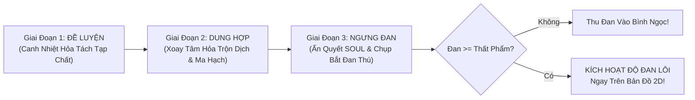

# HỆ THỐNG LUYỆN ĐAN SƯ, MINI-GAME LÒ ĐAN, ĐỘ ĐAN LÔI & THIÊN ĐỈNH BẢNG

> **Mã tài liệu**: `04_Dau_Ky_Cong_Phap_Va_Trang_Bi\He_Thong_Luyen_Dan_Va_Duoc_Dinh.md`
> **Phạm vi**: Thang bậc nghề Luyện Đan Sư (1–9 Phẩm & Đế Phẩm), Mini-game Luyện Đan 3 giai đoạn, Chế độ Luyện Nhanh, Cơ chế Độ Đan Lôi thực chiến, 13 Danh Đỉnh trên Thiên Đỉnh Bảng và 36 Công thức Đan Dược cốt lõi.
> **Đồng bộ**: Liên kết chặt chẽ với chỉ số `SOUL` (Linh Hồn Lực), hệ thống 23 Dị Hỏa, Yêu Khôi hút sét và 12 Đại Cảnh Giới tại [00_Master_Index_Va_Quy_Chuan.md](../00_Tong_Quan_Kien_Truc/00_Master_Index_Va_Quy_Chuan.md).

---

## 1. Hệ Thống Nghề Luyện Đan Sư (Nhất Phẩm -> Cửu Phẩm Tam Giai -> Đế Phẩm)

Trên Đấu Khí Đại Lục, Luyện Đan Sư là nghề nghiệp tôn quý bậc nhất. Tiêu Viêm nhờ huyết mạch Hỏa tinh thuần pha lẫn một tia Mộc chi khí và sự chỉ dạy của Dược Trần mà bước lên đỉnh cao Đan Đạo.

### 1.1. Bảng Phân Cấp 12 Bậc Luyện Đan Sư & Yêu Cầu Linh Hồn (`SOUL`)

| Bậc Luyện Đan Sư | Yêu Cầu Cảnh Giới `SOUL` | Điểm `SOUL` Tối Thiểu | Yêu Cầu Hỏa Chủng Tối Thiểu | Hiện Tượng Khi Thành Đan | Đặc Quyền Huy Chương Công Hội / Đan Tháp |
| :--- | :--- | :---: | :--- | :--- | :--- |
| **Nhất Phẩm** | Phàm Cảnh – Sơ Kỳ | `10 SOUL` | Đấu Khí Hỏa | Tỏa mùi hương nhẹ | Mở sạp bán thuốc dạo; giảm `5%` giá mua dược liệu. |
| **Nhị Phẩm** | Phàm Cảnh – Sơ Đỉnh | `30 SOUL` | Đấu Khí Hỏa / Tử Hỏa | Ánh sáng đan văn mờ | Vào khu giao dịch Luyện Đan Sư cấp tỉnh; giảm `8%` giá. |
| **Tam Phẩm** | Phàm Cảnh – Trung Kỳ | `75 SOUL` | Thú Hỏa bậc 3+ | Cột sáng nhạt vọt khỏi đỉnh | Tham dự nội bộ Công Hội Đế Đô; giảm `12%` giá. |
| **Tứ Phẩm** | Phàm Cảnh – Trung Đỉnh | `150 SOUL` | Thú Hỏa bậc 5 / Dị Hỏa | Hương đan lan `64 px` | Tư cách thi đấu **Đan Hội Gia Mã Đế Quốc**; giảm `15%`. |
| **Ngũ Phẩm** | Phàm Cảnh – Cao Kỳ | `280 SOUL` | Thú Hỏa bậc 6 / Dị Hỏa | Năng lượng gợn sóng quanh lò | Mời chào bởi các tông môn Hắc Giác Vực; mở kho Đan Phương hiếm. |
| **Lục Phẩm** | Phàm Cảnh – Đại Viên Mãn | `480 SOUL` | Hóa Sinh Hỏa / Dị Hỏa | Dị tượng sương mù linh khí | Bậc Tông Sư khu vực Tây Bắc; NPC Đấu Hoàng kính nể nhường đường! |
| **Thất Phẩm** | **Linh Cảnh** – Sơ/Trung Kỳ | `850 SOUL` | **Dị Hỏa** *(Bắt buộc)* | **Đơn Sắc Đan Lôi** *(1–3 đạo)* | Danh chấn Trung Châu; tự động thu hút đệ tử dâng dược liệu quý. |
| **Bát Phẩm** | **Linh Cảnh** – Cao/Viên Mãn | `1,600 SOUL` | Dị Hỏa Top 15 / Đa Hỏa | **Ngũ Sắc -> Cửu Sắc Đan Lôi** + *Đan Hóa Thú Hình*! | Tư cách tranh ngôi **Quán Quân Đan Hội Đan Tháp**; giảm `30%` giá mọi chợ đấu giá! |
| **Cửu Phẩm Bảo Đan** | **Thiên Cảnh** – Sơ/Trung Kỳ | `3,200 SOUL` | Dị Hỏa Top 10 | Đan Thú có trí khôn cao + **Hắc Ma Lôi Kiếp** | Bậc Thánh Giả Đan Đạo; đan dược có thể tự tu luyện hấp thu thiên địa khí. |
| **Cửu Phẩm Huyền Đan** | **Thiên Cảnh** – Cao Kỳ | `5,000 SOUL` | Dị Hỏa Top 5 / Dung Hỏa | Mưa Linh Khí toàn thành + **Huyền Đan Lôi Kiếp** | Trưởng lão tối cao Thiên Phủ Liên Minh; luyện đan thay đổi thời tiết bản đồ! |
| **Cửu Phẩm Kim Đan** | **Thiên Cảnh** – Đại Viên Mãn | `7,500 SOUL` | Tịnh Liên Yêu Hỏa `#03` | Kim Quang Vạn Trượng + **Cửu Huyền Kim Lôi**! | Đỉnh cao thế gian dưới Đế Cảnh; mỗi viên đan ngang một đòn Đấu Thánh! |
| **Đế Phẩm Tông Sư** | **Đế Cảnh Linh Hồn** | `12,000 SOUL` | 23 Dị Hỏa / Đế Viêm | Thiên Địa Triều Bái + **Đế Kiếp Thần Lôi** | Duy nhất Viêm Đế nắm giữ; chạm tới cội nguồn Nguyên Khí Đấu Đế! |

### 1.2. Bốn Cấp Phẩm Chất Viên Đan Xuất Lò (`Output Quality Tier`)
Cùng một công thức, tay nghề điều khiển lửa của người chơi quyết định phẩm chất viên đan thu về:
1. **Phế Đan (`0% – 39% Độ Tinh Thuần`)**: Viên đan đen xì cháy khét. Không uống được nhưng có thể **ném thẳng vào quái như lựu đạn độc** (`150% SOUL` sát thương Độc/Nổ)!
2. **Thành Đan Chuẩn (`40% – 74% Độ Tinh Thuần`)**: Hiệu lực gốc **`×1.00`**, sinh `1 viên`.
3. **Thượng Phẩm Đan Văn (`75% – 94% Độ Tinh Thuần`)**: Viên đan nổi vân sáng xoắn ốc, hiệu lực **`×1.25`**, giảm `50% Đan Độc` tích tụ, `30%` cơ hội ra `2 viên`.
4. **Hoàn Mỹ Đan Linh (`95% – 100% Độ Tinh Thuần`)**: Đạt cảnh giới tối đa (ví dụ *Tam Văn Thanh Linh Đan* lên đủ 3 vân xanh bạc đỏ!), hiệu lực **`×1.50`**, **không gây Đan Độc**, `60%` cơ hội nhân đôi sản lượng!

> **Quy tắc Chống Lạm Dụng Thuốc (`Pill Toxicity / Đan Độc`)**: Uống liên tục các đan dược hồi máu/buff trong thời gian ngắn làm đầy thanh *Đan Độc* (tối đa `100 điểm`). Khi đầy `100/100`, hiệu quả uống thuốc giảm `-70%`. Dùng **Dị Hỏa Nội Thị Tẩy Độc** (ngồi thiền `5s` ngoài giao tranh) hoặc uống đan *Hoàn Mỹ* để giữ cơ thể tinh khiết!

---

## 2. Thiết Kế Mini-Game Luyện Đan Tương Tác 3 Giai Đoạn & Chế Độ Luyện Nhanh

Khi bấm tương tác với **Dược Đỉnh** (có thể đặt đỉnh ngay trên mặt đất bản đồ an toàn hoặc trong Mật Thất), giao diện Lò Đan Pixel mở ra với thời lượng chuẩn **`15 – 22 giây`** cực kỳ lôi cuốn:



### 2.1. Chi Tiết Cơ Chế 3 Giai Đoạn Tương Tác
* **Giai Đoạn 1 — Đề Luyện Dược Liệu (`6 giây` — Nhịp Nhiệt Độ)**:
  * Từng nhánh linh dược rơi vào lòng đỉnh. Một thanh **Nhiệt Kế Hỏa Lực** chạy ngang có **Khung Xanh Ngọc (Vùng Tinh Thuần)** di chuyển lên xuống theo đặc tính cây thuốc (cây Hàn tính cần lửa nhỏ, cây Dương tính cần lửa bùng).
  * Người chơi **nhấn giữ / nhả `Space` (hoặc `LMB`)** để thổi bùng hoặc kìm hãm ngọn lửa giữ kim nhiệt nằm trong Khung Xanh Ngọc.
  * *Vai trò Dị Hỏa*: Sở hữu Dị Hỏa càng cao trên bảng xếp hạng thì Khung Xanh Ngọc càng rộng (`+25% -> +60%`) và tốc độ đốt tạp chất nhanh gấp đôi! Nếu để kim vọt lên Vùng Đỏ quá `1.5s`, cây thuốc cháy thành tro (mất 1 nguyên liệu phụ, trừ `-25% Độ Tinh Thuần`).
* **Giai Đoạn 2 — Dung Hợp Dược Tính & Ma Hạch (`7 giây` — Cân Bằng Âm Dương 2D)**:
  * Góc nhìn chuyển vào **lòng đỉnh tròn Top-down (`180 × 180 px`)**. Các giọt tinh dịch dược liệu (Đỏ Hỏa, Lam Băng, Lục Mộc) và hạt năng lượng **Ma Hạch** trôi nổi xung quanh.
  * Người chơi di chuyển con trỏ chuột điều khiển **Vòng Xoáy Linh Hồn** gom từ từ từng cặp dịch thể vào tâm lò theo thứ tự hiển thị. Nếu để hai luồng dịch xung khắc (như Hàn – Nhiệt chưa có Ma Hạch trung hòa) va sầm trực diện ở tốc độ cao: **Nổ Lò (`Boom!`)** — nắp đỉnh văng tung, khói đen bốc nghi ngút, mặt Sprite Tiêu Viêm nhọ nhem hài hước và mất `10% HP`!
* **Giai Đoạn 3 — Ngưng Đan & Phong Linh (`5 giây` — QTE Ấn Quyết `SOUL`)**:
  * Khối dịch đặc lại thành Phôi Đan phát sáng rung lắc dữ dội. Người chơi bấm chuỗi **3–5 phím Thủ Ấn (`Q`, `E`, `R`, `Space`)** khớp vòng tròn thu nhỏ để đóng Linh Hồn Ấn ổn định viên đan.
  * **Sự kiện đặc biệt từ Bát Phẩm trở lên (`Đan Hóa Linh Thú`)**: Ngay khi nắp đỉnh mở, viên đan hóa thành **Tiểu Long / Bạch Hổ / Hỏa Kỳ Lân bằng ánh sáng** lao vọt khỏi đỉnh chạy trốn trên bản đồ 2D! Người chơi có `8 giây` dùng *Tam Thiên Lôi Động* đuổi theo nhấn `F` quăng lưới **Linh Hồn Hỏa Võng** chụp bắt nó về bình ngọc!

### 2.2. Độ Thông Thạo Đan Phương & Chế Độ "Luyện Nhanh Hàng Loạt" (`Batch Auto-Refine`)
Để người chơi cày cuốc lâu dài hàng trăm giờ không bao giờ thấy phiền phức khi cần chế 50 bình máu/mana đi phó bản:
* Mỗi công thức Đan Phương có thanh **Độ Thông Thạo (`0% -> 100%`)**:
  * Tự tay luyện Thành Đan Chuẩn: `+20%` | Thượng Phẩm: `+35%` | Hoàn Mỹ: `+50%`.
* Ngay khi một Đan Phương đạt **`100% Thông Thạo`** (chỉ cần tự tay luyện chuẩn 2–3 lần đầu!):
  * Mở khóa nút **[Luyện Nhanh Hàng Loạt (`×1 / ×5 / ×10 / ×50`)]**.
  * Hệ thống tự động lấy **kỷ lục Phẩm Chất cao nhất** người chơi từng tự tay luyện được trên công thức đó làm chuẩn đầu ra cố định, hoàn tất cả lô chỉ trong `1.0 giây`!
  * *Lưu ý với Đan Thất Phẩm+*: Khi bấm Luyện Nhanh đan cấp cao có Đan Lôi, game cho chọn: **(A) Ủy thác Thiên Yêu Khôi hấp lôi ngầm** (nhận đan ngay, Khôi Lỗi nhận `50%` năng lượng sét) hoặc **(B) Triệu tập Đan Lôi thực chiến** (để nhận `100%` điểm rèn Thiên Yêu Khôi & rèn Nhục Thân!).

---

## 3. Cơ Chế Đặc Sắc Từ Thất Phẩm Trở Lên: ĐỘ ĐAN LÔI (Pill Lightning Tribulation)

Đúng 100% tinh thần nguyên tác: Đan dược từ **Thất Phẩm Trung Cấp** trở lên mang linh tính nghịch thiên nên vừa ngưng tụ xong sẽ lập tức kéo **Đan Lôi Thiên Kiếp** giáng xuống muốn hủy diệt viên đan!

### 3.1. Bốn Cấp Độ Đan Lôi Trên Bản Đồ Thực Chiến 2D
Ngay khi Giai đoạn 3 hoàn tất, giao diện lò đan đóng lại, camera zoom rộng ra bản đồ 2D: Mây đen sấm chớp cuồn cuộn phủ kín bán kính `320 px` quanh chiếc **Dược Đỉnh đang đặt giữa sân** (Dược Đỉnh lúc này có thanh Máu Bảo Vệ `100%`; nếu để sét đánh vỡ Đỉnh về `0%`, viên đan hóa tro bụi!):

| Cấp Độ Đan Lôi | Xuất Hiện Ở Phẩm Cấp | Số Đợt Sét | Hình Thái Tấn Công Pixel 2D | Phần Thưởng Sạc Khôi Lỗi / Rèn Thể |
| :--- | :--- | :---: | :--- | :--- |
| **1. Đơn Sắc Đan Lôi** *(Bạc)* | Thất Phẩm Trung – Cao | `3 Đợt` | Cột sét thẳng đường kính `64 px` báo đỏ `1.0s` trước khi giáng. | `+60 Điểm Lôi Văn` / đợt; `+15 Max HP` vĩnh viễn (lần đầu). |
| **2. Ngũ Sắc Đan Lôi** | Bát Phẩm Sơ – Trung *(Độ Tinh Thuần <85%)* | `5 Đợt` | 5 cột sét Kim-Mộc-Thủy-Hỏa-Thổ giáng chéo kèm sóng điện lan trên đất `128 px`. | `+150 Điểm Lôi Văn` / đợt; mở tiến hóa **Thiên Yêu Khôi**! |
| **3. Bát Sắc / Cửu Sắc Huyền Đan Lôi** | Bát Phẩm Đỉnh Phong *(Sinh Cốt Dung Huyết Đan!)* | `8 – 9 Đợt` | Mây kiếp hóa **Cửu Sắc Lôi Long dài `256 px`** bổ nhào liên hoàn đuổi theo cả Đỉnh và Người! | `+350 Điểm Lôi Văn` / đợt; đẩy Thiên Yêu Khôi vọt Tinh Đấu Tôn! |
| **4. Hắc Ma Lôi / Cửu Huyền Kim Lôi** | Cửu Phẩm Bảo – Huyền – Kim Đan & Đế Phẩm | `12 Đợt` | Bão sấm đen-vàng phủ kín màn hình + **Lôi Đế Hư Ảnh** cầm búa sét nện trực diện! | `+800 Điểm Lôi Văn` / đợt; thức tỉnh **Yêu Thánh Khôi / Bắc Vương**! |

### 3.2. Ba Phương Pháp Chống Đỡ & Khai Thác Đan Lôi
1. **Nhục Thân Ngạnh Kháng (Body Tempering)**: Uống *Địa Tâm Tôi Thể Nhũ* rồi bật Giáp Đấu Khí nhảy lên đứng đè lên nắp Dược Đỉnh lấy thân mình làm cột thu lôi! Chịu đau mất máu nhưng mỗi kỳ Độ Lôi thành công cộng điểm **Tôi Thể Vĩnh Viễn (`+HP, +DEF, +Kháng Lôi`)**.
2. **Đấu Kỹ Nghênh Thiên**: Canh đúng lúc tia sét / Lôi Long từ đỉnh màn hình lao xuống (`0.5s` cửa sổ phản kích), tung *Diễm Phân Phệ Lãng Xích*, *Đại Thiên Tạo Hóa Chưởng* hoặc ném *Phật Nộ Hỏa Liên* đánh tan tia sét giữa không trung!
3. **Triệu Hồi Thiên Yêu Khôi / Bắc Vương Hút Sét (`Phím T` — Đúng Chuẩn Truyện Nhất!)**: Ra lệnh cho Khôi Lỗi đứng hộ pháp sát bên Dược Đỉnh. Khôi Lỗi tự động nhảy vọt lên đấm tan tia sét và **há miệng nuốt trọn tinh hoa Đan Lôi vào lồng ngực**, toàn thân lóe hoa văn vàng kim tiến hóa cảnh giới ngay trước mắt người chơi!

---

## 4. Thiên Đỉnh Bảng — Danh Sách 13 Tuyệt Thế Danh Đỉnh (+2 Đỉnh Khởi Đầu)

Dược Đỉnh tốt không chỉ chống nổ lò mà còn tăng mạnh xác suất ra Đan Văn và giảm áp lực Đan Lôi:

| Hạng Thiên Đỉnh | Tên Dược Đỉnh | Nguồn Gốc / Chương Thu Thập | Chịu Nhiệt Hỏa Tối Đa | Tăng Tỷ Lệ Thành Đan | Xác Suất Nhân Đôi (`×2 Đan`) | Đặc Tính Độc Quyền Của Danh Đỉnh |
| :---: | :--- | :--- | :--- | :---: | :---: | :--- |
| *Phổ thông* | **Xích Hồng Nhị Khẩu Đỉnh** | Chương 1 (Mua tại Phòng Đấu Giá Ô Thản) | Đấu Khí Hỏa / Thú Hỏa | `+0%` | `0%` | Đỉnh nhập môn 2 lỗ thông hỏa; dùng luyện đan >Tứ Phẩm có `35%` nguy cơ nứt lò! |
| *Cao cấp* | **Xích Diễm Thú Đỉnh** | Chương 4 (Phần thưởng Công Hội Gia Mã) | Dị Hỏa Top 15 | `+8%` | `5%` | Chạm khắc hình Hỏa Báo, giảm `-15%` tốc độ trượt thanh nhiệt ở Giai đoạn 1. |
| **#13** | **Phong Lôi Đỉnh** | Chương 8 (Chiến lợi phẩm Bí Cảnh Bắc Vực) | Dị Hỏa Top 10 | `+12%` | `8%` | Cộng hưởng sấm gió, tăng `+25% hiệu quả hấp thụ Đan Lôi` cho Khôi Lỗi đứng cạnh! |
| **#12** | **Vạn Thú Đỉnh** | Chương 6–7 (Đấu Giá Hắc Giác Vực / Hàn Phong) | Dị Hỏa Top 8 | `+15%` | `10%` | Trong đỉnh phong ấn bách thú hồn; khi Dung Hợp tự gọi hư ảnh thú giúp ổn định Ma Hạch. |
| **#11** | **Hải Hồn Đỉnh** | Chương 8 (Giao dịch Thương Hội Trung Châu) | Dị Hỏa Top 8 | `+16%` | `12%` | Hơi nước ôn nhu trung hòa dược tính nóng nảy, mở rộng Vùng Tinh Thuần thêm `+20%`. |
| **#10** | **Sơn Dung Đỉnh** | Chương 8 (Đoạt từ tay Mộ Cốt / Đan Hội phụ) | Dị Hỏa Top 5 | `+18%` | `14%` | Đúc từ đá lõi núi lửa vạn năm, thanh máu bảo vệ Đỉnh khi Độ Đan Lôi dày gấp **`×2.5 lần`**! |
| **#09** | **Lôi Ngục Đỉnh** | Chương 9 (Viễn Cổ Di Tích Đấu Thánh) | Dị Hỏa Top 5 | `+20%` | `15%` | Tự động hấp thu **1 đợt Đan Lôi đầu tiên** biến thành lớp khiên điện bảo vệ lò đan! |
| **#08** | **Hắc Ma Đỉnh** *(Chủ lực của Dược Lão & Tiêu Viêm!)* | Chương 1 *(Dược Lão cho mượn ngắn)* -> **Chương 7 *(Thu hồi vĩnh viễn từ Hàn Phong!)*** | **Mọi Dị Hỏa** | **`+25%`** | **`20%`** | Thần đỉnh màu đen khắc vạn thú chầu hỏa của Dược Tôn Giả: **Miễn nhiễm `100%` Nổ Lò**, ẩn giấu khí tức giúp **giảm đi `1 đợt Đan Lôi`**, âm thanh vạn thú gầm trấn an Đan Linh! |
| **#07** | **Thiên Diễn Đỉnh** | Chương 9 (Kho báu Đan Tháp Tam Cự Đầu) | Mọi Dị Hỏa | `+26%` | `22%` | Tự động suy diễn bước kế tiếp ở Giai đoạn 2, hiển thị đường dẫn sáng nối các giọt dược dịch. |
| **#06** | **Huyền Hoàng Đỉnh** | Chương 10 (Cống phẩm Thiên Phủ Liên Minh) | Mọi Dị Hỏa | `+28%` | `25%` | Huyền Hoàng nhị khí bao bọc, mọi viên đan xuất lò mặc định đạt tối thiểu bậc **Thượng Phẩm**! |
| **#05** | **Thánh Linh Đỉnh** | Chương 10 (Mật khố Hoa Tông / Dược Tộc giao lưu) | Mọi Dị Hỏa | `+30%` | `28%` | Tăng `×2.0` thời gian làm chậm Đan Thú chạy trốn ở Giai đoạn 3, cực dễ chụp bắt Cửu Phẩm Đan! |
| **#04** | **Vạn Thọ Đỉnh** | Chương 10 (Phần thưởng Dược Điển Dược Tộc) | Mọi Dị Hỏa | `+32%` | `30%` | Mộc khí sinh mệnh nồng đậm, luyện đan hệ Hồi Sinh / Chữa Thương tăng thêm `+30% hiệu lực`. |
| **#03** | **Thần Nông Đỉnh** | Chương 10–11 (Thần vật Thần Nông Lão Nhân truyền lại) | Mọi Dị Hỏa + Đế Viêm | `+36%` | `35%` | Có thể **tự ngưng tụ hư ảnh Bách Thảo** thay thế `1 nguyên liệu dược liệu phụ` còn thiếu trong công thức! |
| **#02** | **Hư Vô Đỉnh** | Chương 11 (Chiến lợi phẩm tổng đàn Hồn Tộc) | Mọi Dị Hỏa + Đế Viêm | `+40%` | `40%` | Luyện hóa trực tiếp Linh Hồn thể tà ác của Hồn Điện thành tinh thuần Hồn Đan tăng `SOUL`. |
| **#01** | **Hỗn Nguyên Đế Đỉnh** | Chương 11 (Đà Xá Cổ Đế Động Phủ — Tối Thượng) | **23 Dị Hỏa Hợp Nhất** | **`+50%`** | **`50%`** | Đệ nhất thần đỉnh thiên địa sơ khai: **Tất cả Đan Dược luyện ra 100% đạt Hoàn Mỹ Đan Linh**, giảm một nửa thời gian hồi chiêu uống thuốc! |

---

## 5. Bảng Công Thức Chi Tiết 36 Đan Dược Cốt Lõi (Chương 1 -> Chương 11)

Tất cả tên dược liệu và cấp độ **Ma Hạch** dưới đây đều bám sát nguyên tác để phân bổ rớt đồ (Loot) trên đúng từng vùng bản đồ:

| # | Tên Đan Dược | Phẩm Cấp | Mở Khóa | Dược Liệu Chính & Cấp Ma Hạch Nguyên Liệu | Tác Dụng Thực Chiến & Đột Phá Trong Game |
| :-: | :--- | :--- | :---: | :--- | :--- |
| **01** | **Trúc Cơ Linh Dịch** | Nhất Phẩm Đỉnh | Chương 1 | *Tử Diệp Lan Thảo + Tẩy Cốt Hoa + Ma Hạch Cấp 1 (Mộc)* | Ngâm mình tu luyện: Tăng **`+100% tốc độ cày EXP Đấu Chi Khí`** (Lv.1–9); bán đấu giá kiếm vốn lớn đầu game! |
| **02** | **Ngưng Huyết Tán** | Nhất Phẩm | Chương 1 | *Huyết Ngưng Thảo + Hoạt Khí Quả* *(Không cần Ma Hạch)* | Thuốc trị thương cơ bản gắn phím `1`: Hồi tức thì `25% HP` + cầm máu xóa hiệu ứng *Xuất Huyết* (CD `8s`). |
| **03** | **Tụ Khí Tán** | Nhất -> Tứ Phẩm | Chương 1 | *Mặc Diệp Liên + Xà Đản Quả + Ma Hạch Cấp 1/2* | Viên đan bước ngoặt từ `9 Đoạn Đấu Chi Khí` ngưng tụ Khí Toàn đột phá **Đấu Giả (`100% thành công`)**! |
| **04** | **Hồi Khí Đan** | Nhị Phẩm | Chương 1 | *Thanh Chi Thảo + Lộ Thủy Diệp + Ma Hạch Cấp 1 (Thủy)* | Đan hồi năng lượng chủ lực đầu game gắn phím `2`: Hồi tức thì `35% QI` + tăng `+20% hồi QI/s` trong `10s`. |
| **05** | **Tăng Khí Đan** | Nhị Phẩm | Chương 2 | *Hỏa Liên Tử + Xích Tinh Thảo + Ma Hạch Cấp 2 (Hỏa)* | Tăng trực tiếp một lượng lớn EXP ở cảnh giới **Đấu Giả** (Lv.10–19), rút ngắn thời gian cày quái rừng. |
| **06** | **Sinh Cốt Đan** | Nhị Phẩm Cao | Chương 2 | *Thiết Mộc Linh Diệp + Bạch Cốt Hoa + Ma Hạch Cấp 2* | Phục hồi tức thì `45% HP` và xóa trạng thái *Gãy Xương / Làm Chậm* do Ma Thú húc trúng. |
| **07** | **Băng Tâm Đan** | Tam Phẩm | Chương 3 | *Băng Linh Diễm Thảo + Hàn Thủy Liên + Ma Hạch Cấp 3 (Băng)* | Trấn áp tà hỏa sa mạc: Tăng **`+50% Kháng Hỏa`**, miễn nhiễm *Mê Hoặc* và giảm sát thương tự đốt khi cắn nuốt Dị Hỏa! |
| **08** | **Hộ Mạch Đan** | Tam Phẩm Cao | Chương 3 | *Kim Tuyến Đằng + Hậu Thổ Chi + Ma Hạch Cấp 3 (Thổ)* | Bảo vệ kinh mạch khi **nuốt Dị Hỏa hoặc cưỡng ép dùng Đấu Kỹ vượt cấp** (giảm `80%` sát thương phản phệ trong `60s`!). |
| **09** | **Cuồng Sư Đan** | Tam Phẩm | Chương 3 | *Liệt Diễm Quả + Cuồng Huyết Thảo + Ma Hạch Cấp 3 (Hỏa)* | Thuốc lắc chiến đấu gắn phím `3`: Tăng **`+25% ATK` & `+15% SPD`** trong `20s` (hết hiệu lực giảm `-10% DEF` `5s`). |
| **10** | **Tẩy Tủy Hàn Linh Dịch** | Tứ Phẩm Đặc Chế | Chương 4 | *Băng Diễm Tuyền Thủy + Tam Hoa Cốt Thảo + Ma Hạch Cấp 4 (Băng)* | Cứu chữa chân tàn phế của đại ca Tiêu Đỉnh & tẩy tủy Gia Hình Thiên; người chơi uống tăng vĩnh viễn **`+5% DEF`**. |
| **11** | **Phá Chướng Đan** | Tứ Phẩm | Chương 4 | *Thanh Mộc Đằng + Tam Diệp Chi + Ma Hạch Cấp 4* | Xóa bỏ bình cảnh đột phá từ **Đấu Sư -> Đại Đấu Sư** (Lv.29 -> 30) không sợ thất bại tụt EXP. |
| **12** | **Tam Văn Thanh Linh Đan** | Tứ Phẩm Đỉnh Phong | Chương 4 | *Thanh Linh Đằng + Thủy Lô Hoa + Phong Linh Tử + Ma Hạch Cấp 4* | Tuyệt phẩm vô địch Đan Hội Gia Mã! Cần dùng **3 loại Hỏa luân phiên** để khắc đủ 3 vân: **Nhảy vọt thẳng `+1 đến +3 Tinh Đại Đấu Sư`**! |
| **13** | **Phục Linh Tử Đan** | Tứ Phẩm Cao | Chương 3–4 | *Sa Chi Hoa (Mạn Đà La Sa Mạc) + Tử Lan Diệp + Ma Hạch Cấp 4* | Giải trừ phong ấn *Ách Nan Độc / Phong Ấn Nữ Hoàng* cho **Băng Hoàng Hải Ba Đông** khôi phục Đấu Hoàng bảo kê Tiêu Viêm! |
| **14** | **Tử Tâm Phá Chướng Đan** | Tứ Phẩm Đỉnh | Chương 5 | *Tử Tâm Lan + Vạn Niên Linh Nhũ + Ma Hạch Cấp 4 Cao* | Có thể uống **2 viên liên tiếp không bị kháng thuốc**, giúp tăng liền **`+2 Tinh Đại Đấu Sư -> Đấu Linh`**! |
| **15** | **Long Lực Đan** | Ngũ Phẩm | Chương 5 | *Long Huyết Thảo + Kim Cương Quả + Ma Hạch Cấp 5 (Á Long)* | Bùng nổ sức mạnh cơ bắp: Tăng **`+40% ATK` và gấp đôi sát thương Phá Giáp** của Huyền Trọng Xích trong `30s`! |
| **16** | **Hồi Xuân Đan (Cao Cấp)** | Ngũ Phẩm | Chương 5 | *Vạn Mộc Thanh Chi + Sinh Cơ Lộ + Ma Hạch Cấp 5 (Mộc)* | Đại dược hồi máu giai đoạn Già Nam: Hồi ngay `60% HP` + hồi tiếp `4% HP/giây` trong `8s`. |
| **17** | **Thanh Hồn Đan** | Ngũ Phẩm Cao | Chương 6 | *Dưỡng Hồn Đằng + Thất Huyễn Thanh Linh Tiên + Ma Hạch Cấp 5* | Phục hồi `80% QI` và chữa lành tổn thương Linh Hồn cho Dược Lão sau khi phụ thể chiến đấu. |
| **18** | **Địa Linh Đan** | Lục Phẩm | Chương 6 | *Địa Tâm Hồng Quả + Hàn Tủy Chi + Ma Hạch Cấp 6 (Băng/Thổ)* | **Đan bảo mệnh bắt buộc phải luyện** trước khi nhảy vào nham tương thu phục *Vẫn Lạc Tâm Viêm* (tạo khiên chống Tâm Hỏa thiêu tim!). |
| **19** | **Đấu Linh Đan** | Lục Phẩm | Chương 5–6 | *Huyền Thủy Hổ Giao Thảo + Thanh Viêm Quả + Ma Hạch Cấp 6* | Dành cho **Đấu Vương** (Lv.50–59): Uống vào tăng trực tiếp **`+1 Tinh Đấu Vương`** (giới hạn 1 viên duy nhất trọn đời!). |
| **20** | **Phục Tử Đan** | Lục Phẩm Đặc Thù | Chương 6 | *Tử Lan Thảo + Hóa Thú Thảo + Vạn Thú Tinh Huyết + Ma Hạch Cấp 6* | Luyện riêng cho cô bé **Tử Nghiên (Thái Hư Cổ Long)** ăn như kẹo và giúp tiến hóa huyết mạch trợ chiến! |
| **21** | **Phá Ách Đan** | Lục Phẩm Cao | Chương 6–7 | *Phá Ách Hoa + Bồ Đề Hóa Thể Tiên (1 giọt) + Ma Hạch Cấp 6* | Khống chế *Ách Nan Độc Thể* cho Tiểu Y Tiên hoặc phá giải cấm chế linh hồn cho Mỹ Đỗ Toa. |
| **22** | **Hoàng Cực Đan** | Lục Phẩm Đỉnh Phong | Chương 7 | *Thiên Hoàng Tham + Vạn Niên Thanh Linh Đằng + Ma Hạch Cấp 6 Đỉnh* | Tương tự Đấu Linh Đan nhưng dành cho **Đấu Hoàng** (Lv.60–69): Tăng vọt **`+1 đến +2 Tinh Đấu Hoàng`**! |
| **23** | **Phá Tông Đan** | Lục Phẩm Cực Hạn | Chương 7 | *Hư Không Linh Chi + Huyết Liên Tinh + Ma Hạch Cấp 6 Đỉnh* | Tăng **`+40% tỷ lệ đột phá đại cảnh giới Đấu Hoàng -> Đấu Tông`** (Lv.69 -> 70), giữ lại nguyên liệu nếu lỡ xịt! |
| **24** | **Âm Dương Huyền Long Đan** | **Thất Phẩm** *(Đơn Sắc Lôi)* | Chương 7–8 | *2 Viên Ma Hạch Cấp 6 Đỉnh Thiên Độc/Hàn Huyền Long + Long Hồn Thảo* | Thần đan *"Hậu tích bạc phát — Phá tử hậu lập"*: Khi Tiêu Viêm bị Boss đánh gục về `0 HP`, tự động kích hoạt **Hồi Sinh Đầy `100% HP/QI` và tăng vĩnh viễn `+10% Toàn Chỉ Số`** (1 lần duy nhất)! |
| **25** | **Thiên Hồn Dung Huyết Đan** | Thất Phẩm Cao | Chương 7–8 | *Thiên Hồn Huyết Cốt Thảo + Minh Hà Châu + Ma Hạch Cấp 7* | Dưỡng thai cho Mỹ Đỗ Toa sinh hạ **Tiêu Tiêu** đạt thẳng cảnh giới Đấu Tông từ trong bụng mẹ! |
| **26** | **Hóa Hình Đan** | Thất Phẩm | Chương 7 | *Hóa Hình Thảo (Săn ở Đấu Giá Hắc Giác) + Ma Hạch Cấp 7* | Giúp Ma Thú Cấp 6–7 hóa hình người hoặc dùng tiến hóa thú cưỡi/đồng hành Ma Thú. |
| **27** | **Hỏa Bồ Đan** | Thất Phẩm Đỉnh | Chương 8 | *Bồ Đề Hóa Thể Tiên + Tam Thiên Diễm Hoa + Ma Hạch Cấp 7 (Hỏa)* | Luyện hóa **Ma Độc Ban** của Vạn Hạt Môn Hạt Tất Nham thành biển Đấu Khí tinh thuần cộng thẳng `+2 Tinh Đấu Tông`! |
| **28** | **Tôn Hồn Đan** | Thất Phẩm Đỉnh | Chương 8 | *Thất Thải Hồn Chi + Dưỡng Thần Mộc + Ma Hạch Cấp 7* | Tăng trực tiếp **`+150 điểm SOUL vĩnh viễn`**, bước đệm quan trọng để tiến vào Đan Hội Trung Châu! |
| **29** | **Phá Tôn Đan** | **Bát Phẩm Sơ** *(Ngũ Sắc Lôi)* | Chương 8–9 | *Thái Hư Huyền Không Quả + Vạn Niên Tinh Tủy + Ma Hạch Cấp 8* | Đột phá rào cản không gian từ **Đấu Tông Đỉnh Phong -> Đấu Tôn** (Lv.79 -> 80) với tỷ lệ thành công `100%`! |
| **30** | **Sinh Cốt Dung Huyết Đan** | **Bát Phẩm Đỉnh** *(Bát/Cửu Sắc Lôi!)* | Chương 8–9 | *Huyết Tinh Yêu Quả + Vạn Niên Thanh Linh Đằng + Long Phượng Quả + Cốt Đấu Thánh + Ma Hạch Cấp 8* | **Đan dược đoạt Quán Quân Đan Hội Đan Tháp & Tái tạo nhục thân hồi sinh sư phụ Dược Lão** bước thẳng lên Bán Thánh! Người chơi uống phụ phẩm tăng `+25% Max HP` vĩnh viễn! |
| **31** | **Cửu Chuyển Phong Tôn Đan** | Bát Phẩm Cao | Chương 9 | *Cửu Chuyển Luân Hồi Thảo + Thiên Mộ Linh Nhũ + Ma Hạch Cấp 8 Cao* | Mỗi viên giúp vượt nhanh **1 Chuyển trong giai đoạn Cửu Chuyển Đấu Tôn** (Lv.86–94) không tốn hàng tháng bế quan! |
| **32** | **Đại Hồn Anh Đan** | Bát Phẩm Đỉnh | Chương 9–10 | *Hồn Anh Yêu Quả (từ Viễn Cổ Di Tích) + Thiên Linh Hoa + Ma Hạch Cấp 8* | Phục hồi hoàn toàn Linh Hồn bị rách nứt và trợ lực đột phá từ Linh Cảnh lên **Linh Hồn Thiên Cảnh**! |
| **33** | **Bồ Đề Đan** | **Cửu Phẩm Bảo Đan** | Chương 10 | *Bồ Đề Tử (lấy từ Bồ Đề Cổ Thụ) + Sinh Linh Thần Thủy + Ma Hạch Cấp 9* | Chí bảo bước chân qua cánh cửa Thánh Giai: Tăng **`+60% xác suất từ Bán Thánh chứng đạo Nhất Tinh Đấu Thánh`** (Lv.99 -> 100)! |
| **34** | **Cửu Âm Hoàng Tuyền Đan** | **Cửu Phẩm Huyền Đan** | Chương 10 | *Hoàng Tuyền Huyết Tinh + Cửu Âm Minh Quả + Tinh Huyết Cửu U Mãng Cấp 9* | Tặng Thải Lân và tự uống cường hóa: Tăng vĩnh viễn **`+15% ATK, +15% SOUL`** và mở kháng tính Hàn-Âm tuyệt đối! |
| **35** | **Lôi Kiếp Đan** | **Cửu Phẩm Kim Đan** | Chương 10–11 | *Bắc Vương Hấp Thu Cửu Huyền Kim Lôi Tinh Tủy + Long Hoàng Chi Tinh Cấp 9* | Đỉnh phong Kim Đan của Tiêu Viêm: Uống hồi tức thì `100% HP & QI` ở cảnh giới Đấu Thánh, hoặc **ném thẳng ra nổ thành Kim Lôi Kiếp gây `6,000% SOUL` xóa sổ Ma Thánh Hồn Tộc**! |
| **36** | **Đế Phẩm Sồ Đan (Phục Nguyên)** | **Đế Phẩm Đan** | Chương 11 | *Bản Nguyên Đế Khí Cổ Đế Động Phủ + Tinh Hoa 23 Dị Hỏa + Đế Cấp Nguyên Hạch* | Tối thượng thần đan của Viêm Đế: Chứa một tia **Nguyên Khí Đấu Đế**, mở khóa cảnh giới cực hạn **Lv.120 Đấu Đế** cho Tiêu Viêm và chia sẻ giúp Huân Nhi, Thải Lân đồng chứng Thần Phẩm! |

---

## 6. Hệ Sinh Thái Dược Liệu, Ma Thú Thủ Hộ & Dược Viên Thế Lực

Để vòng lặp **"Đi săn tìm thuốc -> Luyện đan -> Uống đan đột phá -> Đánh Boss sâu hơn"** vận hành mượt mà không nhàm chán, hệ thống thu thập dược liệu trên bản đồ 2D được thiết kế sát từng chi tiết tiểu thuyết:

### 6.1. Quy Luật "Thiên Tài Địa Bảo Tất Có Dị Thú Thủ Hộ"
* **Dược liệu Phẩm 1 – 3**: Mọc tự nhiên ven rừng Ô Thản, Ma Thú Sơn Mạch ngoài rìa, hoặc mua hạt giống tại Tiệm Thuốc Vạn Dược Trai.
* **Dược liệu Phẩm 4 – 6**: Mọc tại vách đá khuất (phải dùng *Tử Vân Dực* bay sang), ốc đảo ngầm sa mạc hoặc hang động sâu; luôn có **1 Ma Thú Tinh Anh cùng cấp** nằm ngủ canh giữ trong bán kính `128 px`.
* **Thánh Dược Phẩm 7 – 9**: Chỉ xuất hiện tại các Bí Cảnh (*Vạn Dặm Đan Giới, Viễn Cổ Di Tích, Mãng Hoang Cổ Vực*). Dược liệu từ Bát Phẩm trở lên (như *Vạn Niên Thanh Linh Đằng, Huyết Tinh Yêu Quả, Đan Thú*) đã **thông linh biết độn thổ chạy trốn** khi phát hiện người lạ — người chơi phải bật quét cảm nhận `SOUL` và dùng *Hấp Chưởng* hoặc chụp lồng ngọc trước khi nó chui xuống đất!

### 6.2. Công Cụ Thu Hoạch Chuẩn Luyện Đan Sư (`Jade Harvesting Kit`)
Trong nguyên tác, Dược Lão luôn căn dặn Tiêu Viêm không được dùng tay trần hay sắt thép chạm vào linh dược kẻo làm tan biến linh khí:
* **Hái bằng tay không / Trọng Xích**: Làm giảm `-30% Dược Tính` của cây thuốc vừa nhặt (khó luyện ra Thượng Phẩm/Hoàn Mỹ).
* **Trang bị Bộ Dao Ngọc & Hộp Ngọc Hàn Băng** (chế tạo hoặc mua ở Công Hội): Giữ trọn **`100% Dược Tính Tươi`**, đồng thời có `20%` cơ hội rơi thêm **Hạt Giống Linh Dược** để mang về trồng!

### 6.3. Hệ Thống Dược Viên Tự Động Của Thế Lực (`Idle Herb Garden`)
Khi Tiêu Viêm thành lập thế lực riêng qua từng Quyển truyện, người chơi mở khóa khu đất **Dược Viên** để trồng lại các Hạt Giống đã săn được:

| Cấp Độ Thế Lực | Chương Mở | Số Ô Ruộng Linh Điền | Cấp Thuốc Trồng Tối Đa | Tiện Ích Tự Động Hóa Cày Cuốc |
| :--- | :---: | :---: | :---: | :--- |
| **Bàn Môn (Nội Viện Già Nam)** | Chương 6 | `6 Ô` | Ngũ Phẩm | Đệ tử Bàn Môn tự tưới nước, thu hoạch mỗi `15 phút` thực tế; bán đan lẻ thu **Hỏa Năng** tự động! |
| **Viêm Minh (Gia Mã Đế Quốc)** | Chương 7 | `12 Ô` | Lục Phẩm | Liên kết thương hội Mễ Đặc Nhĩ, cho phép đặt lệnh **Thu Mua Ma Hạch Cấp 1–5** định kỳ bằng Vàng. |
| **Tinh Vẫn Các (Trung Châu)** | Chương 9 | `18 Ô` | Bát Phẩm | Trận pháp Tụ Linh Không Gian rút ngắn `-35%` thời gian chín của dược liệu quý. |
| **Thiên Phủ Liên Minh** | Chương 10 | `24 Ô` + *Hồ Sinh Linh* | Cửu Phẩm | Tưới bằng *Sinh Linh Chi Diễm*, xác suất `25%` đột biến dược liệu thường thành **Vạn Niên Dược Vương**! |

---

## 7. Chế Độ Thi Đấu Đối Kháng: "ĐẠI HỘI LUYỆN ĐAN" (Alchemist Tournament Gameplay)

Hai đỉnh cao cảm xúc lớn nhất của mạch nghề Luyện Đan trong nguyên tác là **Đan Hội Gia Mã Đế Quốc** (Chương 4 — Tiêu Viêm hóa trang thành *Nham Kiêu* chặn đứng âm mưu của tên gián điệp Xuất Vân Đế Quốc *Viêm Lợi*) và **Đan Hội Đan Tháp Trung Châu** (Chương 8 — đại chiến *Tào Dĩnh, Đan Thần Tử, Mộ Cốt Lão Nhân*). Trong game, đây là một chế độ **Boss Fight bằng Đan Đạo** cực kỳ kịch tính!

### 7.1. Cấu Trúc 3 Vòng Thi Đấu Đan Hội Trên Quảng Trường Vạn Người
1. **Vòng 1 — Khảo Hạch Linh Hồn Mê Cung (`Soul Maze Trial`)**:
   * Điều khiển luồng Linh Hồn thể của Tiêu Viêm xuyên qua mê cung áp lực tinh thần trên đài đá trong `45 giây`, phá vỡ các ảo ảnh tâm ma để giành bệ đá trung tâm cao nhất (bệ trung tâm cộng `+15% Tốc độ Đề Luyện` cho vòng cuối!).
2. **Vòng 2 — Đề Luyện Cực Hạn Tinh Thiết / Vạn Dược (`Speed Extraction`)**:
   * Đua tốc độ và độ tinh khiết cùng 8 đối thủ AI trên màn hình chia bảng xếp hạng thời gian thực (`Live Leaderboard`). Ai đề luyện đạt `>90% Tinh Thuần` nhanh nhất nhận buff *Khí Thế Áp Đảo*.
3. **Vòng 3 — Chung Kết Luyện Đan Đối Kháng & Chống Quấy Nhiễu Linh Hồn (`Grand Final`)**:
   * Trong khi người chơi thực hiện 3 Giai đoạn Luyện Đan trên bệ đá, các đối thủ tà đạo (như *Viêm Lợi* dùng độc hỏa hay *Mộ Cốt Lão Nhân* phóng ám khí Hồn Điện) sẽ **phóng châm Linh Hồn tàng hình sang lò đan của Tiêu Viêm**!
   * **Cơ chế Phản Kích (`Soul Counter-Parry`)**: Khi viền màn hình nháy tím cảnh báo tập kích ngầm, bấm tức thì phím `E` hoặc `T` để bật **Linh Hồn Thủ Ấn / Hỏa Thuẫn** dội ngược đòn đánh trả lại lò của kẻ ám toán khiến đỉnh của hắn rung lắc tụt điểm!
   * **Tuyệt kỹ lật kèo phút chót — "Thăng Linh Chi Pháp" (Dược Lão Chân Truyền)**:
     * Ở 5 giây cuối của Vòng Chung Kết, người chơi có thể bấm nút đỏ **[THĂNG LINH CHI PHÁP]**: Đốt cháy tạm thời `50% thanh SOUL hiện tại` để ép luồng Tử Hỏa / Tam Thiên Hỏa bùng lên cưỡng chế nâng viên đan lên **thêm 1 bậc Đan Văn / thêm 2 sắc Đan Lôi** (ví dụ biến Ngũ Sắc thành **Bát Sắc Đan Lôi** đè bẹp Ngũ Sắc Đan Lôi của Mộ Cốt Lão Nhân trên bầu trời Đan Thành!).

---

## 8. Bảng Kỳ Vật Thiên Địa & Linh Dịch Trực Tiếp (Không Qua Lò Đan)

Ngoài 36 loại đan dược thành viên, thế giới *Đấu Phá Thương Khung* còn sở hữu **8 loại Thiên Địa Kỳ Vật Dược Dịch** cực hiếm tìm thấy trong hang sâu, lòng đất — có thể dùng trực tiếp để lột xác nhân vật hoặc làm chất xúc tác luyện đan thần cấp:

| # | Tên Thiên Địa Kỳ Vật | Chương Xuất Hiện | Địa Điểm Kỳ Ngộ Ẩn Trên Bản Đồ | Công Dụng Lột Xác Nhân Vật / Luyện Đan |
| :-: | :--- | :---: | :--- | :--- |
| **1** | **Tử Tinh Nguyên** | Chương 2 | Hang Tử Tinh Dực Sư Vương (Ma Thú Sơn Mạch) | Hấp thu mở khóa **Tử Hỏa** đầu đời + cộng vĩnh viễn `+50 QI tối đa`. |
| **2** | **Băng Linh Hàn Tuyền** | Chương 2–3 | Hang kho báu Tiểu Y Tiên / Mật thất Hải Ba Đông | Bôi toàn thân bảo vệ da thịt trước khi nuốt *Thanh Liên Địa Tâm Hỏa* lần đầu! |
| **3** | **Địa Tâm Hỏa Chi Tinh** | Chương 3 | Đáy hồ dung nham Sa Mạc Tháp Qua Nhĩ | Vật liệu rèn thăng bậc **Huyền Trọng Xích** và tôi luyện kinh mạch kháng nham tương. |
| **4** | **Thất Huyễn Thanh Linh Tiên** | Chương 4 | Phần thưởng cứu chữa Nạp Lan Kiệt (Đế Đô) | Thức tỉnh Linh Hồn Dược Lão khỏi trạng thái ngủ say sau khi Tiêu Viêm ném Hỏa Liên quá sức! |
| **5** | **Địa Tâm Tôi Thể Nhũ** | Chương 5–6 | Động phủ Tuyết Ma Thiên Viên (Thâm sơn Già Nam) | Ngâm mình tẩy tủy nhục thân: Tăng vĩnh viễn **`+15% Max HP, +15% DEF`**, điều kiện cần để dùng **Nhục Thân Kháng Đan Lôi**! |
| **6** | **Vạn Niên Linh Nhũ** | Chương 5 | Chung nhũ thạch sâu dưới khe núi Hắc Giác Vực | Uống trực tiếp xóa sạch `100% Đan Độc` và hồi đầy tức thì cả `HP, QI, SOUL`. |
| **7** | **Bồ Đề Hóa Thể Tiên** | Chương 7–8 | Đấu Giá Hội Hắc Hoàng Thành / Ma Thú Khô | Chí bảo kết tinh từ nhựa Bồ Đề Cổ Thụ: Dùng luyện *Hỏa Bồ Đan*, bịt kín tà khí của *Bồ Đề Đan*, và mở trạng thái **Ngộ Đạo Đấu Kỹ lên Hóa Cảnh**! |
| **8** | **Hoàng Tuyền Huyết Tinh** | Chương 9 | Đáy Hoàng Tuyền Đàm (Cửu U Địa Minh Mãng Tộc) | Tinh huyết âm hàn ngàn năm: Thức tỉnh **Hoàng Tuyền Thiên Nộ** đạt uy lực tối đa và luyện chế *Cửu Âm Hoàng Tuyền Đan*. |

---

## 9. Công Thức Toán Học Lò Đan, Kinh Tế Đấu Giá & Bố Cục UI Pixel Art

### 9.1. Công Thức Tính Xác Suất Thành Đan & Điểm Tinh Thuần (`Purity Formula`)
Để lập trình viên dễ dàng cân bằng độ khó từ Nhất Phẩm đến Đế Phẩm, điểm **Độ Tinh Thuần Cuối Cùng (`Final Purity %`)** quyết định phẩm chất viên đan được tính bằng công thức:

$$\text{Final Purity} = \text{Base}_{\text{MiniGame}} \times 0.55 + \text{Bonus}_{\text{SOUL}} + \text{Bonus}_{\text{Đỉnh}} + \text{Bonus}_{\text{Dị Hỏa}} - \text{Penalty}_{\text{Vượt Cấp}}$$

Trong đó:
* $\text{Base}_{\text{MiniGame}} \in [0, 100]$: Trung bình cộng điểm thao tác của người chơi qua 3 giai đoạn (`Đề Luyện 35% + Dung Hợp 40% + Ngưng Đan 25%`).
* $\text{Bonus}_{\text{SOUL}} = \min\left(20,\; \frac{\text{SOUL}_{\text{Hiện Tại}} - \text{SOUL}_{\text{Yêu Cầu}}}{\text{SOUL}_{\text{Yêu Cầu}}} \times 25\right)$: Linh Hồn càng vượt xa yêu cầu đan phương thì thao tác khống chế càng nhàn nhã.
* $\text{Bonus}_{\text{Đỉnh}} \in [0, 50]$: Chỉ số cộng thẳng từ **Thiên Đỉnh Bảng** (ví dụ *Hắc Ma Đỉnh* `+25`, *Đế Đỉnh* `+50`).
* $\text{Bonus}_{\text{Dị Hỏa}} \in [5, 35]$: Phụ thuộc đặc tính ôn hòa hay bá đạo của ngọn lửa dùng châm lò (xem bảng dưới).
* $\text{Penalty}_{\text{Vượt Cấp}}$: Nếu cố luyện đan cao hơn bậc Huy Chương hiện tại `1 Phẩm`, bị trừ `-25 điểm` (bắt buộc thao tác Mini-game gần như tuyệt đối mới ra được Thành Đan!).

### 9.2. Bảng Tương Thích Dị Hỏa Trong Nghề Luyện Đan

Không phải Dị Hỏa nào sát thương cao cũng dễ luyện đan (như *Hư Vô Thôn Viêm* hay *Hải Tâm Viêm* tính chất khác biệt, trong khi *Cốt Linh Lãnh Hỏa* và *Sinh Linh Chi Diễm* là thần hỏa của Luyện Đan Sư!):

| Ngọn Lửa Châm Lò | Xếp Hạng Dị Hỏa | Cộng Tinh Thuần ($\text{Bonus}_{\text{Dị Hỏa}}$) | Mở Rộng Vùng Nhiệt Xanh | Hiệu Ứng Đặc Thù Trong Lò Đan |
| :--- | :---: | :---: | :---: | :--- |
| **Đấu Khí Hỏa Thường** | — | `+0` | `+0%` | Chỉ luyện được tối đa Tứ Phẩm; đề luyện dược liệu cứng rất chậm. |
| **Tử Tinh Dực Sư Hỏa (Tử Hỏa)** | Thú Hỏa Cấp 6 | `+6` | `+10%` | Lửa ổn định đầu game, giúp vượt qua kỳ thi Nhị – Tam Phẩm dễ dàng. |
| **Hóa Sinh Hỏa (Lộng Viêm Quyết)** | Bí Hỏa | `+10` | `+15%` | Linh hoạt đổi nhiệt độ nhanh, giảm `-20%` tiêu hao `QI` khi luyện hàng loạt. |
| **Thanh Liên Địa Tâm Hỏa** | `#19` | `+14` | `+20%` | Nhiệt lượng dồi dào bền bỉ từ lòng đất, đề luyện khoáng chất/xương cốt cực nhanh. |
| **Hải Tâm Viêm** | `#15` | `+16` | `+30%` | Như dòng nước ấm áp bao bọc dược dịch, giảm `50%` nguy cơ xung khắc nổ lò ở Giai đoạn 2. |
| **Vẫn Lạc Tâm Viêm** | `#14` | `+18` | `+25%` | Lửa rèn luyện từ tâm niệm, tự động đồng bộ nhịp QTE Ấn Quyết `SOUL` ở Giai đoạn 3. |
| **Cốt Linh Lãnh Hỏa** *(Chân truyền Dược Tôn Giả!)* | `#11` | **`+26`** | **`+45%`** | **Cực Hàn – Cực Nhiệt tùy tâm chuyển đổi!** Khắc tinh của mọi loại dược liệu khó tính nhất, `+15%` ra Đan Văn! |
| **Tam Thiên Diễm Viêm Hỏa** | `#09` | `+22` | `+30%` | Truyền sinh cơ Tinh Không vào đan dược, giúp đan hồi máu tăng thêm `+20%` lượng hồi. |
| **Sinh Linh Chi Diễm** *(Thần Hỏa Đan Đạo!)* | `#05` | **`+35`** | **`+60%`** | Ngọn lửa của sự sống và thảo mộc: **Không bao giờ làm cháy thuốc ở Giai đoạn 1**, tăng gấp đôi tỷ lệ nhân đôi số viên! |
| **Tịnh Liên Yêu Hỏa** | `#03` | `+32` | `+50%` | Tịnh hóa tuyệt đối `100%` tạp chất ngay giây đầu thả thuốc vào lò, biến mọi đan dược thành không Đan Độc! |

### 9.3. Vòng Lặp Kinh Tế "Khoác Hắc Bào Đi Đấu Giá Đan Dược" (`Black-Robe Auction Economy`)
Trong suốt Quyển 1 và Quyển 2, Tiêu Viêm luôn khoác **Áo Choàng Đen (`Hắc Bào`)** che giấu thân phận bước vào **Phòng Đấu Giá Mễ Đặc Nhĩ / Hắc Hoàng Các** bán đan dược lấy tiền vơ vét kỳ trân dị bảo:
* **Bán Tiệm Thuốc Thường**: Nhận tiền mặt Vàng ngay lập tức nhưng chỉ được `100% Giá Gốc`.
* **Ký Gửi Phòng Đấu Giá (Mở mỗi 3 ngày trong game)**:
  * Đan bậc **Thượng Phẩm / Hoàn Mỹ** (như *Trúc Cơ Linh Dịch, Tụ Khí Tán, Thanh Linh Đan, Đấu Linh Đan, Hoàng Cực Đan*) khi đưa lên sàn đấu giá sẽ kích hoạt **Event NPC Tranh Giá sôi nổi**, đẩy giá bán vọt lên **`180% – 350% Giá Gốc`**!
  * Có xác suất `25%` một NPC Đại Gia Tộc (như *Nhã Phi, Hải Ba Đông, Tô Thiên*) chủ động đề nghị **Lấy Vật Đổi Đan (`Barter Trade`)**: Đổi trực tiếp lấy **Mảnh Bản Đồ Tịnh Liên Yêu Hỏa**, **Quyển Trục Đấu Kỹ Huyền/Địa Giai**, hoặc **Dược Liệu Tuyệt Chủng** không thể mua bằng tiền!
  * *Chi tiết nhập vai thú vị*: Nếu người chơi quên mặc **Hắc Bào** khi mang đan Lục – Thất Phẩm đi bán ở Hắc Giác Vực, lúc bước ra khỏi cổng thành sẽ bị **1 toán Sát Thủ Hắc Bảng / Cướp Cạn Đấu Vương** phục kích cướp thuốc trên đường về (giết ngược chúng lại rớt thêm Nạp Giới đầy chiến lợi phẩm!).

### 9.4. Quy Chuẩn Giao Diện UI Lò Đan Pixel (`640 × 360 px`)
```text
┌──────────────────────────────────────────────────────────────────────────┐
│ [Bậc: Thất Phẩm]   CÔNG THỨC: ÂM DƯƠNG HUYỀN LONG ĐAN    [Thông thạo:80%]│
├────────────────────┬─────────────────────────────────┬───────────────────┤
│ KHE NGUYÊN LIỆU    │        KHUNG LÒ ĐAN TRUNG TÂM   │ THÔNG SỐ HỎA & HỒN│
│ [x] Huyền Long Hạch│            (180 x 180 px)       │ Hỏa: Cốt Linh #11 │
│ [x] Hàn Long Hạch  │         .─.   (Đan Linh)  .─.   │ Đỉnh: Hắc Ma #08  │
│ [x] Long Hồn Thảo  │        (   )  ~~~~~~~~~  (   )  │ SOUL: 1,240 / 850 │
│                    │         `─'  [ HẮC MA ]   `─'   │ Tinh thuần: 92%   │
│ [Luyện Nhanh: Khóa]│              [  ĐỈNH  ]         │ [THĂNG LINH (T)]  │
├────────────────────┴─────────────────────────────────┴───────────────────┤
│ NHIỆT ĐỘ HỎA: [░░░░░░░░░██████████░░░░░░░░] (Giữ SPACE giữ vùng Xanh!)  │
└──────────────────────────────────────────────────────────────────────────┘
```

### 9.5. Săn Bắt "Đan Thú Hoang Dã" (Sentient Wild Pills)
Trong nguyên tác (tại *Đan Giới* Chương 8 và *Cổ Đế Động Phủ* Chương 11), những viên đan dược cổ xưa tồn tại hàng ngàn năm hấp thu tinh hoa nhật nguyệt sẽ tự hóa thành sinh vật sống:
* **Đặc điểm trên bản đồ**: Mang hình dáng Hổ Trắng, Hươu Ngọc, Hạc Lửa kích thước nhỏ (`24 × 24 px`) tỏa hào quang 7 màu, tốc độ chạy cực cao (`160% SPD`), không tấn công người chơi (trừ Boss *Đế Phẩm Sồ Đan*!) mà chỉ tìm kẽ nứt không gian để chui trốn.
* **Cách thu phục**: Nếu chém chết bằng sát thương vật lý thô bạo, viên đan sẽ vỡ nát làm giảm `-50% hiệu lực` (chỉ thu được *Tàn Đan*). Người chơi phải dùng **Linh Hồn Phong Ấn** hoặc quăng **Hắc Ma Đỉnh (`Phím T` khi đứng gần `<96 px`)** úp chụp trực tiếp khi thanh Thể Lực của Đan Thú xuống dưới `25%` để thu về nguyên vẹn **Cửu Phẩm Nguyên Đan**!
