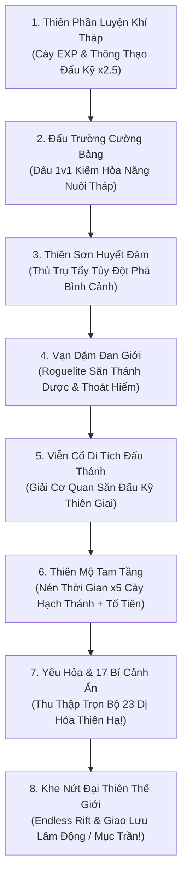

# HỆ THỐNG 8 ĐẠI PHÓ BẢN CÀY CUỐC, BÍ CẢNH SĂN DỊ HỎA & ENDGAME VỊ DIỆN

> **Mã tài liệu**: `05_Quai_Vat_Boss_Va_Ban_Do\Pho_Ban_Cay_Cuoc_Va_Bi_Canh.md`
> **Phạm vi**: Thiết kế vòng lặp Gameplay lặp lại gây nghiện (Replayable Grinding Loops) cho 8 Đại Phó Bản đặc trưng nguyên tác, Bản đồ 17 Bí Cảnh Dị Hỏa Ẩn và Post-game Đại Thiên Thế Giới (Boss Ẩn Võ Tổ Lâm Động & Mục Trần).
> **Đồng bộ**: Kết nối toàn diện với kinh tế Đa Tiền Tệ, Luyện Đan, Đúc Yêu Khôi và 24 Đấu Kỹ tại [00_Master_Index_Va_Quy_Chuan.md](../00_Tong_Quan_Kien_Truc/00_Master_Index_Va_Quy_Chuan.md).

---

## 1. Kiến Trúc Vòng Lặp Cày Cuốc Cuối Tuần / Dài Hạn (`Core Grinding Loop`)

Để người chơi gắn bó hàng chục tới hàng trăm giờ sau khi nắm vững cốt truyện mà không bao giờ rơi vào cảnh "chém quái đồng cỏ lặp đi lặp lại", mỗi Đại Phó Bản trong *Đấu Phá Thương Khung* đại diện cho **1 Thể Loại Gameplay Riêng Biệt** và cung cấp **1 Nhánh Tài Nguyên Độc Quyền**:



---

## 2. Thiết Kế Chi Tiết 8 Đại Phó Bản & Bí Cảnh Cày Cuốc

### Phó Bản 01: Thiên Phần Luyện Khí Tháp *(Chương 6 Mở Khóa | Leo Tầng Ngầm & Cân Bằng Tâm Hỏa)*
* **Thể loại Gameplay**: *Deep-Dive Risk/Reward Grinding Dungeon* (9 Tầng tháp chìm sâu vào lòng đất).
* **Chi phí vào cửa**: Trừ dần **Điểm Hỏa Năng (`Fire Energy`)** trong thẻ tinh thể xanh theo mỗi phút ở dưới tháp (tầng càng sâu tốn càng nhiều Hỏa Năng nhưng hiệu suất tu luyện tăng phi mã).
* **Cơ Chế Gây Nghiện Cốt Lõi — Thanh "Tâm Hỏa Nhiệt Độc (`Heart-Flame Gauge 0% -> 100%`)"**:
  * Năng lượng bức xạ từ *Vẫn Lạc Tâm Viêm* dưới đáy tháp vừa kích thích Đấu Khí sôi trào vừa thiêu đốt lục phủ ngũ tạng. Càng chém quái *Hỏa Tinh Tích Dịch / Hỏa Linh Thể* liên tục ở tầng sâu, thanh Tâm Hỏa càng dâng cao:

| Ngưỡng Tâm Hỏa | Hệ Số Nhân `EXP` & `MP` | Rủi Ro & Biến Đổi Thực Chiến Trên Bản Đồ |
| :--- | :---: | :--- |
| **An Toàn (`0% – 39%`)** | `×1.3 EXP` | Màn hình ấm nhẹ; quái vật bình thường. |
| **Sôi Trào (`40% – 74%`)** | **`×1.8 EXP`, `×1.5 MP`** | Rút máu nhẹ `-1.0% HP/giây`; làm lộ **Mạch Tinh Thể Hỏa Năng Ẩn** trên vách tường để đập lấy thưởng! |
| **Cực Hạn (`75% – 99%`)** | **`×2.8 EXP`, `×2.2 MP`** | Rút `-3.5% HP/giây`; cứ mỗi 45s sinh ra **1 Tâm Ma Hắc Ảnh** (sao chép y hệt vũ khí & Đấu Kỹ của Tiêu Viêm!) lao vào quyết đấu — hạ Tâm Ma rớt thẳng *Tâm Hỏa Tinh Châu*! |
| **Quá Tải (`100%`)** | *Tẩu Hỏa Nhập Ma!* | Choáng ngất ngay lập tức, bị Trưởng lão Nội Viện khiêng văng ra cửa tháp, rơi mất `50%` đồ nhặt trong chuyến đó! |

* **Quyết định chiến thuật của người chơi**: Mang theo nhiều **Băng Tâm Đan** (mỗi viên uống giảm `-30% Thanh Tâm Hỏa`) để ép bản thân duy trì lơ lửng ở mức `80% – 95%` cày cấp nhanh gấp gần ba lần bình thường!

---

### Phó Bản 02: Đấu Trường Cường Bảng & Thiên Tài Chiến Trung Châu *(Chương 6 & 8 | 1v1 Boss Rush Ladder)*
* **Thể loại Gameplay**: *Pure Skill 1v1 Arena Duel & Win-Streak Gauntlet*.
* **Hai Mùa Giải Lớn**:
  1. **Cường Bảng Nội Viện Già Nam (Hạng 50 -> Hạng 1)**: Lần lượt khiêu chiến các cao thủ học viện có AI chiến đấu thông minh như người thật (*Bạch Trình, Phó Ngao, Liễu Phi, Diêu Thịnh, Nghiêm Hạo, Lâm Tu Nhai, Liễu Kình, Tử Nghiên*).
  2. **Phong Vân Thiên Tài Bảng Trung Châu (Hạng 30 -> Hạng 1)**: Đối đầu thế hệ trẻ đỉnh cao Tứ Phương Các & Bát Tộc (*Đường Ưng, Vương Trần, Mộ Thanh Loan, Phượng Thanh Nhi, Lôi Động, Cổ Yêu, Viêm Quân, Hồn Phong*).
* **Cơ Chế "Liên Đấu Chấp Thương (`Unhealed Streak Mode`)"**:
  * Sau khi thắng 1 đối thủ, trọng tài hỏi: **[Rút Lui Nhận Thưởng]** hay **[Đánh Tiếp Đối Thủ Hạng Cao Hơn Mà Không Hồi Máu (`Nhân ×1.5 Phần Thưởng`)]**?
  * Chuỗi thắng 5 trận liên tiếp không uống thuốc mang về lượng **Hỏa Năng / Huyền Tinh Tệ khổng lồ** đủ nuôi cả tuần cày *Thiên Phần Tháp* + Lương thưởng định kỳ mỗi ngày theo thứ hạng đang nắm giữ!

---

### Phó Bản 03: Thiên Sơn Huyết Đàm *(Chương 8 | Thủ Trụ Sinh Tồn Nạp Năng Lượng)*
* **Thể loại Gameplay**: *King-of-the-Hill Wave Defense*.
* **Bối cảnh**: Đỉnh núi lửa Thiên Sơn sương mù đỏ rực; ở trung tâm bản đồ `480 × 480 px` là **Vòng Tròn Tâm Huyết Đàm (`đường kính 112 px`)** đang sủi bọt linh khí ngàn năm.
* **Luật Chơi Căng Thẳng (`180 giây`)**:
  * Chỉ khi Tiêu Viêm đứng bên trong Vòng Tròn Tâm Đàm, thanh **Huyết Mạch Đột Phá (`0% -> 100%`)** mới tăng dần (`+0.8%/giây`).
  * Từ 8 hang đá quanh hồ, từng đợt **Phệ Kim Thử vạn con, Hỏa Độc Giao Xà và Ma Thú Cấp 7** liên tục tràn vào muốn húc văng Tiêu Viêm ra khỏi vòng tròn!
  * Nếu bị húc văng ra ngoài vòng tròn quá `5 giây`, năng lượng nguội đi làm tụt ngược thanh tiến độ!
* **Phối hợp chiến thuật sướng tay**: Ra lệnh `Alt+T` cho **Địa Yêu Khôi** đứng chặn hướng Đông, gọi **Đồng Hành (Tiểu Y Tiên / Thải Lân)** trấn hướng Tây, còn Tiêu Viêm trụ vững giữa tâm hồ xoay *Lục Hợp Du Thân Xích* và gầm *Sư Hổ Toái Kim Ngâm* đẩy lùi vạn thú!
* **Phần thưởng Độc quyền**: Đầy `100%` thanh Huyết Năng giúp **Xóa sạch bình cảnh đột phá đại cảnh giới**, cộng vĩnh viễn `+10% Max HP` và rớt số lượng lớn *Tinh Huyết Ma Thú Cấp 7*!

---

### Phó Bản 04: Vạn Dặm Đan Giới *(Chương 8 -> Vô Hạn | Bản Đồ Ngẫu Nhiên `Procedural Roguelite Extraction`)*
* **Thể loại Gameplay**: *Timed Procedural Exploration & Loot Extraction* (Lấy cảm hứng từ tính chất không gian cổ sụp đổ của Đan Giới!).
* **Cơ Chế Bản Đồ Sinh Ngẫu Nhiên**: Mỗi lần tiêu 1 *Đan Giới Không Gian Phù* bước vào, thuật toán trộn ngẫu nhiên **6 Phân Khu Địa Hình** (*Rừng Vạn Dược, Đầm Hắc Độc, Đồi Lôi Thiết, Thung Lũng Đan Thú, Di Chỉ Dược Tôn, Bệ Truyền Tống Thoát Hiểm*).
* **Luật Chơi "Tham Thì Thâm — Rút Lui Đúng Lúc" (`10 Phút Đếm Ngược`)**:
  1. Dược liệu quý (*Huyết Tinh Yêu Quả, Vạn Niên Thanh Linh Đằng, Long Phượng Quả*) và **Đan Thú Hoang Dã** nằm càng gần tâm bản đồ càng hiếm.
  2. Trên bản đồ có **6 AI Thợ Săn Thuốc Đối Địch** (gồm các Luyện Đan Sư tà phái và Hồn Điện Tôn Lão) cũng đang đi vơ vét rương thuốc — người chơi có thể **chặn đường cướp giỏ thuốc của chúng**!
  3. Khi đồng hồ còn **`02:00 cuối`**, *Không Gian Đại Phong Bạo* nổi lên: Vết nứt đen nuốt dần rìa bản đồ thu hẹp vào trong, nhưng cùng lúc đó **1 Cây Cửu Phẩm Dược Vương** sẽ nở hoa ngay giữa vùng bão!
  4. **Điều kiện Chiến thắng**: Phải chạy kịp vào **Cổng Không Gian Thoát Hiểm (`Extraction Gate`)** trước giây `00:00` để bỏ túi `100%` dược liệu; nếu để không gian sập lên đầu, bị tống xuất trọng thương và **rơi mất `70%` giỏ thuốc vừa nhặt**!

---

### Phó Bản 05: Viễn Cổ Di Tích Đấu Thánh *(Chương 9 -> Vô Hạn | Giải Đố Cơ Quan & Mở Rương Mạo Hiểm)*
* **Thể loại Gameplay**: *Trap Puzzle Dungeon & High-Stakes Chest Gambling*.
* **Hệ Thống Cơ Quan Top-down 2D**:
  * **Hành Lang Lưỡi Đao Không Gian**: Đòi hỏi lướt *Tam Thiên Lôi Động* chính xác từng nhịp `0.28s` qua khe hở tia cắt bạc.
  * **Bàn Cờ Ngũ Hành Hỏa Chủng**: Thắp sáng các chậu lửa cổ bằng đúng thứ tự nhiệt độ Dị Hỏa để mở mật thất ẩn.
  * **Đại Điện Quyển Trục Chân – Giả**: Trên bệ đá đặt `5 Quyển Trục Ánh Vàng` — nếu chỉ số **`SOUL` của người chơi đủ cao**, khi di chuột vào sẽ nghe thấy tiếng ngân thanh thoát của quyển thật; nếu chọn nhầm quyển bẫy giả, nó nổ tung thành *Linh Hồn Phong Bạo* và đánh thức **3 Cốt Thánh Khôi Lỗi** bao vây khóa cửa phòng!
* **Phần thưởng Cày cuốc**: Nguồn duy nhất để cày **Mảnh Đấu Kỹ Thiên Giai** (nâng cấp độ thông thạo *Đại Thiên Tạo Hóa Chưởng, Kim Đế Phần Thiên Trảm*), *Thánh Cốt Tinh Kim* đúc đủ **10 Thiên Yêu Khôi**, và *Hồn Anh Yêu Quả*!

---

### Phó Bản 06: Thiên Mộ Tam Tầng *(Chương 9 – 10 | Nén Thời Gian `×5` & Di Sản Tiêu Huyền)*
* **Thể loại Gameplay**: *Time-Compressed Speed-Grind & Ancestral Blessing*.
* **Đặc Quyền "Thiên Mộ Thời Gian Lưu (`×5 Time Speed`)"**:
  * Đúng nguyên tác 1 ngày ngoài đời bằng 5 ngày trong mộ: Trong suốt `15 phút` vé vào Thiên Mộ, **tốc độ chín của cây thuốc ở Dược Viên bên ngoài, tốc độ hồi phục Khôi Lỗi và điểm Thông Thạo Đấu Kỹ nhận được đều nhân vọt `×500%`**!
* **Cấu Trúc 3 Tầng**:
  * **Tầng 1 (Thảo Nguyên Năng Lượng)**: Săn *Năng Lượng Thể Đấu Tôn* cày **Năng Lượng Hạch Cấp 8** cực nhanh.
  * **Tầng 2 (Sa Mạc Tuyệt Sinh Trùng)**: Bão côn trùng ăn mòn Đấu Khí dày đặc — phải bật **Vòng Lửa Dị Hỏa Hộ Thân** liên tục thiêu cháy trùng vây để nhặt *Năng Lượng Hạch Chuẩn Thánh*.
  * **Tầng 3 (Lăng Mộ Tiêu Huyền & Bán Thánh Linh Thể)**: Khiêu chiến các Năng Lượng Thể Bán Thánh/Đấu Thánh. Cuối tầng 3, đến dập đầu trước **Bia Mộ Tổ Tiên Tiêu Huyền** để kích hoạt hệ thống **Hoán Huyết Tộc Văn (`Xiao Clan Bloodline Awakening`)** — khắc chữ *"Tiêu"* rực lửa lên trán tăng vĩnh viễn chỉ số tối thượng khi bật *Thiên Hỏa Tam Huyền Biến*!

---

### Phó Bản 07: Yêu Hỏa Không Gian & Hệ Thống "17 Bí Cảnh Dị Hỏa Ẩn" Toàn Thế Giới
Để biến giấc mơ lớn nhất của người hâm mộ *Đấu Phá Thương Khung* thành hiện thực — **tự tay đi tìm, giải đố và thu phục đủ cả 23 loại Dị Hỏa trên Dị Hỏa Bảng** trước trận quyết chiến cuối cùng (thay vì chỉ nhận lướt qua bằng lời kể!) — ngoài **6 Dị Hỏa Cốt Truyện Chính**, thế giới game ẩn giấu **17 Bí Cảnh Dị Hỏa Phụ (`Optional Mythic Sanctums`)**:

| Hạng Dị Hỏa | Tên Dị Hỏa | Vị Trí Bí Cảnh Ẩn Trên Thế Giới Mở | Cơ Chế Thử Thách Thu Phục Đặc Thù |
| :---: | :--- | :--- | :--- |
| **#23** | **Huyền Hoàng Viêm** | Hang sâu dãy núi phía Bắc Gia Mã | Chịu sức nặng trọng lực gấp 3 lần trong 90s không tháo Huyền Trọng Xích. |
| **#22** | **Vạn Thú Linh Hỏa** | Lăng mộ cổ Phần Viêm Cốc / Dược Tộc | Đánh bại liên tiếp 5 Linh Hồn Thú Vương hóa lửa trong 3 phút. |
| **#21** | **Âm Dương Song Viêm** | Khe núi giao thoa Băng – Hỏa Hắc Giác Vực | Dẫn 2 luồng lửa Đen – Trắng chạm nhau đồng thời tại tâm thái cực bàn. |
| **#20** | **U Minh Độc Hỏa** | Đáy đầm lầy Vạn Độc Xuất Vân Đế Quốc | Đi xuyên mê cung chướng độc vạn năm (cần Tiểu Y Tiên đi cùng hoặc Hộ Mạch Đan). |
| **#18** | **Phong Nộ Long Viêm** | Mắt bão lốc xoáy Sa Mạc Tháp Qua Nhĩ Cổ | Đua bay bằng Đấu Dực đuổi bắt vòi rồng lửa di chuyển tốc độ cao trên cát! |
| **#17** | **Hỏa Sơn Thạch Diễm** | Miệng núi lửa chết Bắc Vực Trung Châu | Đập vỡ 9 lớp vỏ đá nham thạch cực cứng trước khi núi lửa phun trào. |
| **#16** | **Hỏa Vân Thủy Viêm** | Đảo sương mù Đông Hải Trung Châu | Chiến đấu trên mặt nước sôi trong khi ngọn lửa biến hóa dạng mây – nước. |
| **#13** | **Quy Linh Địa Hỏa** | Lòng đất Mãng Hoang Cổ Vực (trên lưng Rùa Cổ) | Giải trận đồ Bát Quái trên mai rùa lửa khổng lồ đang bò giữa dung nham. |
| **#12** | **Cửu Long Lôi Cương Hỏa** | Đỉnh Cửu Tiêu Lôi Trì (Lôi Tộc Giao Lưu) | Dùng thân thể + Bắc Vương đỡ trọn 9 con Rồng Lửa Sấm Sét cùng giáng xuống! |
| **#10** | **Cửu U Phong Viêm** | Khe gió âm ty Vong Hồn Sơn Mạch sâu thẳm | Bịt tai chống tiếng gió rít hủy thần trí (`SOUL Check >= Thiên Cảnh`). |
| **#08** | **Hồng Liên Nghiệp Hỏa** | Chùa cổ phế tích Tây Vực (Tội Nghiệp Trì) | Lửa đốt theo "Sát Nghiệp" — dùng *Tịnh Liên Hỏa* hóa giải ảo ảnh kẻ thù từng giết. |
| **#07** | **Cửu U Kim Tổ Hỏa** | Thánh địa Viêm Tộc (Khiêu chiến Hỏa Đạo) | Đấu Khống Hỏa Thuật công bằng 1v1 với Trưởng lão Viêm Tộc để mượn Bản Nguyên Hỏa. |
| **#06** | **Bát Hoang Phá Diệt Viêm** | Chiến trường cổ Viêm Tộc (Giao lưu Viêm Tẫn) | Chịu 1 đòn Bát Hoang Hỏa Trụ mà vẫn giữ trên `50% HP` để chứng minh tư cách! |
| **#05** | **Sinh Linh Chi Diễm** | Thần Nông Dược Điển / Dược Giới Cổ Mộc | Truyền Mộc chi khí + Luyện thành công 1 viên Cửu Phẩm Đan ngay trước mặt Linh Hỏa! |
| **#04** | **Kim Đế Phần Thiên Viêm** | Cổ Giới (Kỳ ngộ song tu huyết mạch cùng **Huân Nhi**!) | Phối hợp song kiếm hợp bích cùng Huân Nhi vượt Thử Thách Cổ Đế Kính — nhận Bản Nguyên Tử Hỏa! |
| **#02 & #01** | **Hư Vô Thôn Viêm & Đế Viêm** | Hồn Giới & Đà Xá Cổ Đế Động Phủ (Chương 11) | Mở khóa tự động khi đánh bại **Hồn Thiên Đế** chứng đạo Viêm Đế, hợp nhất 22 Hỏa thành **Đế Viêm #01**! |

---

### Phó Bản 08 (Post-Game Endless Endgame): Khe Nứt Vị Diện "ĐẠI THIÊN THẾ GIỚI" & 2 SUPERBOSS ẨN!
Sau khi hoàn thành cốt truyện chính Chương 11 (`Lv.120 Viêm Đế`), Tiêu Viêm mở đường hầm không gian đưa gia quyến tiến về **Đại Thiên Thế Giới** — mở ra nội dung Endgame không giới hạn cho người chơi đam mê tối ưu hóa nhân vật cực hạn:

#### 8.1. Vực Thẳm Vô Tận: "Vực Ngoại Tà Tộc Xâm Lăng" (`Endless Rift Floor 1 -> 999`)
* Mỗi tầng sinh ngẫu nhiên 1 tổ hợp **Ma Đế Vực Ngoại** kèm các quy tắc biến dị bản đồ (*Mưa Thiên Thạch Hắc Ám, Cấm Hồi Phục, Nhân Đôi Tốc Độ Quái*).
* Phần thưởng độc quyền: **Thần Tinh Đại Thiên** (Cường hóa vượt giới hạn `+1 -> +99` cho *Hằng Cổ Viêm Đế Xích* và *Long Hoàng Khải Giáp*) cùng Bảng Xếp Hạng Kỷ Lục Tầng Sâu cá nhân!

#### 8.2. Đấu Trường Giao Lưu Thần Thoại — 2 SUPERBOSS ẨN ĐỈNH CAO!
Tại **Vô Tận Hỏa Vực Đỉnh Phong**, người chơi có thể gửi thiệp mời giao hữu tỷ thí cùng **2 Vị Chúa Tể Huyền Thoại** bước ra từ vũ trụ chung của tác giả Thiên Tằm Thổ Đậu:

1. **SUPERBOSS ẨN #01: VÕ TỔ — LÂM ĐỘNG** *(Truyền thuyết Vũ Động Càn Khôn)*:
   * **Cảnh giới**: Tổ Cảnh / Chúa Tể Đỉnh Phong (`150,000,000 HP`).
   * **Bộ chiêu thức thương hiệu 2D cực chất**:
     * Xoay **Bát Đại Tổ Phù** quanh người: *Thôn Phệ Tổ Phù* (hố đen hút chiêu), *Không Gian Tổ Phù* (biến ảnh liên hoàn), *Lôi Đình Tổ Phù* (triệu hồi Lôi Đế Quyền Trượng nện nát mặt đất)!
     * Đại chiêu Phase cuối: **Đại Hoang Vu Bi — Thanh Thiên Hóa Long Quyết** hóa Cự Long Xanh rách toạc màn hình đọ sức trực diện với *Hủy Diệt Hỏa Liên* của Tiêu Viêm!
   * **Phần thưởng chiến thắng**: Trang phục ngoại trang *Vô Tận Võ Tổ Giao Hảo* + Pháp bảo kỷ niệm **Lôi Đế Ấn Ký** (cộng thêm hiệu ứng Tổ Phù Lôi Đình cho *Tam Thiên Lôi Động*!).
2. **SUPERBOSS ẨN #02: ĐẠI CHÚA TỂ — MỤC TRẦN** *(Truyền thuyết Đại Chúa Tể)*:
   * **Cảnh giới**: Chúa Tể Cảnh (`180,000,000 HP`).
   * **Bộ chiêu thức thương hiệu 2D độc nhất**:
     * Triệu hồi **Bất Tử Hỏa Điểu Tím Đen** và dựng **Đại Nhật Bất Diệt Thân** (Mặt trời vàng khổng lồ sau lưng đối chọi thẳng với *Đế Cảnh Linh Hồn Pháp Tướng* của Viêm Đế!).
     * Đại chiêu Phase cuối — **Nhất Khí Hóa Tam Thanh**: Mục Trần tách thành **3 Bản Thể Bạch – Hắc – Huyết Mục Trần có 100% sức mạnh như nhau** đánh vây 3 hướng — buộc Tiêu Viêm phải tung hết cả *Tam Thiên Lôi Huyễn Thân + Bắc Vương + Dị Hỏa Hằng Cổ Xích* trong một trận thư hùng mãn nhãn nhất toàn bộ trò chơi!
   * **Phần thưởng Tối Thượng**: Danh hiệu Bạch Kim **"Viêm Đế Chi Danh Chấn Đại Thiên"** + Mở khóa Hào Quang Cầu Vồng 23 Dị Hỏa xoay vĩnh viễn quanh nhân vật!

---

## 3. Cấu Trúc Bản Đồ Tilemap 2D & Thuật Toán Sinh Phòng Bí Cảnh (`Level Design Spec`)

Để đội ngũ thiết kế màn chơi dựng nhanh bằng công cụ **Tiled / Godot TileMap / Unity Grid** (`1 Tile = 32 × 32 px`), mỗi Đại Phó Bản tuân theo quy chuẩn kích thước và sơ đồ phòng rõ ràng:

### 3.1. Bảng Quy Chuẩn Kích Thước & Kiểu Dựng Map Của 8 Phó Bản
| Phó Bản / Bí Cảnh | Phương Pháp Dựng Map | Kích Thước Khung Bản Đồ (`Tiles`) | Số Phòng / Tầng Mỗi Lượt | Điểm Nhấn Ánh Sáng & Palette Pixel |
| :--- | :--- | :---: | :---: | :--- |
| **1. Thiên Phần Tháp** | Cố định theo tầng tròn + Sinh quái động | `28 × 28 Tiles` / tầng | `9 Tầng sâu` | Đá đen viền mạch dung nham cam rực dần theo chiều sâu. |
| **2. Đấu Trường Cường Bảng** | Đấu trường đơn đối xứng (`Single Arena`) | `20 × 14 Tiles` | `1 Lôi đài` (Đổi nền) | Đá cẩm thạch trắng Già Nam -> Đài mây Lôi Sơn Trung Châu. |
| **3. Thiên Sơn Huyết Đàm** | Bản đồ đồng tâm 8 hướng mở (`Radial Arena`) | `30 × 30 Tiles` | `1 Hồ trung tâm` | Sương đỏ thẫm, mặt nước máu sủi bọt phát sáng hồng. |
| **4. Vạn Dặm Đan Giới** | **Sinh ngẫu nhiên (`Procedural Grid 4×4`)** | `80 × 80 Tiles` tổng | `12 – 16 Phân khu` | Bầu trời nứt mảnh kính tím, cỏ cây phát lân tinh 7 sắc. |
| **5. Viễn Cổ Di Tích** | Tuyến tính rẽ nhánh mật thất (`Branching`) | `60 × 45 Tiles` | `7 Phòng + 2 Mật thất` | Gạch vàng cổ đại phủ rêu xanh, đuốc lửa xanh u minh. |
| **6. Thiên Mộ Tam Tầng** | 3 Vùng bán mở rộng lớn (`Open Zones`) | `90 × 90 Tiles` / tầng | `3 Đại Tầng` | Xám bạc cổ kính -> Cát vàng gió lốc -> Đỏ máu Bia Tiêu Huyền. |
| **7. 17 Bí Cảnh Dị Hỏa** | Phòng Giải Đố + Phòng Boss Hỏa Linh | `36 × 24 Tiles` | `3 Phòng / Bí cảnh` | Đổi hoàn toàn theo bảng màu riêng của từng ngọn Dị Hỏa! |
| **8. Khe Nứt Đại Thiên** | **Chuỗi Đảo Hư Không Ngẫu Nhiên (`Node Rift`)** | `24 × 24 Tiles` / đảo | `Vô hạn (1 -> 999)` | Nền vũ trụ tinh hà sâu thẳm nối bằng cầu ánh sáng Đế Khí. |

### 3.2. Sơ Đồ Mặt Bằng Mẫu: 1 Lượt Chạy "Vạn Dặm Đan Giới" (`Procedural Extraction Map`)
```text
      [Khu Bắc: Đồi Lôi Thiết] ─────── [Mật Khu: Hang Đan Thú Cửu Phẩm!]
                 │                                    │
                 ▼                                    ▼
[Điểm Vào] ─▶ [Rừng Dược Liệu Phẩm 7] ──▶ [TÂM BẢN ĐỒ: VƯỜN DƯỢC VƯƠNG] ◀── (AI Đối Thủ Tranh Cướp!)
                                                      │
                 ┌────────────────────────────────────┴──────────────────┐
                 ▼                                                       ▼
      [Đầm Hắc Độc & Rương Cổ] ───────────────────────────▶ [CỔNG KHÔNG GIAN THOÁT HIỂM]
                                                            (Đóng lại khi đồng hồ 00:00!)
```

### 3.3. Bốn Loại "Phòng Kỳ Ngộ Ngẫu Nhiên" Giữa Đường Đi Bí Cảnh
Khi khám phá *Vạn Dặm Đan Giới*, *Viễn Cổ Di Tích* và *Khe Nứt Đại Thiên*, mỗi cánh cửa phụ có xác suất mở ra 1 trong 4 phòng sự kiện đổi gió:
1. **Phòng Đan Thất Bỏ Hoang (`Ancient Pill Room`)**: Có sẵn một chiếc đỉnh cổ còn ấm lửa — cho phép người chơi bỏ dược liệu vừa nhặt vào luyện nóng ngay 1 mẻ thuốc với **`+20% Tỷ lệ Nhân đôi`**!
2. **Phòng Hắc Thương Nhân Bí Ẩn (`Black-Market Peddler`)**: Một lão già trùm áo tơi bán 3 món đồ ngẫu nhiên cực hiếm (Mảnh Đấu Kỹ, Vé Thiên Mộ, Tinh Huyết Cấp 8) đổi trực tiếp bằng Ma Hạch đang có trong túi.
3. **Phòng Tế Đàn Bị Xiềng Xích (`Cursed Soul Altar`)**: Giam giữ 1 Linh Hồn Luyện Đan Sư tiền bối — phá hủy 4 cọc *Tụ Hồn Phiên* trong 30 giây sẽ được tiền bối truyền thẳng **`+50 Điểm SOUL Vĩnh Viễn` hoặc `300 MP Thông Thạo`**!
4. **Phòng Rương Khôi Lỗi Giả Dạng (`Puppet Mimic Vault`)**: Đặt 3 chiếc rương ngọc — 2 rương chứa kho báu thật, 1 rương là **Thiên Yêu Khôi Ngụy Trang** bật dậy đấm lén (dùng cảm ứng `SOUL` quét trước sẽ thấy nhịp đập Ma Hạch bên trong rương giả!).

---

## 4. Bảng Kinh Tế Vé Vào Cửa, Thời Lượng Chơi & Cơ Chế Ủy Thác Chống Mệt Mỏi

### 4.1. Bảng Cân Bằng Thời Lượng & Đầu Ra Độc Quyền Của 8 Phó Bản
Mọi phó bản đều được thiết kế gọn gàng trong **3 – 10 phút mỗi lượt** để phù hợp nhịp chơi hành động nhanh, sảng khoái:

| # | Tên Phó Bản | Cấp Mở | Vật Phẩm Mở Cổng / Chi Phí | Thời Lượng / Lượt | Tài Nguyên Độc Quyền Cốt Lõi (Không Trùng Lặp) |
| :-: | :--- | :---: | :--- | :---: | :--- |
| **1** | Thiên Phần Luyện Khí Tháp | `Lv.50` | *Điểm Hỏa Năng* (`10/phút`) | `5 – 8 phút` | **EXP Đấu Khí ×2.8**, Điểm Thông Thạo `MP`, Tâm Hỏa Châu. |
| **2** | Đấu Trường Cường Bảng | `Lv.46` | Miễn phí (`5 lượt/ngày` hoặc Vé) | `2 – 4 phút` | **Thẻ Hỏa Năng**, Huyền Tinh Tệ, Danh hiệu cộng `SPD/Crit`. |
| **3** | Thiên Sơn Huyết Đàm | `Lv.68` | *Huyết Đàm Kim Lệnh* | `3 phút` cố định | **Xóa bình cảnh đột phá**, Tăng Max `HP`, Tinh Huyết Cấp 7. |
| **4** | Vạn Dặm Đan Giới | `Lv.80` | *Đan Giới Không Gian Phù* | Tối đa `10 phút` | **Thánh Dược Bát – Cửu Phẩm**, Đan Thú sống, Đan Phương Cổ. |
| **5** | Viễn Cổ Di Tích Đấu Thánh | `Lv.85` | *Cổ Đồ Tàn Quyển* | `6 – 9 phút` | **Đấu Kỹ Thiên Giai**, *Thánh Cốt Tinh Kim* (đúc 10 Yêu Khôi). |
| **6** | Thiên Mộ Tam Tầng | `Lv.90` | *Thiên Mộ Cổ Lệnh* | `10 phút` (`×5 tốc`) | **Năng Lượng Hạch Cấp Thánh**, Thức tỉnh *Tiêu Tộc Tộc Văn*. |
| **7** | 17 Bí Cảnh Dị Hỏa Ẩn | `Lv.30–115` | *Đà Xá Cổ Ngọc Cảm Ứng* | `5 – 7 phút` *(1 lần)* | **17 Ngọn Dị Hỏa Phụ** (mở khóa đủ 23 màu & *Hằng Cổ Xích*). |
| **8** | Khe Nứt Đại Thiên Thế Giới | `Lv.120` | Mở tự do sau Phá Đảo | `4 phút / tầng` | **Thần Tinh Đại Thiên (`+99 Gear`)**, Vật phẩm kỷ niệm Lâm Động & Mục Trần. |

### 4.2. Cơ Chế "Ủy Thác Đệ Tử Thế Lực" (`Anti-Burnout Sect Dispatch`)
Khi người chơi đã tiến lên cảnh giới Đấu Tôn – Đấu Thánh, việc phải tự tay chạy lại các tầng thấp để kiếm nguyên liệu phụ sẽ gây nhàm chán. Hệ thống **Thế Lực Tự Lập** giải quyết triệt để điều này:
* Bất kỳ tầng Phó Bản nào người chơi đã tự tay vượt qua với **Xếp hạng `S` trở lên** và cao hơn cấp phó bản đó từ `10 Level`, nút **[Cử Đội Tinh Nhuệ Viêm Minh / Tinh Vẫn Các Thám Hiểm]** sẽ mở khóa!
* Chỉ cần chọn đội trưởng (ví dụ cử *Tiêu Đỉnh, Tiêu Lệ, Lâm Tu Nhai* hoặc *Liễu Kình*) dẫn đội đi trong `10 phút` nền, người chơi nhận về `85%` lượng tài nguyên chuẩn của tầng đó trong khi bản thân rảnh tay đi chinh phục các Bí Cảnh Đấu Thánh mới nhất!

---

## 5. Hệ Thống "Thiên Đạo Khảo Nghiệm" (Endgame Heat Modifiers) & Chế Độ Luân Hồi (`New Game+`)

### 5.1. Bảng Khế Ước Tăng Độ Khó Tự Chọn (`Heavenly Trial Mutators`)
Từ Chương 9 trở đi, trước khi bước vào bất kỳ Phó Bản nào trong 8 Phó Bản trên, người chơi có thể chủ động bật thêm các **Khắc Ấn Thử Thách** để tăng vọt phần thưởng rớt đồ:

| Tên Khắc Ấn Thử Thách | Biến Đổi Độ Khó Trong Phó Bản | Phần Thưởng Cộng Thêm |
| :--- | :--- | :---: |
| **1. Cuồng Thú Lệ Khí** | Toàn bộ quái và Boss trong phó bản tăng `+40% SPD` và `+30% ATK`. | `+35% EXP & Tiền tệ` |
| **2. Không Gian Áp Chế** | Thời gian hồi chiêu `Space` (Lướt né) tăng thêm `+1.5 giây`; tiêu hao `QI` tăng `+25%`. | `+40% Tỷ lệ rớt Ma Hạch` |
| **3. Hồn Điện Truy Sát** | Ngẫu nhiên giữa trận Boss phó bản sẽ có **1 Thiên Tôn Hồn Điện** xé không gian nhảy vào đánh hội đồng! | **`+100% Rớt Hung Hồn & Đồ Hiếm`** |
| **4. Thiên Lôi Dẫn Dụ** | Cứ mỗi `20 giây` có 3 đạo sấm sét giáng xuống vị trí người chơi đứng (nhưng sạc được cho *Thiên Yêu Khôi*!). | `+50% Tỷ lệ rớt Mảnh Thiên Giai` |
| **5. Sinh Tử Nhất Tuyến** | Cấm hồi máu bằng Đan Dược; chỉ hồi máu qua kỹ năng *Tam Thiên Diễm Viêm Hỏa / Sinh Linh Chi Diễm*. | **`×2.0 Toàn Bộ Rương Cuối Màn!`** |

### 5.2. Chế Độ "Viêm Đế Trọng Lâm (`New Game+ / Luân Hồi Ký Ức`)"
Sau khi đánh bại Hồn Thiên Đế và giao lưu thắng cả **Võ Tổ Lâm Động & Mục Trần**, người chơi mở khóa chế độ chơi lại đặc biệt **Đế Giả Trọng Tu**:
* **Giữ lại toàn bộ thành tựu sưu tầm**: Trọn bộ 23 màu Dị Hỏa, 24 Đấu Kỹ ở bậc *Hóa Cảnh*, Đội hình *Bắc Vương & 10 Thiên Yêu Khôi*, cùng toàn bộ ngoại trang danh hiệu!
* **Nâng tầm thử thách toàn bản đồ**: Ngay từ Chương 1 Ô Thản Thành, toàn bộ quái và 25 Đại Boss được nâng thẳng lên thang cấp độ **Đấu Thánh – Bán Đế (`Lv.105 – 125`)** với tốc độ và AI hung hãn bậc *Tuyệt Thế Tu La*!
* **Hội thoại ẩn thú vị (`Lore Easter Eggs`)**: Mở khóa các lựa chọn thoại "nhìn thấu thiên cơ" đầy sảng khoái (ví dụ ngay lần gặp Nạp Lan Yên Nhiên tới từ hôn ở Chương 1, người chơi có tùy chọn bật nhẹ uy áp *Đế Cảnh Linh Hồn* làm toàn bộ trưởng lão Vân Lam Tông rơi chén trà ngơ ngác — tạo giá trị chơi lại vô giá cho fan nguyên tác!).

---

## 6. Lộ Trình Cày Cuốc Thực Tế Từ Level 1 Đến Level 120 (`Progression Pacing Guide`)

Bảng lộ trình dưới đây đảm bảo mạch cốt truyện chính và các Phó Bản Cày Cuốc đan cài chặt chẽ, không có bất kỳ khoảng trống "bí cấp" nào xuyên suốt hành trình của người chơi:

| Giai Đoạn Cấp Độ | Cảnh Giới Nhân Vật | Hoạt Động Cốt Truyện Chính | Vòng Lặp Cày Cuốc Bổ Trợ Song Song | Mục Tiêu Đột Phá Lối Chơi |
| :--- | :--- | :--- | :--- | :--- |
| **`Lv.1 – 19`** | Đấu Chi Khí -> Đấu Giả | Chương 1: Ô Thản Thành, Bái sư Dược Lão, Diệt Gia Liệt Gia. | Đeo *Huyền Trọng Xích* săn rừng sau núi + Luyện *Trúc Cơ Linh Dịch* bán Đấu Giá. | Mở *Phần Quyết*, học Combo *Hấp – Xuy – Bát Cực Băng*. |
| **`Lv.20 – 39`** | Đấu Sư -> Đại Đấu Sư | Chương 2 – 4: Ma Thú Sơn Mạch, Sa Mạc, Ước Hẹn 3 Năm Vân Lam. | Khám phá hang ẩn lấy *Tử Vân Dực*, săn *Thanh Liên Hỏa (#19)*, thi **Đan Hội Gia Mã**. | Bay lượn vượt địa hình + Mở khóa **Song Sắc Phật Nộ Hỏa Liên**! |
| **`Lv.40 – 69`** | Đấu Linh -> Đấu Hoàng | Chương 5 – 7: Hắc Giác Vực, Nội Viện Già Nam, Lập Viêm Minh. | Đấu **Cường Bảng (PB #2)** lấy Hỏa Năng -> Cày sâu **Thiên Phần Tháp (PB #1)** + Trồng Dược Viên Bàn Môn! | Học *Tam Thiên Lôi Động*, thu *Vẫn Lạc Tâm Viêm (#14)*, đúc **Địa Yêu Khôi**! |
| **`Lv.70 – 94`** | Đấu Tông -> Cửu Chuyển Đấu Tôn | Chương 8 – 9: Bắc Vực, Đan Hội Trung Châu, Cứu Dược Lão, Cổ Di Tích. | Thủ **Thiên Sơn Huyết Đàm (PB #3)** -> Chạy **Vạn Dặm Đan Giới (PB #4)** hái thuốc -> Luyện đan Bát Phẩm gọi Đan Lôi sạc **Thiên Yêu Khôi** -> Săn **Di Tích (PB #5)**! | Mở đủ *Thiên Hỏa Tam Huyền Biến*, **4 Đấu Kỹ Thiên Giai**, thu *Tam Thiên Diễm Viêm Hỏa (#09)*. |
| **`Lv.95 – 119`** | Bán Thánh -> Cửu Tinh Đấu Thánh | Chương 10 – 11 Đầu: Thiên Mộ, Bồ Đề Cổ Thụ, Yêu Hỏa, Diệt Điện Chủ. | Cày **Thiên Mộ Tam Tầng (PB #6)** tốc độ `×5` -> Bay khắp đại lục chinh phục **17 Bí Cảnh Dị Hỏa Ẩn (PB #7)** + Đúc **Bắc Vương**! | Sưu tầm trọn vẹn **21/23 Dị Hỏa**, mở *Tịnh Liên Yêu Trận*, *Phật Nộ Luân Hồi*, *Đế Cảnh Pháp Tướng*! |
| **`Lv.120+`** | **ĐẤU ĐẾ (VIÊM ĐẾ)** | Chương 11 Cuối: Cổ Đế Động Phủ & Quyết Chiến **Hồn Thiên Đế**! | Leo **Khe Nứt Đại Thiên Thế Giới 999 Tầng (PB #8)**, Tỷ thí **Võ Tổ Lâm Động & Mục Trần**, mở **New Game+ Đế Giả Trọng Lâm**! | Hợp nhất **23 Dị Hỏa**, tung **Dị Hỏa Hằng Cổ Xích** thống ngự vạn giới! |

---

## 7. Hệ Thống Danh Hiệu Vinh Quang & Thành Tựu Cày Cuốc Bí Cảnh (`Achievement Titles`)

Hoàn thành các cột mốc khắc nghiệt trong 8 Đại Phó Bản trao cho người chơi các **Danh Hiệu Phát Sáng Trên Đầu Nhân Vật** kèm chỉ số cộng vĩnh viễn cho toàn tài khoản:

| # | Tên Danh Hiệu Vinh Quang | Điều Kiện Đạt Được Trong Phó Bản | Chỉ Số Thưởng Vĩnh Viễn |
| :-: | :--- | :--- | :--- |
| **01** | **Tâm Hỏa Cuồng Đồ** | Duy trì thanh Tâm Hỏa `>90%` suốt `3 phút` liên tục dưới tầng 9 Thiên Phần Tháp mà không ngất. | `+10% Tốc độ cày EXP` toàn thời gian |
| **02** | **Nội Viện Đệ Nhất Cường Giả** | Đánh bại liên tiếp Top 10 *Cường Bảng* trong 1 chuỗi *Liên Đấu Chấp Thương* không uống thuốc. | `+8% SPD, +10% Tỷ lệ Chí mạng` |
| **03** | **Bất Động Huyết Bàn** | Hoàn thành `100%` thanh *Thiên Sơn Huyết Đàm* mà không bước chân ra khỏi vòng tròn dù chỉ 1 lần! | `+15% Kháng Đẩy Lùi, +10% DEF` |
| **04** | **Đan Giới Đại Đạo Tặc** | Hái được *Cửu Phẩm Dược Vương* ở phút cuối và chui qua cổng thoát hiểm khi đồng hồ còn `< 3 giây`! | `+20% Tốc độ chạy khi đầy túi đồ` |
| **05** | **Thiên Giai Tầm Bảo Sư** | Mở trúng `10 Quyển Trục Thật` liên tiếp trong *Viễn Cổ Di Tích* mà không kích hoạt nhầm bẫy giả. | `+150 Điểm SOUL Vĩnh Viễn` |
| **06** | **Tiêu Tộc Vinh Quang** | Hạ gục *Huyết Đao Thánh Giả* ở Tầng 3 Thiên Mộ dưới `90 giây` và thức tỉnh tối đa *Tộc Văn*. | `+12% Toàn Chỉ Số` khi bật *Tam Huyền Biến* |
| **07** | **Thập Khôi Phá Thánh** | Sở hữu trọn vẹn **Đội hình 10 Thiên Yêu Khôi + Bắc Vương** đều đạt cấp tối đa. | `+25% Sát thương & Độ bền mọi Khôi Lỗi` |
| **08** | **Vạn Hỏa Chi Chủ** | Tự tay chinh phục toàn bộ **17 Bí Cảnh Dị Hỏa Ẩn** gom đủ **23/23 Ngọn Dị Hỏa** trên Dị Hỏa Bảng! | Giảm `-25% Hồi chiêu` cho *Phật Nộ Hỏa Liên* |
| **09** | **Tà Tộc Khắc Tinh** | Vượt mốc **Tầng 100** tại *Khe Nứt Vị Diện Đại Thiên Thế Giới* với ít nhất 3 Khắc Ấn Thử Thách bật. | `+20% Sát thương chuẩn` lên mọi Boss |
| **10** | **Tam Đại Chúa Tể Đồng Minh** | Chiến thắng cả **Võ Tổ Lâm Động** và **Mục Trần** ở độ khó *Tuyệt Thế Tu La*! | Mở khóa **Hào Quang Đế Viêm 23 Sắc Vĩnh Cửu**! |

---

## 8. Kết Nối Mạng Lưới Bản Đồ Thế Giới Mở & Hệ Thống "Trùng Động Không Gian"

Để 8 Đại Phó Bản và 11 Chương cốt truyện liên kết thành một đại lục liền mạch thay vì menu chọn màn rời rạc, bản đồ thế giới (`World Atlas`) được kết nối qua **4 Đại Vùng Địa Lý & Mạng Lưới Trùng Động**:

```text
[TÂY BẮC ĐẠI LỤC: Gia Mã Đế Quốc] ──(Biên Ải Độc Tông)──▶ [HẮC GIÁC VỰC & GIÀ NAM HỌC VIỆN]
                                                                          │
                                                        (Phi Thuyền Xuyên Trùng Động Không Gian!)
                                                                          ▼
[VỊ DIỆN NGOÀI: Đại Thiên Thế Giới] ◀──(Đế Cảnh Thông Đạo)── [TRUNG CHÂU: Bắc-Đông-Nam-Tây-Đan Vực + Cổ Giới]
```

### Cơ Chế Du Hành Qua "Trùng Động Không Gian" (`Spatial Wormhole Mini-Event`)
* Lần đầu tiên đi từ *Già Nam Học Viện* tiến sang *Trung Châu* (Chương 8), người chơi trực tiếp điều khiển **Không Gian Ngọc Thuyền** lướt xuyên đường hầm không gian bạc lấp lánh trong `45 giây`:
  * Nếu lái khéo léo tránh các luồng *Cương Phong Không Gian*: Cập bến an toàn nhận thành tựu thám hiểm.
  * Đúng kịch bản nguyên tác: Ở giữa đường hầm sẽ nổ ra **Hắc Phong Bão Cấp Đấu Tôn** đánh vỡ thuyền khiến Tiêu Viêm bị cuốn lạc khỏi Tiểu Y Tiên, rơi xuống hoang mạc Bắc Vực và gặp đoàn xe nhà họ Hàn (Hàn Nguyệt – Hàn Tuyết) dẫn thẳng tới **Thiên Sơn Huyết Đàm**!
* Sau khi đã mở khóa điểm truyền tống tại các thành lớn (*Ô Thản Thành, Đế Đô Gia Mã, Hắc Hoàng Thành, Thiên Hoàng Thành, Diệp Thành, Đan Thành, Tinh Vẫn Các*), người chơi có thể dịch chuyển tức thời không tốn thời gian chờ đợi để thuận tiện đi săn **17 Bí Cảnh Dị Hỏa Ẩn** và cày cuốc lâu dài!
