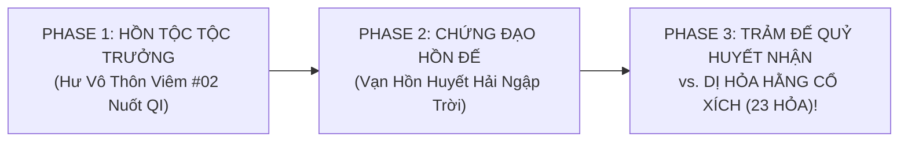

# HỒ SƠ THIẾT KẾ 25 ĐẠI BOSS, CƠ CHẾ CHUYỂN PHASE & TELEGRAPH 2D

> **Mã tài liệu**: `05_Quai_Vat_Boss_Va_Ban_Do\Thiet_Ke_Boss_Va_Co_Che_Phase.md`
> **Phạm vi**: Quy chuẩn thiết kế trận đánh Boss Top-down 2D, hệ thống cảnh báo Telegraph Pixel, và Kịch bản chiến đấu chi tiết từng Phase cho 25 Đại Boss biểu tượng từ Ô Thản Thành tới Quyết Chiến Song Đế.
> **Đồng bộ**: Khớp tuyệt đối mạch cốt truyện 11 Chương, 24 Đấu Kỹ của Tiêu Viêm và hệ thống chiến lợi phẩm tại [00_Master_Index_Va_Quy_Chuan.md](../00_Tong_Quan_Kien_Truc/00_Master_Index_Va_Quy_Chuan.md).

---

## 1. Triết Lý Thiết Kế Boss Action 2D: "Đọc Chiêu Rõ Ràng — Phá Giải Đúng Truyện"

Mỗi trận Đại Boss trong *Đấu Phá Thương Khung* là một bài kiểm tra kỹ năng điều khiển thực thụ kết hợp tái hiện những khoảnh khắc nổi da gà nhất của nguyên tác (không bao giờ là "bịch bông nhiều máu đứng đọ chỉ số"):

* **Hệ Thống 4 Màu Cảnh Báo Trên Nền Đất (`2D Pixel Telegraph Language`)**:
  1. **Vùng Viền Đỏ Đậm (`Red Fill`)**: Chiêu sát thương vật lý/Đấu Khí thông thường -> Có thể lướt `Space` có I-frame xuyên qua hoặc bật *Lục Hợp Du Thân Xích* đỡ.
  2. **Vùng Tím Chớp Nháy (`Purple Soul Zone`)**: Chiêu tấn công thẳng vào Linh Hồn (`SOUL`) / Bắt hồn -> **Không thể đỡ bằng khiên vật lý**, bắt buộc bước ra khỏi vùng hoặc dùng *Dị Hỏa / Yêu Khôi* cản!
  3. **Mũi Tên Vàng Va Chạm (`Gold Clash Vector`)**: Chiêu lao húc hoặc chưởng lực có thể **Đấu Chiêu Trực Diện (`Beam/Strike Clash`)** hoặc dẫn dụ Boss đâm vào cột đá địa hình!
  4. **Sóng Nhiệt Toàn Màn (`Full-Screen Wipe`)**: Đại chiêu hủy diệt khi chuyển Phase -> Phải nấp sau chướng ngại vật tạo sẵn, bay vọt lên không trung (`Giữ Space`), hoặc ném *Phật Nộ Hỏa Liên* đối đầu phá chiêu!
* **Cơ Chế "Tái Chiến Ký Ức" (`Memory Rematch` để Cày Đồ)**: Sau khi hạ Boss trong cốt truyện chính, người chơi có thể ngồi thiền tại *Tâm Ma Thạch* để đánh lại bất kỳ Boss nào ở độ khó **Huyết Chiến** nhằm cày đủ *Tinh Huyết / Mảnh Cổ Đồ* còn thiếu.

---

## 2. Kịch Bản Chiến Đấu Quyển 1: Gia Mã Đế Quốc (Boss #01 – #09)

### Boss 01: Tiêu Ninh — *Thành Niên Lễ Ô Thản Thành (Chương 1)*
* **Cảnh giới & Chỉ số**: Bát Đoạn Đấu Chi Khí -> Cưỡng ép uống thuốc lên *Nhất Tinh Đấu Giả* (`Lv.10` | `1,200 HP` | Không có Giáp).
* **Đấu trường**: Đài Tỷ Thí Tiêu Gia (`320 × 320 px`), xung quanh đệ tử reo hò (rơi khỏi mép đài xử thua!).
* **Phases & Chiêu thức**:
  * *Phase 1 (`100% -> 50% HP`)*: Lao đấm *Thiết Sơn Quyền* vạch đỏ ngắn `64 px`.
  * *Phase 2 (`<50% HP` — Cắn trộm Tăng Khí Tán)*: Nổi gân máu tăng `+40% SPD`, liên hoàn trảo 3 nhịp đẩy lùi Tiêu Viêm về sát mép đài!
* **Khắc chế & Thưởng**: Dùng Combo *Hấp Chưởng* kéo hắn lệch tâm rồi *Xuy Hỏa Chưởng* hất văng chính hắn bay khỏi lôi đài! **Rớt**: *500 Kim Tệ, Danh hiệu Thiếu Tộc Trưởng, Quyển trục Toái Thạch Chưởng Sơ Cấp*.

### Boss 02: Gia Liệt Áo — *Đêm Mưa Huyết Tẩy Chợ Ô Thản (Chương 1)*
* **Cảnh giới & Chỉ số**: Nhất Tinh Đại Đấu Sư (`Lv.31` | `12,000 HP` | `40% Giáp Phong Khải`).
* **Đấu trường**: Hẻm tối mưa tầm tã (nước mưa làm giảm nhẹ tầm nhìn, Tiêu Viêm mặc **Hắc Bào** che mặt).
* **Phases & Chiêu thức**:
  * *Phase 1*: Quét *Cuồng Phong Đao Khí* hình lưỡi liềm xanh lục `160 px`; gọi 4 hộ vệ Gia Liệt cầm khiên chắn.
  * *Phase 2 (`<45% HP`)*: Tụ lốc xoáy *Phong Quyển Tàn Vân* hút kéo toàn bộ hẻm vào tâm đao!
* **Khắc chế & Thưởng**: Bấm **`Phím T (Dược Lão Phụ Thể — Cốt Linh Lãnh Hỏa)`** xóa bỏ áp chế cảnh giới, đấm *Bát Cực Băng* vỡ nát Phong Khải Giáp! **Rớt**: *Hồi Xuân Tán Đan Phương, Huyền Thiết Tinh, Túi tiền Gia Liệt Gia*.

### Boss 03: Tử Tinh Dực Sư Vương — *Sự Kiện Sinh Tồn Đỉnh Núi Ma Thú (Chương 2)*
* **Cảnh giới & Chỉ số**: Ma Thú Cấp 6 — Ngang Đấu Hoàng (`Lv.62` | `180,000 HP` — **Survival Event Boss, không cần đánh chết!**).
* **Đấu trường**: Hẻm núi rực lửa tím; trên bầu trời **Đấu Hoàng Vân Vận** và **Sư Vương** đang đại chiến long trời lở đất!
* **Cơ chế Sinh tồn 2 Phases (`120 giây`)**:
  * *Phase 1 (Vượt Bão Đạn)*: Trên mặt đất liên tục rơi mưa *Tử Hỏa Trụ* (`96 px`) và *Phong Cực Vẫn Sát* từ trận chiến trên cao trong khi 2 con *Tiểu Tử Tinh Sư* chặn cửa hang.
  * *Phase 2 (Đánh Cắp Trong Hang)*: Lẻn vào hang đập vỡ khối đá tím lấy *Tử Tinh Nguyên*; Sư Vương phát hiện gầm *Tử Tinh Phong Ấn* làm chậm `50%` — phải bung **Tử Vân Dực (`Giữ Space`)** bay ziczac thoát khỏi luồng tia lửa tím quét dọc hẻm núi!
* **Phần thưởng Độc quyền**: **Tử Tinh Nguyên (Mở khóa Tử Hỏa)**, *Tử Linh Tinh (Nắng kết tinh)*, kích hoạt tuyến cốt truyện hang đá chăm sóc Vân Chi!

### Boss 04: Mục Xà (Đoàn Trưởng Lang Đầu Đoàn) — *Huyết Chiến Vách Núi Thanh Sơn (Chương 2)*
* **Cảnh giới & Chỉ số**: Nhị Tinh Đấu Sư (`Lv.22` | `6,800 HP` | `30% Giáp Đấu Khí Sa Y`).
* **Phases & Chiêu thức**:
  * *Phase 1*: Đâm *Tật Phong Thương* thẳng dài `144 px` kèm gọi lính đánh thuê phóng lưới sắt trói chân.
  * *Phase 2 (`<40% HP`)*: Ném búa rìu xoay boomerang dọc mép vực hẹp và nhảy bổ từ trên cao xuống (`80 × 80 px`).
* **Khắc chế & Thưởng**: Chặt đứt lưới bằng *Khống Hỏa Thuật*, lừa hắn nhảy hụt sát mép vách đá rồi đấm *Bát Cực Băng* hất hắn rơi thẳng xuống vực sâu! **Rớt**: *Chìa khóa kho báu Lang Đầu Đoàn (3 hộp ngọc dược liệu + Huyết Hồng Nạp Giới)*.

### Boss 05: Băng Hoàng Hải Ba Đông — *Mật Thất Tiệm Bản Đồ Cổ Sa Mạc (Chương 3)*
* **Cảnh giới & Chỉ số**: Đấu Linh Đỉnh Phong bị phong ấn (Thực chất Ngũ Tinh Đấu Hoàng! `Lv.49` | `38,000 HP` | `80% Băng Kính Giáp`).
* **Đấu trường**: Căn phòng cát hóa băng lạnh toát; có **6 Tấm Gương Băng (`Ice Mirrors`)** dựng quanh phòng.
* **Phases & Chiêu thức**:
  * *Phase 1*: Hải Ba Đông tự do **dịch chuyển tức thời giữa 6 Tấm Gương Băng** và bắn *Hàn Băng Thứ* phản xạ ziczac qua các gương!
  * *Phase 2 (`<50% HP`)*: Triệu hồi **Huyền Băng Cự Long dài `224 px`** quét ngang phòng đóng băng cứng mặt đất!
* **Khắc chế & Thưởng**: Dùng *Huyền Trọng Xích* đập vỡ các tấm gương băng để triệt đường biến ảnh của lão; khi xuất hiện **Nút Tương Tác Đưa Mảnh Tịnh Liên Tàn Đồ / Hứa Luyện Phục Linh Tử Đan**, trận đấu dừng lại chuyển thành đồng minh bảo tiêu số 1! **Rớt**: *Mảnh Bản Đồ Tịnh Liên Yêu Hỏa #2, Băng Linh Hàn Tuyền*.

### Boss 06: Mặc Ba Tư & Cơn Thịnh Nộ Nữ Hoàng Mỹ Đỗ Toa — *Thánh Thành Xà Nhân (Chương 3)*
* **Cảnh giới & Chỉ số**: Mặc Ba Tư (`Lv.54 Đấu Vương` | `48,000 HP`) + Thiên Kiếp Tiến Hóa Mỹ Đỗ Toa trên hồ dung nham!
* **Phases & Chiêu thức**:
  * *Phase 1 (Đột Phá Vòng Vây Mặc Ba Tư)*: Thủ lĩnh Hắc Xà hóa thân Xà Ảnh cắn mổ độc + gọi Bát Đại Thống Lĩnh chặn cầu đá dẫn ra đảo sen giữa hồ nham tương.
  * *Phase 2 (Đoạt Hỏa Giữa Thiên Lôi)*: Mỹ Đỗ Toa hóa bản thể Cự Xà tím khổng lồ chịu **Tử Lôi Thiên Kiếp** đánh xuống hồ dung nham tạo sóng nham thạch lan vòng tròn (`Ring Waves` phải nhảy `Space` qua như nhảy dây!). Tiêu Viêm lao vào tâm đài sen giật lấy **Thanh Liên Địa Tâm Hỏa** và ẵm **Thất Thải Thôn Thiên Mãng** tí hon chạy trốn!
* **Phần thưởng**: **Dị Hỏa #19 Thanh Liên Địa Tâm Hỏa**, **Thanh Liên Đài**, bạn đồng hành **Thôn Thiên Mãng (Thải Lân)**!

### Boss 07: Mặc Thừa (Đại Trưởng Lão Mặc Gia Hóa Quái) — *Đêm Đại Náo Mặc Gia Bảo (Chương 4)*
* **Cảnh giới & Chỉ số**: Ngũ Tinh Đấu Linh ghép chi Ma Thú -> Bán Đấu Vương (`Lv.48` | `52,000 HP` | Giáp Vảy Quái Vật cực dày).
* **Phases & Chiêu thức**:
  * *Phase 1*: Cánh tay phải ghép vuốt Hắc Báo vồ xé rách không khí (`128 px`) gây Xuất Huyết nặng.
  * *Phase 2 (`<50% HP` — Hóa Quái Nhân Đáng Sợ)*: Xé rách áo lộ thân thể khâu vá 4 loài Ma Thú, mọc cánh dơi độc bay lên dội mưa gai xương xuống sân!
* **Khắc chế Kinh Điển**: Trong khi Hải Ba Đông và Thanh Lân/Lục Man giữ chân trên không, Tiêu Viêm mở khóa lần đầu tiên phím **`F — Song Sắc Phật Nộ Hỏa Liên (Thanh Liên + Cốt Linh)`** ném nổ tung nửa tòa thành Mặc Gia tiễn Mặc Thừa thành tro bụi! **Rớt**: *Giải cứu Thanh Lân, Quyển trục Huyền Giai Cao Cấp, Vật liệu rèn Xích Bậc 4*.

### Boss 08: Nạp Lan Yên Nhiên — *Quyết Chiến Ước Hẹn Ba Năm Trên Vân Lam Sơn (Chương 4)*
* **Cảnh giới & Chỉ số**: Tam Tinh Đại Đấu Sư Đỉnh Phong (`Lv.36` | `26,000 HP` | `60% Vân Linh Giáp` — **Solo 1v1 Công Bằng, Cấm Dược Lão Phụ Thể ở Phase 1–2!**).
* **Đấu trường**: Quảng trường đá trắng đỉnh Vân Lam Sơn rộng `480 × 360 px` lộng gió mây ngàn.
* **Phases & Chiêu thức**:
  * *Phase 1 (Phong Linh Phân Hình Kiếm)*: Tốc độ cực nhanh, lướt tạo 3 tàn ảnh kiếm khí chém hình chữ X xanh ngọc.
  * *Phase 2 (`<60% HP` — Ngự Phong Không Chiến)*: Đạp gió bay lên không bắn hàng chục tia *Phong Nhẫn Ánh Sáng* cắm xuống mặt quảng trường.
  * *Phase 3 (`<25% HP` — Tuyệt Học **Phong Cực — Lạc Nhật Diệu**)*: Tụ thanh kiếm ánh sáng mặt trời khổng lồ trên bầu trời giáng thẳng xuống (`240 × 240 px`)!
* **Khắc chế Đỉnh Cao**: Tháo chốt *Giải Phong Huyền Trọng Xích* lấy tốc độ đối tốc độ, bổ *Diễm Phân Phệ Lãng Xích* chẻ đôi kiếm trận, và kết thúc Phase 3 bằng một đóa **Phật Nộ Hỏa Liên thu nhỏ** đánh gãy kiếm, xé nát tờ Hưu Thư cũ viết lại bằng máu! **Rớt**: *Danh hiệu Rửa Nhục Ba Năm, Thất Huyễn Thanh Linh Tiên (từ Nạp Lan Gia), Mở khóa Diễm Phân Phệ Lãng Xích Đại Thành*.

### Boss 09: Đại Trưởng Lão Vân Lăng & Hộ Tông Đại Trận — *Đào Thoát Vân Lam Sơn (Chương 4)*
* **Cảnh giới & Chỉ số**: Đấu Vương Đỉnh Phong + **Vân Yên Phúc Nhật Trận** của 300 đệ tử (`Lv.58` | `95,000 HP` | Khiên Trận Pháp Bất Tử nếu chưa phá mắt trận!).
* **Cơ chế Giải Đố Chiến Đấu**:
  * Vân Lăng đứng giữa trời phóng *Vân Lăng Phong Ấn Cự Kiếm*. Xung quanh quảng trường có **4 Cột Cờ Trận Nhãn** do 4 Trưởng lão Đấu Linh trấn giữ truyền Đấu Khí lên khiên của Vân Lăng.
  * Phải dùng *Tử Vân Dực* lượn vòng chém gục **4 Trưởng Lão Giữ Cờ** (có Thất Thải Thôn Thiên Mãng hóa Mỹ Đỗ Toa xuất hiện phút chót dọa sập tinh thần địch!) làm vỡ khiên Vân Yên Trận rồi nện *Hỏa Liên* trọng thương Vân Lăng! **Rớt**: *Vân Lam Tinh Kim, Mảnh Hải Tâm Giáp tinh luyện*.

---

## 3. Kịch Bản Chiến Đấu Quyển 2: Hắc Giác Vực & Nội Viện Già Nam (Boss #10 – #14)

### Boss 10: Bá Vương Thương Liễu Kình — *Chung Kết Cường Bảng Nội Viện (Chương 6)*
* **Cảnh giới & Chỉ số**: Bát Tinh Đấu Linh Đỉnh Phong (`Lv.49` | `68,000 HP` | `80% Hoàng Kim Khải Giáp`).
* **Phases & Chiêu thức**:
  * *Phase 1*: Đâm thương quét rộng `160 px` tạo lốc xoáy cát đá chấn văng người chơi; lao húc *Bá Vương Phá Quân*.
  * *Phase 2 (`<35% HP` — **Đại Liệt Phách Quan Trảo**)*: Bỏ thương, tụ kim quang chói lòa trên tay phải xé nát không khí lao thẳng về phía Tiêu Viêm (`Gold Clash Vector`)!
* **Khắc chế**: Đứng vững gồng *Diễm Phân Phệ Lãng Xích / Tiểu Hỏa Liên* đối chưởng trực diện tạo vụ nổ rung sập cả đấu trường, cùng ngã xuống nhưng Tiêu Viêm đứng dậy trước giành hạng Top Cường Bảng! **Rớt**: *5,000 Điểm Hỏa Năng, Quyền vào tầng sâu Thiên Phần Tháp, Giao hảo Liễu Kình*.

### Boss 11: Vẫn Lạc Tâm Viêm Bản Thể (Vô Hình Hỏa Mãng) — *Đáy Tháp Thiên Phần (Chương 6)*
* **Cảnh giới & Chỉ số**: Thiên Địa Dị Hỏa `#14` Hóa Hình — Ngang Đấu Hoàng Đỉnh Phong (`Lv.68` | `210,000 HP`).
* **Đấu trường**: Lòng đất dung nham đỏ rực bên dưới học viện; có các đảo đá nổi chìm dần trong biển lửa.
* **Phases & Chiêu thức**:
  * *Phase 1 ( Đại Chiến Giữa Phong Ấn)*: Con trăn lửa khổng lồ dài `320 px` **trong suốt vặn xoắn không khí (`Heat-haze Distortion Shader`)** lặn ngụp dưới nham tương quất đuôi và phun sóng *Tâm Hỏa Vô Hình*!
  * *Phase 2 (`<30% HP` — **Tâm Trung Luyện Hỏa Mini-Boss**)*: Bị kéo chìm xuống đáy nham tương! Bản đồ chuyển vào **Không Gian Nội Tâm Tiêu Viêm**: Phải uống sẵn *Địa Linh Đan*, vừa điều khiển Linh Hồn đập tan các *Tâm Ma Ảo Ảnh* vừa dùng *Thanh Liên Địa Tâm Hỏa* quấn siết luyện hóa lõi Tâm Viêm!
* **Phần thưởng**: **Dị Hỏa #14 Vẫn Lạc Tâm Viêm (Tự động cày EXP nền liên tục!)**, nhảy vọt thẳng lên **Đấu Vương**!

### Boss 12: Dược Hoàng Hàn Phong — *Thanh Toán Phản Đồ Sư Môn (Chương 6 & 7)*
* **Cảnh giới & Chỉ số**: Đấu Hoàng Đỉnh Phong (`Lv.69` | `240,000 HP` | Linh Hồn Lục Phẩm Đỉnh + **Dị Hỏa #15 Hải Tâm Viêm**).
* **Phases & Chiêu thức**:
  * *Phase 1*: Điều khiển *Hải Tâm Viêm* hóa thành đại dương lửa xanh thẫm dâng ngập sàn đấu + ném *Độc Đan Nổ* diện rộng.
  * *Phase 2 (`<50% HP`)*: Triệu hồi 2 tên viện binh Đấu Hoàng Hắc Giác Vực (*Kim Ngân Nhị Lão* hợp kích!) trong khi Hàn Phong núp sau **Hắc Ma Đỉnh** kết ấn *Hải Ma Thực Diễm Quyết* (cá mập lửa xanh lao cắn).
* **Khắc chế & Thưởng**: Mở **Thiên Hỏa Tam Huyền Biến (Biến 2)** + kết hợp *Thanh Liên + Vẫn Lạc Tâm Viêm* tạo **Tam Sắc Hỏa Liên** nổ tung đại dương Hải Tâm Viêm, thu hồi thần đỉnh của sư phụ! **Rớt**: **Danh Đỉnh #08 Hắc Ma Đỉnh**, *Quyển trục Lộng Viêm Quyết, Xác/Hồn liên quan đúc Khôi Lỗi*.

### Boss 13: Vân Sơn & Vụ Hộ Pháp Hồn Điện — *Tam Thượng Vân Lam Tông (Chương 7)*
* **Cảnh giới & Chỉ số**: Vân Sơn (`Lv.73 Tam Tinh Đấu Tông` | `320,000 HP`) -> Vụ Hộ Pháp (`Lv.75 Ngũ Tinh Đấu Tông` | `390,000 HP`).
* **Kịch bản 2 Trận Nối Tiếp Bi Tráng**:
  * *Phase 1 (Diệt Vân Sơn)*: Vân Sơn dùng *Phong Sát Chỉ* và *Đại Phong Thủ Ấn* khóa không gian sơ cấp. Tiêu Viêm dùng *Đế Ấn Quyết (Khai Sơn + Phiên Hải)* kết hợp *Tam Sắc Phật Nộ Hỏa Liên* đánh gục Vân Sơn báo thù cho gia tộc!
  * *Phase 2 (Vụ Hộ Pháp Lộ Diện Nuốt Hồn!)*: Bầu trời tối sầm, **Vụ Hộ Pháp Hồn Điện** bật cười quái dị **hút chửng linh hồn Vân Sơn và hàng chục trưởng lão Vân Lam** để cường hóa *Hắc Vụ Khải Giáp*, giăng *Tỏa Hồn Liên* vây bắt Dược Lão!
* **Khắc chế & Kết cục Cốt truyện**: Dùng Dị Hỏa đốt xích đen giải vây; dù đánh trọng thương Vụ Hộ Pháp nhưng Dược Lão chủ động giao phó *Cốt Viêm Giới & Cốt Linh Lãnh Hỏa* cho Tiêu Viêm rồi bị bắt đi — mở ra hành trình tiến quân Trung Châu cứu thầy! **Rớt**: *Cốt Linh Lãnh Hỏa (Tàn Hỏa Kế Thừa), Giải tán Vân Lam Tông, Thành lập Viêm Minh*.

### Boss 14: Hạt Tất Nham (Lão Tổ Vạn Hạt Môn) — *Quyết Chiến Tam Tông Biên Ải (Chương 7)*
* **Cảnh giới & Chỉ số**: Tứ Tinh Đấu Tông (`Lv.74` | `410,000 HP` | Hệ Kịch Độc).
* **Phases & Chiêu thức**:
  * *Phase 1*: Cầm *Vạn Độc Ngô Công Kiếm* chém ra sóng độc xanh lét ăn mòn Giáp Đấu Khí; triệu hồi 4 vũng đầm bọ cạp trên sân.
  * *Phase 2 (`<20% HP` — Huyết Tế **Ma Độc Ban**)*: Biết chắc phải chết, lão tự nổ toàn bộ độc hạch trong tim phóng một đạo ấn đen tử vong không thể né găm vào ngực Tiêu Viêm!
* **Khắc chế & Thưởng**: Phối hợp cùng **Tiểu Y Tiên (Ách Nan Độc Thể)** & **Mỹ Đỗ Toa** chém chết Hạt Tất Nham; vết nguyền *Ma Độc Ban* nằm trong người Tiêu Viêm (giảm `-10% Max QI` tạm thời nhưng khi sau này gom đủ *Bồ Đề Hóa Thể Tiên* luyện thành **Hỏa Bồ Đan** ở Chương 8 sẽ nổ bình EXP tăng vọt **+2 Tinh Đấu Tông**!). **Rớt**: *Ma Hạch Cấp 7 (Độc), Thi thể Đấu Tông (dùng luyện Khôi Lỗi phụ)*.

---

## 4. Kịch Bản Chiến Đấu Quyển 3: Trung Châu Phong Vân (Boss #15 – #20)

### Boss 15: Phượng Thanh Nhi — *Tứ Phương Các Đại Hội Trên Lôi Sơn (Chương 8)*
* **Cảnh giới & Chỉ số**: Đấu Hoàng Đỉnh Phong / Chuẩn Đấu Tông mang **Huyết Mạch Thiên Yêu Hoàng** (`Lv.71` | `360,000 HP` | Tốc độ cao nhất giai đoạn giữa game!).
* **Phases & Chiêu thức**:
  * *Phase 1*: Thi triển chính bản gốc *Tam Thiên Lôi Động* đua tốc độ tàn ảnh với Tiêu Viêm + phóng *Phong Sát Yêu Cương*.
  * *Phase 2 (`<45% HP` — Triệu Hồi Yêu Hoàng Tinh Huyết)*: Sau lưng mọc đôi cánh mười màu rực rỡ, tạo **Cửu Thiên Lôi Ngục** biến toàn bộ viền đấu trường thành lưới điện giật sát thương lớn và tung *Yêu Hoàng Chung*!
* **Khắc chế**: Bung **Thiên Nhạn Cửu Hành Dực** áp chế ngược lại khí tức huyết mạch của ả + dùng *Đế Ấn Quyết* đập vỡ Yêu Hoàng Chung! **Rớt**: *Danh hiệu Quán Quân Tứ Phương Các, Hoàn thiện Tam Thiên Lôi Huyễn Thân*.

### Boss 16: Thiên Xà & Băng Hà Cốc Chủ — *Đại Chiến Hộ Hoa Tại Diệp Thành (Chương 8)*
* **Cảnh giới & Chỉ số**: Băng Hà Cốc Chủ — Tứ Tinh Đấu Tôn (`Lv.83` | `980,000 HP` | Hậu thiên *Băng Tôn Kính*).
* **Phases & Chiêu thức**:
  * *Phase 1 (Thiên Xà Trưởng Lão — Thất Tinh Đấu Tông)*: Khởi động làm nóng tay, bị **Địa Yêu Khôi** và Tiêu Viêm đập nát.
  * *Phase 2 (Băng Hà Cốc Chủ Giáng Lâm)*: Đóng băng cứng không gian bán kính `200 px` quanh mục tiêu (*Băng Tôn Ấn*) — nếu đứng yên quá `1.5s` trong vùng tuyết rơi sẽ bị đóng thành tượng băng!
* **Khắc chế**: Kích hoạt **Thiên Hỏa Tam Huyền Biến (Đủ Tam Biến!)** kết hợp ném **Hủy Diệt Hỏa Liên (4 Hỏa)** ép lùi Đấu Tôn, chờ **Cổ Tộc Hắc Yên Quân / Huân Nhi** xuất hiện quét sạch Băng Hà Cốc! **Rớt**: *Băng Tôn Hàn Tinh, Mở khóa tuyến cốt truyện Tiểu Y Tiên đột phá Đấu Tôn*.

### Boss 17: Mộ Cốt Lão Nhân — *Đối Đầu Đan Hội & Hắc Ám Vong Hồn Điện (Chương 8 – 9)*
* **Cảnh giới & Chỉ số**: Tam Tinh -> Tứ Tinh Đấu Tôn + Luyện Đan Sư Bát Phẩm (`Lv.84` | `1,150,000 HP` | Sở hữu *Hải Tâm Viêm* cướp của Hàn Phong).
* **Phases & Chiêu thức**:
  * *Phase 1*: Kết hợp tà khí Hồn Điện với *Hải Tâm Viêm* tạo thành **Ám Hải Minh Hỏa** vừa rút `QI` vừa làm nhiễu loạn cảm nhận `SOUL`.
  * *Phase 2 (`<40% HP`)*: Phóng **Linh Hồn Cốt Thứ** vô hình (`Purple Soul Telegraph`) nhắm thẳng vào mi tâm!
* **Khắc chế & Thưởng**: Dùng *Linh Hồn Linh Cảnh Đại Viên Mãn* phản chấn + *Hoàng Tuyền Chỉ* đâm xuyên Hải Tâm Viêm thu hồi ngọn lửa này (hoặc ở Chương 9 phối hợp Dược Lão tiễn lão về chầu trời lấy **Tiêu Tộc Cổ Ngọc**!). **Rớt**: **Dị Hỏa #15 Hải Tâm Viêm**, *Sơn Dung Đỉnh (#10), Hồn Đan Bát Phẩm*.

### Boss 18: Cự Long Tam Thiên Diễm Viêm Hỏa — *Đan Tháp Tinh Không Lĩnh Vực (Chương 8)*
* **Cảnh giới & Chỉ số**: Bản Thể Dị Hỏa `#09` — Cự Long Đen Tím dài kín màn hình (`Lv.85` | `1,500,000 HP` | **Tự Hồi `5% HP/giây` Bất Tử dưới ánh sao!**).
* **Cơ chế Giải Đố Boss Bất Tử**:
  * Nếu chỉ chém vào thân rồng từ bên ngoài, ánh sao từ nền trời Tinh Không sẽ hồi đầy máu cho nó mãi mãi!
  * Người chơi phải chém gãy **2 Sừng Tinh Thần** trên đầu rồng khi nó bổ nhào xuống đất -> Lập tức nhảy vào miệng xoáy không gian trên trán rồng -> Phối hợp với **Ấn Ký Long Hoàng của Tử Nghiên** đóng dấu **Linh Hồn Bản Nguyên Ấn** thu phục nó từ bên trong!
* **Phần thưởng**: **Dị Hỏa #09 Tam Thiên Diễm Viêm Hỏa ("Bất Tử Chi Thân" — siêu hồi máu tự động!)**.

### Boss 19: Trích Tinh Lão Quỷ — *Huyết Chiến Vong Hồn Sơn Mạch Cứu Dược Lão (Chương 9)*
* **Cảnh giới & Chỉ số**: Ngũ Tinh Đấu Tôn Đỉnh Phong — Thiên Tôn Hồn Điện (`Lv.86` | `1,850,000 HP`).
* **Phases & Chiêu thức**:
  * *Phase 1*: Bẻ cong không gian tạo bàn tay *Trích Tinh Thủ* khổng lồ `224 × 224 px` chụp bóp nát mục tiêu từ xa; triệu hồi 4 Tôn Lão Hồn Điện dựng *Tỏa Hồn Đại Trận*.
  * *Phase 2 (`<45% HP`)*: Nén không gian xung quanh thành khối vuông thủy tinh nổ sập cả đại điện!
* **Khắc chế**: Cho **Thiên Yêu Khôi** kèm cứng các Tôn Lão phụ, Tiêu Viêm mở *Tam Huyền Biến* ném thẳng **Phật Nộ Hỏa Liên 4 Sắc** nổ đứt lìa một cánh tay của Trích Tinh Lão Quỷ, phá ngục cứu sống **Dược Trần**! **Rớt**: *Hung Hồn Ngũ Tinh Đấu Tôn, Tinh Thiết đúc Thiên Yêu Khôi thứ 2, Dược Lão trở về Tinh Vẫn Các*.

### Boss 20: Tạo Hóa Thánh Cốt & Tàn Niệm Hoàng Tuyền Thiên Tôn — *Viễn Cổ Di Tích (Chương 9)*
* **Cảnh giới & Chỉ số**: Thử thách Kép Đấu Thánh Di Tích (`Lv.89 – 92` | `2,600,000 HP`).
* **Phases & Cơ chế**:
  * *Ải 1 (Tạo Hóa Thánh Cốt)*: Bộ xương ngọc vàng kim ngồi trên ngai đá tự động phản kích bằng *Đại Thiên Tạo Hóa Chưởng* hút toàn bộ 8 thế lực tranh bảo vào lỗ đen — người chơi phải lắp đúng **3 chiếc Xương Sườn Ngọc** đã nhặt ở hành lang trước vào ngực bộ xương để nhận chân truyền!
  * *Ải 2 (Ảo Ảnh Hoàng Tuyền Thiên Tôn dưới đáy Hoàng Tuyền Đàm)*: Chịu đựng 3 đợt sóng âm **Hoàng Tuyền Thiên Nộ** toàn màn hình bằng cách căn đúng nhịp bấm QTE *Linh Hồn Thiên Cảnh* đối kháng!
* **Phần thưởng**: Trọn bộ **4 Đấu Kỹ Thiên Giai (*Đại Thiên Tạo Hóa Chưởng, Hoàng Tuyền Chỉ, Hoàng Tuyền Chưởng, Hoàng Tuyền Thiên Nộ*)** + *Hồn Anh Yêu Quả*!

---

## 5. Kịch Bản Chiến Đấu Quyển 4: Thánh Đế Quyết Chiến (Boss #21 – #25)

### Boss 21: Huyết Đao Thánh Giả — *Bá Chủ Đáy Thiên Mộ Tầng 3 (Chương 9 – 10)*
* **Cảnh giới & Chỉ số**: Bán Thánh Cao Cấp Năng Lượng Thể (`Lv.97` | `4,800,000 HP` | Huyết Đao dài `400 px`!).
* **Phases & Chiêu thức**:
  * *Phase 1*: Mỗi nhát vung Huyết Đao tạo sóng trăng máu quét dài toàn màn hình, tốc độ chém tăng dần theo lượng máu Tiêu Viêm bị mất.
  * *Phase 2 (`<40% HP` — Huyết Hải Đồ Thành)*: Triệu hồi 12 thanh Huyết Đao cắm quanh biên đấu trường nối dây laze máu cắt ngang dọc liên tục!
* **Khắc chế & Thưởng**: Phối hợp **Hợp Kích cùng Huân Nhi (Kim Đế Phần Thiên Viêm)** đốt bốc hơi Huyết Hải, dùng *Ngũ Ấn Hợp Nhất + Hủy Diệt Hỏa Liên* chém tan lõi năng lượng lấy vé ngâm mình trong **Thiên Mộ Chi Hồn Bản Nguyên**! **Rớt**: **Năng Lượng Hạch Bán Thánh (Đột phá Cửu Chuyển Đấu Tôn Đỉnh + Linh Hồn Thiên Cảnh!)**, *Huyết Đao Tinh Phách*.

### Boss 22: Bán Thánh Khôi Lỗi Bồ Đề Cổ Thụ — *Thâm Cung Mãng Hoang Cổ Vực (Chương 10)*
* **Cảnh giới & Chỉ số**: 5 Hộ Vệ Bán Thánh Đỉnh Phong + **Ác Niệm Đấu Đế Trong Lõi Bồ Đề Thụ** (`Lv.99` | Bất Tử Hồi Sinh Liên Tục!).
* **Cơ chế Giải Đố Đúng 100% Truyện**:
  * 5 Bán Thánh Khôi Lỗi mắt đỏ ngầu đánh hội đồng cực rát; dù đấm vỡ chúng cũng tự liền lại nhờ rễ cây cổ thụ bơm nhựa đen!
  * Người chơi gọi **Đội Hình 10 Thiên Yêu Khôi Đại Trận** ra câu giờ giữ chân 5 con Bán Thánh -> Điều khiển Tiêu Viêm lách qua màn rễ cây quất mặt đất tiến sát gốc **Bồ Đề Cổ Thụ**, kích hoạt **Bồ Đề Hóa Thể Tiên** trong túi đồ phóng luồng sáng xanh tịnh hóa Ác Niệm Đấu Đế cổ xưa!
* **Phần thưởng Siêu Cấp**: **Bồ Đề Tâm + Bồ Đề Tử + Trăm Luân Hồi Ngộ Đạo** -> Đưa Tiêu Viêm bước thẳng lên **Bán Thánh -> Đấu Thánh**!

### Boss 23: Ác Niệm Tịnh Liên Yêu Hỏa & Điện Chủ Hồn Diệt Sinh — *Yêu Hỏa & Dược Giới (Chương 10)*
* **Cảnh giới & Chỉ số**: Ngũ Tinh – Lục Tinh Đấu Thánh (`Lv.110` | `16,500,000 HP`).
* **Kịch bản Đại Chiến Kép**:
  * *Màn A (Thu Phục Yêu Hỏa)*: Yêu Hỏa hóa nam tử tuấn mỹ áo trắng điều khiển hàng chục **Hỏa Nô Bán Thánh/Đấu Thánh** lập *Yêu Hỏa Luyện Thiên Trận* muốn luyện hóa tất cả thiên tài Bát Tộc thành tro! Tiêu Viêm hợp lực cùng **Huân Nhi** mở đường máu, thức tỉnh **Tàn Đồ Tịnh Liên Yêu Thánh** phong ấn ác niệm biến nó thành bé **Tiểu Y**!
  * *Màn B (Chém Điện Chủ Hồn Điện Hồn Diệt Sinh)*: Hồn Diệt Sinh mang theo mảnh **Hư Vô Thôn Viêm Tử Hỏa** nuốt chửng sinh linh. Tiêu Viêm trải **Tịnh Liên Yêu Trận** khóa cứng không gian, tung **Phật Nộ Luân Hồi** nghiền nát Điện Chủ, hoàn tất đại thù năm xưa cho Dược Lão và Tiêu Gia!
* **Phần thưởng**: **Dị Hỏa #03 Tịnh Liên Yêu Hỏa (Tiểu Y)**, *Linh Hồn Bản Nguyên Hồn Diệt Sinh (Đột phá Linh Hồn Đế Cảnh!)*.

### Boss 24: Đế Phẩm Sồ Đan — *Cổ Đế Động Phủ Thâm Hải Dung Nham (Chương 11)*
* **Cảnh giới & Chỉ số**: Chuẩn Đấu Đế Linh Vật (`Lv.118` | `28,000,000 HP` | Hurtbox nhỏ `24 × 28 px` cực kỳ lắt léo!).
* **Phases & Chiêu thức**:
  * *Phase 1*: Lão già áo tím lùn tịt tốc độ ngang Cửu Tinh Đấu Thánh Đỉnh Phong, giơ tay dựng **Đan Khí Phản Kính** bật ngược các chiêu chưởng tầm xa về phía người bắn!
  * *Phase 2 (`<50% HP` — Ngưng Tụ Hủy Diệt Đan Lôi)*: Tự triệu hồi mây sấm Đế Phẩm đánh bừa bãi khắp Động Phủ trong khi cố lao về phía tay của Hồn Thiên Đế!
* **Khắc chế**: Không thể thắng hết máu vì kịch bản Hồn Thiên Đế sẽ đoạt Sồ Đan — mục tiêu của người chơi là **đánh vỡ lớp vỏ Đan Khí bên ngoài để hút trộm 1 tia Nguyên Khí Đấu Đế mở cửa Tượng Đá Đà Xá Cổ Đế** bên dưới! **Rớt**: *Mở khóa Truyền Thừa Đà Xá Cổ Đế -> Tiến cấp **Lv.120 VIÊM ĐẾ**!*

---

## 6. FINAL BOSS (#25): HỒN THIÊN ĐẾ (HỒN ĐẾ) — SONG ĐẾ CHI CHIẾN VẠN CỔ

> **Cảnh giới**: Cửu Tinh Đấu Thánh Đỉnh Phong -> **ĐẤU ĐẾ (HỒN ĐẾ `Lv.120`)**
> **Tổng Sinh Lực 3 Phases**: `99,999,999 HP` (`30M` + `35M` + `35M`) | **Âm nhạc**: Giao hưởng 16-bit Chiptune + Hợp xướng Bi Tráng.
> **Đấu trường**: Bầu trời Trung Châu vỡ nát thành **Hư Không Hỗn Độn** nối liền vạn dặm núi sông bên dưới.

### Phase 1: Bá Chủ Hồn Tộc & Hư Vô Thôn Viêm (`100% -> 70% Tổng HP`)
* **Chiêu thức cốt lõi**:
  1. **Hư Vô Thôn Thiên Khẩu**: Triệu hồi cái miệng đen kịt khổng lồ của *Dị Hỏa #02 Hư Vô Thôn Viêm* ở góc màn hình — hút kéo liên tục người chơi và **nếu người chơi tung chiêu tầm xa bay vào miệng nó, nó nuốt sạch chiêu đó để hồi `5% HP` cho Hồn Thiên Đế**!
  2. **Hồn Ấn Thiên Sát**: Điểm 9 đạo hắc ấn rượt đuổi trên mặt đất (`Purple Soul Zone`), trúng đòn bị khóa 1 ô kỹ năng (`Q/E/R`) trong `5s`.
* **Cách đánh**: Bật *Đế Cảnh Linh Hồn Pháp Tướng* miễn nhiễm khóa hồn, dùng *Tam Thiên Lôi Động* áp sát đánh cận chiến Trọng Xích tránh bắn đạn vào miệng Thôn Viêm!

### Phase 2: Huyết Tế Tộc Nhân — Chứng Đạo HỒN ĐẾ (`70% -> 35% Tổng HP`)
* **Biến đổi Đấu trường**: Hồn Thiên Đế nuốt Đế Phẩm Sồ Đan và huyết tế hàng triệu sinh linh Hồn Tộc, toàn bộ nền màn hình hóa thành **Huyết Hải Sôi Trào**! Các đảo đá lơ lửng trôi giữa biển máu (rơi xuống biển máu rút `5% HP/giây`).
* **Chiêu thức cốt lõi**:
  1. **Huyết Hải Cự Lãng**: Sóng thần máu cao `180 px` cuộn từ trái sang phải rồi từ trên xuống dưới — bắt buộc dùng **Đế Diễm Thần Hoàng Dực** bay lượn căn kẽ hở sóng!
  2. **Tứ Phương Thôn Linh Ma Trụ**: Cắm 4 cột máu ở 4 góc màn hình rút nguyên khí đất trời chuẩn bị đòn kết liễu toàn cõi Trung Châu (`Wipe Timer 20 giây`)!
* **Cách đánh**: Gọi **Bắc Vương + Thập Đại Thiên Yêu Khôi** đập 2 cột phía dưới trong khi Tiêu Viêm dùng *Phật Nộ Luân Hồi* cắt nát 2 cột phía trên kịp trong `20 giây` khiến Hồn Thiên Đế bị phản phệ **Phá Giáp (`Stagger 5s`)**!

### Phase 3: Hồi Kết Thần Thoại — "TRẢM ĐẾ QUỶ HUYẾT NHẬN vs. DỊ HỎA HẰNG CỔ XÍCH" (`35% -> 0% HP`)
* **Cao trào Đỉnh điểm**:
  * Hồn Thiên Đế rút toàn bộ máu thịt bản thân ngưng tụ thành thanh đao máu khổng lồ vắt ngang bầu trời — **Trảm Đế Quỷ Huyết Nhận (`640 × 300 px`)**! Mỗi nhát chém xẻ nát không gian để lại khe nứt đen vĩnh viễn thu hẹp dần sân đấu!
  * Khi máu Hồn Thiên Đế tụt xuống **`10% cuối cùng`**, hắn lao vào kích hoạt đại chiêu tự sát hủy diệt toàn đại lục -> Màn hình hiện lời hiệu triệu chấn động của Viêm Đế: ***"Thiên Hỏa Hằng Cổ — Dị Hỏa Quy Vị!"***
  * **Tương tác Kết liễu Lịch sử (`Interactive Climax Clash`)**:
    1. Người chơi nhấn giữ **`Phím F`** triệu tập đủ **23 Ngọn Dị Hỏa** bay từ khắp thế gian hội tụ thành **Dị Hỏa Hằng Cổ Xích** bổ thẳng vào *Trảm Đế Quỷ Huyết Nhận*!
    2. Nhấp liên hoàn `LMB + Space` đẩy thanh đối kháng năng lượng 23 sắc màu ép vỡ tan tành thanh đao máu của Hồn Đế!
    3. Kết ấn cuối cùng: Tự thiêu đốt Đế Thân hóa thành **Dị Hỏa Quảng Trường 23 Màu** phong ấn vĩnh viễn linh hồn Hồn Thiên Đế vạn năm — mở khóa màn kết viên mãn đại hôn cùng **Huân Nhi & Thải Lân** tại Ô Thản Thành và mở cổng Endgame **Đại Thiên Thế Giới**!
* **Phần thưởng Tối Thượng**: **Danh hiệu thần thoại "VIÊM ĐẾ"**, *Hư Vô Thôn Viêm (#02) & Đế Viêm (#01)*, mở khóa **Chế độ Khe Nứt Đại Thiên Thế Giới & New Game+**.

---

## 7. Bảng Ma Trận Tra Cứu Nhanh 25 Đại Boss (`Master Boss Database Matrix`)

Bảng tổng hợp thông số cốt lõi phục vụ thiết lập nhanh `BossEncounterConfig.json`:

| ID | Tên Đại Boss | Chương | `Lv` | Tổng `HP` | Kháng Cao (`-40%`) | Điểm Yếu (`+30%`) | Phần Thưởng Độc Quyền Quan Trọng Nhất |
| :-: | :--- | :---: | :---: | :---: | :---: | :---: | :--- |
| **B01** | Tiêu Ninh | C.1 | `10` | `1,200` | Vật lý nhẹ | Đẩy văng khỏi đài | Danh hiệu Thiếu Tộc Trưởng + 500 Vàng |
| **B02** | Gia Liệt Áo | C.1 | `31` | `12,000` | Phong | Hỏa / Băng (Dược Lão) | Đan Phương Hồi Xuân + Huyền Thiết Tinh |
| **B03** | Tử Tinh Dực Sư Vương | C.2 | `62` | *Survival* | Hỏa Tím | Lén lút / Tốc độ bay | **Tử Tinh Nguyên (Tử Hỏa)** |
| **B04** | Mục Xà | C.2 | `22` | `6,800` | Phong | Ám kình / Hất vực | Huyết Hồng Nạp Giới + 3 Hộp Ngọc Thuốc |
| **B05** | Băng Hoàng Hải Ba Đông | C.3 | `49` | `38,000` | Băng (`-80%`) | Trọng Xích đập gương | **Tàn Đồ Tịnh Liên #2** + Đồng Minh Hải Lão |
| **B06** | Mặc Ba Tư & Thiên Kiếp Xà | C.3 | `54` | `48,000` | Độc / Hỏa | Bay né sóng nham | **Dị Hỏa #19 Thanh Liên Địa Tâm Hỏa** |
| **B07** | Mặc Thừa (Hóa Thú) | C.4 | `48` | `52,000` | Vật lý giáp | **Phật Nộ Hỏa Liên** | Mở khóa *Song Sắc Hỏa Liên* + Cứu Thanh Lân |
| **B08** | Nạp Lan Yên Nhiên | C.4 | `36` | `26,000` | Phong kiếm | Giải Phong Trọng Xích | Rửa nhục 3 năm + *Thất Huyễn Thanh Linh Tiên* |
| **B09** | Vân Lăng & Hộ Tông Trận | C.4 | `58` | `95,000` | Bất tử khiên | Phá 4 Cột Cờ Trận Nhãn | Vân Lam Tinh Kim + Tinh luyện Hải Tâm Giáp |
| **B10** | Bá Vương Thương Liễu Kình | C.6 | `49` | `68,000` | Đẩy lùi | Đối chưởng trực diện | 5,000 Hỏa Năng + Vé Tầng Sâu Tháp |
| **B11** | Vẫn Lạc Tâm Viêm Hỏa Mãng | C.6 | `68` | `210,000` | Hỏa thường | *Địa Linh Đan* + Tâm Hồn | **Dị Hỏa #14 Vẫn Lạc Tâm Viêm** |
| **B12** | Dược Hoàng Hàn Phong | C.6–7 | `69` | `240,000` | Thủy / Hỏa | Tam Sắc Hỏa Liên | **Danh Đỉnh #08 Hắc Ma Đỉnh** + *Lộng Viêm Quyết* |
| **B13** | Vân Sơn & Vụ Hộ Pháp | C.7 | `75` | `710,000` | Phong / Hồn | Dị Hỏa đốt xích đen | Kế thừa **Cốt Linh Lãnh Hỏa** + Lập Viêm Minh |
| **B14** | Hạt Tất Nham | C.7 | `74` | `410,000` | Kịch Độc | Tịnh độc / Hỏa | Nguyên liệu nổ bình **Hỏa Bồ Đan (+2 Tinh)** |
| **B15** | Phượng Thanh Nhi | C.8 | `71` | `360,000` | Phong / Lôi | Thiên Nhạn Cửu Hành Dực | Hoàn thiện **Tam Thiên Lôi Huyễn Thân** |
| **B16** | Băng Hà Cốc Chủ | C.8 | `83` | `980,000` | Băng Tôn | Tam Huyền Biến + 4 Hỏa | Băng Tôn Hàn Tinh + Cốt truyện Tiểu Y Tiên |
| **B17** | Mộ Cốt Lão Nhân | C.8–9 | `84` | `1,150,000` | Ám Hồn | Đấu `SOUL` + Hoàng Tuyền | **Dị Hỏa #15 Hải Tâm Viêm** + *Sơn Dung Đỉnh* |
| **B18** | Cự Long Tam Thiên Viêm | C.8 | `85` | `1,500,000` | Hồi máu sao | Chặt sừng + Khắc Ấn Hồn | **Dị Hỏa #09 Tam Thiên Diễm Viêm Hỏa** |
| **B19** | Trích Tinh Lão Quỷ | C.9 | `86` | `1,850,000` | Không gian | Thiên Yêu Khôi + Hỏa Liên | Cứu sống **Dược Lão** + Hung Hồn Đấu Tôn |
| **B20** | Tạo Hóa Cốt & Hoàng Tuyền | C.9 | `92` | `2,600,000` | Vật lý | Giải đố xương + Kháng âm | **4 Đấu Kỹ Thiên Giai** + *Hồn Anh Yêu Quả* |
| **B21** | Huyết Đao Thánh Giả | C.9–10 | `97` | `4,800,000` | Huyết khí | Hợp kích Huân Nhi | **Thiên Mộ Chi Hồn (Lên Thiên Cảnh SOUL)** |
| **B22** | Bán Thánh Khôi Bồ Đề Thụ | C.10 | `99` | *Immortal* | Bất tử rễ cây | *Bồ Đề Hóa Thể Tiên* tịnh lõi | **Bồ Đề Tâm & Bồ Đề Tử (Chứng Đấu Thánh!)** |
| **B23** | Yêu Hỏa & Hồn Diệt Sinh | C.10 | `110` | `16,500,000` | Vạn Hỏa / Hồn | Tịnh Liên Yêu Trận + Luân Hồi | **Dị Hỏa #03 Tịnh Liên Yêu Hỏa (Tiểu Y)** |
| **B24** | Đế Phẩm Sồ Đan | C.11 | `118` | `28,000,000` | Phản đạn xa | Cận chiến Trọng Xích vỡ vỏ | Tia Nguyên Khí mở **Truyền Thừa Viêm Đế** |
| **B25** | **HỒN THIÊN ĐẾ (HỒN ĐẾ)** | C.11 | **`120`** | **`99,999,999`** | Nuốt đạn xa | **Dị Hỏa Hằng Cổ Xích (23 Hỏa)** | **Chứng Đạo VIÊM ĐẾ** + Mở Đại Thiên Thế Giới |

---

## 8. Chế Độ Tái Chiến "Tâm Ma Luyện Cảnh", Xếp Hạng Chiến Đấu & Cảm Giác Đánh (`Game Feel`)

### 8.1. Ba Bậc Độ Khó Khi Tái Chiến Boss (`Boss Rematch Tiers`)
Sau khi vượt qua một Boss trong mạch truyện, bức tượng của Boss đó sẽ mở khóa trong **Tâm Ma Huyễn Cảnh** với 3 cấp thử thách để người chơi cày nguyên liệu hiếm và rèn luyện kỹ năng cá nhân:
1. **Cấp 1 — Ký Ức Nguyên Bản (`Normal`)**: Giữ nguyên cấp độ cốt truyện; dùng test thử bộ Đấu Kỹ mới học.
2. **Cấp 2 — Huyết Chiến Vượt Giới (`Hard / Scaling`)**: Boss tự động nâng cấp chỉ số **ngang bằng Level hiện tại của Tiêu Viêm**, tốc độ ra đòn nhanh hơn `+20%`, mở thêm 1 chiêu biến thể mới -> **Tỷ lệ rớt Tinh Huyết & Mảnh Cổ Đồ tăng gấp `×2.5 lần`!**
3. **Cấp 3 — Tuyệt Thế Tu La (`Hell / No-Pill Challenge`)**: Khóa toàn bộ 3 phím uống Đan Dược (`1, 2, 3`), Boss gây gấp đôi sát thương! Vượt qua lần đầu thưởng **Hào Quang Danh Hiệu Pixel Độc Quyền** và **Ngộ Đạo Tinh Hoa** (nâng thẳng 1 Đấu Kỹ lên bậc *Hóa Cảnh*!).

### 8.2. Hệ Thống Chấm Điểm Kỹ Năng Sau Trận Boss (`Combat Rank C -> SSS`)
Kết thúc mỗi trận Boss, bảng tổng kết tính điểm theo 4 tiêu chí để trao thêm **Rương Thưởng Phụ**:
* **Thời gian tiêu diệt** (`< 120 giây` đạt điểm tối đa).
* **Phản xạ Né Hoàn Hảo (`Perfect Dodge` / Phản đạn *Lục Hợp Du Thân Xích*)**: Mỗi lần né sát sạt cộng `+200 điểm`.
* **Độ đa dạng Đấu Kỹ**: Phối hợp mượt từ 4 kỹ năng khác nhau trở lên (chống spam 1 nút).
* **Sát thương nhận vào**: Nhận tổng sát thương `< 30% Max HP` đạt hạng **SSS (Đế Cấp)** -> **Chắc chắn nhận thêm 1 Viên Ma Hạch Cao Cấp hoặc Đan Văn Hoàn Mỹ!**

### 8.3. Quy Tắc Gia Tăng Khoái Cảm Kết Liễu (`Boss Execution Polish`)
Để khoảnh khắc đánh gục Đại Boss đọng lại ấn tượng sâu sắc:
* **Phá Giáp (`Guard Break`)**: Phát âm thanh kính vỡ giòn tan kèm nháy sáng trắng `3 frames` trên Sprite Boss và rung nhẹ camera `4 px`.
* **Đòn Kết Liễu Cuối Cùng (`Final Blow Slow-Motion`)**: Ngay khoảnh khắc đòn đánh của Tiêu Viêm rút giọt máu cuối cùng của Boss về `0`, tốc độ thời gian toàn game giảm xuống **`0.15x` trong `1.2 giây`**, camera zoom nhẹ `1.2x` vào nhát Trọng Xích / đóa Hỏa Liên cắt ngang người Boss trước khi bùng nổ hiệu ứng hạt Pixel tung tóe!
